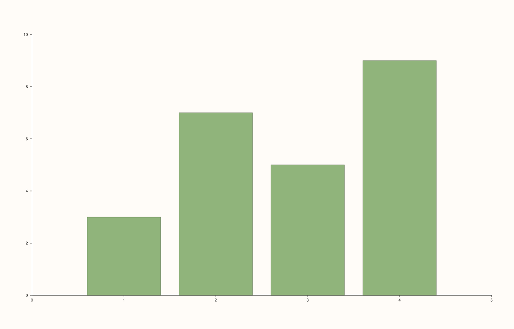
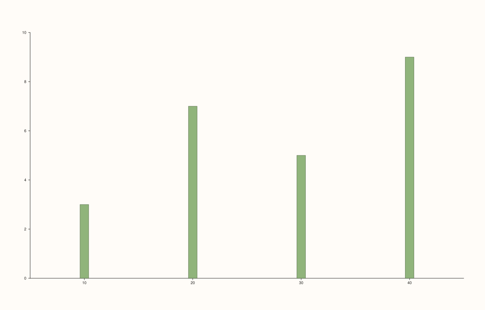

<!-- pluss-hand-authored -->

# Pane::columns

[Back to Pane API Reference](../../pane_api_reference)

## Signatures

```cpp
template <class Y>
Trace& Pane::columns(Y&& y)

template <class X, class Y>
Trace& Pane::columns(X&& x, Y&& y)
```

## What It Does

Adds a vertical bar-chart trace — the low-level primitive behind `flash::barplot`. Two
overloads:

- **`columns(y)`** — bar heights only; x-positions are auto-generated index positions
  (`0, 1, 2, ...`).
- **`columns(x, y)`** — explicit x-positions paired with each bar height.

Internally, both build a `ColumnsData{x, y, base=0.0, width=0.8, horizontal=false}` —
[`columns_h()`](columns_h.md) constructs the exact same `TraceKind::Columns` payload with
`horizontal` flipped to `true`, so `columns()`/`columns_h()` are really the same
underlying trace kind distinguished by one boolean field, not two different `TraceKind`
values.

```{important} Requires a Planar pane
Calling `columns()` on a `Volumetric` pane throws
`std::logic_error("columns requires a planar pane")`.
```

## Parameters

**y** (series-convertible)
    The bar heights.

**x** (series-convertible, second overload only)
    Explicit bar positions, paired with `y` by index.

## Returns

`Trace&`
    A reference to the newly created trace, for chaining.

## Examples

Example 1. Bar heights only — auto-generated x-positions.

```cpp
using namespace pluss::pl;

auto fig = studio("columns_y_only");
auto& pane = fig.pane2();
pane.columns(std::vector<double>{3.0, 7.0, 5.0, 9.0});
fig.show();
```



Example 2. Explicit x-positions.

```cpp
using namespace pluss::pl;

auto fig = studio("columns_xy");
auto& pane = fig.pane2();
pane.columns(std::vector<double>{10.0, 20.0, 30.0, 40.0}, std::vector<double>{3.0, 7.0, 5.0, 9.0});
fig.show();
```



## Notes

- Not `noexcept`.
- Shares its underlying `TraceKind::Columns`/`ColumnsData` payload with
  [`columns_h()`](columns_h.md) — the two differ only in a `horizontal` flag, verified via
  direct SVG diff to render genuinely different (vertical vs. horizontal) bar orientation
  for otherwise identical data.
- Default bar `base` is `0.0` and default `width` is `0.8` — neither is directly settable
  through `columns()`'s own parameters; they come from `ColumnsData`'s own defaults.
- `flash::barplot` is a convenience wrapper around this exact method.

## See Also

- [`Pane::columns_h`](columns_h.md): the horizontal-orientation counterpart, sharing the
  same underlying trace kind.
- [`Pane::bucket`](bucket.md): a related but distinct trace kind for histograms, which
  computes its own bar heights from raw values rather than taking them directly.

<div class="pluss-inline-prev-next">
  <a class="prev-link" href="cloud.html">
    <span class="label">Previous</span>
    <span class="title">cloud</span>
  </a>
  <a class="next-link" href="columns_h.html">
    <span class="label">Next</span>
    <span class="title">columns_h</span>
  </a>
</div>
