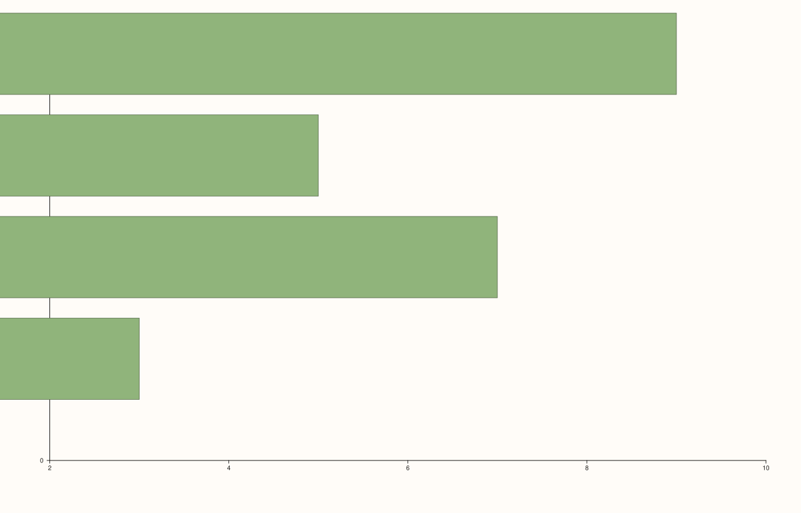
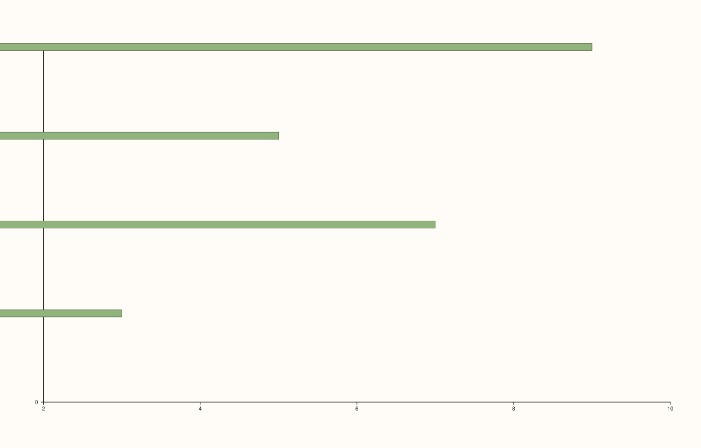

<!-- pluss-hand-authored -->

# Pane::columns_h

[Back to Pane API Reference](../../pane_api_reference)

## Signatures

```cpp
template <class X>
Trace& Pane::columns_h(X&& x)

template <class X, class Y>
Trace& Pane::columns_h(X&& x, Y&& y)
```

## What It Does

The horizontal counterpart of [`columns()`](columns.md): adds a horizontal bar-chart
trace, sharing the exact same `TraceKind::Columns`/`ColumnsData` payload, just with the
`horizontal` field set to `true`. Two overloads, mirroring `columns()`'s own shape but
with the roles of the single-series parameter and the auto-generated axis swapped (since
for horizontal bars, the bar *lengths* run along the x-axis, and the auto-generated index
positions fall on the y-axis instead):

- **`columns_h(x)`** — bar lengths only; y-positions are auto-generated index positions.
- **`columns_h(x, y)`** — explicit y-positions paired with each bar length.

```{important} Requires a Planar pane
Calling `columns_h()` on a `Volumetric` pane throws
`std::logic_error("columns_h requires a planar pane")`.
```

## Parameters

**x** (series-convertible)
    The bar lengths.

**y** (series-convertible, second overload only)
    Explicit bar positions, paired with `x` by index.

## Returns

`Trace&`
    A reference to the newly created trace, for chaining.

## Examples

Example 1. Bar lengths only — auto-generated y-positions.

```cpp
using namespace pluss::pl;

auto fig = studio("columns_h_x_only");
auto& pane = fig.pane2();
pane.columns_h(std::vector<double>{3.0, 7.0, 5.0, 9.0});
fig.show();
```



Example 2. Explicit y-positions.

```cpp
using namespace pluss::pl;

auto fig = studio("columns_h_xy");
auto& pane = fig.pane2();
pane.columns_h(std::vector<double>{3.0, 7.0, 5.0, 9.0}, std::vector<double>{10.0, 20.0, 30.0, 40.0});
fig.show();
```



Example 3. The same underlying data (`{3, 7, 5, 9}`) plotted through
[`columns()`](columns.md) and `columns_h()` — verified via direct SVG diff to produce
genuinely different (vertical vs. horizontal) output.

```cpp
using namespace pluss::pl;

auto fig1 = studio("columns_y_only");
auto& pane1 = fig1.pane2();
pane1.columns(std::vector<double>{3.0, 7.0, 5.0, 9.0});

auto fig2 = studio("columns_h_x_only");
auto& pane2 = fig2.pane2();
pane2.columns_h(std::vector<double>{3.0, 7.0, 5.0, 9.0});

std::cout << (fig1.to_svg() != fig2.to_svg()) << "\n";
```

### Output

```text
1
```

## Notes

- Not `noexcept`.
- Shares its underlying trace kind and payload structure with
  [`columns()`](columns.md), differing only in the `horizontal` flag.
- `flash::barplot`'s own horizontal-orientation option is a convenience wrapper around
  this exact method.

## See Also

- [`Pane::columns`](columns.md): the vertical-orientation counterpart, with the full
  discussion of the shared underlying payload.

<div class="pluss-inline-prev-next">
  <a class="prev-link" href="columns.html">
    <span class="label">Previous</span>
    <span class="title">columns</span>
  </a>
  <a class="next-link" href="bucket.html">
    <span class="label">Next</span>
    <span class="title">bucket</span>
  </a>
</div>
