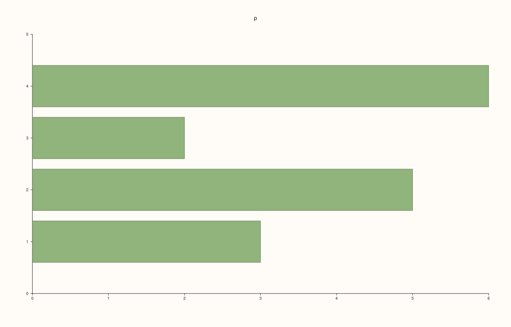
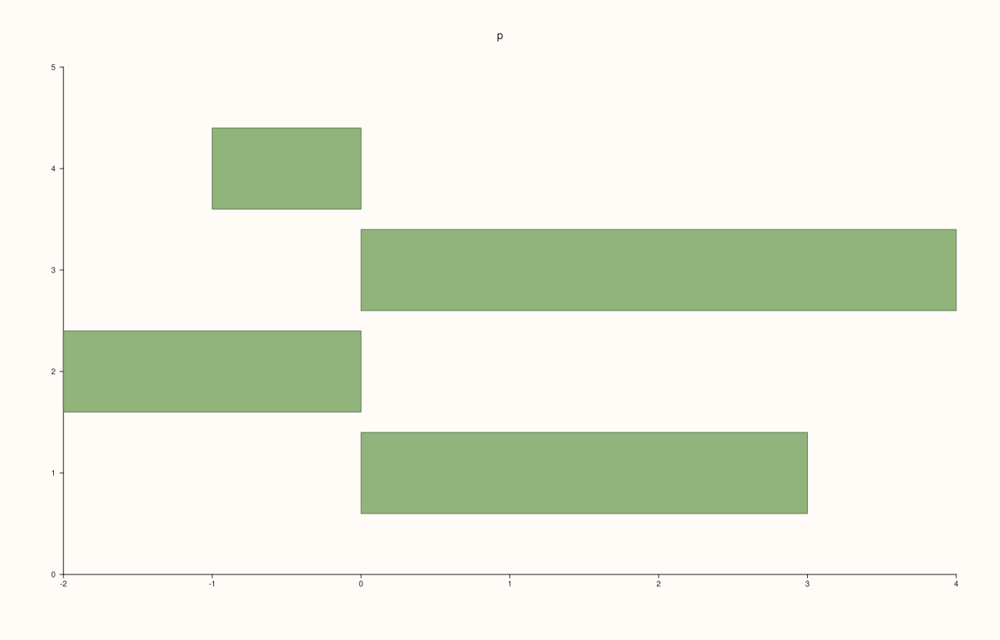
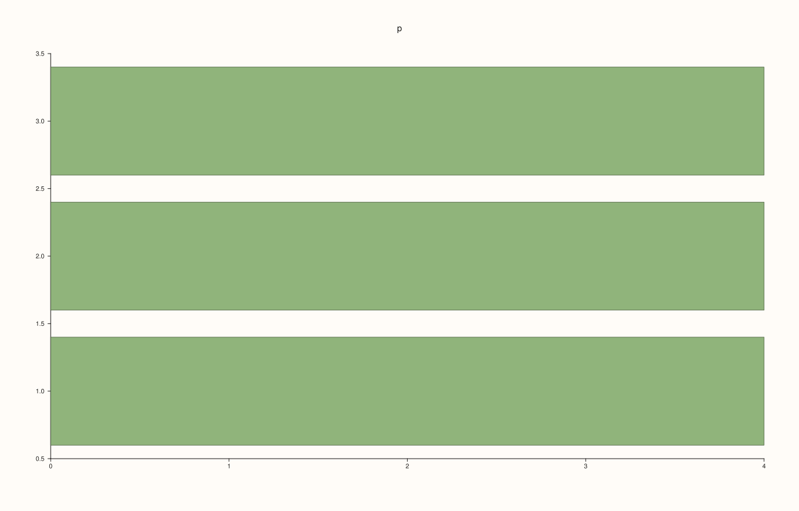
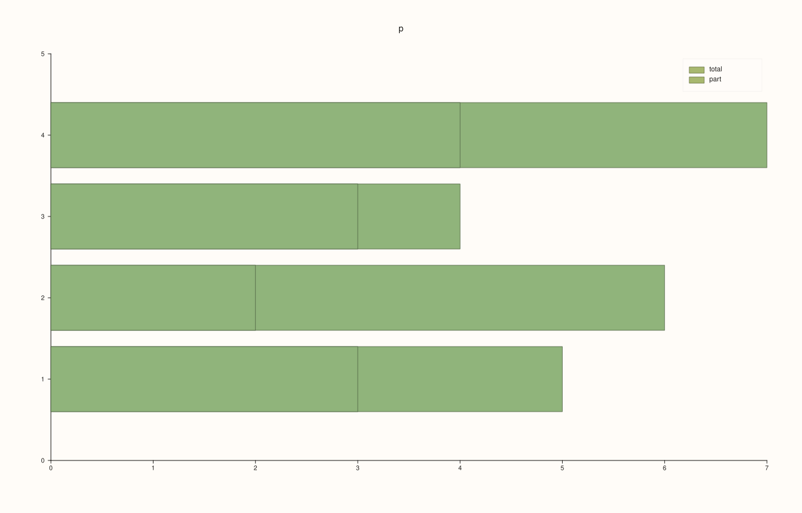
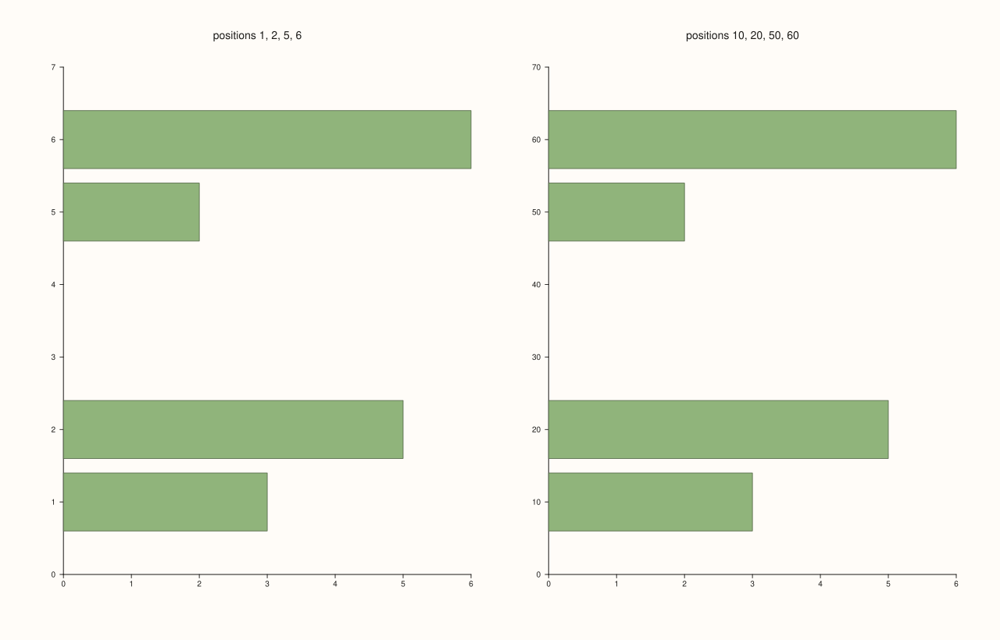
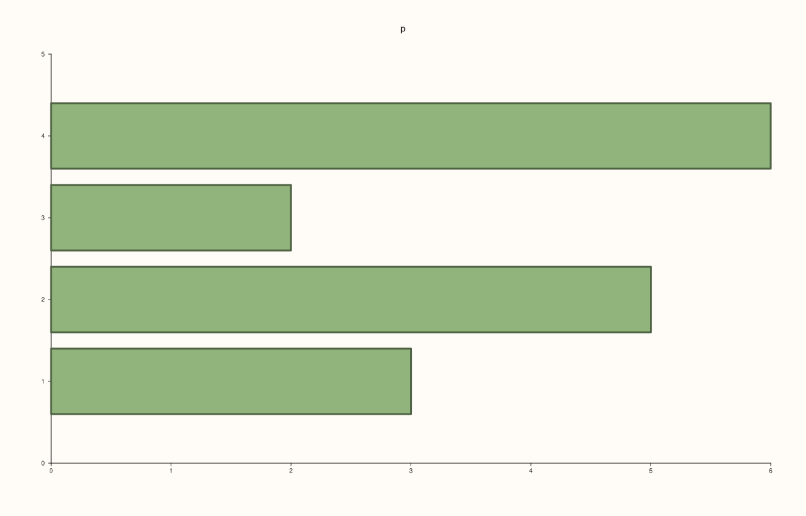

<!-- pluss-hand-authored -->

# Pane::columns_h

[Back to Pane API Reference](../../pane_api_reference)

## Signature

```cpp
Trace& Pane::columns_h(Series x)
Trace& Pane::columns_h(Series x, Series y)
```

## What It Does

Adds a **horizontal bar chart**: one bar for each value, standing on the y axis and running to the right (or left for a negative value) from zero to the value. It is the horizontal counterpart of [`columns`](columns.md): the two make the same kind of trace, drawn along different axes, and everything said of one holds for the other with the axes exchanged.

| Call | Meaning |
|---|---|
| `columns_h(x)` | The lengths of the bars; they stand at the positions 1, 2, 3, ... |
| `columns_h(x, y)` | The lengths along x and the positions along y. |

The two series have the same length, or one of them has length 1. The bars are 0.8 of the smallest gap between two positions wide (0.8 for the positions 1, 2, 3, ...); their outline is set by [`Trace::width`](../trace/width.md). Bars of several traces on one pane are drawn over one another; to place them side by side, give each its own positions, offset by less than a bar. For counts of raw data use [`bucket`](bucket.md), which does the counting.

## Parameters

**x** (`Series`-convertible)
    The bar lengths (single-argument call) or, in the two-argument call, the lengths.

**y** (`Series`-convertible, two-argument call)
    The positions.

## Returns

`Trace&`
    The new trace.

## Examples

Example 1. One series. The values are the lengths of the bars, and the y positions are the indices 1, 2, 3, 4.

```cpp
auto fig = studio("columns_h_one");
auto& pane = fig.pane2("p");
pane.columns_h(std::vector<double>{3, 5, 2, 6});
fig.save_svg("figure.svg");
```



Example 2. Two series: the first is the bar lengths, the second the positions. The bars stand at the positions given, 10, 20, 30 and 40, and are 8 wide, 0.8 of the gap of 10 between neighbours.

```cpp
auto fig = studio("columns_h_two");
auto& pane = fig.pane2("p");
pane.columns_h(std::vector<double>{3, 5, 2, 6}, std::vector<double>{10, 20, 30, 40});
fig.save_svg("figure.svg");
```


Example 3. Values below zero run the other way: bars are drawn from zero to the value, so negative values go down (or left).

```cpp
auto fig = studio("columns_h_negative");
auto& pane = fig.pane2("p");
pane.columns_h(std::vector<double>{3, -2, 4, -1});
fig.save_svg("figure.svg");
```



Example 4. A single value is repeated for every position: equal bars at the positions given.

```cpp
auto fig = studio("columns_h_broadcast");
auto& pane = fig.pane2("p");
pane.columns_h(std::vector<double>{4}, std::vector<double>{1, 2, 3});
fig.save_svg("figure.svg");
```



Example 5. Two traces on one pane are drawn over one another at the same positions, the later in front: useful for a total and a part of it.

```cpp
auto fig = studio("columns_h_two_series");
auto& pane = fig.pane2("p");
pane.columns_h(std::vector<double>{5, 6, 4, 7}).label("total");
pane.columns_h(std::vector<double>{3, 2, 3, 4}).label("part");
pane.legend(KeyPlace::NorthEast);
fig.save_svg("figure.svg");
```



Example 6. The bars adapt to the spacing of their positions: they are 0.8 of the smallest gap between two positions wide. Positions 1, 2, 5 and 6 (gap 1) give bars 0.8 wide; positions 10, 20, 50 and 60 (gap 10) give bars 8 wide, so the same picture is drawn at any scale.

```cpp
auto fig = studio("columns_h_spacing");
fig.mosaic(1, 2);
auto& near = fig.pane2("positions 1, 2, 5, 6");
near.columns_h(std::vector<double>{3, 5, 2, 6}, std::vector<double>{1, 2, 5, 6});
auto& far = fig.pane2("positions 10, 20, 50, 60");
far.columns_h(std::vector<double>{3, 5, 2, 6}, std::vector<double>{10, 20, 50, 60});
fig.save_svg("figure.svg");
```



Example 7. The outline of the bars is a line of the trace, set with [`Trace::width`](../trace/width.md) and [`Trace::stroke`](../trace/stroke.md); the width of the bars themselves follows the positions.

```cpp
auto fig = studio("columns_h_outline");
auto& pane = fig.pane2("p");
pane.columns_h(std::vector<double>{3, 5, 2, 6}).width(3.0);
fig.save_svg("figure.svg");
```



Example 8. Inputs that cannot be drawn are refused when the trace is added, and the message names the method and the problem. The pane keeps the traces it had.

```cpp
auto report = [](const char* what, auto&& call) {
  auto fig = studio("columns_h_errors");
  auto& pane = fig.pane2("p");
  try {
    call(pane);
    std::cout << what << ": accepted\n";
  } catch (const pluss::Error& e) {
    std::cout << what << ": " << e.message() << "\n";
  }
};
report("lengths differ", [](Pane& pane) { pane.columns_h(std::vector<double>{1, 2, 3}, std::vector<double>{1, 2}); });
auto fig = studio("columns_h_errors_out");
auto& pane = fig.pane2("p");
pane.trend(std::vector<double>{0, 1}, std::vector<double>{0, 1});
fig.save_svg("figure.svg");
```

### Output

```text
lengths differ: columns_h: series lengths must match or broadcast from scalar
```


Example 9. `columns_h` needs a planar pane. On a volumetric pane it throws at once, naming the kind it needs, and nothing is added.

```cpp
auto fig = studio("columns_h_wrong_pane");
auto& pane = fig.pane3("p");
try {
  pane.columns_h(std::vector<double>{1, 2});
} catch (const pluss::Error& e) {
  std::cout << e.message() << "\n";
}
std::cout << "traces: " << pane.trace_count() << "\n";
fig.save_svg("figure.svg");
```

### Output

```text
columns_h requires a planar pane
traces: 0
```


## Notes

- Returns the new [`Trace&`](../trace/label.md); the reference stays valid for the life of the pane, and the style calls of the trace ([`label`](../trace/label.md), [`stroke`](../trace/stroke.md), [`width`](../trace/width.md), ...) chain off it.
- The data is copied into the trace when it is added, so changing the vector afterwards does not change the figure.

## See Also

- [`Pane::columns`](columns.md): the vertical form.
- [`Pane::bucket`](bucket.md): bars from raw data, counted.
- [`Pane::x_categories`](x_categories.md): names under the bars.
- [`Trace::width`](../trace/width.md): the outline of the bars.

<div class="pluss-inline-prev-next">
  <a class="prev-link" href="columns.html">
    <span class="label">Previous</span>
    <span class="title">columns</span>
  </a>
  <a class="next-link" href="contour.html">
    <span class="label">Next</span>
    <span class="title">contour</span>
  </a>
</div>
