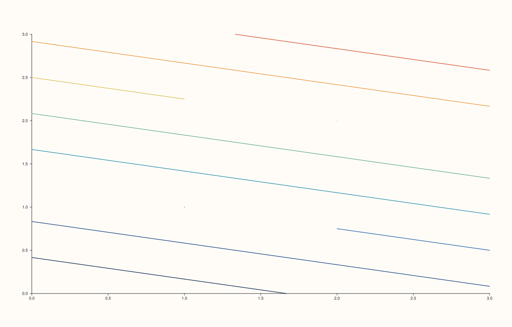
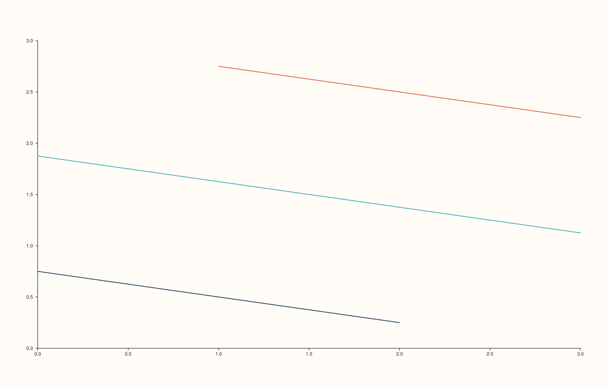
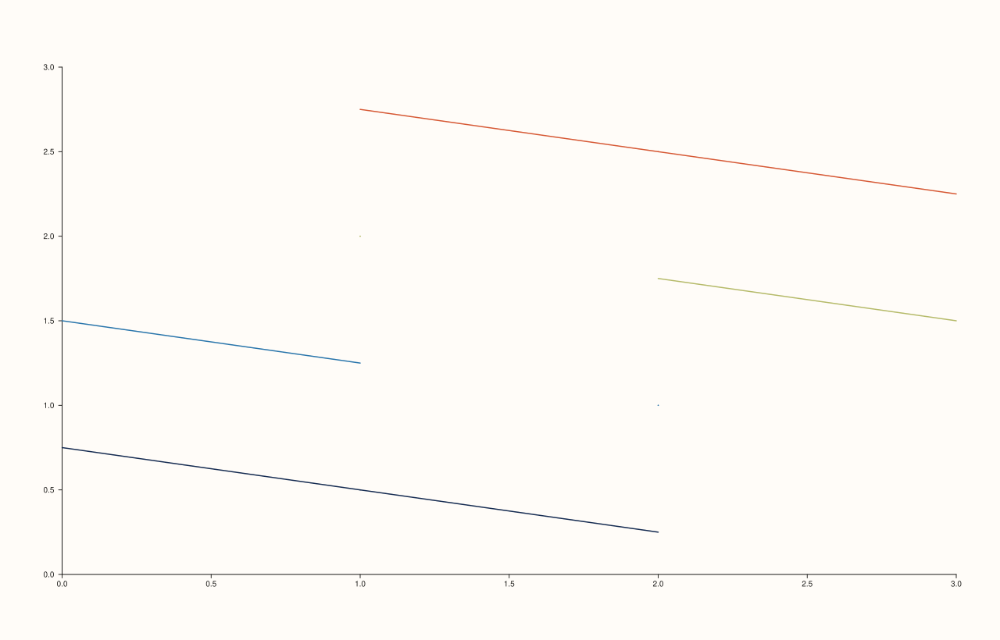

<!-- pluss-hand-authored -->

# Pane::contour

[Back to Pane API Reference](../../pane_api_reference)

## Signatures

```cpp
template <class X, class Y, class Z>
Trace& Pane::contour(X&& x, Y&& y, Z&& z)

template <class X, class Y, class Z, class Levels>
  requires (!std::integral<std::remove_cvref_t<Levels>>)
Trace& Pane::contour(X&& x, Y&& y, Z&& z, Levels&& levels)

template <class X, class Y, class Z>
Trace& Pane::contour(X&& x, Y&& y, Z&& z, int level_count)
```

## What It Does

Adds a contour-line trace over a scalar field `z(x, y)` — lines connecting points of equal
`z` value, at either automatically or explicitly chosen levels. Three overloads control how
many, and which, levels are drawn:

- **`contour(x, y, z)`** — automatically chooses `8` evenly-spaced levels
  (`ContourData::auto_levels` defaults to `8`).
- **`contour(x, y, z, levels)`** — draws contour lines at the exact `z` values listed in
  `levels`, instead of automatically spaced ones.
- **`contour(x, y, z, level_count)`** — automatically spaces exactly `level_count` levels,
  overriding the default of `8` without needing to compute or list the exact values.

```{important} Disambiguation via a requires clause
The `levels`-taking overload is constrained with `requires (!std::integral<...>)` on the
`Levels` template parameter specifically so that `contour(x, y, z, 4)` — a bare integer —
unambiguously resolves to the `level_count` overload rather than attempting (and failing)
to treat `4` as a series of explicit level values. Pass an actual container
(`std::vector<double>{...}`) to select explicit levels instead of a level *count*.
```

`z` must be a rank-2 matrix — `z(x[i], y[j])` at grid position `(i, j)` — matching every
other field-valued trace kind on `Pane` (see [`Pane::fieldmap`](fieldmap.md), which shares
this same rank-2 `z` requirement and its exact error message).

```{important} Requires a Planar pane
Calling `contour()` on a `Volumetric` pane throws
`std::logic_error("contour requires a planar pane")`.
```

## Parameters

**x**, **y** (series-convertible)
    The grid's coordinate axes.

**z** (series-convertible, must be rank-2)
    The scalar field values over the `(x, y)` grid.

**levels** (series-convertible, `levels`-overload only)
    Explicit `z` values at which to draw contour lines, replacing automatic spacing
    entirely.

**level_count** (`int`, `level_count`-overload only)
    The number of automatically, evenly spaced levels to draw, replacing the default of
    `8` (`ContourData::auto_levels`).

## Returns

`Trace&`
    A reference to the newly created trace, for chaining.

## Examples

Example 1. The default automatic level count (`8`), over a small `4×4` field.

```cpp
using namespace pluss::pl;

auto fig = studio("contour_default");
auto& pane = fig.pane2();
auto z = pluss::series::linspace(0.0, 1.0, 16, pluss::ScalarType::Float64).reshape({4, 4});
pane.contour(std::vector<double>{0.0, 1.0, 2.0, 3.0}, std::vector<double>{0.0, 1.0, 2.0, 3.0}, z);
fig.show();
```



Example 2. Explicit levels — only three specific `z` values are contoured, instead of
`8` automatically spaced ones. Verified via direct SVG diff to render genuinely different
from Example 1.

```cpp
using namespace pluss::pl;

auto fig = studio("contour_explicit_levels");
auto& pane = fig.pane2();
auto z = pluss::series::linspace(0.0, 1.0, 16, pluss::ScalarType::Float64).reshape({4, 4});
pane.contour(std::vector<double>{0.0, 1.0, 2.0, 3.0}, std::vector<double>{0.0, 1.0, 2.0, 3.0}, z,
             std::vector<double>{0.2, 0.5, 0.8});
fig.show();
```



Example 3. An explicit level *count* of `4` (fewer than the default `8`), automatically
spaced. Verified via direct SVG diff to render genuinely different from Example 1.

```cpp
using namespace pluss::pl;

auto fig = studio("contour_level_count");
auto& pane = fig.pane2();
auto z = pluss::series::linspace(0.0, 1.0, 16, pluss::ScalarType::Float64).reshape({4, 4});
pane.contour(std::vector<double>{0.0, 1.0, 2.0, 3.0}, std::vector<double>{0.0, 1.0, 2.0, 3.0}, z, 4);
fig.show();
```



## Notes

- Not `noexcept`.
- `ContourData` also carries `filled` (default `false`) and `elevated` (default `false`)
  fields with no corresponding constructor parameter on any of the three `contour()`
  overloads above — they remain `false` for every `contour()` call. Confirmed: these two
  fields are the exact mechanism behind two sibling trace kinds that reuse `ContourData`
  under different method names — [`Pane::isoband`](isoband.md) (`filled=true`,
  `elevated=false`, same three-overload shape, `Planar`) and
  [`Pane::ridge3`](ridge3.md) (`filled=false`, `elevated=true`, same three-overload shape,
  `Volumetric`). There is no direct way to set `filled`/`elevated` through `contour()`
  itself — call `isoband()` or `ridge3()` instead.
- Building a valid rank-2 `z` from scratch (as in every example above) is most easily done
  with `pluss::series::linspace(...).reshape({rows, cols})` — see
  [`Pane::fieldmap`](fieldmap.md) for the identical pattern and its accompanying rank-2
  validation failure demonstration.
- `flash::contourplot` (if present) is a convenience wrapper around one of these overloads.

## See Also

- [`Pane::fieldmap`](fieldmap.md): a filled-color rendering of the same kind of `(x, y, z)`
  scalar field, rather than line contours.
- [`Pane::isoband`](isoband.md): identical `ContourData`, identical three-overload shape,
  with `filled=true` — draws solid bands between levels instead of lines.
- [`Pane::ridge3`](ridge3.md): identical `ContourData`, identical three-overload shape,
  with `elevated=true` — draws the same contours lifted onto a `Volumetric` 3D pane.

<div class="pluss-inline-prev-next">
  <a class="prev-link" href="spike.html">
    <span class="label">Previous</span>
    <span class="title">spike</span>
  </a>
  <a class="next-link" href="fieldmap.html">
    <span class="label">Next</span>
    <span class="title">fieldmap</span>
  </a>
</div>
