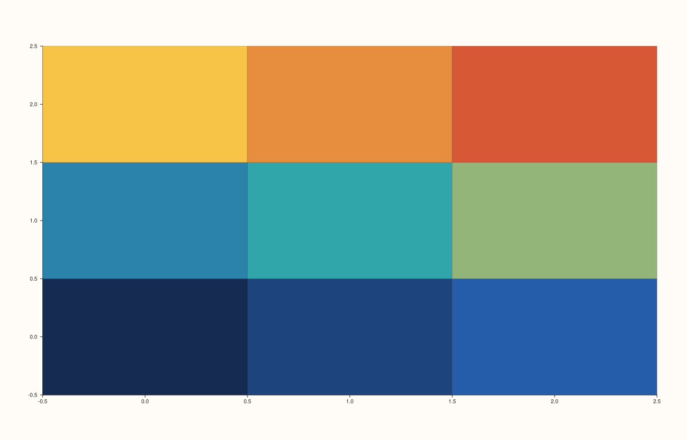
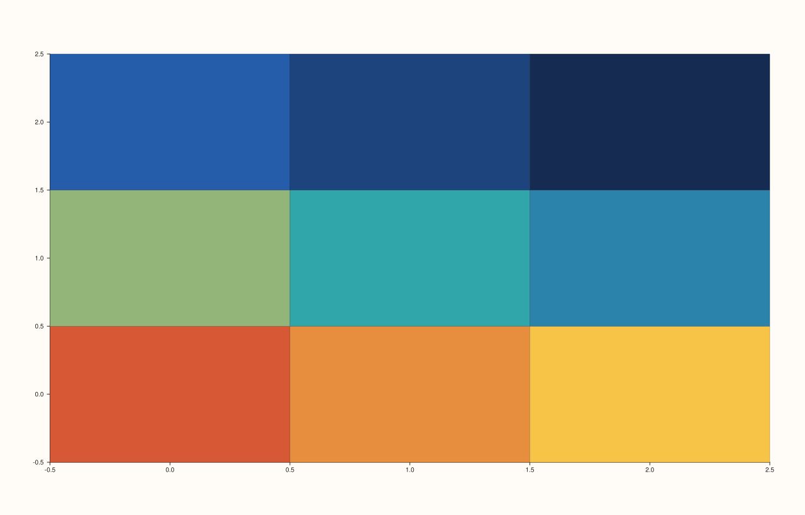

<!-- pluss-hand-authored -->

# Pane::fieldmap

[Back to Pane API Reference](../../pane_api_reference)

## Signatures

```cpp
template <class X, class Y, class Z>
Trace& Pane::fieldmap(X&& x, Y&& y, Z&& z)

template <class X, class Y, class Z, class C>
Trace& Pane::fieldmap(X&& x, Y&& y, Z&& z, C&& c)
```

## What It Does

Adds a filled-color heatmap trace over a scalar field `z(x, y)` — each grid cell shaded
according to its `z` value (or, in the four-argument overload, a separately supplied color
value). Two overloads:

- **`fieldmap(x, y, z)`** — cells are colored directly from `z`.
- **`fieldmap(x, y, z, c)`** — cells are shaped/positioned by `z`, but colored from a
  separate `c` matrix instead — letting the fill color encode a different quantity than
  the field's own shape.

```{important} z (and c) must be rank-2 matrices
Both `z` and, in the four-argument overload, `c` must be genuine rank-2 (two-dimensional)
matrices — one value per `(x[i], y[j])` grid cell. Passing a flat, one-dimensional series
throws:
```

```text
pluss::Error: fieldmap: z must be a rank-2 matrix
```

```{important} Requires a Planar pane
Calling `fieldmap()` on a `Volumetric` pane throws
`std::logic_error("fieldmap requires a planar pane")`.
```

## Parameters

**x**, **y** (series-convertible)
    The grid's coordinate axes.

**z** (series-convertible, must be rank-2)
    The scalar field values over the `(x, y)` grid — always determines the cell layout,
    and (in the three-argument overload) the fill color as well.

**c** (series-convertible, must be rank-2, four-argument overload only)
    A separate rank-2 matrix supplying the fill color per cell, decoupled from `z`'s own
    values. Must match `z`'s shape.

## Returns

`Trace&`
    A reference to the newly created trace, for chaining.

## Examples

Example 1. A `3×3` field, colored directly from `z`.

```cpp
using namespace pluss::pl;

auto fig = studio("fieldmap_xyz");
auto& pane = fig.pane2();
auto z = pluss::series::linspace(0.0, 1.0, 9, pluss::ScalarType::Float64).reshape({3, 3});
pane.fieldmap(std::vector<double>{0.0, 1.0, 2.0}, std::vector<double>{0.0, 1.0, 2.0}, z);
fig.show();
```



Example 2. The same grid shape, but colored from a separate matrix `c` that is the exact
*reverse* gradient of `z` — verified via direct SVG diff to render genuinely different
coloring from Example 1 while the grid layout itself stays identical.

```cpp
using namespace pluss::pl;

auto fig = studio("fieldmap_xyzc");
auto& pane = fig.pane2();
auto z = pluss::series::linspace(0.0, 1.0, 9, pluss::ScalarType::Float64).reshape({3, 3});
auto c = pluss::series::linspace(1.0, 0.0, 9, pluss::ScalarType::Float64).reshape({3, 3});
pane.fieldmap(std::vector<double>{0.0, 1.0, 2.0}, std::vector<double>{0.0, 1.0, 2.0}, z, c);
fig.show();
```



Example 3 (failure). Passing a flat, one-dimensional `z` instead of a rank-2 matrix.

```cpp
using namespace pluss::pl;

auto fig = studio("fieldmap_flat_z_failure");
auto& pane = fig.pane2();
try {
  pane.fieldmap(std::vector<double>{0.0, 1.0}, std::vector<double>{0.0, 1.0}, std::vector<double>{0.1, 0.5});
} catch (const std::invalid_argument& e) {
  std::cout << e.what() << "\n";
}
```

Output:

```text
fieldmap: z must be a rank-2 matrix
```

## Notes

- Not `noexcept`.
- The rank-2 requirement is most easily satisfied by building `z` (and `c`) with
  `pluss::series::linspace(...).reshape({rows, cols})` rather than hand-assembling a
  nested container.
- The rank-2 validation failure is raised as a plain `std::invalid_argument` — a
  different exception family from the `pluss::Error`/`std::runtime_error` used by
  [`Studio::save_svg`](../studio/save_svg.md)'s extension-mismatch check. Catch
  `std::invalid_argument` here, not `std::runtime_error`.
- `flash::heatmap` is a convenience wrapper around this exact method.

## See Also

- [`Pane::contour`](contour.md): a line-contour rendering of the same kind of `(x, y, z)`
  scalar field, sharing the identical rank-2 `z` requirement and error message, rather
  than filled cells.

<div class="pluss-inline-prev-next">
  <a class="prev-link" href="contour.html">
    <span class="label">Previous</span>
    <span class="title">contour</span>
  </a>
  <a class="next-link" href="cloud3.html">
    <span class="label">Next</span>
    <span class="title">cloud3</span>
  </a>
</div>
