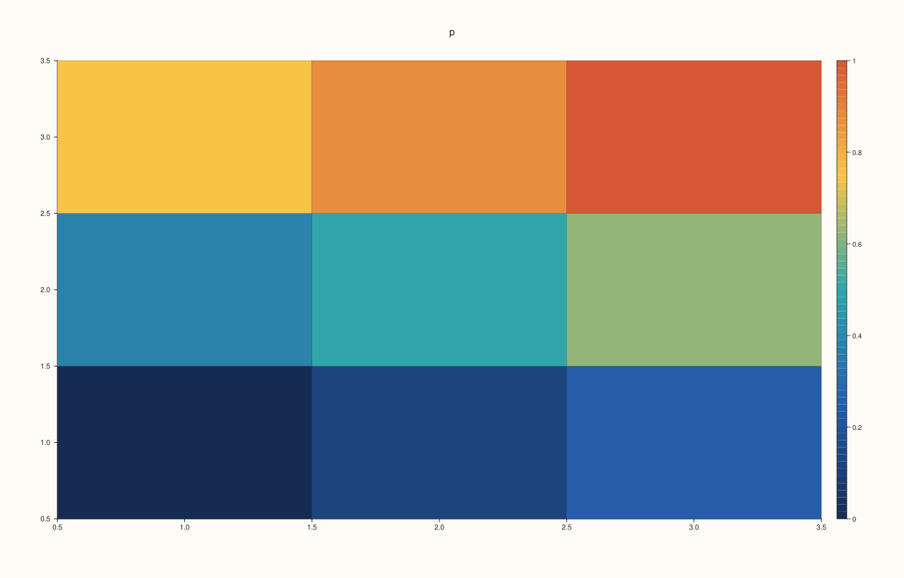
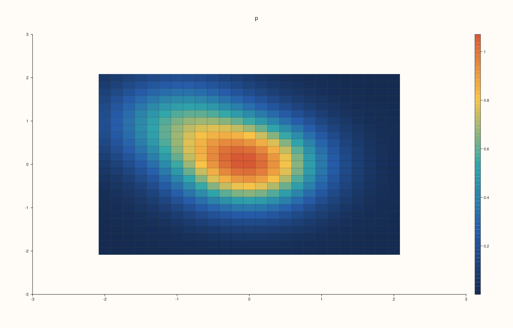
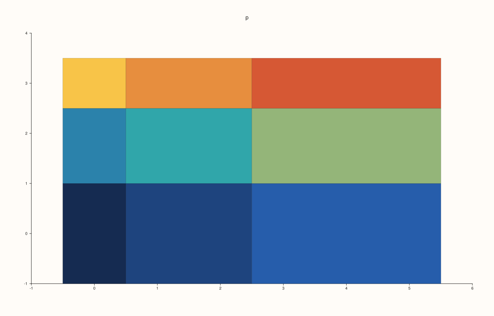
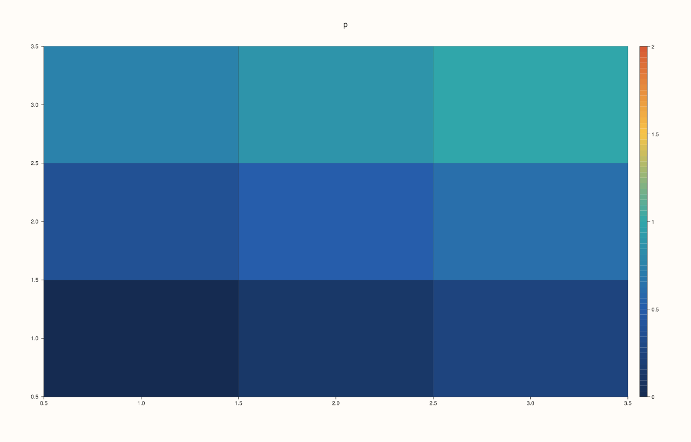

<!-- pluss-hand-authored -->

# Pane::fieldmap

[Back to Pane API Reference](../../pane_api_reference)

## Signature

```cpp
Trace& Pane::fieldmap(Series x, Series y, Series z)
Trace& Pane::fieldmap(Series x, Series y, Series z, Series c)
```

## What It Does

Adds a **heat map**: a grid of cells coloured by the value of a field `z` at each grid point. It shows a quantity that depends on two others, a measurement over a plane, a table of values, a correlation matrix.

`z` is a rank-2 matrix with one row for each `y` and one column for each `x`; `x` and `y` give the coordinates of the columns and rows (or, as matrices, of every point). They need not be evenly spaced. The colours come from the palette of the trace over the range of the data, or the pane's [`color_limits`](color_limits.md).

| Call | Colours from |
|---|---|
| `fieldmap(x, y, z)` | `z`. |
| `fieldmap(x, y, z, c)` | `c`, a matrix of the same shape as `z`. The cells are placed by `z`'s grid and coloured by another quantity. |

Switch on [`scale_guide`](scale_guide.md) to show what the colours mean. The contours of the same kind of data are drawn by [`contour`](contour.md) and [`isoband`](isoband.md); in three dimensions use [`sheet`](sheet.md).

## Parameters

**x**, **y** (`Series`-convertible)
    The coordinates of the columns and the rows, or full matrices of coordinates.

**z** (`Series`-convertible, rank 2)
    The field.

**c** (`Series`-convertible, optional)
    The values that colour the cells, with as many elements as `z`.

## Returns

`Trace&`
    The new trace.

## Examples

Example 1. A grid of values drawn as coloured cells: `z(i, j)` is the value at `x[j]` and `y[i]`... here a 3x3 grid of values from 0 to 1.

```cpp
auto fig = studio("fieldmap_grid");
auto& pane = fig.pane2("p");
auto z = pluss::series::linspace(0.0, 1.0, 9, pluss::ScalarType::Float64).reshape({3, 3});
pane.fieldmap(std::vector<double>{1, 2, 3}, std::vector<double>{1, 2, 3}, z);
pane.scale_guide(true);
fig.save_svg("figure.svg");
```



Example 2. A smooth field, a hill and a smaller one, on a 25 by 25 grid: the cells are small enough to read as a continuous picture.

```cpp
auto fig = studio("fieldmap_smooth");
auto& pane = fig.pane2("p");
const std::int64_t n = 25;
std::vector<double> axis(static_cast<std::size_t>(n)), field(static_cast<std::size_t>(n * n));
for (std::int64_t i = 0; i < n; ++i) axis[static_cast<std::size_t>(i)] = -2.0 + 4.0 * i / (n - 1);
for (std::int64_t i = 0; i < n; ++i) {
  for (std::int64_t j = 0; j < n; ++j) {
    const double x = axis[static_cast<std::size_t>(i)], y = axis[static_cast<std::size_t>(j)];
    field[static_cast<std::size_t>(i * n + j)] = std::exp(-(x * x + y * y)) + 0.5 * std::exp(-((x - 1.0) * (x - 1.0) + (y + 1.0) * (y + 1.0)));
  }
}
auto z = pluss::make_series(field, {n, n});
pane.fieldmap(axis, axis, z);
pane.scale_guide(true);
fig.save_svg("figure.svg");
```



Example 3. A fourth argument colours the cells by another quantity: the figure is drawn at the positions of `z`, and coloured by `c`. Here `c` is the field turned upside down, so the colours run the other way.

```cpp
auto fig = studio("fieldmap_color");
auto& pane = fig.pane2("p");
auto z = pluss::series::linspace(0.0, 1.0, 9, pluss::ScalarType::Float64).reshape({3, 3});
auto c = pluss::series::linspace(1.0, 0.0, 9, pluss::ScalarType::Float64).reshape({3, 3});
auto build = [&](bool with_color) {
  auto f = studio("fieldmap_color_cmp");
  auto& p = f.pane2("p");
  if (with_color) p.fieldmap(std::vector<double>{1, 2, 3}, std::vector<double>{1, 2, 3}, z, c);
  else p.fieldmap(std::vector<double>{1, 2, 3}, std::vector<double>{1, 2, 3}, z);
  return f.to_svg();
};
std::cout << "colour series changes the figure: " << (build(true) != build(false)) << "\n";
pane.fieldmap(std::vector<double>{1, 2, 3}, std::vector<double>{1, 2, 3}, z, c);
fig.save_svg("figure.svg");
```

### Output

```text
colour series changes the figure: 1
```


Example 4. The coordinates need not be evenly spaced: the cells are drawn where the coordinates put them.

```cpp
auto fig = studio("fieldmap_uneven");
auto& pane = fig.pane2("p");
auto z = pluss::series::linspace(0.0, 1.0, 9, pluss::ScalarType::Float64).reshape({3, 3});
pane.fieldmap(std::vector<double>{0, 1, 4}, std::vector<double>{0, 2, 3}, z);
fig.save_svg("figure.svg");
```



Example 5. The range of the colours is the data's own, or what [`color_limits`](color_limits.md) sets. Limits 0..2 over data 0..1 use only the lower half of the palette.

```cpp
auto build = [&](bool limited) {
  auto fig = studio("fieldmap_limits");
  auto& pane = fig.pane2("p");
  auto z = pluss::series::linspace(0.0, 1.0, 9, pluss::ScalarType::Float64).reshape({3, 3});
  pane.fieldmap(std::vector<double>{1, 2, 3}, std::vector<double>{1, 2, 3}, z);
  if (limited) pane.color_limits(Range1d{0.0, 2.0});
  return fig.to_svg();
};
std::cout << "limits change the colours: " << (build(true) != build(false)) << "\n";
auto fig = studio("fieldmap_limits_out");
auto& pane = fig.pane2("p");
auto z = pluss::series::linspace(0.0, 1.0, 9, pluss::ScalarType::Float64).reshape({3, 3});
pane.fieldmap(std::vector<double>{1, 2, 3}, std::vector<double>{1, 2, 3}, z);
pane.color_limits(Range1d{0.0, 2.0}).scale_guide(true);
fig.save_svg("figure.svg");
```

### Output

```text
limits change the colours: 1
```



Example 6. Inputs that cannot be drawn are refused when the trace is added, and the message names the method and the problem. The pane keeps the traces it had.

```cpp
auto report = [](const char* what, auto&& call) {
  auto fig = studio("fieldmap_errors");
  auto& pane = fig.pane2("p");
  try {
    call(pane);
    std::cout << what << ": accepted\n";
  } catch (const pluss::Error& e) {
    std::cout << what << ": " << e.message() << "\n";
  }
};
report("coordinates do not match z", [](Pane& pane) { auto z = pluss::series::linspace(0.0, 1.0, 9, pluss::ScalarType::Float64).reshape({3, 3}); pane.fieldmap(std::vector<double>{1, 2}, std::vector<double>{1, 2, 3}, z); });
report("colour has another shape", [](Pane& pane) { auto z = pluss::series::linspace(0.0, 1.0, 9, pluss::ScalarType::Float64).reshape({3, 3}); auto c = pluss::series::linspace(0.0, 1.0, 4, pluss::ScalarType::Float64).reshape({2, 2}); pane.fieldmap(std::vector<double>{1, 2, 3}, std::vector<double>{1, 2, 3}, z, c); });
auto fig = studio("fieldmap_errors_out");
auto& pane = fig.pane2("p");
pane.trend(std::vector<double>{0, 1}, std::vector<double>{0, 1});
fig.save_svg("figure.svg");
```

### Output

```text
coordinates do not match z: fieldmap: x/y must both be vectors with extents matching z columns/rows or full matrices matching z
colour has another shape: fieldmap: color data must match z element count
```


Example 7. `fieldmap` needs a planar pane. On a volumetric pane it throws at once, naming the kind it needs, and nothing is added.

```cpp
auto fig = studio("fieldmap_wrong_pane");
auto& pane = fig.pane3("p");
try {
  pane.fieldmap(std::vector<double>{1, 2}, std::vector<double>{1, 2}, pluss::series::linspace(0.0, 1.0, 4, pluss::ScalarType::Float64).reshape({2, 2}));
} catch (const pluss::Error& e) {
  std::cout << e.message() << "\n";
}
std::cout << "traces: " << pane.trace_count() << "\n";
fig.save_svg("figure.svg");
```

### Output

```text
fieldmap requires a planar pane
traces: 0
```


## Notes

- Returns the new [`Trace&`](../trace/label.md); the reference stays valid for the life of the pane, and the style calls of the trace ([`label`](../trace/label.md), [`stroke`](../trace/stroke.md), [`width`](../trace/width.md), ...) chain off it.
- The data is copied into the trace when it is added, so changing the vector afterwards does not change the figure.

## See Also

- [`Pane::contour`](contour.md), [`Pane::isoband`](isoband.md): the same data as lines or bands.
- [`Pane::sheet`](sheet.md): the field as a surface.
- [`Pane::scale_guide`](scale_guide.md): the key to the colours.

<div class="pluss-inline-prev-next">
  <a class="prev-link" href="contour.html">
    <span class="label">Previous</span>
    <span class="title">contour</span>
  </a>
  <a class="next-link" href="grid.html">
    <span class="label">Next</span>
    <span class="title">grid</span>
  </a>
</div>
