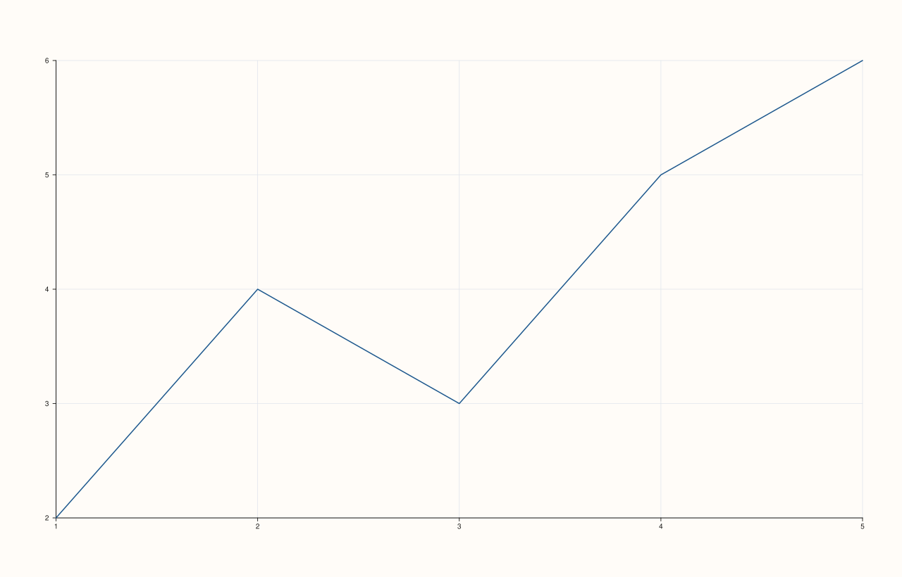
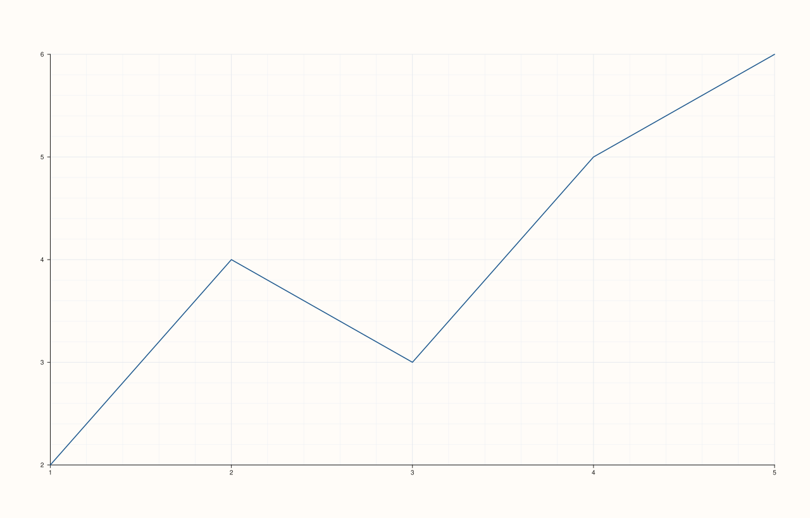
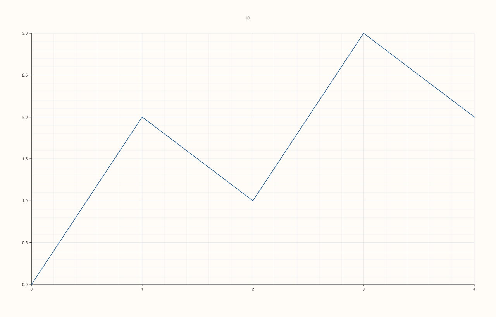
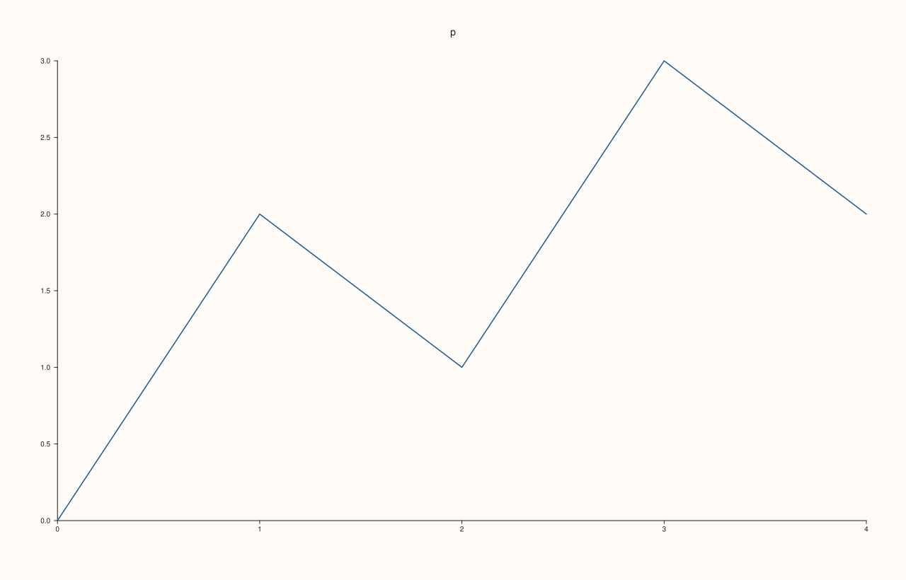
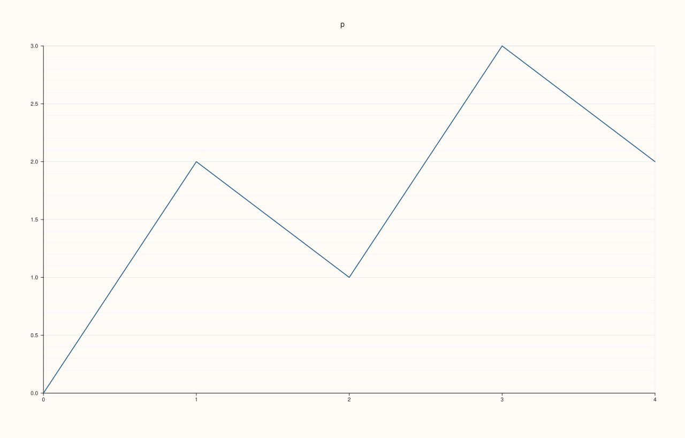
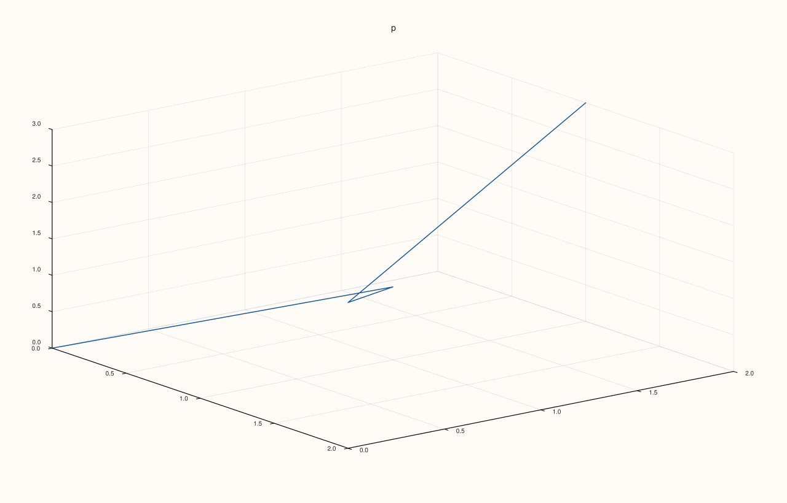

<!-- pluss-hand-authored -->

# Pane::grid

[Back to Pane API Reference](../../pane_api_reference)

## Signature

```cpp
Pane& Pane::grid(GridStyle style) noexcept
GridStyle Pane::grid_style() const noexcept
```

## What It Does

Sets the grid lines of every axis of the pane at once, and reads the overall style back.

| `GridStyle` | Drawing |
|---|---|
| `None` | No grid lines. The default. |
| `Major` | A line at every major tick, on every axis. |
| `MajorMinor` | Major lines, and a finer line between them. |

The style is a shorthand for the six per-axis switches ([`x_major_grid`](x_major_grid.md), [`x_minor_grid`](x_minor_grid.md) and the y and z ones): `grid` sets all six to match the style and so overwrites whatever they held. The reverse holds too: `grid_style()` is worked out from the switches, so it always describes what is drawn. It is `MajorMinor` if any axis has its minor grid on, otherwise `Major` if any axis has its major grid on, otherwise `None`.

Use `grid` for the same grid everywhere, and the per-axis switches for a grid on one axis only (horizontal lines on a bar chart, for instance). Call `grid` first and the switches afterwards; the other order loses the switches.

## Parameters

**style** (`GridStyle`, setter only)
    `None`, `Major` or `MajorMinor`, applied to all three axes.

## Returns

**Setter:** `Pane&`, the same pane.
**Getter:** `GridStyle`, the summary of the six switches.

## Examples

Example 1. The default is `None`: no grid lines on any axis.

```cpp
auto fig = studio("grid_default");
auto& pane = fig.pane2("p");
pane.trend(std::vector<double>{0, 1, 2, 3, 4}, std::vector<double>{0, 2, 1, 3, 2});
std::cout << "None: " << (pane.grid_style() == GridStyle::None) << "\n";
fig.save_svg("figure.svg");
```

### Output

```text
None: 1
```


Example 2. `GridStyle::Major` draws a line at every major tick of every axis.

```cpp
auto fig = studio("grid_major");
auto& pane = fig.pane2("p");
pane.trend(std::vector<double>{0, 1, 2, 3, 4}, std::vector<double>{0, 2, 1, 3, 2});
pane.grid(GridStyle::Major);
std::cout << "x major: " << pane.x_axis().major_grid << ", y major: " << pane.y_axis().major_grid << ", x minor: " << pane.x_axis().minor_grid << "\n";
fig.save_svg("figure.svg");
```

### Output

```text
x major: 1, y major: 1, x minor: 0
```



Example 3. `GridStyle::MajorMinor` adds a finer line between the major ones.

```cpp
auto fig = studio("grid_majorminor");
auto& pane = fig.pane2("p");
pane.trend(std::vector<double>{0, 1, 2, 3, 4}, std::vector<double>{0, 2, 1, 3, 2});
pane.grid(GridStyle::MajorMinor);
std::cout << "x major: " << pane.x_axis().major_grid << ", x minor: " << pane.x_axis().minor_grid << ", y minor: " << pane.y_axis().minor_grid << "\n";
fig.save_svg("figure.svg");
```

### Output

```text
x major: 1, x minor: 1, y minor: 1
```



Example 4. Three different figures. The grid is the only difference between them.

```cpp
auto build = [&](GridStyle style) {
  auto fig = studio("grid_compare");
  auto& pane = fig.pane2("p");
  pane.trend(std::vector<double>{0, 1, 2, 3, 4}, std::vector<double>{0, 2, 1, 3, 2});
  pane.grid(style);
  return fig.to_svg();
};
const auto none = build(GridStyle::None), major = build(GridStyle::Major), minor = build(GridStyle::MajorMinor);
std::cout << "none != major: " << (none != major) << ", major != major+minor: " << (major != minor) << "\n";
auto fig = studio("grid_compare_out");
auto& pane = fig.pane2("p");
pane.trend(std::vector<double>{0, 1, 2, 3, 4}, std::vector<double>{0, 2, 1, 3, 2});
pane.grid(GridStyle::MajorMinor);
fig.save_svg("figure.svg");
```

### Output

```text
none != major: 1, major != major+minor: 1
```



Example 5. `grid` sets every axis the same way, so it overwrites what the per-axis calls set before it. The y axis had a major grid of its own; after `grid(GridStyle::None)` it has none.

```cpp
auto fig = studio("grid_overwrite");
auto& pane = fig.pane2("p");
pane.trend(std::vector<double>{0, 1, 2, 3, 4}, std::vector<double>{0, 2, 1, 3, 2});
pane.y_major_grid(true);
std::cout << "before: y major " << pane.y_axis().major_grid << "\n";
pane.grid(GridStyle::None);
std::cout << "after:  y major " << pane.y_axis().major_grid << "\n";
fig.save_svg("figure.svg");
```

### Output

```text
before: y major 1
after:  y major 0
```



Example 6. `grid_style()` summarises the per-axis grids: `MajorMinor` if any axis has a minor grid, else `Major` if any axis has a major grid, else `None`. One axis turned off does not lower it while another still has the line.

```cpp
auto fig = studio("grid_summary");
auto& pane = fig.pane2("p");
pane.trend(std::vector<double>{0, 1, 2, 3, 4}, std::vector<double>{0, 2, 1, 3, 2});
pane.x_major_grid(true).y_major_grid(true);
std::cout << "two majors: " << static_cast<int>(pane.grid_style()) << " (Major = 1)\n";
pane.x_major_grid(false);
std::cout << "x off, y still on: " << static_cast<int>(pane.grid_style()) << "\n";
pane.y_minor_grid(true);
std::cout << "y minor added: " << static_cast<int>(pane.grid_style()) << " (MajorMinor = 2)\n";
fig.save_svg("figure.svg");
```

### Output

```text
two majors: 1 (Major = 1)
x off, y still on: 1
y minor added: 2 (MajorMinor = 2)
```



Example 7. On a 3D pane the style covers all three axes, and the grid is drawn on the faces behind the data.

```cpp
auto fig = studio("grid_3d");
auto& pane = fig.pane3("p");
pane.path3(std::vector<double>{0, 1, 2, 1}, std::vector<double>{0, 1, 0, 2}, std::vector<double>{0, 1, 2, 3});
pane.grid(GridStyle::Major);
std::cout << "z major: " << pane.z_axis().major_grid << "\n";
fig.save_svg("figure.svg");
```

### Output

```text
z major: 1
```



## Notes

- Both forms are `noexcept`.
- The z switches are set on a planar pane too; a planar pane has no z axis, so they draw nothing.

## See Also

- [`Pane::x_major_grid`](x_major_grid.md), [`x_minor_grid`](x_minor_grid.md): one axis at a time.
- [`GridStyle`](../types/GridStyle.md): the values it takes.

<div class="pluss-inline-prev-next">
  <a class="prev-link" href="fieldmap.html">
    <span class="label">Previous</span>
    <span class="title">fieldmap</span>
  </a>
  <a class="next-link" href="grid_style.html">
    <span class="label">Next</span>
    <span class="title">grid_style</span>
  </a>
</div>
