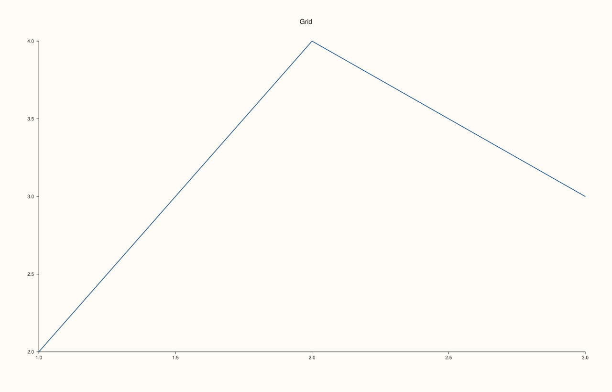
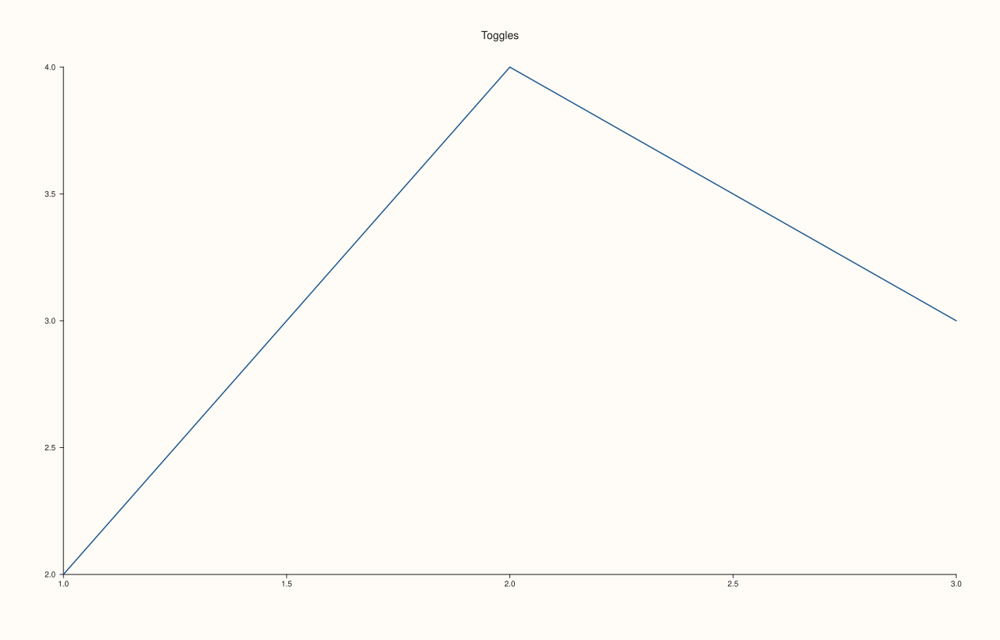
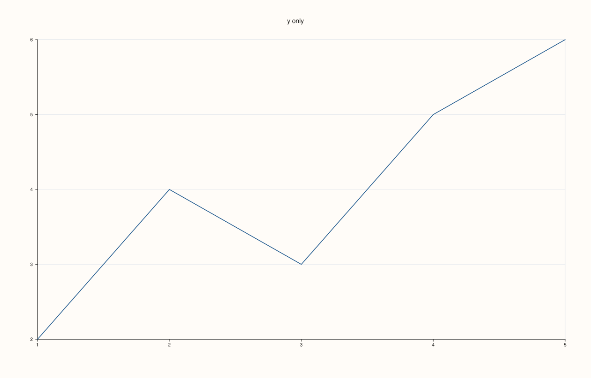

<!-- pluss-hand-authored -->

# Pane::grid_style

[Back to Pane API Reference](../../pane_api_reference)

## Signature

```cpp
GridStyle Pane::grid_style() const noexcept
```

## What It Does

Returns the grid the pane is currently drawing, summarised as a [`GridStyle`](../types/GridStyle.md): `None` when no grid line is on, `Major` when major lines are on and minor lines are not, and `MajorMinor` when both are on.
It is the getter that pairs with [`grid(GridStyle)`](grid.md), and it also reflects the per-axis toggles ([`x_major_grid`](x_major_grid.md), [`y_minor_grid`](y_minor_grid.md) and the others), because they and `grid` are two ways of setting the same flags.

The summary is over all axes of the pane: it is `MajorMinor` if any axis has minor lines on, `Major` if some axis has major lines on and none has minor lines, and `None` otherwise. It cannot say *which* axes have lines. To find that, read the flags of each axis with
[`x_axis()`](axis_accessors.md), `y_axis()` or `z_axis()`: `major_grid` and `minor_grid`.

## Parameters

*(none)*

## Returns

`GridStyle`
    `None`, `Major` or `MajorMinor`, the summary of the pane's current grid flags. A new pane returns `None`.

## Examples

Example 1. A new pane has no grid, so `grid_style()` is `None`. After `grid(Major)` it is `Major`, and after `grid(MajorMinor)` it is `MajorMinor`.

```cpp
auto fig = studio("grid_style_default");
auto& pane = fig.pane2("Grid");
pane.trend(std::vector<double>{1, 2, 3}, std::vector<double>{2, 4, 3});
std::cout << "new pane:               " << static_cast<int>(pane.grid_style()) << "  (None = 0, Major = 1, MajorMinor = 2)\n";
pane.grid(GridStyle::Major);
std::cout << "after grid(Major):      " << static_cast<int>(pane.grid_style()) << "\n";
pane.grid(GridStyle::MajorMinor);
std::cout << "after grid(MajorMinor): " << static_cast<int>(pane.grid_style()) << "\n";
pane.grid(GridStyle::None);
std::cout << "after grid(None):       " << static_cast<int>(pane.grid_style()) << "\n";
fig.save_svg("figure.svg");
```

### Output

```text
new pane:               0  (None = 0, Major = 1, MajorMinor = 2)
after grid(Major):      1
after grid(MajorMinor): 2
after grid(None):       0
```



Example 2. The per-axis toggles change the summary. One major grid on one axis makes the pane `Major`; adding a minor grid on any axis makes it `MajorMinor`; and minor lines on their own, with no major lines, also read `MajorMinor`.

```cpp
auto fig = studio("grid_style_toggles");
auto& pane = fig.pane2("Toggles");
pane.trend(std::vector<double>{1, 2, 3}, std::vector<double>{2, 4, 3});
auto show = [&](const char* what) { std::cout << what << ": " << static_cast<int>(pane.grid_style()) << "\n"; };
show("start                    ");
pane.x_major_grid(true);
show("x_major_grid(true)       ");
pane.y_minor_grid(true);
show("+ y_minor_grid(true)     ");
pane.x_major_grid(false);
show("x_major_grid(false)      ");
pane.y_minor_grid(false);
show("y_minor_grid(false)      ");
fig.save_svg("figure.svg");
```

### Output

```text
start                    : 0
x_major_grid(true)       : 1
+ y_minor_grid(true)     : 2
x_major_grid(false)      : 2
y_minor_grid(false)      : 0
```



Example 3. The summary does not say which axes have lines; the flags of each axis do. After `y_major_grid(true)` the pane reports `Major`, and reading the axes shows that only the y axis has major lines.

```cpp
auto fig = studio("grid_style_axes");
auto& pane = fig.pane2("y only");
pane.trend(std::vector<double>{1, 2, 3, 4, 5}, std::vector<double>{2, 4, 3, 5, 6});
pane.y_major_grid(true);
std::cout << "grid_style: " << static_cast<int>(pane.grid_style()) << "\n";
std::cout << "x major " << pane.x_axis().major_grid << ", minor " << pane.x_axis().minor_grid << "\n";
std::cout << "y major " << pane.y_axis().major_grid << ", minor " << pane.y_axis().minor_grid << "\n";
fig.save_svg("figure.svg");
```

### Output

```text
grid_style: 1
x major 0, minor 0
y major 1, minor 0
```



## Notes

- `grid_style()` is `noexcept` and never throws.
- The summary is what `grid(GridStyle)` sets: `grid(GridStyle::Major)` turns the major lines on for every axis of the pane and the minor lines off, and `grid(GridStyle::None)` turns every line off.
- A 3D pane has a z axis whose flags take part in the summary, like the x and y axes.

## See Also

- [`Pane::grid`](grid.md): sets the grid for the whole pane.
- [`GridStyle`](../types/GridStyle.md): the values, with a rendered demonstration of each.
- [`Pane::x_major_grid`](x_major_grid.md), [`Pane::x_minor_grid`](x_minor_grid.md) and the y and z versions: per-axis toggles.
- [`Pane::x_axis`](axis_accessors.md): reads the flags of one axis.

<div class="pluss-inline-prev-next">
  <a class="prev-link" href="grid.html">
    <span class="label">Previous</span>
    <span class="title">grid</span>
  </a>
  <a class="next-link" href="isoband.html">
    <span class="label">Next</span>
    <span class="title">isoband</span>
  </a>
</div>
