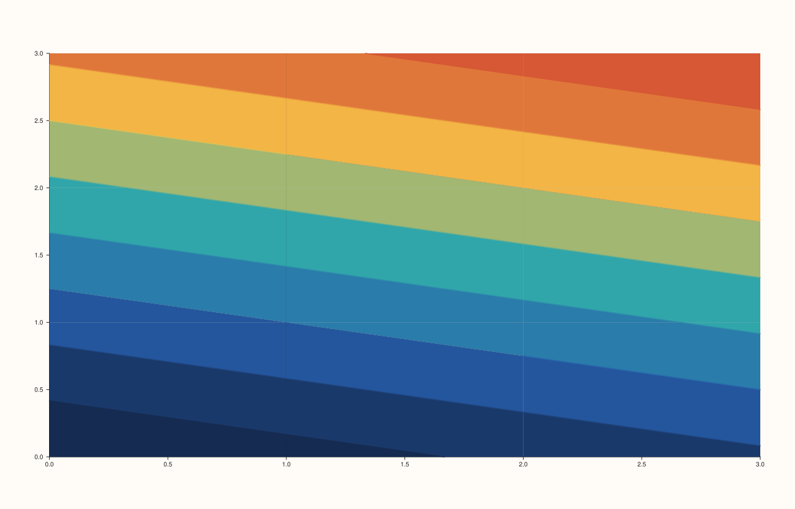
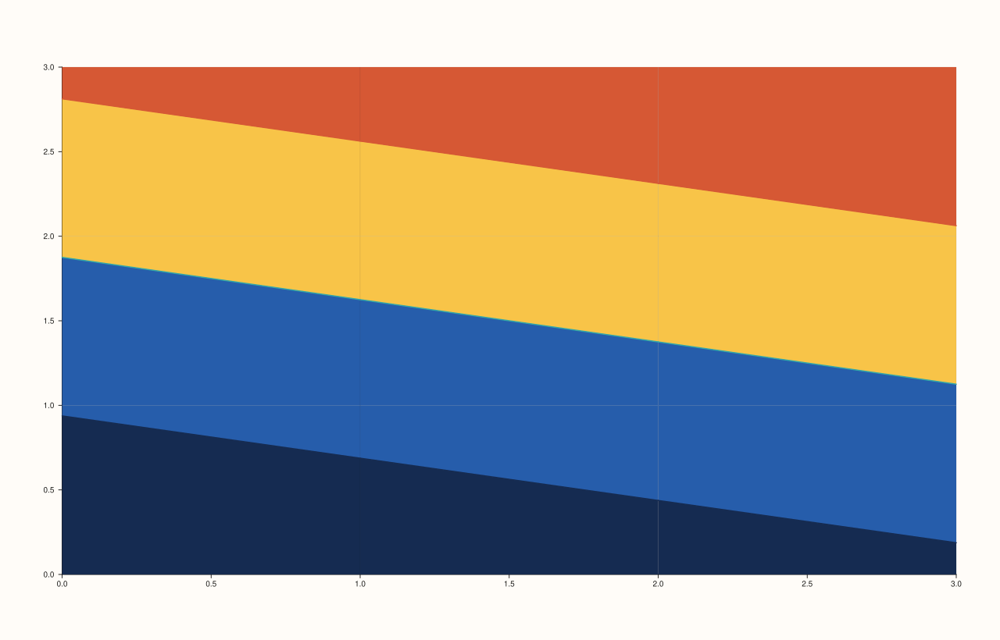

<!-- pluss-hand-authored -->

# Pane::isoband

[Back to Pane API Reference](../../pane_api_reference)

## Signatures

```cpp
template <class X, class Y, class Z>
Trace& Pane::isoband(X&& x, Y&& y, Z&& z)

template <class X, class Y, class Z, class Levels>
  requires (!std::integral<std::remove_cvref_t<Levels>>)
Trace& Pane::isoband(X&& x, Y&& y, Z&& z, Levels&& levels)

template <class X, class Y, class Z>
Trace& Pane::isoband(X&& x, Y&& y, Z&& z, int level_count)
```

## What It Does

Adds a filled-band contour trace over a scalar field `z(x, y)` — solid-filled regions
between consecutive levels, rather than [`contour()`](contour.md)'s bare lines. `isoband()`
reuses `ContourData` and `contour()`'s exact three-overload shape wholesale, constructing
it with `filled=true` instead of `contour()`'s `filled=false` — confirmed by direct SVG
diff against `contour()` called with identical `(x, y, z)` data, and by reading the
implementation, which shares the same struct and disambiguation logic:

- **`isoband(x, y, z)`** — automatically chooses `8` evenly-spaced levels.
- **`isoband(x, y, z, levels)`** — draws bands at exact `z` values listed in `levels`.
- **`isoband(x, y, z, level_count)`** — automatically spaces exactly `level_count` levels.

```{important} Requires a Planar pane
Despite being thematically grouped with the elevation-related 3D trace kinds
([`ridge3()`](ridge3.md), [`spire3()`](spire3.md)) elsewhere in this reference,
`isoband()` itself operates on an ordinary 2D `Planar` pane, not a `Volumetric` one.
Calling `isoband()` on a `Volumetric` pane throws
`std::logic_error("isoband requires a planar pane")`.
```

`z` must be rank-2, identically to [`contour()`](contour.md) and
[`Pane::fieldmap`](fieldmap.md).

## Parameters

**x**, **y** (series-convertible)
    The grid's coordinate axes.

**z** (series-convertible, must be rank-2)
    The scalar field values over the `(x, y)` grid.

**levels** (series-convertible, `levels`-overload only)
    Explicit `z` values marking band boundaries, replacing automatic spacing.

**level_count** (`int`, `level_count`-overload only)
    The number of automatically, evenly spaced band boundaries, replacing the default of
    `8`.

## Returns

`Trace&`
    A reference to the newly created trace, for chaining.

## Examples

Example 1. The default automatic level count (`8`), over the identical `4×4` field used
throughout [`contour()`](contour.md)'s examples — verified via direct SVG diff to render
genuinely different from `contour()` on the same data (filled bands vs. bare lines).

```cpp
using namespace pluss::pl;

auto fig = studio("isoband_default");
auto& pane = fig.pane2();
auto z = pluss::series::linspace(0.0, 1.0, 16, pluss::ScalarType::Float64).reshape({4, 4});
pane.isoband(std::vector<double>{0.0, 1.0, 2.0, 3.0}, std::vector<double>{0.0, 1.0, 2.0, 3.0}, z);
fig.show();
```



Example 2. Explicit band boundaries. Verified via direct SVG diff to render genuinely
different from Example 1.

```cpp
using namespace pluss::pl;

auto fig = studio("isoband_explicit_levels");
auto& pane = fig.pane2();
auto z = pluss::series::linspace(0.0, 1.0, 16, pluss::ScalarType::Float64).reshape({4, 4});
pane.isoband(std::vector<double>{0.0, 1.0, 2.0, 3.0}, std::vector<double>{0.0, 1.0, 2.0, 3.0}, z,
             std::vector<double>{0.25, 0.5, 0.75});
fig.show();
```



Example 3. An explicit level count of `3` instead of the default `8`. Verified via direct
SVG diff to render genuinely different from Example 1.

```cpp
using namespace pluss::pl;

auto fig = studio("isoband_level_count");
auto& pane = fig.pane2();
auto z = pluss::series::linspace(0.0, 1.0, 16, pluss::ScalarType::Float64).reshape({4, 4});
pane.isoband(std::vector<double>{0.0, 1.0, 2.0, 3.0}, std::vector<double>{0.0, 1.0, 2.0, 3.0}, z, 3);
fig.show();
```


## Notes

- Not `noexcept`.
- The `Levels`-taking overload uses the same `requires (!std::integral<...>)`
  disambiguation as [`contour()`](contour.md), for the same reason: so a bare integer
  argument resolves to the `level_count` overload instead.
- `flash::isobandplot` (if present) is a convenience wrapper around one of these overloads.

## See Also

- [`Pane::contour`](contour.md): the un-filled line-only sibling, sharing the identical
  `ContourData` payload and overload shape.
- [`Pane::ridge3`](ridge3.md): the `elevated=true` sibling, lifting the same contour
  levels onto a `Volumetric` 3D pane instead of filling them.

<div class="pluss-inline-prev-next">
  <a class="prev-link" href="spire3.html">
    <span class="label">Previous</span>
    <span class="title">spire3</span>
  </a>
  <a class="next-link" href="ridge3.html">
    <span class="label">Next</span>
    <span class="title">ridge3</span>
  </a>
</div>
