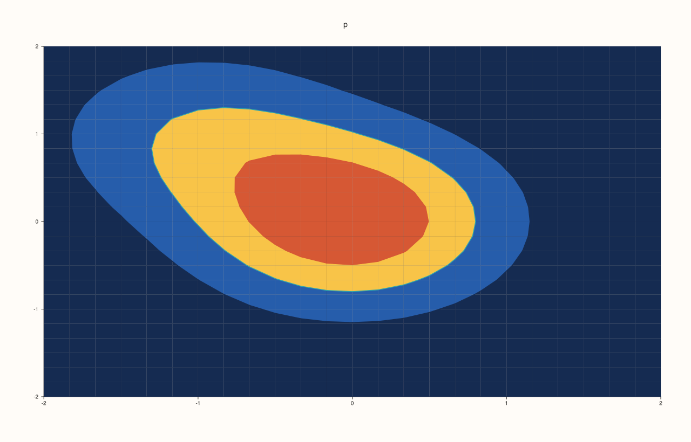
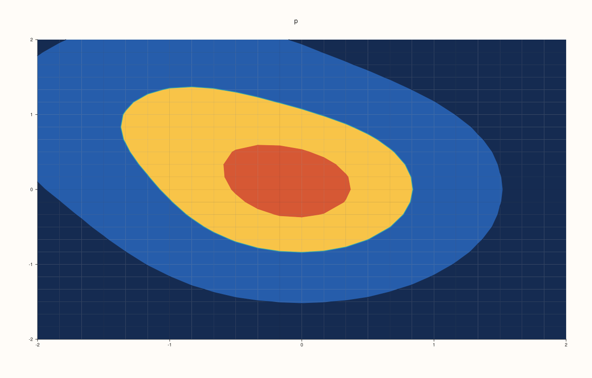
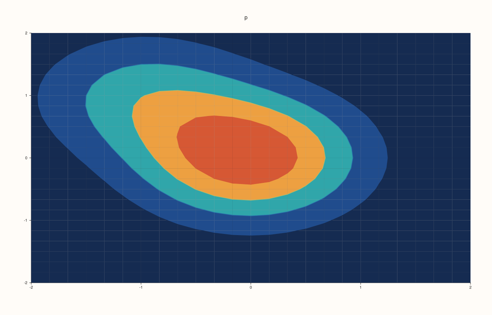
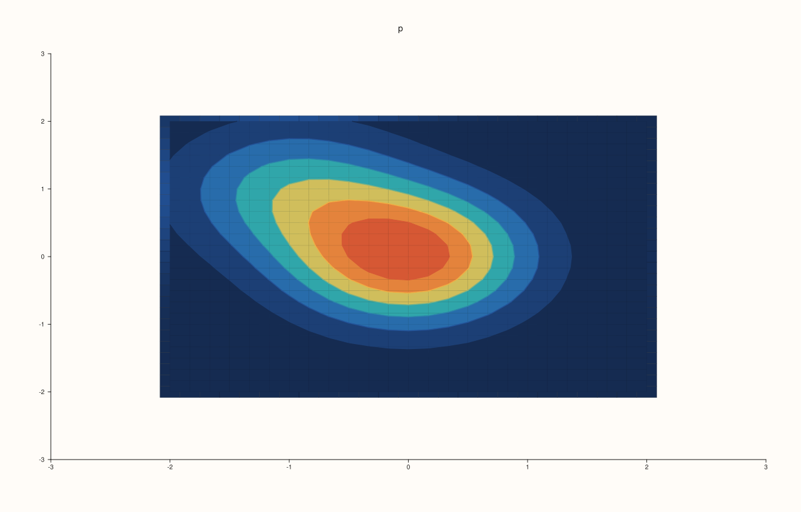
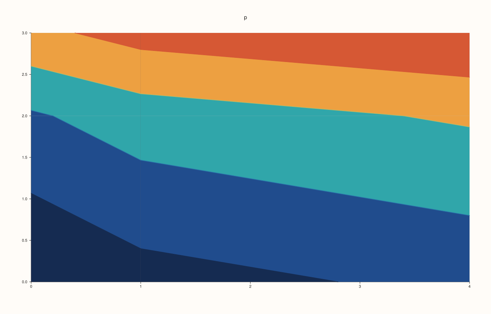

<!-- pluss-hand-authored -->

# Pane::isoband

[Back to Pane API Reference](../../pane_api_reference)

## Signature

```cpp
Trace& Pane::isoband(Series x, Series y, Series z)
Trace& Pane::isoband(Series x, Series y, Series z, std::vector<double> levels)
Trace& Pane::isoband(Series x, Series y, Series z, int level_count)
```

## What It Does

Adds **filled bands**: the regions between successive levels of a field, each filled with its own colour. It is the filled form of [`contour`](contour.md).

`z` is a rank-2 matrix with a row for each `y` and a column for each `x`, as for [`fieldmap`](fieldmap.md). The levels are chosen by the call:

| Call | Levels |
|---|---|
| `isoband(x, y, z)` | 8, evenly spaced between the lowest and highest value of `z`. |
| `isoband(x, y, z, level_count)` | `level_count` (an integer, positive), evenly spaced. |
| `isoband(x, y, z, levels)` | Exactly the values in the container `levels`. |

An integer is always a count: `4` asks for four levels, and one level at the value 4 is `std::vector<double>{4.0}`. The colours of the bands come from the palette over the range of the field (or [`color_limits`](color_limits.md)); with one level the trace's own colour is used.

## Parameters

**x**, **y** (`Series`-convertible)
    The coordinates of the columns and rows, or full matrices.

**z** (`Series`-convertible, rank 2)
    The field.

**level_count** (`int`) or **levels** (container of numbers)
    How many levels, or which.

## Returns

`Trace&`
    The new trace.

## Examples

Example 1. The default: 8 evenly spaced levels between the lowest and the highest value of the field, drawn as bands.

```cpp
auto fig = studio("isoband_default");
auto& pane = fig.pane2("p");
const std::int64_t n = 25;
std::vector<double> axis(static_cast<std::size_t>(n)), field(static_cast<std::size_t>(n * n));
for (std::int64_t i = 0; i < n; ++i) axis[static_cast<std::size_t>(i)] = -2.0 + 4.0 * i / (n - 1);
for (std::int64_t i = 0; i < n; ++i) {
  for (std::int64_t j = 0; j < n; ++j) {
    const double x = axis[static_cast<std::size_t>(i)], y = axis[static_cast<std::size_t>(j)];
    field[static_cast<std::size_t>(i * n + j)] = std::exp(-(x * x + y * y)) + 0.5 * std::exp(-((x - 1.0) * (x - 1.0) + (y + 1.0) * (y + 1.0)));
  }
}
auto z = pluss::make_series(field, {n, n});
pane.isoband(axis, axis, z);
fig.save_svg("figure.svg");
```


Example 2. A count of levels, as an integer, spaces that many levels evenly. Three levels give a coarse picture.

```cpp
auto fig = studio("isoband_count");
auto& pane = fig.pane2("p");
const std::int64_t n = 25;
std::vector<double> axis(static_cast<std::size_t>(n)), field(static_cast<std::size_t>(n * n));
for (std::int64_t i = 0; i < n; ++i) axis[static_cast<std::size_t>(i)] = -2.0 + 4.0 * i / (n - 1);
for (std::int64_t i = 0; i < n; ++i) {
  for (std::int64_t j = 0; j < n; ++j) {
    const double x = axis[static_cast<std::size_t>(i)], y = axis[static_cast<std::size_t>(j)];
    field[static_cast<std::size_t>(i * n + j)] = std::exp(-(x * x + y * y)) + 0.5 * std::exp(-((x - 1.0) * (x - 1.0) + (y + 1.0) * (y + 1.0)));
  }
}
auto z = pluss::make_series(field, {n, n});
pane.isoband(axis, axis, z, 3);
fig.save_svg("figure.svg");
```



Example 3. Explicit levels, in a container, are used as given: here the levels at 0.1, 0.5 and 0.9 of a field that runs from 0 to about 1.2.

```cpp
auto fig = studio("isoband_levels");
auto& pane = fig.pane2("p");
const std::int64_t n = 25;
std::vector<double> axis(static_cast<std::size_t>(n)), field(static_cast<std::size_t>(n * n));
for (std::int64_t i = 0; i < n; ++i) axis[static_cast<std::size_t>(i)] = -2.0 + 4.0 * i / (n - 1);
for (std::int64_t i = 0; i < n; ++i) {
  for (std::int64_t j = 0; j < n; ++j) {
    const double x = axis[static_cast<std::size_t>(i)], y = axis[static_cast<std::size_t>(j)];
    field[static_cast<std::size_t>(i * n + j)] = std::exp(-(x * x + y * y)) + 0.5 * std::exp(-((x - 1.0) * (x - 1.0) + (y + 1.0) * (y + 1.0)));
  }
}
auto z = pluss::make_series(field, {n, n});
pane.isoband(axis, axis, z, std::vector<double>{0.1, 0.5, 0.9});
fig.save_svg("figure.svg");
```



Example 4. An integer is a count and a container is a list of levels: `4` and `std::vector<double>{4}` are different calls. The first draws four levels, the second one level at the value 4, which a field below 4 does not reach.

```cpp
auto build = [&](bool count) {
  auto fig = studio("isoband_int_or_container");
  auto& pane = fig.pane2("p");
  const std::int64_t n = 25;
std::vector<double> axis(static_cast<std::size_t>(n)), field(static_cast<std::size_t>(n * n));
for (std::int64_t i = 0; i < n; ++i) axis[static_cast<std::size_t>(i)] = -2.0 + 4.0 * i / (n - 1);
for (std::int64_t i = 0; i < n; ++i) {
  for (std::int64_t j = 0; j < n; ++j) {
    const double x = axis[static_cast<std::size_t>(i)], y = axis[static_cast<std::size_t>(j)];
    field[static_cast<std::size_t>(i * n + j)] = std::exp(-(x * x + y * y)) + 0.5 * std::exp(-((x - 1.0) * (x - 1.0) + (y + 1.0) * (y + 1.0)));
  }
}
auto z = pluss::make_series(field, {n, n});
  if (count) pane.isoband(axis, axis, z, 4);
  else pane.isoband(axis, axis, z, std::vector<double>{4.0});
  return fig.to_svg();
};
std::cout << "count and list differ: " << (build(true) != build(false)) << "\n";
auto fig = studio("isoband_int_or_container_out");
auto& pane = fig.pane2("p");
const std::int64_t n = 25;
std::vector<double> axis(static_cast<std::size_t>(n)), field(static_cast<std::size_t>(n * n));
for (std::int64_t i = 0; i < n; ++i) axis[static_cast<std::size_t>(i)] = -2.0 + 4.0 * i / (n - 1);
for (std::int64_t i = 0; i < n; ++i) {
  for (std::int64_t j = 0; j < n; ++j) {
    const double x = axis[static_cast<std::size_t>(i)], y = axis[static_cast<std::size_t>(j)];
    field[static_cast<std::size_t>(i * n + j)] = std::exp(-(x * x + y * y)) + 0.5 * std::exp(-((x - 1.0) * (x - 1.0) + (y + 1.0) * (y + 1.0)));
  }
}
auto z = pluss::make_series(field, {n, n});
pane.isoband(axis, axis, z, 4);
fig.save_svg("figure.svg");
```

### Output

```text
count and list differ: 1
```



Example 5. Over a heat map of the same field the bands mark where the colours change. Both traces are on one pane, the bands drawn after the map.

```cpp
auto fig = studio("isoband_with_map");
auto& pane = fig.pane2("p");
const std::int64_t n = 25;
std::vector<double> axis(static_cast<std::size_t>(n)), field(static_cast<std::size_t>(n * n));
for (std::int64_t i = 0; i < n; ++i) axis[static_cast<std::size_t>(i)] = -2.0 + 4.0 * i / (n - 1);
for (std::int64_t i = 0; i < n; ++i) {
  for (std::int64_t j = 0; j < n; ++j) {
    const double x = axis[static_cast<std::size_t>(i)], y = axis[static_cast<std::size_t>(j)];
    field[static_cast<std::size_t>(i * n + j)] = std::exp(-(x * x + y * y)) + 0.5 * std::exp(-((x - 1.0) * (x - 1.0) + (y + 1.0) * (y + 1.0)));
  }
}
auto z = pluss::make_series(field, {n, n});
pane.fieldmap(axis, axis, z);
pane.isoband(axis, axis, z, 6);
fig.save_svg("figure.svg");
```



Example 6. The coordinates can be uneven: the grid is stretched to them.

```cpp
auto fig = studio("isoband_uneven");
auto& pane = fig.pane2("p");
auto z = pluss::series::linspace(0.0, 1.0, 9, pluss::ScalarType::Float64).reshape({3, 3});
pane.isoband(std::vector<double>{0, 1, 4}, std::vector<double>{0, 2, 3}, z, 4);
fig.save_svg("figure.svg");
```



Example 7. Inputs that cannot be drawn are refused when the trace is added, and the message names the method and the problem. The pane keeps the traces it had.

```cpp
auto report = [](const char* what, auto&& call) {
  auto fig = studio("isoband_errors");
  auto& pane = fig.pane2("p");
  try {
    call(pane);
    std::cout << what << ": accepted\n";
  } catch (const pluss::Error& e) {
    std::cout << what << ": " << e.message() << "\n";
  }
};
report("no levels", [](Pane& pane) { auto z = pluss::series::linspace(0.0, 1.0, 9, pluss::ScalarType::Float64).reshape({3, 3}); pane.isoband(std::vector<double>{1, 2, 3}, std::vector<double>{1, 2, 3}, z, 0); });
report("negative levels", [](Pane& pane) { auto z = pluss::series::linspace(0.0, 1.0, 9, pluss::ScalarType::Float64).reshape({3, 3}); pane.isoband(std::vector<double>{1, 2, 3}, std::vector<double>{1, 2, 3}, z, -1); });
report("coordinates do not match z", [](Pane& pane) { auto z = pluss::series::linspace(0.0, 1.0, 9, pluss::ScalarType::Float64).reshape({3, 3}); pane.isoband(std::vector<double>{1, 2}, std::vector<double>{1, 2, 3}, z); });
report("z is not a matrix", [](Pane& pane) { pane.isoband(std::vector<double>{1, 2, 3}, std::vector<double>{1, 2, 3}, std::vector<double>{1, 2, 3}); });
auto fig = studio("isoband_errors_out");
auto& pane = fig.pane2("p");
pane.trend(std::vector<double>{0, 1}, std::vector<double>{0, 1});
fig.save_svg("figure.svg");
```

### Output

```text
no levels: isoband: automatic contour levels must be positive
negative levels: isoband: automatic contour levels must be positive
coordinates do not match z: isoband: x/y must both be vectors with extents matching z columns/rows or full matrices matching z
z is not a matrix: isoband: z must be a rank-2 matrix
```


Example 8. `isoband` needs a planar pane. On a volumetric pane it throws at once, naming the kind it needs, and nothing is added.

```cpp
auto fig = studio("isoband_wrong_pane");
auto& pane = fig.pane3("p");
try {
  pane.isoband(std::vector<double>{1, 2}, std::vector<double>{1, 2}, pluss::series::linspace(0.0, 1.0, 4, pluss::ScalarType::Float64).reshape({2, 2}));
} catch (const pluss::Error& e) {
  std::cout << e.message() << "\n";
}
std::cout << "traces: " << pane.trace_count() << "\n";
fig.save_svg("figure.svg");
```

### Output

```text
isoband requires a planar pane
traces: 0
```


## Notes

- Returns the new [`Trace&`](../trace/label.md); the reference stays valid for the life of the pane, and the style calls of the trace ([`label`](../trace/label.md), [`stroke`](../trace/stroke.md), [`width`](../trace/width.md), ...) chain off it.
- The data is copied into the trace when it is added, so changing the vector afterwards does not change the figure.

## See Also

- [`Pane::contour`](contour.md): the lines.
- [`Pane::fieldmap`](fieldmap.md): the heat map.
- [`Pane::ridge3`](ridge3.md): contour lines lifted into three dimensions.
- [`Trace::annotate_levels`](../trace/annotate_levels.md): write the level on each line.

<div class="pluss-inline-prev-next">
  <a class="prev-link" href="grid_style.html">
    <span class="label">Previous</span>
    <span class="title">grid_style</span>
  </a>
  <a class="next-link" href="isoshell.html">
    <span class="label">Next</span>
    <span class="title">isoshell</span>
  </a>
</div>
