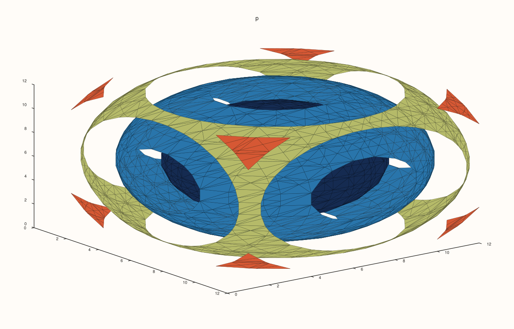
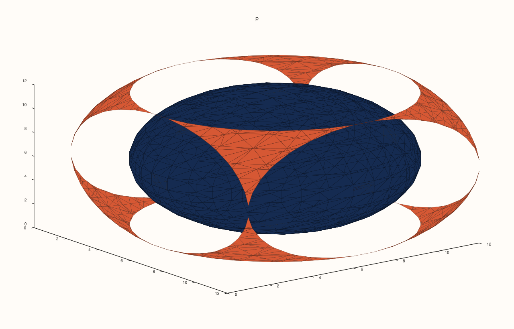
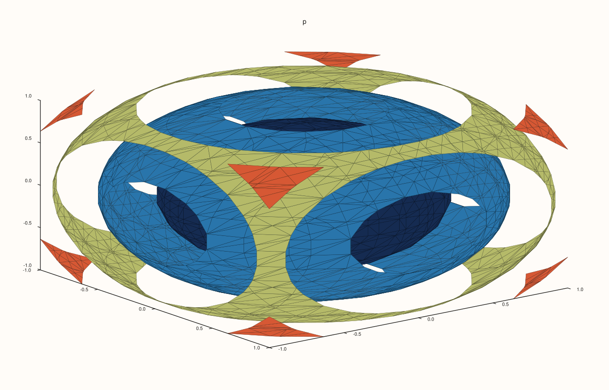
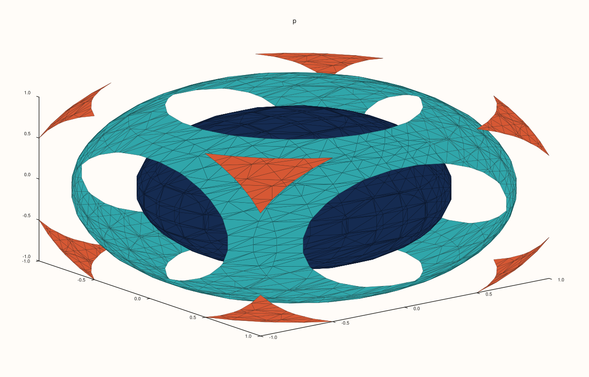
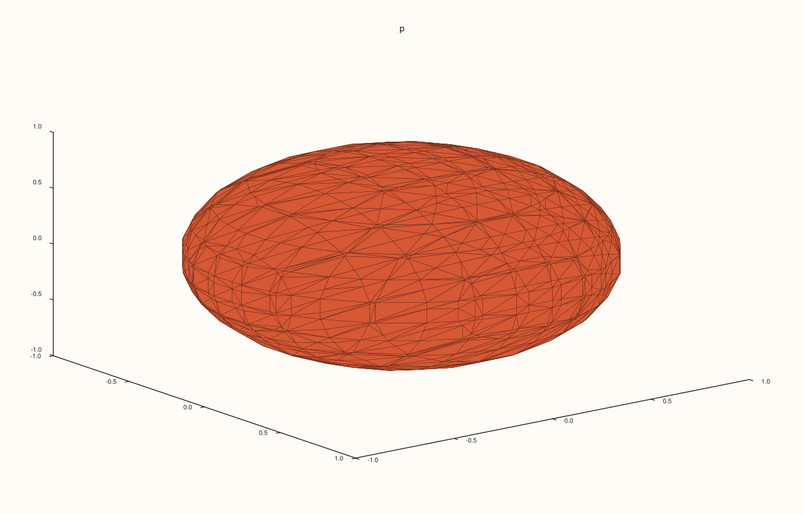
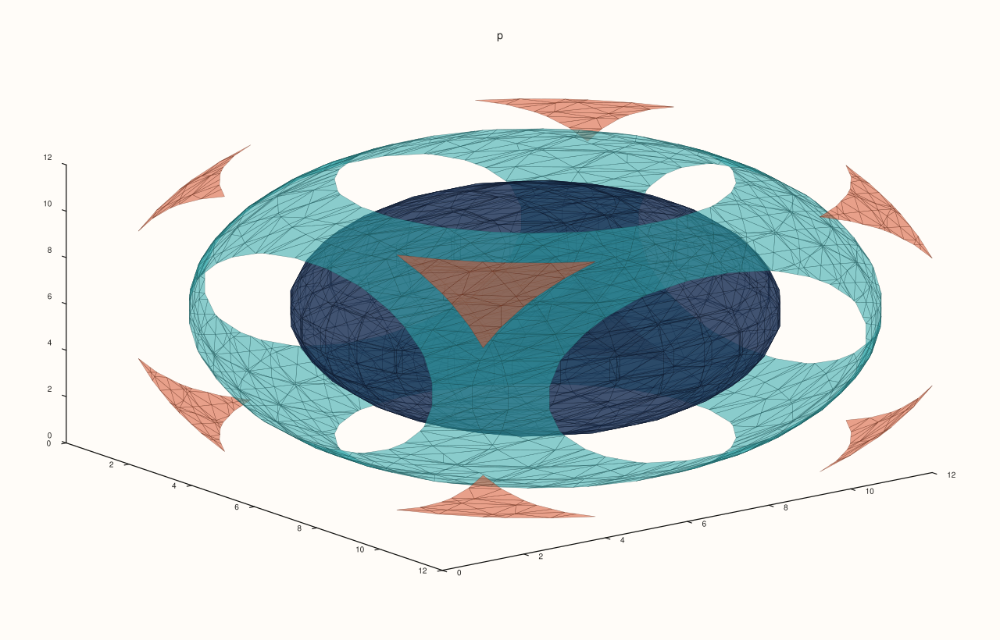

<!-- pluss-hand-authored -->

# Pane::isoshell

[Back to Pane API Reference](../../pane_api_reference)

## Signature

```cpp
Trace& Pane::isoshell(Series values, int level_count = 4)
Trace& Pane::isoshell(Series x, Series y, Series z, Series values, int level_count = 4)
Trace& Pane::isoshell(Series x, Series y, Series z, Series values, std::vector<double> levels)
```

## What It Does

Adds **isosurfaces**: for a field with a value at every point of a three-dimensional grid, the surfaces on which the field takes given values, drawn as nested shells. It is [`contour`](contour.md) one dimension up, and shows the shape of a volume of data, such as a density, a temperature or an electric potential.

`values` is a rank-3 field, indexed along x, y and z.

| Call | Coordinates | Levels |
|---|---|---|
| `isoshell(values, level_count = 4)` | The indices 1, 2, 3, ... | `level_count` evenly spaced. |
| `isoshell(x, y, z, values, level_count = 4)` | Given: one series for each axis, with the extent of `values` along it. | `level_count` evenly spaced. |
| `isoshell(x, y, z, values, levels)` | Given. | Exactly the container `levels`. |

The levels are spread between the lowest and highest value of the field, and the count must be positive. A shell is coloured by its level. Inner shells are hidden by outer ones unless the trace is [transparent](../trace/transparent.md).

## Parameters

**values** (`Series`-convertible, rank 3)
    The field.

**x**, **y**, **z** (`Series`-convertible, optional)
    The coordinates along each axis.

**level_count** (`int`, default 4) or **levels** (container)
    How many shells, or at which values.

## Returns

`Trace&`
    The new trace.

## Examples

Example 1. A field with a value at each point of a 12 by 12 by 12 grid, here the squared distance from the centre. By default four levels are chosen, and a nested shell is drawn for each: shells of equal distance around the centre.

```cpp
auto fig = studio("isoshell_default");
auto& pane = fig.pane3("p");
const std::int64_t n = 12;
std::vector<double> axis(static_cast<std::size_t>(n)), values(static_cast<std::size_t>(n * n * n));
for (std::int64_t i = 0; i < n; ++i) axis[static_cast<std::size_t>(i)] = -1.0 + 2.0 * i / (n - 1);
for (std::int64_t i = 0; i < n; ++i) {
  for (std::int64_t j = 0; j < n; ++j) {
    for (std::int64_t k = 0; k < n; ++k) {
      const double x = axis[static_cast<std::size_t>(i)], y = axis[static_cast<std::size_t>(j)], z = axis[static_cast<std::size_t>(k)];
      values[static_cast<std::size_t>((i * n + j) * n + k)] = x * x + y * y + z * z;
    }
  }
}
auto field = pluss::make_series(values, {n, n, n});
pane.isoshell(field);
fig.save_svg("figure.svg");
```



Example 2. A count of levels: two shells show the inside of the nest.

```cpp
auto fig = studio("isoshell_count");
auto& pane = fig.pane3("p");
const std::int64_t n = 12;
std::vector<double> axis(static_cast<std::size_t>(n)), values(static_cast<std::size_t>(n * n * n));
for (std::int64_t i = 0; i < n; ++i) axis[static_cast<std::size_t>(i)] = -1.0 + 2.0 * i / (n - 1);
for (std::int64_t i = 0; i < n; ++i) {
  for (std::int64_t j = 0; j < n; ++j) {
    for (std::int64_t k = 0; k < n; ++k) {
      const double x = axis[static_cast<std::size_t>(i)], y = axis[static_cast<std::size_t>(j)], z = axis[static_cast<std::size_t>(k)];
      values[static_cast<std::size_t>((i * n + j) * n + k)] = x * x + y * y + z * z;
    }
  }
}
auto field = pluss::make_series(values, {n, n, n});
pane.isoshell(field, 2);
fig.save_svg("figure.svg");
```



Example 3. With coordinates of your own the field is placed in space: the axes run from -1 to 1 here, so the shells are placed around the origin and the axes are labelled in those units.

```cpp
auto fig = studio("isoshell_coordinates");
auto& pane = fig.pane3("p");
const std::int64_t n = 12;
std::vector<double> axis(static_cast<std::size_t>(n)), values(static_cast<std::size_t>(n * n * n));
for (std::int64_t i = 0; i < n; ++i) axis[static_cast<std::size_t>(i)] = -1.0 + 2.0 * i / (n - 1);
for (std::int64_t i = 0; i < n; ++i) {
  for (std::int64_t j = 0; j < n; ++j) {
    for (std::int64_t k = 0; k < n; ++k) {
      const double x = axis[static_cast<std::size_t>(i)], y = axis[static_cast<std::size_t>(j)], z = axis[static_cast<std::size_t>(k)];
      values[static_cast<std::size_t>((i * n + j) * n + k)] = x * x + y * y + z * z;
    }
  }
}
auto field = pluss::make_series(values, {n, n, n});
pane.isoshell(axis, axis, axis, field);
fig.save_svg("figure.svg");
```



Example 4. Coordinates and a count of levels.

```cpp
auto fig = studio("isoshell_coordinates_count");
auto& pane = fig.pane3("p");
const std::int64_t n = 12;
std::vector<double> axis(static_cast<std::size_t>(n)), values(static_cast<std::size_t>(n * n * n));
for (std::int64_t i = 0; i < n; ++i) axis[static_cast<std::size_t>(i)] = -1.0 + 2.0 * i / (n - 1);
for (std::int64_t i = 0; i < n; ++i) {
  for (std::int64_t j = 0; j < n; ++j) {
    for (std::int64_t k = 0; k < n; ++k) {
      const double x = axis[static_cast<std::size_t>(i)], y = axis[static_cast<std::size_t>(j)], z = axis[static_cast<std::size_t>(k)];
      values[static_cast<std::size_t>((i * n + j) * n + k)] = x * x + y * y + z * z;
    }
  }
}
auto field = pluss::make_series(values, {n, n, n});
pane.isoshell(axis, axis, axis, field, 3);
fig.save_svg("figure.svg");
```



Example 5. Explicit levels, in a container: the shells at the squared distances 0.2 and 0.8.

```cpp
auto fig = studio("isoshell_levels");
auto& pane = fig.pane3("p");
const std::int64_t n = 12;
std::vector<double> axis(static_cast<std::size_t>(n)), values(static_cast<std::size_t>(n * n * n));
for (std::int64_t i = 0; i < n; ++i) axis[static_cast<std::size_t>(i)] = -1.0 + 2.0 * i / (n - 1);
for (std::int64_t i = 0; i < n; ++i) {
  for (std::int64_t j = 0; j < n; ++j) {
    for (std::int64_t k = 0; k < n; ++k) {
      const double x = axis[static_cast<std::size_t>(i)], y = axis[static_cast<std::size_t>(j)], z = axis[static_cast<std::size_t>(k)];
      values[static_cast<std::size_t>((i * n + j) * n + k)] = x * x + y * y + z * z;
    }
  }
}
auto field = pluss::make_series(values, {n, n, n});
pane.isoshell(axis, axis, axis, field, std::vector<double>{0.2, 0.8});
fig.save_svg("figure.svg");
```



Example 6. The shells hide one another. A transparent trace shows the inner ones through the outer.

```cpp
auto fig = studio("isoshell_transparent");
auto& pane = fig.pane3("p");
const std::int64_t n = 12;
std::vector<double> axis(static_cast<std::size_t>(n)), values(static_cast<std::size_t>(n * n * n));
for (std::int64_t i = 0; i < n; ++i) axis[static_cast<std::size_t>(i)] = -1.0 + 2.0 * i / (n - 1);
for (std::int64_t i = 0; i < n; ++i) {
  for (std::int64_t j = 0; j < n; ++j) {
    for (std::int64_t k = 0; k < n; ++k) {
      const double x = axis[static_cast<std::size_t>(i)], y = axis[static_cast<std::size_t>(j)], z = axis[static_cast<std::size_t>(k)];
      values[static_cast<std::size_t>((i * n + j) * n + k)] = x * x + y * y + z * z;
    }
  }
}
auto field = pluss::make_series(values, {n, n, n});
pane.isoshell(field, 3).transparent(true);
fig.save_svg("figure.svg");
```



Example 7. Inputs that cannot be drawn are refused when the trace is added, and the message names the method and the problem. The pane keeps the traces it had.

```cpp
auto report = [](const char* what, auto&& call) {
  auto fig = studio("isoshell_errors");
  auto& pane = fig.pane3("p");
  try {
    call(pane);
    std::cout << what << ": accepted\n";
  } catch (const pluss::Error& e) {
    std::cout << what << ": " << e.message() << "\n";
  }
};
report("values are not a field", [](Pane& pane) { pane.isoshell(pluss::series::linspace(0.0, 1.0, 9, pluss::ScalarType::Float64).reshape({3, 3})); });
report("no levels", [](Pane& pane) { pane.isoshell(pluss::series::linspace(0.0, 1.0, 27, pluss::ScalarType::Float64).reshape({3, 3, 3}), 0); });
auto fig = studio("isoshell_errors_out");
auto& pane = fig.pane3("p");
pane.path3(std::vector<double>{0, 1}, std::vector<double>{0, 1}, std::vector<double>{0, 1});
fig.save_svg("figure.svg");
```

### Output

```text
values are not a field: isoshell: values must be a rank-3 field
no levels: isoshell: automatic levels must be positive
```


Example 8. `isoshell` needs a volumetric pane. On a planar pane it throws at once, naming the kind it needs, and nothing is added.

```cpp
auto fig = studio("isoshell_wrong_pane");
auto& pane = fig.pane2("p");
try {
  pane.isoshell(pluss::series::linspace(0.0, 1.0, 8, pluss::ScalarType::Float64).reshape({2, 2, 2}));
} catch (const pluss::Error& e) {
  std::cout << e.message() << "\n";
}
std::cout << "traces: " << pane.trace_count() << "\n";
fig.save_svg("figure.svg");
```

### Output

```text
isoshell requires a volumetric pane
traces: 0
```


## Notes

- Returns the new [`Trace&`](../trace/label.md); the reference stays valid for the life of the pane, and the style calls of the trace ([`label`](../trace/label.md), [`stroke`](../trace/stroke.md), [`width`](../trace/width.md), ...) chain off it.
- The data is copied into the trace when it is added, so changing the vector afterwards does not change the figure.

## See Also

- [`Pane::contour`](contour.md): contour lines of a two-dimensional field.
- [`Pane::sheet`](sheet.md): a surface over a grid.
- [`Trace::transparent`](../trace/transparent.md): see through the shells.

<div class="pluss-inline-prev-next">
  <a class="prev-link" href="isoband.html">
    <span class="label">Previous</span>
    <span class="title">isoband</span>
  </a>
  <a class="next-link" href="kind.html">
    <span class="label">Next</span>
    <span class="title">kind</span>
  </a>
</div>
