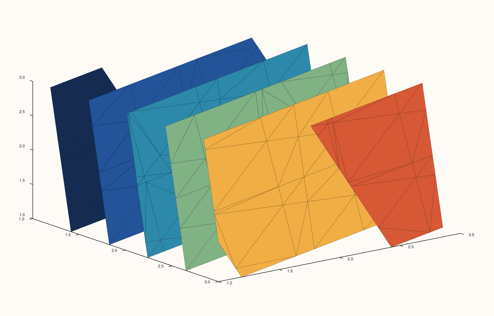
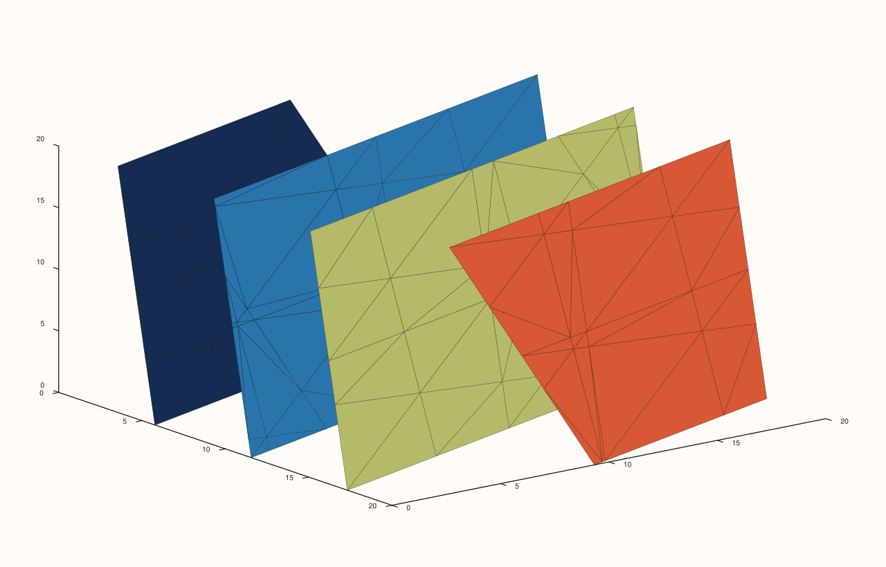
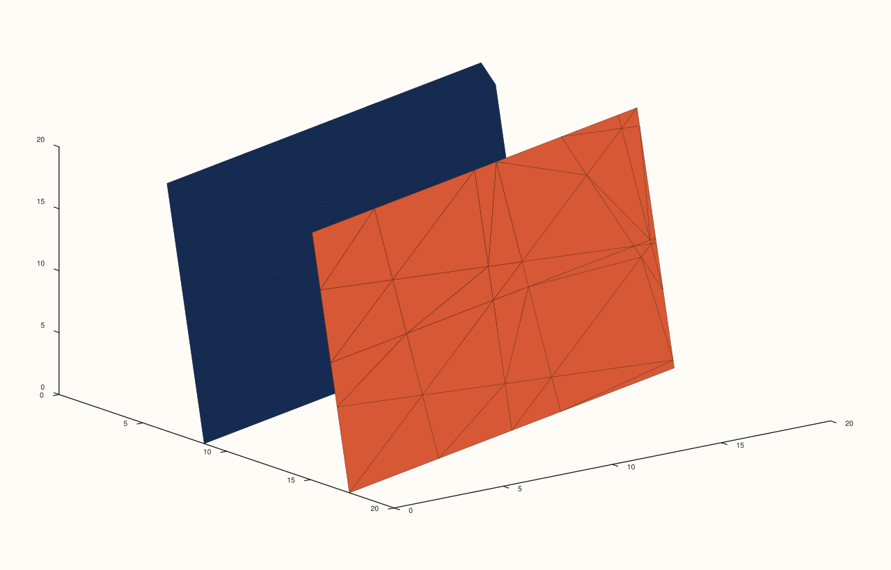

<!-- pluss-hand-authored -->

# Pane::isoshell

[Back to Pane API Reference](../../pane_api_reference)

## Signatures

```cpp
template <class Values>
Trace& Pane::isoshell(Values&& values, int level_count = 4)

template <class X, class Y, class Z, class Values>
Trace& Pane::isoshell(X&& x, Y&& y, Z&& z, Values&& values, int level_count = 4)

template <class X, class Y, class Z, class Values, class Levels>
  requires (!std::integral<std::remove_cvref_t<Levels>>)
Trace& Pane::isoshell(X&& x, Y&& y, Z&& z, Values&& values, Levels&& levels)
```

## What It Does

Adds an isosurface ("shell") trace over a volumetric scalar field — nested surfaces
enclosing the regions where `values` crosses each chosen threshold, the 3D volumetric
analogue of [`contour()`](contour.md)'s 2D level lines. `values` is always a genuine
rank-3 field. Three overloads:

- **`isoshell(values, level_count = 4)`** — `values` alone; `x`, `y`, `z` axes are all
  auto-indexed as `0, 1, 2, …` from `values`'s own three dimensions. `level_count`
  defaults to `4` (note: a *different* default from `contour()`'s family, which defaults
  to `8`).
- **`isoshell(x, y, z, values, level_count = 4)`** — explicit coordinate axes alongside
  `values`, `level_count` still defaulting to `4`.
- **`isoshell(x, y, z, values, levels)`** — explicit coordinate axes and explicit
  threshold `levels`, replacing automatic spacing entirely.

```{important} values must be rank-3
The single-argument overload validates this eagerly, throwing immediately if `values`
isn't a genuine three-dimensional field:
```

```text
std::invalid_argument: isoshell: values must be a rank-3 field
```

```{important} Requires a Volumetric pane
Calling `isoshell()` on a `Planar` pane throws
`std::logic_error("isoshell requires a volumetric pane")`.
```

## Parameters

**values** (series-convertible, must be rank-3)
    The volumetric scalar field, indexed `values(x, y, z)`.

**x**, **y**, **z** (series-convertible, four- and five-argument overloads)
    Explicit coordinate axes, matching `values`'s three dimensions. Auto-indexed as
    `0, 1, 2, …` in the one-argument overload.

**level_count** (`int`, default `4`, one- and four-argument overloads)
    The number of automatically, evenly spaced isosurface thresholds. Note the default of
    `4` here, versus `8` for [`contour()`](contour.md)/[`isoband()`](isoband.md)/
    [`ridge3()`](ridge3.md) — do not assume a shared default across the whole
    contour-level family.

**levels** (series-convertible, five-argument overload only)
    Explicit threshold values, replacing automatic spacing.

## Returns

`Trace&`
    A reference to the newly created trace, for chaining.

## Examples

Example 1. `values` alone, default `level_count = 4`, all axes auto-indexed from a
`3×3×3` field.

```cpp
using namespace pluss::pl;

auto fig = studio("isoshell_values_only");
auto& pane = fig.pane3();
auto field = pluss::series::linspace(0.0, 1.0, 27, pluss::ScalarType::Float64).reshape({3, 3, 3});
pane.isoshell(field);
fig.show();
```


Example 2. The same field, `level_count` raised to `6`. Verified via direct SVG diff to
render genuinely different from Example 1.

```cpp
using namespace pluss::pl;

auto fig = studio("isoshell_values_count");
auto& pane = fig.pane3();
auto field = pluss::series::linspace(0.0, 1.0, 27, pluss::ScalarType::Float64).reshape({3, 3, 3});
pane.isoshell(field, 6);
fig.show();
```



Example 3. Explicit `x`/`y`/`z` coordinate axes alongside `values`, default
`level_count = 4`.

```cpp
using namespace pluss::pl;

auto fig = studio("isoshell_xyz_values");
auto& pane = fig.pane3();
auto field = pluss::series::linspace(0.0, 1.0, 27, pluss::ScalarType::Float64).reshape({3, 3, 3});
pane.isoshell(std::vector<double>{0.0, 10.0, 20.0}, std::vector<double>{0.0, 10.0, 20.0}, std::vector<double>{0.0, 10.0, 20.0}, field);
fig.show();
```



Example 4. Explicit `x`/`y`/`z`, `values`, and explicit threshold `levels` instead of an
automatic count. Verified via direct SVG diff to render genuinely different from
Example 3.

```cpp
using namespace pluss::pl;

auto fig = studio("isoshell_xyz_values_levels");
auto& pane = fig.pane3();
auto field = pluss::series::linspace(0.0, 1.0, 27, pluss::ScalarType::Float64).reshape({3, 3, 3});
pane.isoshell(std::vector<double>{0.0, 10.0, 20.0}, std::vector<double>{0.0, 10.0, 20.0}, std::vector<double>{0.0, 10.0, 20.0}, field,
              std::vector<double>{0.3, 0.6});
fig.show();
```



Example 5 (failure). A rank-2 field passed where a rank-3 field is required.

```cpp
using namespace pluss::pl;

auto fig = studio("isoshell_rank2_failure");
auto& pane = fig.pane3();
try {
  auto flat = pluss::series::linspace(0.0, 1.0, 9, pluss::ScalarType::Float64).reshape({3, 3});
  pane.isoshell(flat);
} catch (const std::invalid_argument& e) {
  std::cout << e.what() << "\n";
}
```

Output:

```text
isoshell: values must be a rank-3 field
```

## Notes

- Not `noexcept`.
- The rank-3 check shown above (`std::invalid_argument`) was directly exercised only on
  the single-argument overload; the four- and five-argument (explicit-axes) overloads were
  not separately probed for the identical failure mode in this documentation pass —
  treat the eager-vs-shared-validation distinction found on [`spire3()`](spire3.md) as a
  plausible but unverified parallel here, not a confirmed fact for `isoshell()`
  specifically.
- `level_count`'s default (`4`) differs from the rest of the contour-level family's
  default (`8`) — see the Parameters section above.
- `flash::isosurface` (if present) is a convenience wrapper around one of these overloads.

## See Also

- [`Pane::contour`](contour.md): the 2D scalar-field analogue (level lines rather than
  level surfaces).
- [`Pane::fieldmap`](fieldmap.md): another rank-2-validated field trace kind, for
  comparison with `isoshell()`'s rank-3 requirement.

<div class="pluss-inline-prev-next">
  <a class="prev-link" href="ridge3.html">
    <span class="label">Previous</span>
    <span class="title">ridge3</span>
  </a>
  <a class="next-link" href="sheet.html">
    <span class="label">Next</span>
    <span class="title">sheet</span>
  </a>
</div>
