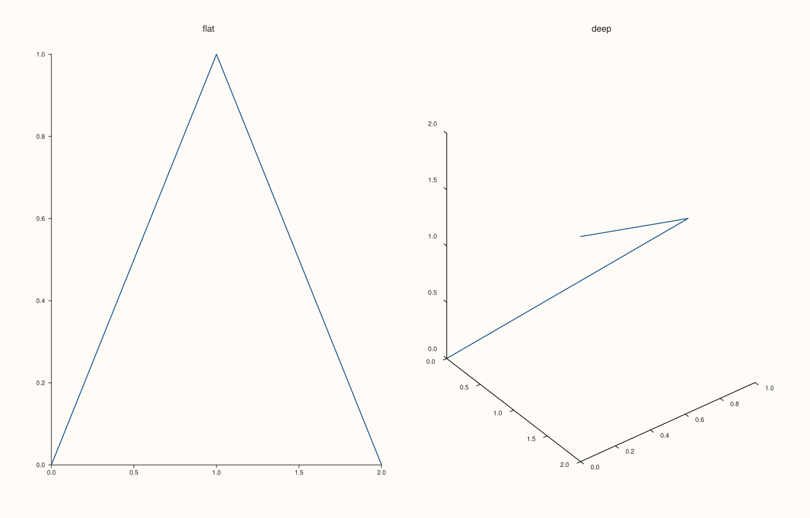
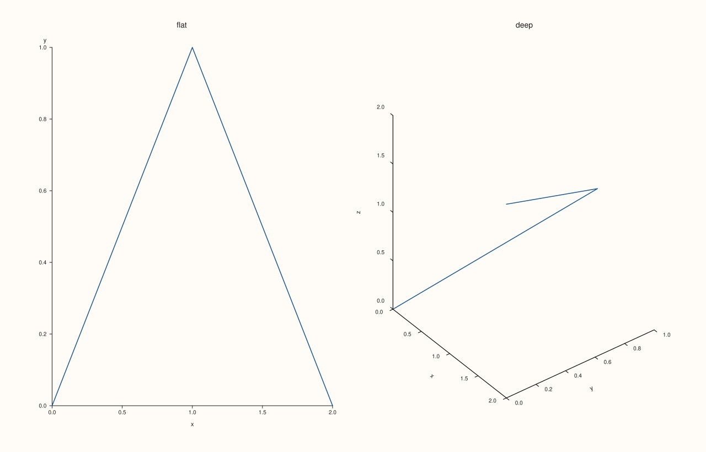

<!-- pluss-hand-authored -->

# Pane::kind

[Back to Pane API Reference](../../pane_api_reference)

## Signature

```cpp
PaneKind Pane::kind() const noexcept
```

## What It Does

Returns which kind of surface the pane is: `PaneKind::Planar`, made by [`Studio::pane2`](../studio/pane2.md), or `PaneKind::Volumetric`, made by [`Studio::pane3`](../studio/pane3.md). The kind is fixed when the pane is made and never changes.

The kind decides what can be added to the pane. The planar trace methods ([`trend`](trend.md), [`cloud`](cloud.md), [`columns`](columns.md), [`violin`](violin.md), [`contour`](contour.md), and the rest of the planar kinds) need a planar pane, and the volumetric ones ([`path3`](path3.md), [`cloud3`](cloud3.md), [`spire3`](spire3.md), [`sheet`](sheet.md), [`isoshell`](isoshell.md)...) need a volumetric one; calling the wrong family throws. The kind also decides the starting [`lens`](lens.md): a planar pane begins with the flat, straight-on view of `Lens::planar()`, a volumetric pane with the angled view of `Lens::spatial()`. Both can be changed afterwards.

Call `kind()` in code that receives panes it did not make (a helper that decorates every pane of a figure, say) to choose between the planar and volumetric calls.

## Parameters

*(none)*

## Returns

`PaneKind`
    `Planar` or `Volumetric`.

## Examples

Example 1. The two factories make the two kinds.

```cpp
auto fig = studio("kind_both");
fig.mosaic(1, 2);
auto& flat = fig.pane2("flat");
flat.trend(std::vector<double>{0, 1, 2}, std::vector<double>{0, 1, 0});
auto& deep = fig.pane3("deep");
deep.path3(std::vector<double>{0, 1, 2}, std::vector<double>{0, 1, 0}, std::vector<double>{0, 1, 2});
std::cout << "flat is Planar: " << (flat.kind() == PaneKind::Planar) << ", deep is Volumetric: " << (deep.kind() == PaneKind::Volumetric) << "\n";
fig.save_svg("figure.svg");
```

### Output

```text
flat is Planar: 1, deep is Volumetric: 1
```


Example 2. A planar pane refuses the volumetric trace methods, naming the kind it needs.

```cpp
auto fig = studio("kind_planar_refuses");
auto& pane = fig.pane2("p");
try {
  pane.path3(std::vector<double>{0, 1}, std::vector<double>{0, 1}, std::vector<double>{0, 1});
} catch (const pluss::Error& e) {
  std::cout << e.message() << "\n";
}
pane.trend(std::vector<double>{0, 1}, std::vector<double>{0, 1});
fig.save_svg("figure.svg");
```

### Output

```text
path3 requires a volumetric pane
```


Example 3. And a volumetric pane refuses the planar ones.

```cpp
auto fig = studio("kind_volumetric_refuses");
auto& pane = fig.pane3("p");
try {
  pane.trend(std::vector<double>{0, 1}, std::vector<double>{0, 1});
} catch (const pluss::Error& e) {
  std::cout << e.message() << "\n";
}
pane.path3(std::vector<double>{0, 1}, std::vector<double>{0, 1}, std::vector<double>{0, 1});
fig.save_svg("figure.svg");
```

### Output

```text
trend requires a planar pane
```


Example 4. The kind sets the starting view. A planar pane looks straight at the plane; a volumetric pane starts at an angle, so that depth shows.

```cpp
auto fig = studio("kind_lens");
fig.mosaic(1, 2);
auto& flat = fig.pane2("flat");
flat.trend(std::vector<double>{0, 1, 2}, std::vector<double>{0, 1, 0});
auto& deep = fig.pane3("deep");
deep.path3(std::vector<double>{0, 1, 2}, std::vector<double>{0, 1, 0}, std::vector<double>{0, 1, 2});
std::cout << "flat: azimuth " << flat.lens().azimuth_deg() << ", elevation " << flat.lens().elevation_deg() << "\n";
std::cout << "deep: azimuth " << deep.lens().azimuth_deg() << ", elevation " << deep.lens().elevation_deg() << "\n";
fig.save_svg("figure.svg");
```

### Output

```text
flat: azimuth 0, elevation 90
deep: azimuth -37.5, elevation 30
```



Example 5. Decorating panes of either kind. The helper labels every axis and then adds the z label only where there is a z axis.

```cpp
auto fig = studio("kind_dispatch");
fig.mosaic(1, 2);
auto& flat = fig.pane2("flat");
flat.trend(std::vector<double>{0, 1, 2}, std::vector<double>{0, 1, 0});
auto& deep = fig.pane3("deep");
deep.path3(std::vector<double>{0, 1, 2}, std::vector<double>{0, 1, 0}, std::vector<double>{0, 1, 2});
for (auto* pane : {&flat, &deep}) {
  pane->x_label("x").y_label("y");
  if (pane->kind() == PaneKind::Volumetric) pane->z_label("z");
}
std::cout << "flat z label: '" << flat.z_axis().label << "', deep z label: '" << deep.z_axis().label << "'\n";
fig.save_svg("figure.svg");
```

### Output

```text
flat z label: '', deep z label: 'z'
```



## Notes

- `noexcept`, and has no setter.
- The planar and volumetric trace methods are listed on their own pages; each names the kind it needs in the error it throws.

## See Also

- [`Studio::pane2`](../studio/pane2.md), [`Studio::pane3`](../studio/pane3.md): make a pane.
- [`Pane::lens`](lens.md): the view, whose starting value depends on the kind.

<div class="pluss-inline-prev-next">
  <a class="prev-link" href="isoshell.html">
    <span class="label">Previous</span>
    <span class="title">isoshell</span>
  </a>
  <a class="next-link" href="lattice.html">
    <span class="label">Next</span>
    <span class="title">lattice</span>
  </a>
</div>
