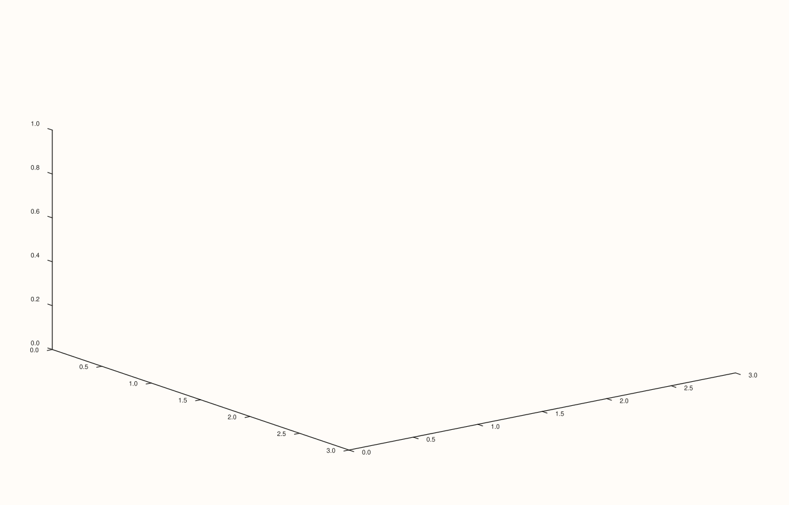

<!-- pluss-hand-authored -->

# Pane::lattice

[Back to Pane API Reference](../../pane_api_reference)

## Signatures

```cpp
template <class X, class Y, class Z>
Trace& Pane::lattice(X&& x, Y&& y, Z&& z)

template <class X, class Y, class Z, class C>
Trace& Pane::lattice(X&& x, Y&& y, Z&& z, C&& c)
```

## What It Does

Adds a wireframe-mesh 3D trace over a scalar field `z(x, y)` — the grid lines connecting
`(x[i], y[j], z(i,j))` points, without a filled surface between them. `lattice()` shares
its exact payload type (`SurfaceData`) and both overload signatures with
[`sheet()`](sheet.md) letter-for-letter; the only difference between the two methods is
the `TraceKind` tag they construct (`Lattice` vs. `Sheet`), which the renderer uses to
choose wireframe-only versus filled-solid drawing:

- **`lattice(x, y, z)`** — wireframe mesh, shape from `z`.
- **`lattice(x, y, z, c)`** — wireframe mesh, shape from `z`, with a `c` parameter
  accepted in the payload for shape-parity with `sheet()` — but see the important callout
  below.

```{important} c has no observed rendering effect on lattice()
Unlike on [`sheet()`](sheet.md), where an identical `c` argument produces a genuinely
different fill color (directly verified via SVG diff), supplying `c` to `lattice()` was
verified to produce **byte-for-byte identical** output to omitting it — even at an
extreme color contrast (`0` to `5000` on a field otherwise ranging `0`–`1`). This is
consistent with `lattice()` drawing a pure wireframe with no filled area for a per-cell
color to paint: the parameter is accepted (for API/payload symmetry with `sheet()`) but
has no visible effect in every case tested here. Do not assume `c` colors the wireframe's
lines — that behavior was not observed.
```

```{important} Requires a Volumetric pane
Calling `lattice()` on a `Planar` pane throws
`std::logic_error("lattice requires a volumetric pane")`.
```

## Parameters

**x**, **y** (series-convertible)
    The grid's coordinate axes.

**z** (series-convertible, must be rank-2)
    The mesh height at each `(x, y)` grid point.

**c** (series-convertible, must be rank-2 matching `z`'s shape, four-argument overload
only)
    Accepted for payload/overload-shape symmetry with [`sheet()`](sheet.md); no
    rendering effect was observed in this documentation pass (see the important callout
    above).

## Returns

`Trace&`
    A reference to the newly created trace, for chaining.

## Examples

Example 1. A wireframe mesh over the same `4×4` field used throughout
[`sheet()`](sheet.md)'s examples.

```cpp
using namespace pluss::pl;

auto fig = studio("lattice_xyz");
auto& pane = fig.pane3();
auto z = pluss::series::linspace(0.0, 1.0, 16, pluss::ScalarType::Float64).reshape({4, 4});
pane.lattice(std::vector<double>{0.0, 1.0, 2.0, 3.0}, std::vector<double>{0.0, 1.0, 2.0, 3.0}, z);
fig.show();
```



Example 2. The identical shape, with a `c` argument supplied — verified via direct SVG
diff to render **byte-for-byte identically** to Example 1, confirming `c` has no observed
effect on `lattice()`'s output (contrast this with [`sheet()`](sheet.md), where the
identical `c` genuinely changes the fill color).

```cpp
using namespace pluss::pl;

auto fig = studio("lattice_xyzc");
auto& pane = fig.pane3();
auto z = pluss::series::linspace(0.0, 1.0, 16, pluss::ScalarType::Float64).reshape({4, 4});
auto c = pluss::series::linspace(1.0, 0.0, 16, pluss::ScalarType::Float64).reshape({4, 4});
pane.lattice(std::vector<double>{0.0, 1.0, 2.0, 3.0}, std::vector<double>{0.0, 1.0, 2.0, 3.0}, z, c);
fig.show();
```


## Notes

- Not `noexcept`.
- `lattice(x, y, z)` and `sheet(x, y, z)` were verified, on identical input data, to
  render genuinely *different* output from each other (wireframe vs. filled surface) —
  the shared payload type does not mean the two methods are interchangeable, only that
  they accept the same call shape.
- `flash::wireframe3d` (if present) is a convenience wrapper around this exact method.

## See Also

- [`Pane::sheet`](sheet.md): the identical-payload filled-surface sibling of this method
  — where `c` *does* have an observed rendering effect.
- [`Pane::spire3`](spire3.md): a discrete per-cell-bar alternative to a continuous mesh,
  on the same `Volumetric` pane kind.

<div class="pluss-inline-prev-next">
  <a class="prev-link" href="sheet.html">
    <span class="label">Previous</span>
    <span class="title">sheet</span>
  </a>
</div>
