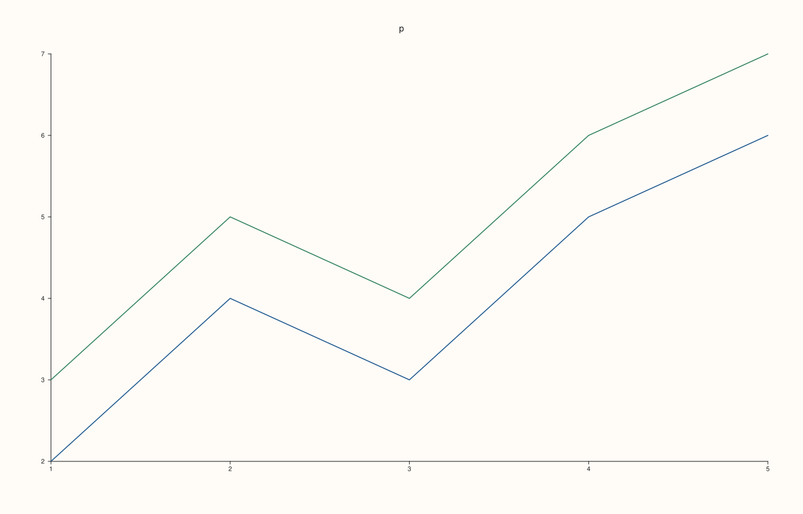
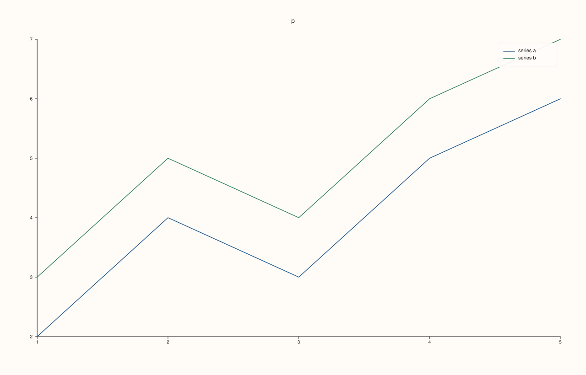
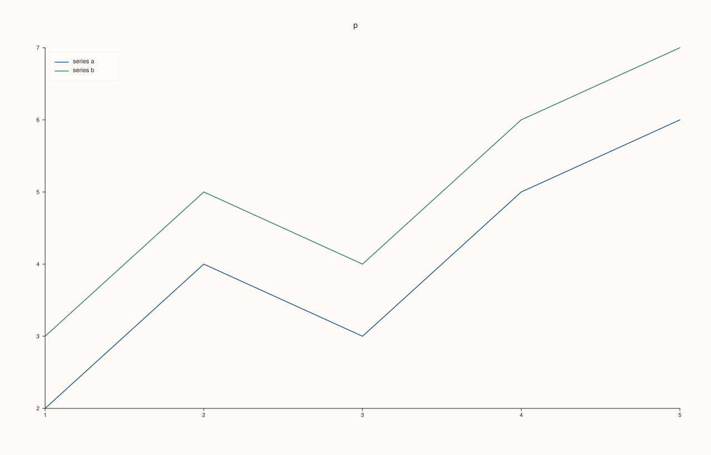
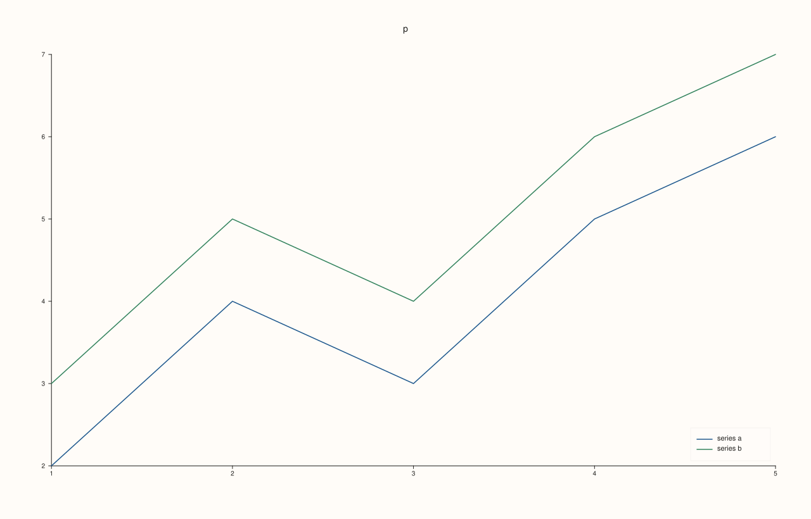
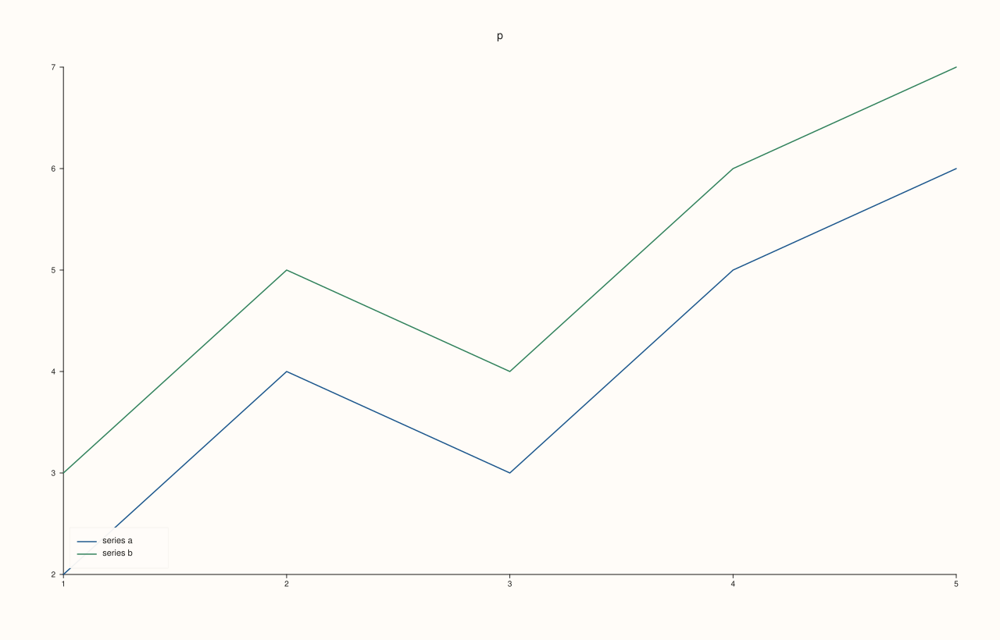
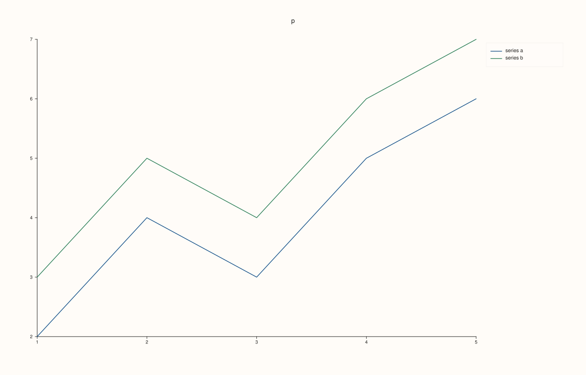
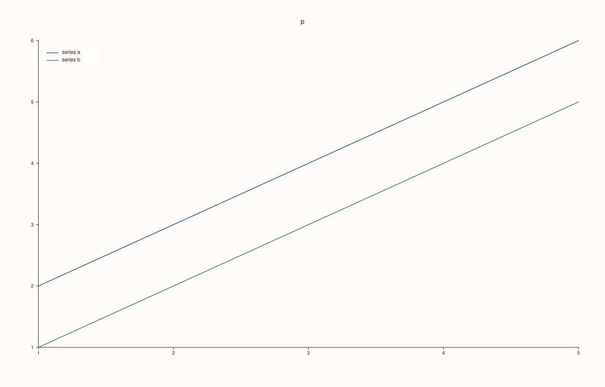
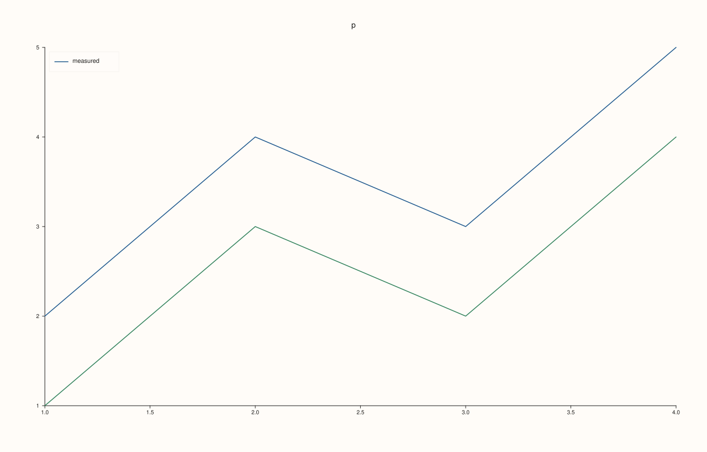
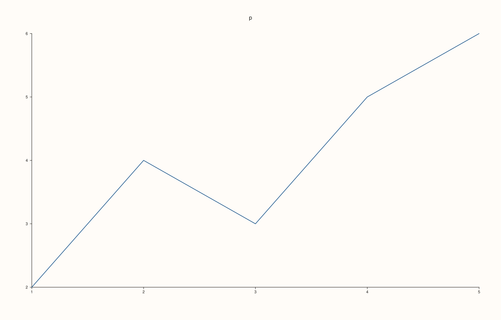
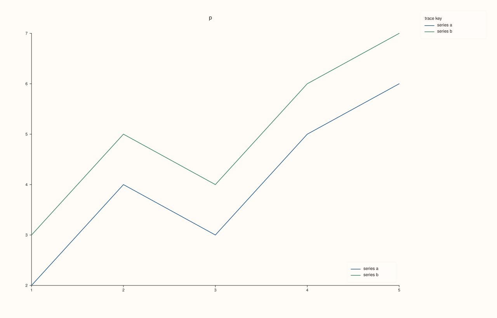

<!-- pluss-hand-authored -->

# Pane::legend

[Back to Pane API Reference](../../pane_api_reference)

## Signature

```cpp
Pane& Pane::legend(KeyPlace place) noexcept
```

## What It Does

Chooses where the pane draws its own legend, inside or beside its plot area: a box that lists the labelled traces of this pane, one entry per trace, with a sample of the trace's colour and shape and its label. [`Studio::legend`](../studio/legend.md) docks one legend for the whole figure instead; the two are independent and either, both or neither can be on.

| `KeyPlace` | Where the legend goes |
|---|---|
| `None` | Nowhere: no legend. The default. |
| `Auto` | The corner among NorthEast, NorthWest, SouthEast, SouthWest where the legend covers the least of what is drawn; ties go to the first of them in that order. |
| `NorthEast`, `NorthWest`, `SouthEast`, `SouthWest` | That corner of the plot area, inset slightly from the axes. |
| `OutsideEast` | Outside the plot area, to its right. The pane keeps its room for the legend. |

Only traces that have a [`label`](../trace/label.md) are listed, in the order they were added. A pane with no labelled trace draws no legend and keeps no room for it. The frame is chosen with [`legend_frame`](legend_frame.md) and the proportions of the box with [`legend_shape`](legend_shape.md); a label too long for the box wraps, and a label longer than four lines ends in "...".

## Parameters

**place** (`KeyPlace`)
    Where to draw the legend; `KeyPlace::None` turns it off.

## Returns

`Pane&`
    The same pane, for chaining.

## Examples

Example 1. The default is no inset legend: the traces carry labels, but nothing is drawn for them until a place is chosen.

```cpp
auto fig = studio("pane_legend_none");
auto& pane = fig.pane2("p");
pane.trend(std::vector<double>{1, 2, 3, 4, 5}, std::vector<double>{2, 4, 3, 5, 6}).label("series a");
pane.trend(std::vector<double>{1, 2, 3, 4, 5}, std::vector<double>{3, 5, 4, 6, 7}).label("series b");
const std::string svg = fig.to_svg();
std::cout << "place is None: " << (pane.legend_place() == KeyPlace::None) << "\n";
std::cout << "label drawn: " << (svg.find(">series a<") != std::string::npos) << "\n";
fig.save_svg("figure.svg");
```

### Output

```text
place is None: 1
label drawn: 0
```



Example 2. `KeyPlace::NorthEast`: the upper right corner of the plot area (the usual place). The position of the first entry's text, read from the figure, shows where the box went.

```cpp
auto fig = studio("pane_legend_northeast");
auto& pane = fig.pane2("p");
pane.trend(std::vector<double>{1, 2, 3, 4, 5}, std::vector<double>{2, 4, 3, 5, 6}).label("series a");
pane.trend(std::vector<double>{1, 2, 3, 4, 5}, std::vector<double>{3, 5, 4, 6, 7}).label("series b");
pane.legend(KeyPlace::NorthEast);
const std::string svg = fig.to_svg();
auto at = [](const std::string& svg, const std::string& text) {
  const auto hit = svg.find(">" + text + "<");
  if (hit == std::string::npos) return std::string("absent");
  const auto open = svg.rfind("<text", hit);
  auto number = [&](const char* key) {
    const auto k = svg.find(std::string(key) + "=\"", open) + std::string(key).size() + 2;
    return std::stod(svg.substr(k, svg.find('"', k) - k));
  };
  return "(" + std::to_string(static_cast<int>(number("x"))) + ", " + std::to_string(static_cast<int>(number("y"))) + ")";
};
std::cout << "series a at " << at(svg, "series a") << ", series b at " << at(svg, "series b") << "\n";
fig.save_svg("figure.svg");
```

### Output

```text
series a at (1132, 114), series b at (1132, 130)
```



Example 3. `KeyPlace::NorthWest`: the upper left corner. The position of the first entry's text, read from the figure, shows where the box went.

```cpp
auto fig = studio("pane_legend_northwest");
auto& pane = fig.pane2("p");
pane.trend(std::vector<double>{1, 2, 3, 4, 5}, std::vector<double>{2, 4, 3, 5, 6}).label("series a");
pane.trend(std::vector<double>{1, 2, 3, 4, 5}, std::vector<double>{3, 5, 4, 6, 7}).label("series b");
pane.legend(KeyPlace::NorthWest);
const std::string svg = fig.to_svg();
auto at = [](const std::string& svg, const std::string& text) {
  const auto hit = svg.find(">" + text + "<");
  if (hit == std::string::npos) return std::string("absent");
  const auto open = svg.rfind("<text", hit);
  auto number = [&](const char* key) {
    const auto k = svg.find(std::string(key) + "=\"", open) + std::string(key).size() + 2;
    return std::stod(svg.substr(k, svg.find('"', k) - k));
  };
  return "(" + std::to_string(static_cast<int>(number("x"))) + ", " + std::to_string(static_cast<int>(number("y"))) + ")";
};
std::cout << "series a at " << at(svg, "series a") << ", series b at " << at(svg, "series b") << "\n";
fig.save_svg("figure.svg");
```

### Output

```text
series a at (131, 114), series b at (131, 130)
```



Example 4. `KeyPlace::SouthEast`: the lower right corner. The position of the first entry's text, read from the figure, shows where the box went.

```cpp
auto fig = studio("pane_legend_southeast");
auto& pane = fig.pane2("p");
pane.trend(std::vector<double>{1, 2, 3, 4, 5}, std::vector<double>{2, 4, 3, 5, 6}).label("series a");
pane.trend(std::vector<double>{1, 2, 3, 4, 5}, std::vector<double>{3, 5, 4, 6, 7}).label("series b");
pane.legend(KeyPlace::SouthEast);
const std::string svg = fig.to_svg();
auto at = [](const std::string& svg, const std::string& text) {
  const auto hit = svg.find(">" + text + "<");
  if (hit == std::string::npos) return std::string("absent");
  const auto open = svg.rfind("<text", hit);
  auto number = [&](const char* key) {
    const auto k = svg.find(std::string(key) + "=\"", open) + std::string(key).size() + 2;
    return std::stod(svg.substr(k, svg.find('"', k) - k));
  };
  return "(" + std::to_string(static_cast<int>(number("x"))) + ", " + std::to_string(static_cast<int>(number("y"))) + ")";
};
std::cout << "series a at " << at(svg, "series a") << ", series b at " << at(svg, "series b") << "\n";
fig.save_svg("figure.svg");
```

### Output

```text
series a at (1132, 696), series b at (1132, 712)
```



Example 5. `KeyPlace::SouthWest`: the lower left corner. The position of the first entry's text, read from the figure, shows where the box went.

```cpp
auto fig = studio("pane_legend_southwest");
auto& pane = fig.pane2("p");
pane.trend(std::vector<double>{1, 2, 3, 4, 5}, std::vector<double>{2, 4, 3, 5, 6}).label("series a");
pane.trend(std::vector<double>{1, 2, 3, 4, 5}, std::vector<double>{3, 5, 4, 6, 7}).label("series b");
pane.legend(KeyPlace::SouthWest);
const std::string svg = fig.to_svg();
auto at = [](const std::string& svg, const std::string& text) {
  const auto hit = svg.find(">" + text + "<");
  if (hit == std::string::npos) return std::string("absent");
  const auto open = svg.rfind("<text", hit);
  auto number = [&](const char* key) {
    const auto k = svg.find(std::string(key) + "=\"", open) + std::string(key).size() + 2;
    return std::stod(svg.substr(k, svg.find('"', k) - k));
  };
  return "(" + std::to_string(static_cast<int>(number("x"))) + ", " + std::to_string(static_cast<int>(number("y"))) + ")";
};
std::cout << "series a at " << at(svg, "series a") << ", series b at " << at(svg, "series b") << "\n";
fig.save_svg("figure.svg");
```

### Output

```text
series a at (131, 696), series b at (131, 712)
```



Example 6. `KeyPlace::OutsideEast`: outside the plot area, to its right: the plot is left as wide as it was and the legend takes room beside it. The position of the first entry's text, read from the figure, shows where the box went.

```cpp
auto fig = studio("pane_legend_outsideeast");
auto& pane = fig.pane2("p");
pane.trend(std::vector<double>{1, 2, 3, 4, 5}, std::vector<double>{2, 4, 3, 5, 6}).label("series a");
pane.trend(std::vector<double>{1, 2, 3, 4, 5}, std::vector<double>{3, 5, 4, 6, 7}).label("series b");
pane.legend(KeyPlace::OutsideEast);
const std::string svg = fig.to_svg();
auto at = [](const std::string& svg, const std::string& text) {
  const auto hit = svg.find(">" + text + "<");
  if (hit == std::string::npos) return std::string("absent");
  const auto open = svg.rfind("<text", hit);
  auto number = [&](const char* key) {
    const auto k = svg.find(std::string(key) + "=\"", open) + std::string(key).size() + 2;
    return std::stod(svg.substr(k, svg.find('"', k) - k));
  };
  return "(" + std::to_string(static_cast<int>(number("x"))) + ", " + std::to_string(static_cast<int>(number("y"))) + ")";
};
std::cout << "series a at " << at(svg, "series a") << ", series b at " << at(svg, "series b") << "\n";
fig.save_svg("figure.svg");
```

### Output

```text
series a at (1104, 114), series b at (1104, 130)
```



Example 7. `KeyPlace::Auto` tries the four corners and takes the one where the legend covers the least of what is already drawn. Where the data runs from the upper left down to the lower right the upper right is free and `Auto` takes it; where it rises, the upper right is covered and `Auto` takes the upper left. The line is sampled along its length, so a line crossing a corner counts even with no data point in it. When two corners cover equally little, the first of NorthEast, NorthWest, SouthEast, SouthWest is taken.

```cpp
auto build = [&](bool falling, KeyPlace place) {
  auto fig = studio("pane_legend_auto");
  auto& pane = fig.pane2("p");
  std::vector<double> x{1, 2, 3, 4, 5};
  std::vector<double> a = falling ? std::vector<double>{6, 5, 4, 3, 2} : std::vector<double>{2, 3, 4, 5, 6};
  std::vector<double> b = falling ? std::vector<double>{5, 4, 3, 2, 1} : std::vector<double>{1, 2, 3, 4, 5};
  pane.trend(x, a).label("series a");
  pane.trend(x, b).label("series b");
  pane.legend(place);
  return fig.to_svg();
};
const KeyPlace corners[] = {KeyPlace::NorthEast, KeyPlace::NorthWest, KeyPlace::SouthEast, KeyPlace::SouthWest};
const char* names[] = {"NorthEast", "NorthWest", "SouthEast", "SouthWest"};
for (bool falling : {true, false}) {
  for (int i = 0; i < 4; ++i) {
    if (build(falling, KeyPlace::Auto) == build(falling, corners[i])) {
      std::cout << (falling ? "falling" : "rising ") << " data: Auto = " << names[i] << "\n";
      break;
    }
  }
}
auto fig = studio("pane_legend_auto_out");
auto& pane = fig.pane2("p");
pane.trend(std::vector<double>{1, 2, 3, 4, 5}, std::vector<double>{2, 3, 4, 5, 6}).label("series a");
pane.trend(std::vector<double>{1, 2, 3, 4, 5}, std::vector<double>{1, 2, 3, 4, 5}).label("series b");
pane.legend(KeyPlace::Auto);
fig.save_svg("figure.svg");
```

### Output

```text
falling data: Auto = NorthEast
rising  data: Auto = NorthWest
```



Example 8. Only labelled traces are listed. The second trace has no label and is not in the legend; a pane none of whose traces has a label draws no legend, and no room is kept for one.

```cpp
auto fig = studio("pane_legend_labelled");
auto& pane = fig.pane2("p");
pane.trend(std::vector<double>{1, 2, 3, 4}, std::vector<double>{2, 4, 3, 5}).label("measured");
pane.trend(std::vector<double>{1, 2, 3, 4}, std::vector<double>{1, 3, 2, 4});
pane.legend(KeyPlace::NorthWest);
const std::string svg = fig.to_svg();
std::cout << "measured listed: " << (svg.find(">measured<") != std::string::npos) << "\n";
auto bare = studio("pane_legend_unlabelled");
auto& other = bare.pane2("p");
other.trend(std::vector<double>{1, 2, 3, 4}, std::vector<double>{2, 4, 3, 5});
auto bare_plain = bare.to_svg();
other.legend(KeyPlace::OutsideEast);
std::cout << "unlabelled pane unchanged by an outside legend: " << (bare.to_svg() == bare_plain) << "\n";
fig.save_svg("figure.svg");
```

### Output

```text
measured listed: 1
unlabelled pane unchanged by an outside legend: 1
```



Example 9. Turning it off again. `legend(KeyPlace::None)` removes the inset legend; the figure is the figure that never had one.

```cpp
auto build = [&](bool toggled) {
  auto fig = studio("pane_legend_off");
  auto& pane = fig.pane2("p");
  pane.trend(std::vector<double>{1, 2, 3, 4, 5}, std::vector<double>{2, 4, 3, 5, 6}).label("series a");
  if (toggled) {
    pane.legend(KeyPlace::NorthEast);
    pane.legend(KeyPlace::None);
  }
  return fig.to_svg();
};
std::cout << "same as never set: " << (build(true) == build(false)) << "\n";
auto fig = studio("pane_legend_off_out");
auto& pane = fig.pane2("p");
pane.trend(std::vector<double>{1, 2, 3, 4, 5}, std::vector<double>{2, 4, 3, 5, 6}).label("series a");
fig.save_svg("figure.svg");
```

### Output

```text
same as never set: 1
```



Example 10. A pane's own legend and the figure's docked legend are separate. Here the pane lists its two series inside its plot area, and the figure docks a legend of all labelled traces to the east; each is drawn where it was asked.

```cpp
auto fig = studio("pane_legend_both");
auto& pane = fig.pane2("p");
pane.trend(std::vector<double>{1, 2, 3, 4, 5}, std::vector<double>{2, 4, 3, 5, 6}).label("series a");
pane.trend(std::vector<double>{1, 2, 3, 4, 5}, std::vector<double>{3, 5, 4, 6, 7}).label("series b");
pane.legend(KeyPlace::SouthEast);
fig.legend(KeyDock::East);
const std::string svg = fig.to_svg();
const auto first = svg.find(">series a<");
std::cout << "series a drawn twice: " << (first != std::string::npos && svg.find(">series a<", first + 1) != std::string::npos) << "\n";
fig.save_svg("figure.svg");
```

### Output

```text
series a drawn twice: 1
```



## Notes

- `noexcept`; no value is invalid.
- The request is stored as given: [`legend_place`](legend_place.md) returns `Auto` after `legend(KeyPlace::Auto)`, not the corner it resolved to; the corner is chosen each time the figure is drawn, from the data as it is then.
- A corner legend sits over the plot area. It is placed clear of the data only by `Auto`; the explicit corners go where they are told.

## See Also

- [`Pane::legend_place`](legend_place.md): read the request back.
- [`Pane::legend_frame`](legend_frame.md), [`legend_shape`](legend_shape.md): the frame and proportions.
- [`Studio::legend`](../studio/legend.md): the legend of the whole figure.
- [`Trace::label`](../trace/label.md): the text of an entry.

<div class="pluss-inline-prev-next">
  <a class="prev-link" href="lattice.html">
    <span class="label">Previous</span>
    <span class="title">lattice</span>
  </a>
  <a class="next-link" href="legend_frame.html">
    <span class="label">Next</span>
    <span class="title">legend_frame</span>
  </a>
</div>
