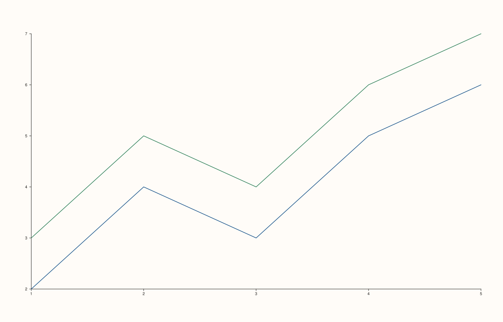
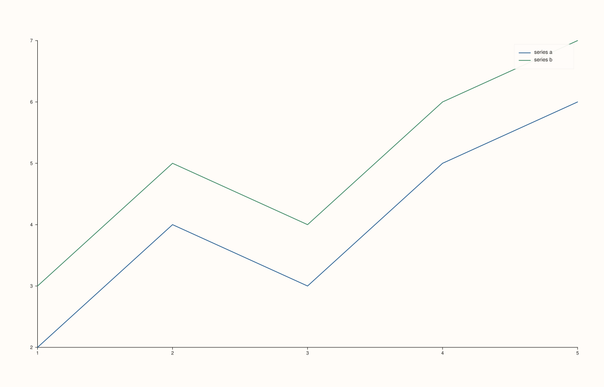
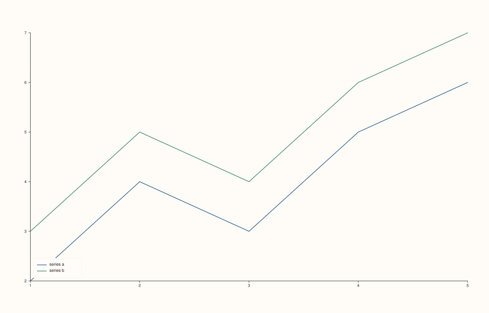
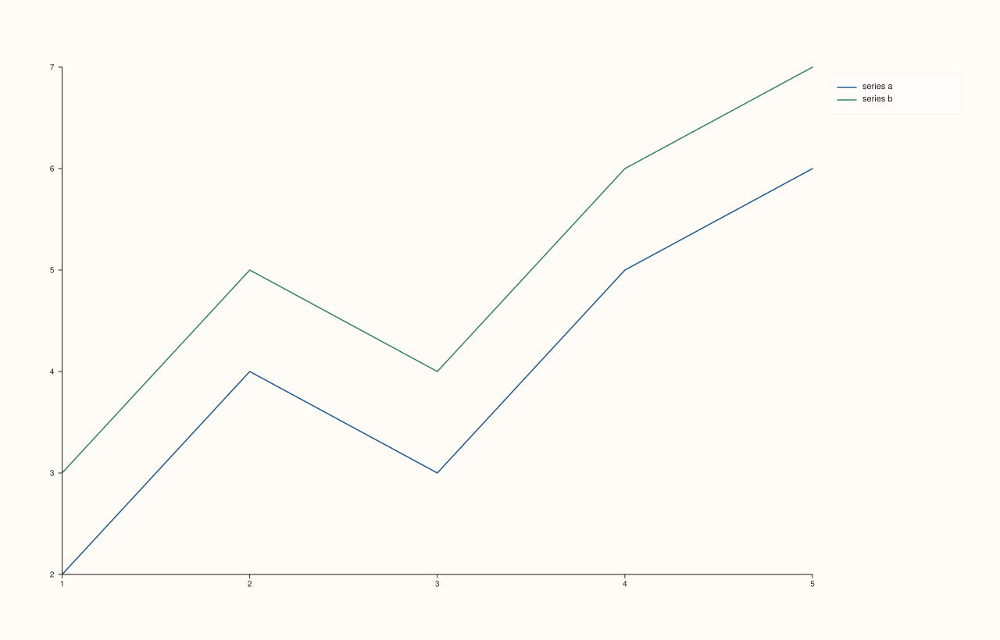

<!-- pluss-hand-authored -->

# Pane::legend

[Back to Pane API Reference](../../pane_api_reference)

## Signature

```cpp
Pane& Pane::legend(KeyPlace place) noexcept
```

## What It Does

Turns on (or off, or repositions) this pane's own **inset legend** — drawn *inside* the
pane's own plot area, as opposed to [`Studio::legend(KeyDock)`](../studio/legend.md), which
docks one consolidated legend to an edge of the whole figure, pooling every visible pane's
labeled traces. The two mechanisms are independent and can be mixed freely.

`KeyPlace` has seven values — far more placement granularity than `Studio`'s three-value
`KeyDock`, since an inset legend needs to fit into a specific corner or edge of a single
plot area without covering the data:

- **`KeyPlace::None`** — the constructor default. No inset legend.
- **`KeyPlace::Auto`** — picks a corner automatically, aiming to avoid overlapping the
  plotted data. See the important callout below for what was actually observed.
- **`KeyPlace::NorthEast`**, **`NorthWest`**, **`SouthEast`**, **`SouthWest`** — the four
  corners, inside the plot area.
- **`KeyPlace::OutsideEast`** — outside the plot area entirely, to its right.

Only traces with a [`label()`](../trace/label.md) appear in this legend, exactly like the
figure-wide docked legend.

```{important} Auto was observed to resolve to NorthEast for simple ascending data
Directly tested: for a two-series ascending line plot, `KeyPlace::Auto` produced
byte-for-byte identical output to explicit `KeyPlace::NorthEast` — consistent with `Auto`
picking whichever corner the data leaves clearest, and an upward trend leaving the
top-right corner empty in this case. This is an observed result for the data tested, not
a documented guarantee that `Auto` always resolves to `NorthEast` — different data shapes
would be expected to make `Auto` choose differently.
```

## Parameters

**place** (`KeyPlace`)
    Where to draw the inset legend, or `KeyPlace::None` to turn it off.

## Returns

`Pane&`
    A reference to the same pane, for chaining.

## Examples

Example 1. The default: no inset legend.

```cpp
using namespace pluss::pl;

auto fig = studio("pane_legend_none");
auto& pane = fig.pane2();
pane.trend(std::vector<double>{1.0, 2.0, 3.0, 4.0, 5.0}, std::vector<double>{2.0, 4.0, 3.0, 5.0, 6.0}).label("series a");
pane.trend(std::vector<double>{1.0, 2.0, 3.0, 4.0, 5.0}, std::vector<double>{3.0, 5.0, 4.0, 6.0, 7.0}).label("series b");
fig.show();

std::cout << (pane.legend_place() == KeyPlace::None) << "\n";
```

### Output

```text
1
```



Example 2. `KeyPlace::Auto` — see the important callout above for what it resolved to
here.

```cpp
using namespace pluss::pl;

auto fig = studio("pane_legend_auto");
auto& pane = fig.pane2();
pane.trend(std::vector<double>{1.0, 2.0, 3.0, 4.0, 5.0}, std::vector<double>{2.0, 4.0, 3.0, 5.0, 6.0}).label("series a");
pane.trend(std::vector<double>{1.0, 2.0, 3.0, 4.0, 5.0}, std::vector<double>{3.0, 5.0, 4.0, 6.0, 7.0}).label("series b");
pane.legend(KeyPlace::Auto);
fig.show();
```



Example 3 and 4. `KeyPlace::NorthEast` and `KeyPlace::SouthWest` — verified via direct SVG
diff to render genuinely different placements.

```cpp
using namespace pluss::pl;

auto fig1 = studio("pane_legend_northeast");
auto& pane1 = fig1.pane2();
pane1.trend(std::vector<double>{1.0, 2.0, 3.0, 4.0, 5.0}, std::vector<double>{2.0, 4.0, 3.0, 5.0, 6.0}).label("series a");
pane1.trend(std::vector<double>{1.0, 2.0, 3.0, 4.0, 5.0}, std::vector<double>{3.0, 5.0, 4.0, 6.0, 7.0}).label("series b");
pane1.legend(KeyPlace::NorthEast);
fig1.show();

auto fig2 = studio("pane_legend_southwest");
auto& pane2 = fig2.pane2();
pane2.trend(std::vector<double>{1.0, 2.0, 3.0, 4.0, 5.0}, std::vector<double>{2.0, 4.0, 3.0, 5.0, 6.0}).label("series a");
pane2.trend(std::vector<double>{1.0, 2.0, 3.0, 4.0, 5.0}, std::vector<double>{3.0, 5.0, 4.0, 6.0, 7.0}).label("series b");
pane2.legend(KeyPlace::SouthWest);
fig2.show();

std::cout << (fig1.to_svg() != fig2.to_svg()) << "\n";
```

### Output

```text
1
```




Example 5. `KeyPlace::OutsideEast` — outside the plot area, to the right, rather than
inset into one of its corners.

```cpp
using namespace pluss::pl;

auto fig = studio("pane_legend_outsideeast");
auto& pane = fig.pane2();
pane.trend(std::vector<double>{1.0, 2.0, 3.0, 4.0, 5.0}, std::vector<double>{2.0, 4.0, 3.0, 5.0, 6.0}).label("series a");
pane.trend(std::vector<double>{1.0, 2.0, 3.0, 4.0, 5.0}, std::vector<double>{3.0, 5.0, 4.0, 6.0, 7.0}).label("series b");
pane.legend(KeyPlace::OutsideEast);
fig.show();
```



## Notes

- `noexcept`.
- `KeyPlace::None` is `0`, `Auto` is `1`, `NorthEast` is `2`, `NorthWest` is `3`,
  `SouthEast` is `4`, `SouthWest` is `5`, `OutsideEast` is `6`.
- Independent of, and additive with, [`Studio::legend(KeyDock)`](../studio/legend.md) — a
  figure can show both a per-pane inset legend and a figure-wide docked legend
  simultaneously.
- Only traces with a [`label()`](../trace/label.md) contribute an entry.
- `OutsideEast` is the only value that draws the legend *outside* the plot area rather
  than inset into a corner.

## See Also

- [`Pane::legend_place`](legend_place.md): reads back the current placement.
- [`Pane::legend_frame`](legend_frame.md) / [`Pane::legend_shape`](legend_shape.md): the
  frame style and layout of this same inset legend.
- [`Studio::legend`](../studio/legend.md): the independent, figure-wide docked legend.
- [`Trace::label`](../trace/label.md): what makes a trace eligible to appear in any
  legend.

<div class="pluss-inline-prev-next">
  <a class="prev-link" href="z_categories.html">
    <span class="label">Previous</span>
    <span class="title">z_categories</span>
  </a>
  <a class="next-link" href="legend_place.html">
    <span class="label">Next</span>
    <span class="title">legend_place</span>
  </a>
</div>
