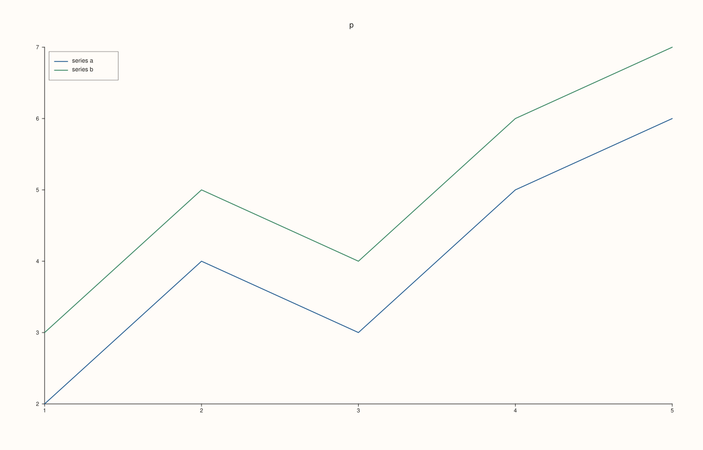
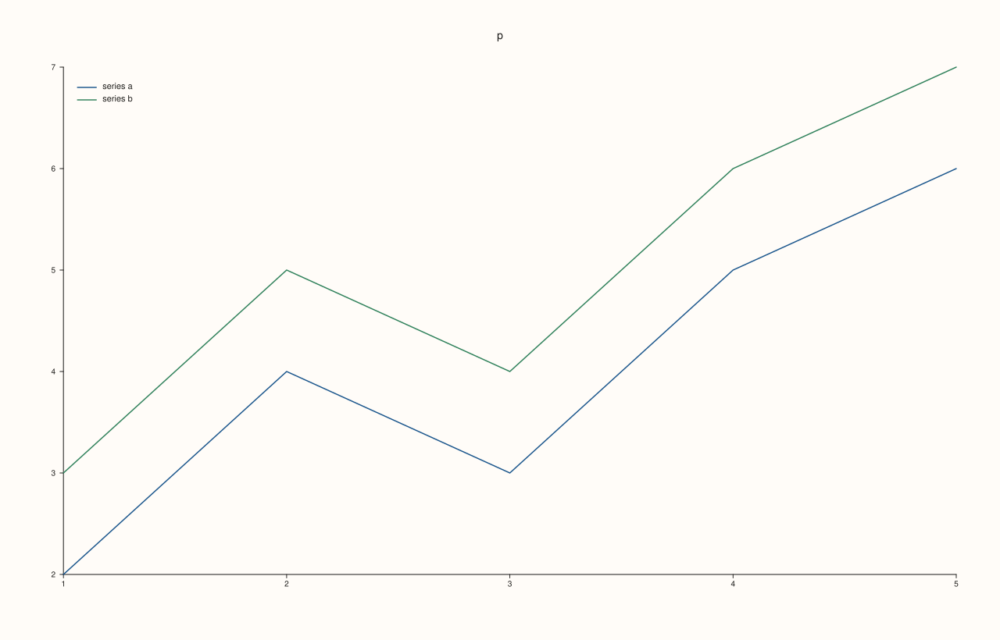
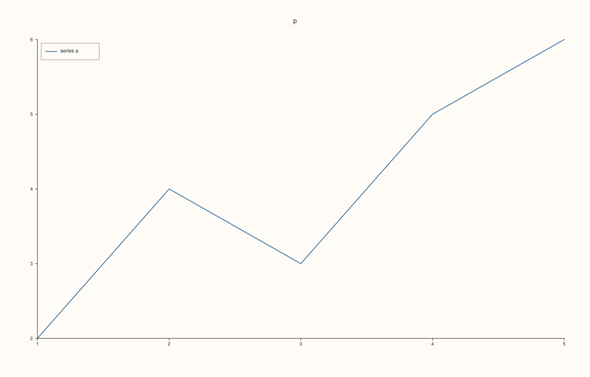
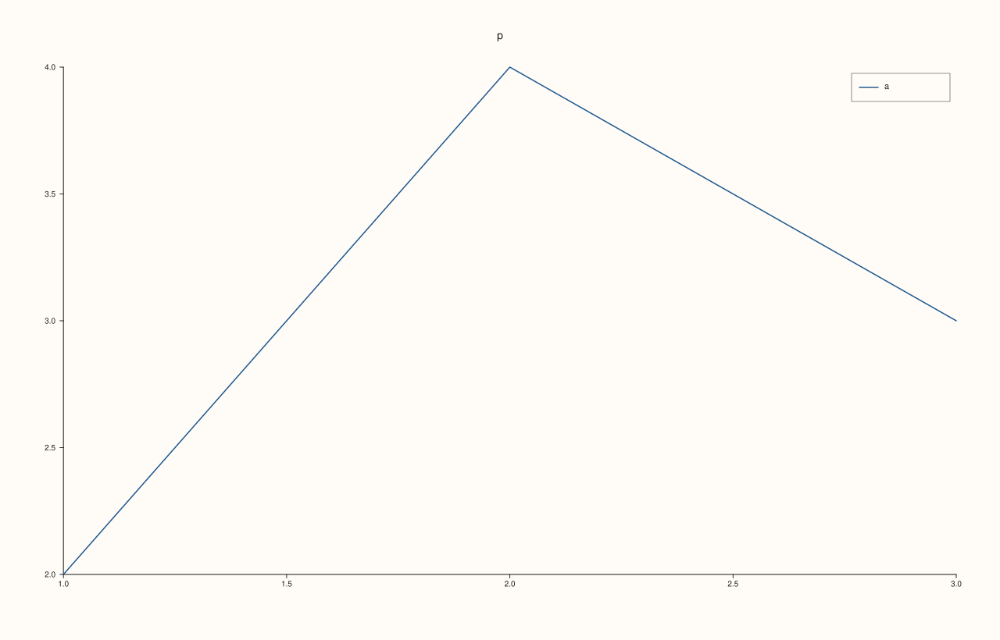

<!-- pluss-hand-authored -->

# Pane::legend_frame

[Back to Pane API Reference](../../pane_api_reference)

## Signature

```cpp
Pane& Pane::legend_frame(KeyFrame frame) noexcept
KeyFrame Pane::legend_frame() const noexcept
```

## What It Does

Chooses how the pane's own legend ([`legend`](legend.md)) is boxed, and reads the choice back. The same `KeyFrame` values style the figure's docked legend through [`Studio::legend_frame`](../studio/legend_frame.md); this one applies to this pane's legend only.

| `KeyFrame` | Drawing |
|---|---|
| `Framed` | A solid background and a border. The legend stands apart from the data. |
| `Soft` | A faint background, no border. The default. |
| `None` | Neither: the entries are drawn directly on the plot. |

The setter and the getter share a name; the call with an argument sets, the call without one reads.

## Parameters

**frame** (`KeyFrame`, setter only)
    `Framed`, `Soft` or `None`.

## Returns

**Setter:** `Pane&`, the same pane.
**Getter:** `KeyFrame`, the frame in force.

## Examples

Example 1. The default is `Soft`: a quiet background behind the entries, with no hard border.

```cpp
auto fig = studio("legend_frame_default");
auto& pane = fig.pane2("p");
pane.trend(std::vector<double>{1, 2, 3, 4, 5}, std::vector<double>{2, 4, 3, 5, 6}).label("series a");
pane.trend(std::vector<double>{1, 2, 3, 4, 5}, std::vector<double>{3, 5, 4, 6, 7}).label("series b");
pane.legend(KeyPlace::NorthWest);
std::cout << "Soft: " << (pane.legend_frame() == KeyFrame::Soft) << "\n";
fig.save_svg("figure.svg");
```

### Output

```text
Soft: 1
```


Example 2. `KeyFrame::Framed`: a solid background with a border.

```cpp
auto fig = studio("legend_frame_framed");
auto& pane = fig.pane2("p");
pane.trend(std::vector<double>{1, 2, 3, 4, 5}, std::vector<double>{2, 4, 3, 5, 6}).label("series a");
pane.trend(std::vector<double>{1, 2, 3, 4, 5}, std::vector<double>{3, 5, 4, 6, 7}).label("series b");
pane.legend(KeyPlace::NorthWest);
pane.legend_frame(KeyFrame::Framed);
std::cout << "reads back Framed: " << (pane.legend_frame() == KeyFrame::Framed) << "\n";
fig.save_svg("figure.svg");
```

### Output

```text
reads back Framed: 1
```



Example 3. `KeyFrame::Soft`: a faint background, no border.

```cpp
auto fig = studio("legend_frame_soft");
auto& pane = fig.pane2("p");
pane.trend(std::vector<double>{1, 2, 3, 4, 5}, std::vector<double>{2, 4, 3, 5, 6}).label("series a");
pane.trend(std::vector<double>{1, 2, 3, 4, 5}, std::vector<double>{3, 5, 4, 6, 7}).label("series b");
pane.legend(KeyPlace::NorthWest);
pane.legend_frame(KeyFrame::Soft);
std::cout << "reads back Soft: " << (pane.legend_frame() == KeyFrame::Soft) << "\n";
fig.save_svg("figure.svg");
```

### Output

```text
reads back Soft: 1
```


Example 4. `KeyFrame::None`: no background and no border: the entries sit directly on the plot.

```cpp
auto fig = studio("legend_frame_none");
auto& pane = fig.pane2("p");
pane.trend(std::vector<double>{1, 2, 3, 4, 5}, std::vector<double>{2, 4, 3, 5, 6}).label("series a");
pane.trend(std::vector<double>{1, 2, 3, 4, 5}, std::vector<double>{3, 5, 4, 6, 7}).label("series b");
pane.legend(KeyPlace::NorthWest);
pane.legend_frame(KeyFrame::None);
std::cout << "reads back None: " << (pane.legend_frame() == KeyFrame::None) << "\n";
fig.save_svg("figure.svg");
```

### Output

```text
reads back None: 1
```



Example 5. The three frames are three different drawings. Comparing the figures of the same pane with each frame shows that none of them equals another.

```cpp
auto build = [&](KeyFrame frame) {
  auto fig = studio("legend_frame_compare");
  auto& pane = fig.pane2("p");
  pane.trend(std::vector<double>{1, 2, 3, 4, 5}, std::vector<double>{2, 4, 3, 5, 6}).label("series a");
  pane.legend(KeyPlace::NorthWest);
  pane.legend_frame(frame);
  return fig.to_svg();
};
const auto framed = build(KeyFrame::Framed), soft = build(KeyFrame::Soft), none = build(KeyFrame::None);
std::cout << "framed != soft: " << (framed != soft) << ", soft != none: " << (soft != none) << ", framed != none: " << (framed != none) << "\n";
auto fig = studio("legend_frame_compare_out");
auto& pane = fig.pane2("p");
pane.trend(std::vector<double>{1, 2, 3, 4, 5}, std::vector<double>{2, 4, 3, 5, 6}).label("series a");
pane.legend(KeyPlace::NorthWest).legend_frame(KeyFrame::Framed);
fig.save_svg("figure.svg");
```

### Output

```text
framed != soft: 1, soft != none: 1, framed != none: 1
```



Example 6. Without a legend the frame has nothing to apply to: it is stored, the figure is unchanged, and it takes effect when a legend is turned on.

```cpp
auto build = [&](bool framed) {
  auto fig = studio("legend_frame_unused");
  auto& pane = fig.pane2("p");
  pane.trend(std::vector<double>{1, 2, 3}, std::vector<double>{2, 4, 3}).label("a");
  if (framed) pane.legend_frame(KeyFrame::Framed);
  return fig.to_svg();
};
std::cout << "unchanged without a legend: " << (build(true) == build(false)) << "\n";
auto fig = studio("legend_frame_unused_out");
auto& pane = fig.pane2("p");
pane.trend(std::vector<double>{1, 2, 3}, std::vector<double>{2, 4, 3}).label("a");
pane.legend_frame(KeyFrame::Framed).legend(KeyPlace::NorthEast);
fig.save_svg("figure.svg");
```

### Output

```text
unchanged without a legend: 1
```



## Notes

- Both forms are `noexcept`.
- The frame is stored whether or not the pane has a legend; it is drawn when there is one.

## See Also

- [`Pane::legend`](legend.md): turn the legend on and place it.
- [`Pane::legend_shape`](legend_shape.md): the proportions of the box.
- [`Studio::legend_frame`](../studio/legend_frame.md): the same for the docked legend.
- [`KeyFrame`](../types/KeyFrame.md): the values it takes.

<div class="pluss-inline-prev-next">
  <a class="prev-link" href="legend.html">
    <span class="label">Previous</span>
    <span class="title">legend</span>
  </a>
  <a class="next-link" href="legend_place.html">
    <span class="label">Next</span>
    <span class="title">legend_place</span>
  </a>
</div>
