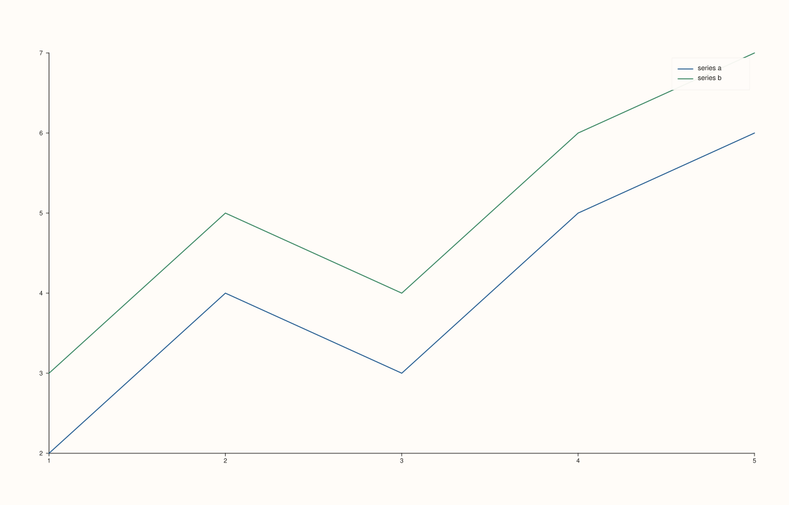
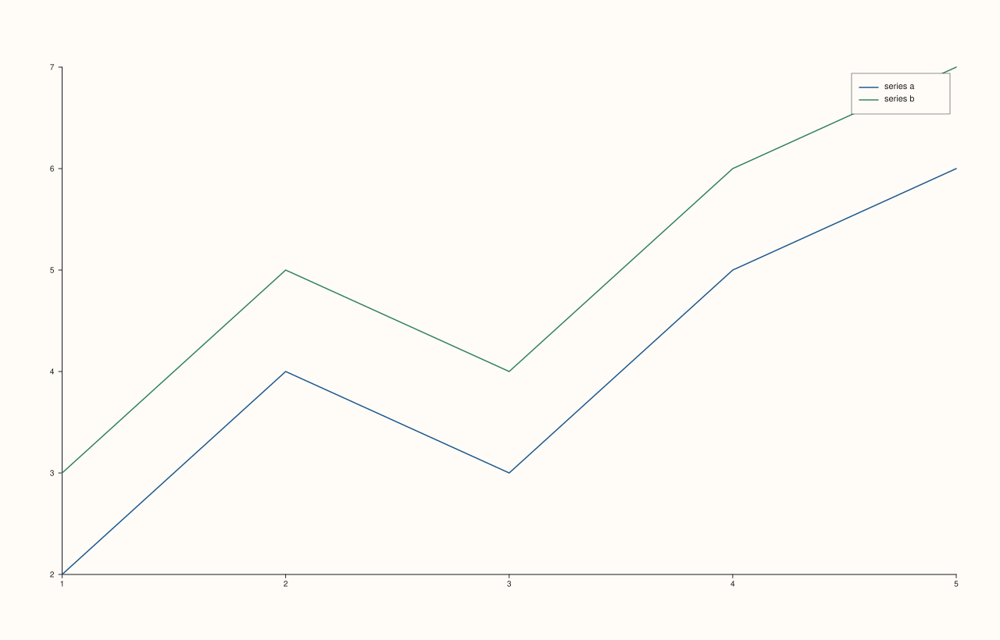
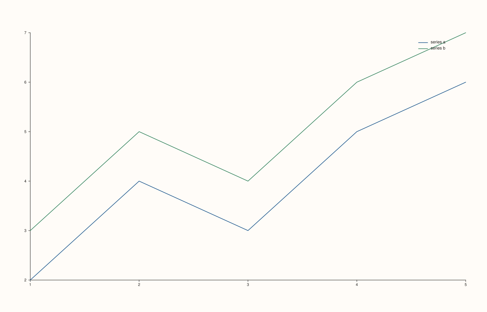

<!-- pluss-hand-authored -->

# Pane::legend_frame

[Back to Pane API Reference](../../pane_api_reference)

## Signatures

```cpp
Pane& Pane::legend_frame(KeyFrame frame) noexcept   // setter
KeyFrame Pane::legend_frame() const noexcept         // getter
```

## What It Does

Controls the border/background styling drawn around this pane's own inset legend (enabled
by [`legend(KeyPlace)`](legend.md)) — the exact same `KeyFrame` mechanism and default as
[`Studio::legend_frame`](../studio/legend_frame.md), just scoped to this one pane's inset
legend instead of the figure-wide docked one.

`KeyFrame` has three values: `KeyFrame::Framed` (solid border and background),
`KeyFrame::Soft` (the constructor default — a soft, low-contrast background, no hard
border), and `KeyFrame::None` (no background or border at all).

Both the setter and getter share the name `legend_frame` — overload resolution picks the
right one from the argument count.

## Parameters

**frame** (`KeyFrame`, setter only)
    The frame style: `Framed`, `Soft`, or `None`.

## Returns

**Setter:** `Pane&` — a reference to the same pane, for chaining.

**Getter:** `KeyFrame` — the current frame style.

## Examples

Example 1. The default (`Soft`), with an inset legend enabled.

```cpp
using namespace pluss::pl;

auto fig = studio("pane_legend_frame_default");
auto& pane = fig.pane2();
pane.trend(std::vector<double>{1.0, 2.0, 3.0, 4.0, 5.0}, std::vector<double>{2.0, 4.0, 3.0, 5.0, 6.0}).label("series a");
pane.trend(std::vector<double>{1.0, 2.0, 3.0, 4.0, 5.0}, std::vector<double>{3.0, 5.0, 4.0, 6.0, 7.0}).label("series b");
pane.legend(KeyPlace::NorthEast);
fig.show();

std::cout << (pane.legend_frame() == KeyFrame::Soft) << "\n";
```

### Output

```text
1
```



Example 2. `KeyFrame::Framed`.

```cpp
using namespace pluss::pl;

auto fig = studio("pane_legend_frame_framed");
auto& pane = fig.pane2();
pane.trend(std::vector<double>{1.0, 2.0, 3.0, 4.0, 5.0}, std::vector<double>{2.0, 4.0, 3.0, 5.0, 6.0}).label("series a");
pane.trend(std::vector<double>{1.0, 2.0, 3.0, 4.0, 5.0}, std::vector<double>{3.0, 5.0, 4.0, 6.0, 7.0}).label("series b");
pane.legend(KeyPlace::NorthEast).legend_frame(KeyFrame::Framed);
fig.show();
```



Example 3. `KeyFrame::None`.

```cpp
using namespace pluss::pl;

auto fig = studio("pane_legend_frame_none");
auto& pane = fig.pane2();
pane.trend(std::vector<double>{1.0, 2.0, 3.0, 4.0, 5.0}, std::vector<double>{2.0, 4.0, 3.0, 5.0, 6.0}).label("series a");
pane.trend(std::vector<double>{1.0, 2.0, 3.0, 4.0, 5.0}, std::vector<double>{3.0, 5.0, 4.0, 6.0, 7.0}).label("series b");
pane.legend(KeyPlace::NorthEast).legend_frame(KeyFrame::None);
fig.show();
```



## Notes

- Both overloads are `noexcept`.
- `KeyFrame::Framed` is `0`, `Soft` is `1`, `None` is `2`.
- Only has a visible effect once [`legend(KeyPlace)`](legend.md) is set to something other
  than `KeyPlace::None`.

## See Also

- [`Pane::legend`](legend.md): turns the inset legend on and picks its placement.
- [`Pane::legend_shape`](legend_shape.md): layout of the same inset legend.
- [`Studio::legend_frame`](../studio/legend_frame.md): the equivalent for the figure-wide
  docked legend.

<div class="pluss-inline-prev-next">
  <a class="prev-link" href="legend_place.html">
    <span class="label">Previous</span>
    <span class="title">legend_place</span>
  </a>
  <a class="next-link" href="legend_shape.html">
    <span class="label">Next</span>
    <span class="title">legend_shape</span>
  </a>
</div>
