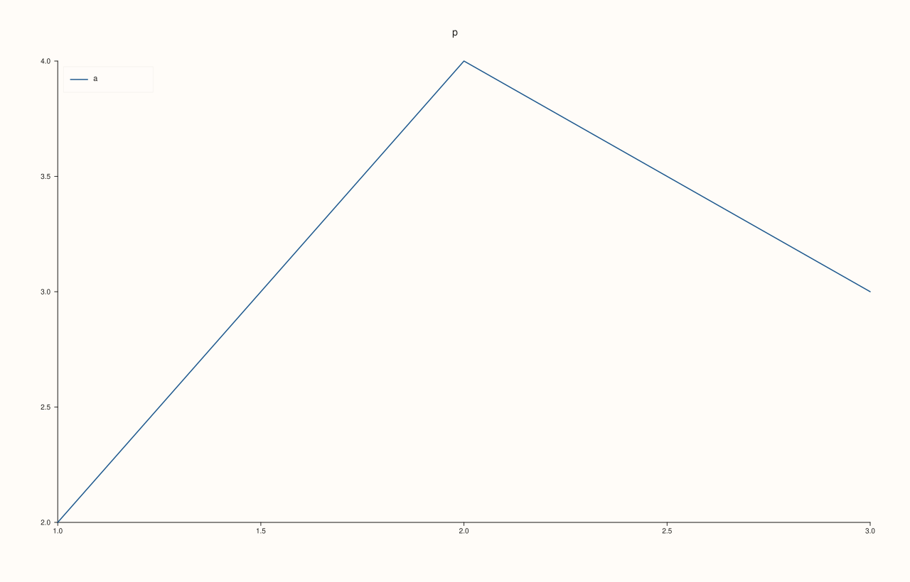
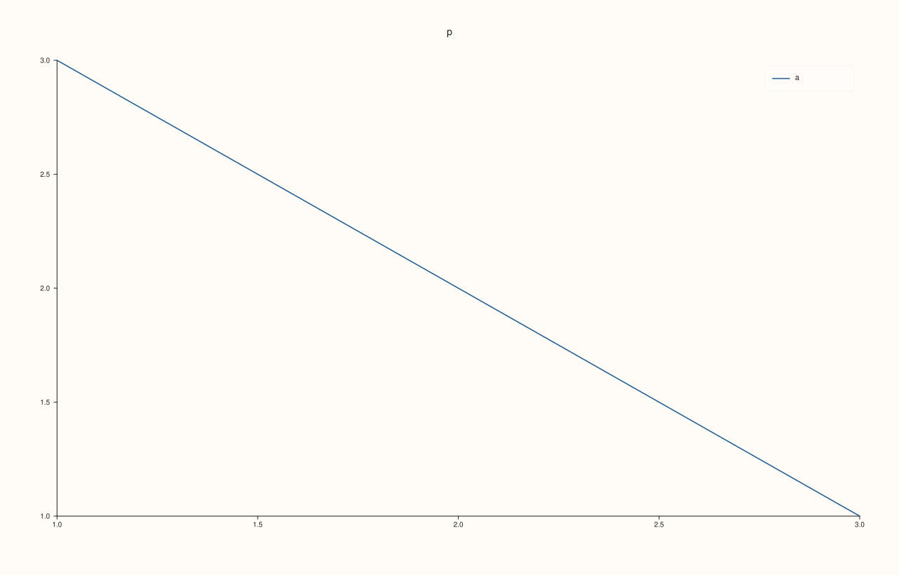
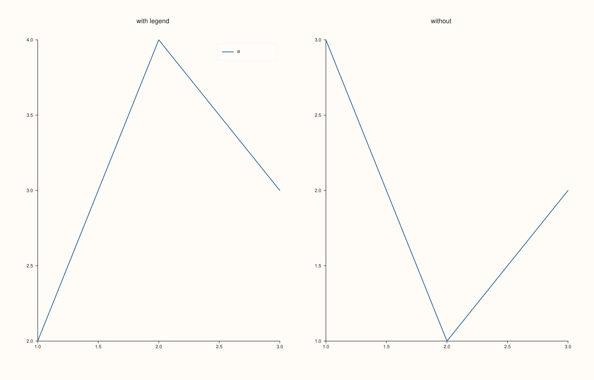

<!-- pluss-hand-authored -->

# Pane::legend_place

[Back to Pane API Reference](../../pane_api_reference)

## Signature

```cpp
KeyPlace Pane::legend_place() const noexcept
```

## What It Does

Returns the placement most recently given to [`legend`](legend.md): `None` (the default), `Auto`, `NorthEast`, `NorthWest`, `SouthEast`, `SouthWest` or `OutsideEast`.

It returns the request, not the result. After `legend(KeyPlace::Auto)` it returns `Auto`, whatever corner the figure then draws the legend in; the corner is chosen when the figure is drawn. Use it to find out whether a pane has an inset legend at all (anything but `None`) before adding a figure-level legend that would repeat it.

## Parameters

*(none)*

## Returns

`KeyPlace`
    The placement last set, `None` for a pane that was never given one.

## Examples

Example 1. A new pane has no inset legend.

```cpp
auto fig = studio("legend_place_default");
auto& pane = fig.pane2("p");
pane.trend(std::vector<double>{1, 2, 3}, std::vector<double>{2, 4, 3}).label("a");
std::cout << "None: " << (pane.legend_place() == KeyPlace::None) << "\n";
fig.save_svg("figure.svg");
```

### Output

```text
None: 1
```


Example 2. Every placement reads back as set.

```cpp
auto fig = studio("legend_place_each");
auto& pane = fig.pane2("p");
pane.trend(std::vector<double>{1, 2, 3}, std::vector<double>{2, 4, 3}).label("a");
const KeyPlace places[] = {KeyPlace::Auto, KeyPlace::NorthEast, KeyPlace::NorthWest, KeyPlace::SouthEast, KeyPlace::SouthWest, KeyPlace::OutsideEast, KeyPlace::None};
const char* names[] = {"Auto", "NorthEast", "NorthWest", "SouthEast", "SouthWest", "OutsideEast", "None"};
for (int i = 0; i < 7; ++i) {
  pane.legend(places[i]);
  std::cout << names[i] << ": " << (pane.legend_place() == places[i]) << "\n";
}
pane.legend(KeyPlace::NorthWest);
fig.save_svg("figure.svg");
```

### Output

```text
Auto: 1
NorthEast: 1
NorthWest: 1
SouthEast: 1
SouthWest: 1
OutsideEast: 1
None: 1
```



Example 3. `Auto` is a request. The figure draws the legend in one of the four corners, but the accessor still returns `Auto`.

```cpp
auto fig = studio("legend_place_auto");
auto& pane = fig.pane2("p");
pane.trend(std::vector<double>{1, 2, 3}, std::vector<double>{3, 2, 1}).label("a");
pane.legend(KeyPlace::Auto);
fig.to_svg();
std::cout << "still Auto after drawing: " << (pane.legend_place() == KeyPlace::Auto) << "\n";
fig.save_svg("figure.svg");
```

### Output

```text
still Auto after drawing: 1
```



Example 4. Deciding whether a pane already has a legend. A figure-level legend is added only for panes that have none of their own.

```cpp
auto fig = studio("legend_place_decide");
fig.mosaic(1, 2);
auto& left = fig.pane2("with legend");
left.trend(std::vector<double>{1, 2, 3}, std::vector<double>{2, 4, 3}).label("a");
left.legend(KeyPlace::NorthEast);
auto& right = fig.pane2("without");
right.trend(std::vector<double>{1, 2, 3}, std::vector<double>{3, 1, 2}).label("b");
for (const auto& pane : fig.panes()) {
  std::cout << pane.title_text() << ": " << (pane.legend_place() != KeyPlace::None ? "has its own legend" : "needs one") << "\n";
}
fig.save_svg("figure.svg");
```

### Output

```text
with legend: has its own legend
without: needs one
```



## Notes

- `noexcept`; reads only.

## See Also

- [`Pane::legend`](legend.md): set the placement.
- [`Pane::legend_frame`](legend_frame.md), [`legend_shape`](legend_shape.md): the other legend settings.

<div class="pluss-inline-prev-next">
  <a class="prev-link" href="legend_frame.html">
    <span class="label">Previous</span>
    <span class="title">legend_frame</span>
  </a>
  <a class="next-link" href="legend_shape.html">
    <span class="label">Next</span>
    <span class="title">legend_shape</span>
  </a>
</div>
