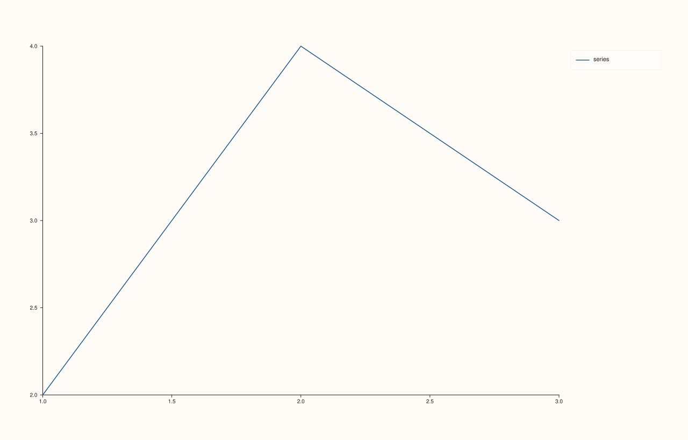

<!-- pluss-hand-authored -->

# Pane::legend_place

[Back to Pane API Reference](../../pane_api_reference)

## Signature

```cpp
KeyPlace Pane::legend_place() const noexcept
```

## What It Does

Returns this pane's current inset-legend placement — whatever
[`legend(KeyPlace)`](legend.md) last set it to, or `KeyPlace::None` (the constructor
default, meaning no inset legend) if `legend()` was never called.

## Parameters

*(none)*

## Returns

`KeyPlace`
    The current placement: `None`, `Auto`, `NorthEast`, `NorthWest`, `SouthEast`,
    `SouthWest`, or `OutsideEast`.

## Examples

Example 1. The default, and after switching it on.

```cpp
using namespace pluss::pl;

auto fig = studio("legend_place_check");
auto& pane = fig.pane2();
pane.trend(std::vector<double>{1.0, 2.0, 3.0}, std::vector<double>{2.0, 4.0, 3.0}).label("series");
std::cout << static_cast<int>(pane.legend_place()) << "\n";  // None == 0

pane.legend(KeyPlace::NorthEast);
std::cout << static_cast<int>(pane.legend_place()) << "\n";  // NorthEast == 2

pane.legend(KeyPlace::OutsideEast);
std::cout << static_cast<int>(pane.legend_place()) << "\n";  // OutsideEast == 6

fig.show();
```

### Output

```text
0
2
6
```



## Notes

- `noexcept`.
- Purely a readback of the value set by `legend(KeyPlace)`; has no side effect on
  rendering itself.

## See Also

- [`Pane::legend`](legend.md): the only way to change this.

<div class="pluss-inline-prev-next">
  <a class="prev-link" href="legend.html">
    <span class="label">Previous</span>
    <span class="title">legend</span>
  </a>
  <a class="next-link" href="legend_frame.html">
    <span class="label">Next</span>
    <span class="title">legend_frame</span>
  </a>
</div>
