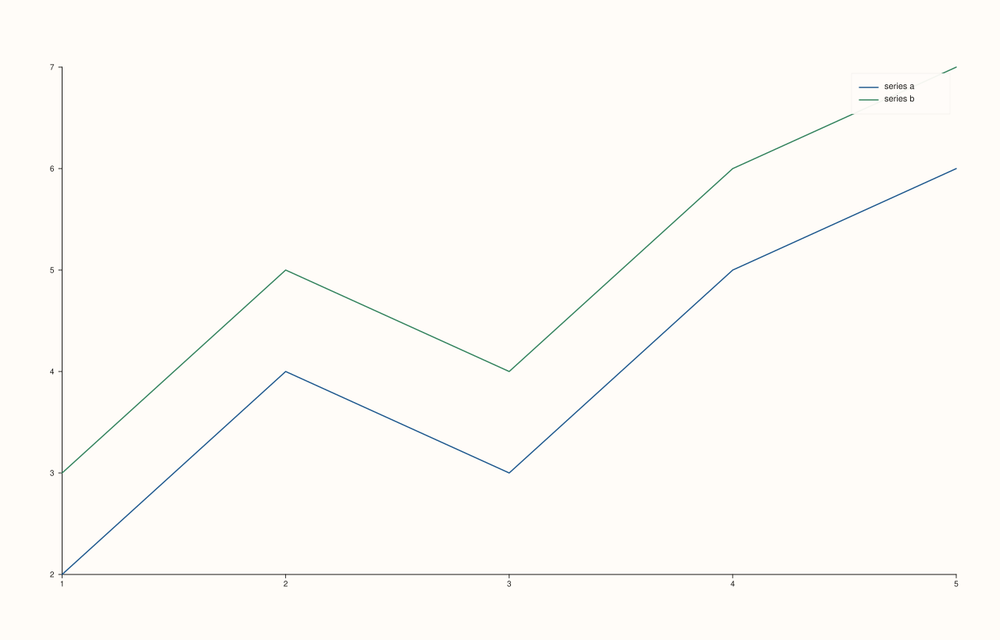

<!-- pluss-hand-authored -->

# Pane::legend_shape

[Back to Pane API Reference](../../pane_api_reference)

## Signatures

```cpp
Pane& Pane::legend_shape(KeyShape shape) noexcept   // setter
KeyShape Pane::legend_shape() const noexcept         // getter
```

## What It Does

Controls whether the entries in this pane's inset legend (enabled by
[`legend(KeyPlace)`](legend.md)) are laid out as a horizontal row or a vertical column —
the same `KeyShape` mechanism as
[`Studio::legend_shape`](../studio/legend_shape.md), scoped to this pane's inset legend.

`KeyShape` has three values: `KeyShape::Auto` (the constructor default — for an inset
legend, resolves to a vertical column, unlike `Studio`'s dock-edge-dependent resolution),
`KeyShape::Horizontal`, and `KeyShape::Vertical`.

Both the setter and getter share the name `legend_shape` — overload resolution picks the
right one from the argument count.

## Parameters

**shape** (`KeyShape`, setter only)
    `Auto`, `Horizontal`, or `Vertical`.

## Returns

**Setter:** `Pane&` — a reference to the same pane, for chaining.

**Getter:** `KeyShape` — the current shape.

## Examples

Example 1. The default (`Auto`) — a vertical column for an inset legend.

```cpp
using namespace pluss::pl;

auto fig = studio("pane_legend_shape_auto");
auto& pane = fig.pane2();
pane.trend(std::vector<double>{1.0, 2.0, 3.0, 4.0, 5.0}, std::vector<double>{2.0, 4.0, 3.0, 5.0, 6.0}).label("series a");
pane.trend(std::vector<double>{1.0, 2.0, 3.0, 4.0, 5.0}, std::vector<double>{3.0, 5.0, 4.0, 6.0, 7.0}).label("series b");
pane.legend(KeyPlace::NorthEast);
fig.show();

std::cout << (pane.legend_shape() == KeyShape::Auto) << "\n";
```

### Output

```text
1
```


Example 2. `KeyShape::Horizontal`, forced explicitly.

```cpp
using namespace pluss::pl;

auto fig = studio("pane_legend_shape_horizontal");
auto& pane = fig.pane2();
pane.trend(std::vector<double>{1.0, 2.0, 3.0, 4.0, 5.0}, std::vector<double>{2.0, 4.0, 3.0, 5.0, 6.0}).label("series a");
pane.trend(std::vector<double>{1.0, 2.0, 3.0, 4.0, 5.0}, std::vector<double>{3.0, 5.0, 4.0, 6.0, 7.0}).label("series b");
pane.legend(KeyPlace::NorthEast).legend_shape(KeyShape::Horizontal);
fig.show();
```



Example 3. `KeyShape::Vertical`, forced explicitly.

```cpp
using namespace pluss::pl;

auto fig = studio("pane_legend_shape_vertical");
auto& pane = fig.pane2();
pane.trend(std::vector<double>{1.0, 2.0, 3.0, 4.0, 5.0}, std::vector<double>{2.0, 4.0, 3.0, 5.0, 6.0}).label("series a");
pane.trend(std::vector<double>{1.0, 2.0, 3.0, 4.0, 5.0}, std::vector<double>{3.0, 5.0, 4.0, 6.0, 7.0}).label("series b");
pane.legend(KeyPlace::NorthEast).legend_shape(KeyShape::Vertical);
fig.show();
```


## Notes

- Both overloads are `noexcept`.
- `KeyShape::Auto` is `0`, `Horizontal` is `1`, `Vertical` is `2`.
- Only has a visible effect once [`legend(KeyPlace)`](legend.md) is set to something other
  than `KeyPlace::None`.

## See Also

- [`Pane::legend`](legend.md): turns the inset legend on and picks its placement.
- [`Pane::legend_frame`](legend_frame.md): border/background of the same inset legend.
- [`Studio::legend_shape`](../studio/legend_shape.md): the equivalent for the figure-wide
  docked legend.

<div class="pluss-inline-prev-next">
  <a class="prev-link" href="legend_frame.html">
    <span class="label">Previous</span>
    <span class="title">legend_frame</span>
  </a>
  <a class="next-link" href="scale_guide.html">
    <span class="label">Next</span>
    <span class="title">scale_guide</span>
  </a>
</div>
