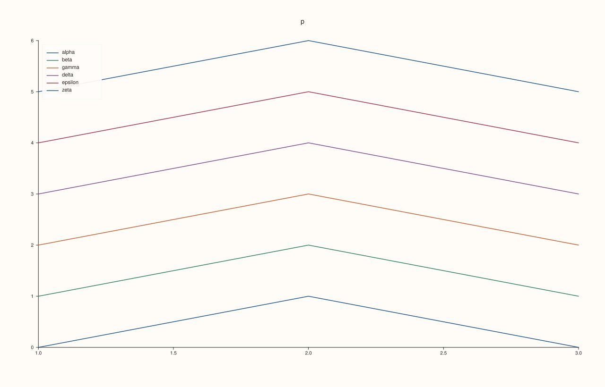
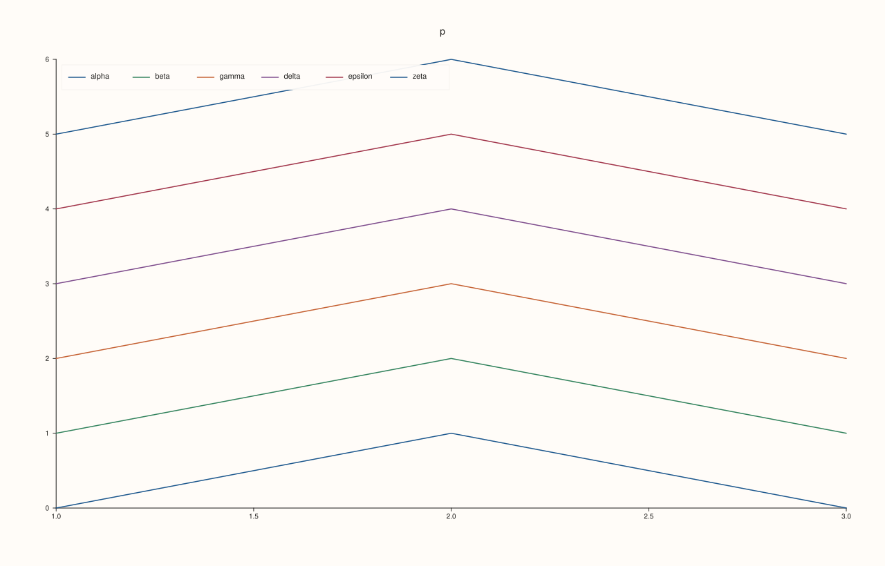
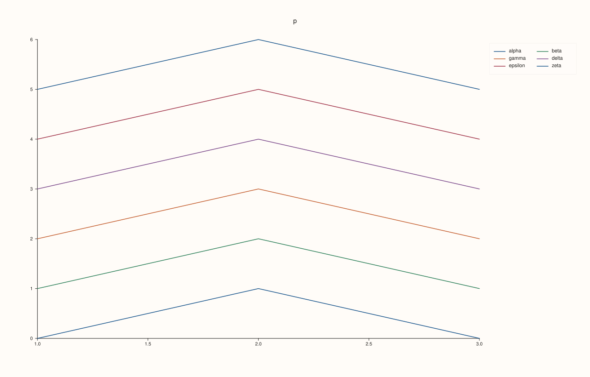
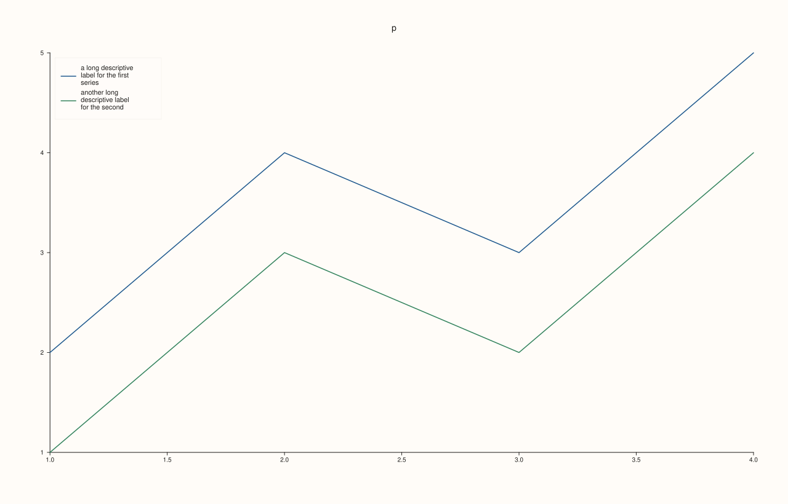
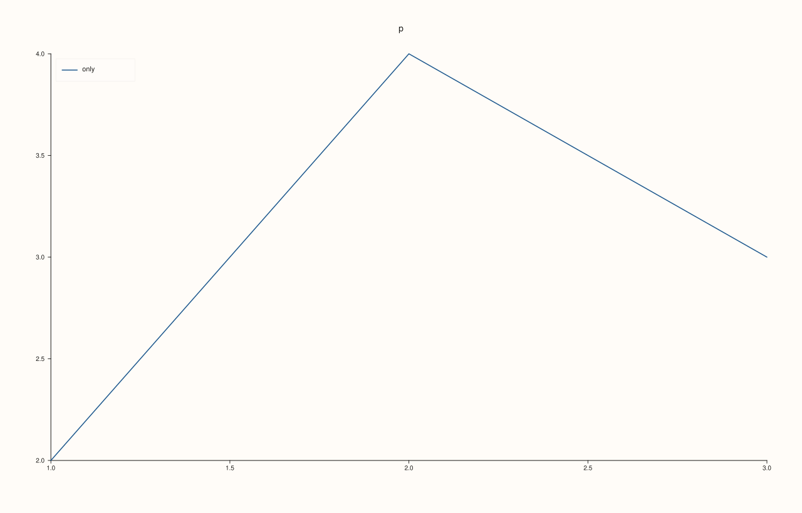

<!-- pluss-hand-authored -->

# Pane::legend_shape

[Back to Pane API Reference](../../pane_api_reference)

## Signature

```cpp
Pane& Pane::legend_shape(KeyShape shape) noexcept
KeyShape Pane::legend_shape() const noexcept
```

## What It Does

Chooses how the entries of the pane's own legend ([`legend`](legend.md)) are arranged, and reads the choice back.

| `KeyShape` | Arrangement |
|---|---|
| `Auto` | The default. For a pane's legend: one column, entries down the box. |
| `Horizontal` | A wide box: the entries run along rows, in as many columns as the room allows (one row when they all fit, several columns of fewer rows when not). |
| `Vertical` | A narrow box: one column, one entry per row. |

The room is the plot area for a corner legend and a fixed width for `OutsideEast`; the box is never wider than its room. A label too long for the box wraps onto further lines, and one longer than four lines ends in "...". With one entry, or with labels so long that only one fits per row, the shapes draw the same legend. See [`KeyShape`](../types/KeyShape.md) for its values, and [`Studio::legend_shape`](../studio/legend_shape.md) for the legend of the whole figure, where `Auto` depends on the edge it is docked to.

## Parameters

**shape** (`KeyShape`, setter only)
    `Auto`, `Horizontal` or `Vertical`.

## Returns

**Setter:** `Pane&`, the same pane.
**Getter:** `KeyShape`, the arrangement in force.

## Examples

Example 1. `KeyShape::Auto`, the default: for a pane's legend, one column, entries listed down the box. The positions of the entries' texts, read from the figure, show the arrangement.

```cpp
auto fig = studio("legend_shape_auto");
auto& pane = fig.pane2("p");
const char* names[] = {"alpha", "beta", "gamma", "delta", "epsilon", "zeta"};
for (int i = 0; i < 6; ++i) {
  pane.trend(std::vector<double>{1, 2, 3}, std::vector<double>{static_cast<double>(i), i + 1.0, static_cast<double>(i)}).label(names[i]);
}
pane.legend(KeyPlace::NorthWest).legend_shape(KeyShape::Auto);
const std::string svg = fig.to_svg();
auto where = [](const std::string& svg, const std::string& text) {
  const auto hit = svg.find(">" + text + "<");
  const auto open = svg.rfind("<text", hit);
  auto number = [&](const char* key) {
    const auto k = svg.find(std::string(key) + "=\"", open) + std::string(key).size() + 2;
    return static_cast<int>(std::stod(svg.substr(k, svg.find('"', k) - k)));
  };
  return "(" + std::to_string(number("x")) + ", " + std::to_string(number("y")) + ")";
};
std::cout << "reads back Auto: " << (pane.legend_shape() == KeyShape::Auto) << "\n";
for (const char* name : names) std::cout << name << " " << where(svg, name) << "  ";
std::cout << "\n";
fig.save_svg("figure.svg");
```

### Output

```text
reads back Auto: 1
alpha (131, 114)  beta (131, 130)  gamma (131, 146)  delta (131, 162)  epsilon (131, 178)  zeta (131, 194)  
```



Example 2. `KeyShape::Horizontal` lays the entries out in a row, and in as many columns as the room allows. In a corner of this figure all six fit on one line. The positions of the entries' texts, read from the figure, show the arrangement.

```cpp
auto fig = studio("legend_shape_horizontal");
auto& pane = fig.pane2("p");
const char* names[] = {"alpha", "beta", "gamma", "delta", "epsilon", "zeta"};
for (int i = 0; i < 6; ++i) {
  pane.trend(std::vector<double>{1, 2, 3}, std::vector<double>{static_cast<double>(i), i + 1.0, static_cast<double>(i)}).label(names[i]);
}
pane.legend(KeyPlace::NorthWest).legend_shape(KeyShape::Horizontal);
const std::string svg = fig.to_svg();
auto where = [](const std::string& svg, const std::string& text) {
  const auto hit = svg.find(">" + text + "<");
  const auto open = svg.rfind("<text", hit);
  auto number = [&](const char* key) {
    const auto k = svg.find(std::string(key) + "=\"", open) + std::string(key).size() + 2;
    return static_cast<int>(std::stod(svg.substr(k, svg.find('"', k) - k)));
  };
  return "(" + std::to_string(number("x")) + ", " + std::to_string(number("y")) + ")";
};
std::cout << "reads back Horizontal: " << (pane.legend_shape() == KeyShape::Horizontal) << "\n";
for (const char* name : names) std::cout << name << " " << where(svg, name) << "  ";
std::cout << "\n";
fig.save_svg("figure.svg");
```

### Output

```text
reads back Horizontal: 1
alpha (131, 114)  beta (224, 114)  gamma (317, 114)  delta (410, 114)  epsilon (503, 114)  zeta (596, 114)  
```



Example 3. `KeyShape::Vertical` always uses one column, one entry per row. The positions of the entries' texts, read from the figure, show the arrangement.

```cpp
auto fig = studio("legend_shape_vertical");
auto& pane = fig.pane2("p");
const char* names[] = {"alpha", "beta", "gamma", "delta", "epsilon", "zeta"};
for (int i = 0; i < 6; ++i) {
  pane.trend(std::vector<double>{1, 2, 3}, std::vector<double>{static_cast<double>(i), i + 1.0, static_cast<double>(i)}).label(names[i]);
}
pane.legend(KeyPlace::NorthWest).legend_shape(KeyShape::Vertical);
const std::string svg = fig.to_svg();
auto where = [](const std::string& svg, const std::string& text) {
  const auto hit = svg.find(">" + text + "<");
  const auto open = svg.rfind("<text", hit);
  auto number = [&](const char* key) {
    const auto k = svg.find(std::string(key) + "=\"", open) + std::string(key).size() + 2;
    return static_cast<int>(std::stod(svg.substr(k, svg.find('"', k) - k)));
  };
  return "(" + std::to_string(number("x")) + ", " + std::to_string(number("y")) + ")";
};
std::cout << "reads back Vertical: " << (pane.legend_shape() == KeyShape::Vertical) << "\n";
for (const char* name : names) std::cout << name << " " << where(svg, name) << "  ";
std::cout << "\n";
fig.save_svg("figure.svg");
```

### Output

```text
reads back Vertical: 1
alpha (131, 114)  beta (131, 130)  gamma (131, 146)  delta (131, 162)  epsilon (131, 178)  zeta (131, 194)  
```


Example 4. Beside the plot the box is narrower, so `Horizontal` wraps its row into columns: here two columns of three. `Auto` and `Vertical` still give one column.

```cpp
auto build = [&](KeyShape shape) {
  auto fig = studio("legend_shape_outside");
  auto& pane = fig.pane2("p");
const char* names[] = {"alpha", "beta", "gamma", "delta", "epsilon", "zeta"};
for (int i = 0; i < 6; ++i) {
  pane.trend(std::vector<double>{1, 2, 3}, std::vector<double>{static_cast<double>(i), i + 1.0, static_cast<double>(i)}).label(names[i]);
}
  pane.legend(KeyPlace::OutsideEast).legend_shape(shape);
  return fig.to_svg();
};
auto where = [](const std::string& svg, const std::string& text) {
  const auto hit = svg.find(">" + text + "<");
  const auto open = svg.rfind("<text", hit);
  auto number = [&](const char* key) {
    const auto k = svg.find(std::string(key) + "=\"", open) + std::string(key).size() + 2;
    return static_cast<int>(std::stod(svg.substr(k, svg.find('"', k) - k)));
  };
  return "(" + std::to_string(number("x")) + ", " + std::to_string(number("y")) + ")";
};
const std::string wide = build(KeyShape::Horizontal), tall = build(KeyShape::Vertical);
std::cout << "Horizontal: alpha " << where(wide, "alpha") << " beta " << where(wide, "beta") << " gamma " << where(wide, "gamma") << "\n";
std::cout << "Vertical:   alpha " << where(tall, "alpha") << " beta " << where(tall, "beta") << " gamma " << where(tall, "gamma") << "\n";
auto fig = studio("legend_shape_outside_out");
auto& pane = fig.pane2("p");
const char* names[] = {"alpha", "beta", "gamma", "delta", "epsilon", "zeta"};
for (int i = 0; i < 6; ++i) {
  pane.trend(std::vector<double>{1, 2, 3}, std::vector<double>{static_cast<double>(i), i + 1.0, static_cast<double>(i)}).label(names[i]);
}
pane.legend(KeyPlace::OutsideEast).legend_shape(KeyShape::Horizontal);
fig.save_svg("figure.svg");
```

### Output

```text
Horizontal: alpha (1104, 114) beta (1197, 114) gamma (1104, 130)
Vertical:   alpha (1104, 114) beta (1104, 130) gamma (1104, 146)
```



Example 5. Long labels wrap inside whatever box there is. In a column the box is as wide as the longest label needs, up to a share of the plot, and a label wider than that wraps onto more lines; the shape does not make a box wider than its room, so with labels this long every shape gives the same legend.

```cpp
auto build = [&](KeyShape shape) {
  auto fig = studio("legend_shape_long");
  auto& pane = fig.pane2("p");
  pane.trend(std::vector<double>{1, 2, 3, 4}, std::vector<double>{2, 4, 3, 5}).label("a long descriptive label for the first series");
  pane.trend(std::vector<double>{1, 2, 3, 4}, std::vector<double>{1, 3, 2, 4}).label("another long descriptive label for the second");
  pane.trend(std::vector<double>{1, 2, 3, 4}, std::vector<double>{0, 2, 1, 3}).label("and a third label that is just as long as the rest");
  pane.legend(KeyPlace::NorthWest).legend_shape(shape);
  return fig.to_svg();
};
std::cout << "Auto == Horizontal: " << (build(KeyShape::Auto) == build(KeyShape::Horizontal)) << ", Auto == Vertical: " << (build(KeyShape::Auto) == build(KeyShape::Vertical)) << "\n";
auto fig = studio("legend_shape_long_out");
auto& pane = fig.pane2("p");
pane.trend(std::vector<double>{1, 2, 3, 4}, std::vector<double>{2, 4, 3, 5}).label("a long descriptive label for the first series");
pane.trend(std::vector<double>{1, 2, 3, 4}, std::vector<double>{1, 3, 2, 4}).label("another long descriptive label for the second");
pane.legend(KeyPlace::NorthWest);
fig.save_svg("figure.svg");
```

### Output

```text
Auto == Horizontal: 1, Auto == Vertical: 1
```



Example 6. With one entry there is nothing to arrange: every shape draws the same legend.

```cpp
auto build = [&](KeyShape shape) {
  auto fig = studio("legend_shape_one");
  auto& pane = fig.pane2("p");
  pane.trend(std::vector<double>{1, 2, 3}, std::vector<double>{2, 4, 3}).label("only");
  pane.legend(KeyPlace::NorthWest).legend_shape(shape);
  return fig.to_svg();
};
std::cout << "all equal: " << (build(KeyShape::Auto) == build(KeyShape::Horizontal) && build(KeyShape::Auto) == build(KeyShape::Vertical)) << "\n";
auto fig = studio("legend_shape_one_out");
auto& pane = fig.pane2("p");
pane.trend(std::vector<double>{1, 2, 3}, std::vector<double>{2, 4, 3}).label("only");
pane.legend(KeyPlace::NorthWest);
fig.save_svg("figure.svg");
```

### Output

```text
all equal: 1
```



## Notes

- Both forms are `noexcept`.
- The shape is stored whether or not the pane has a legend.

## See Also

- [`Pane::legend`](legend.md): turn the legend on.
- [`Pane::legend_frame`](legend_frame.md): the box's frame.
- [`Studio::legend_shape`](../studio/legend_shape.md): the same for the docked legend.
- [`KeyShape`](../types/KeyShape.md): the values it takes.

<div class="pluss-inline-prev-next">
  <a class="prev-link" href="legend_place.html">
    <span class="label">Previous</span>
    <span class="title">legend_place</span>
  </a>
  <a class="next-link" href="lens.html">
    <span class="label">Next</span>
    <span class="title">lens</span>
  </a>
</div>
