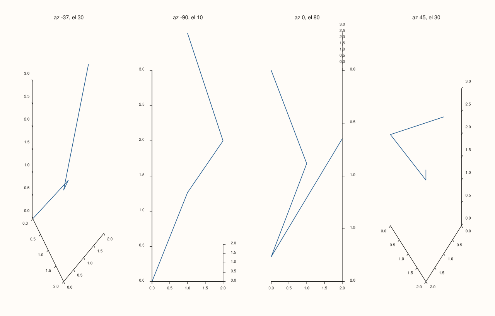
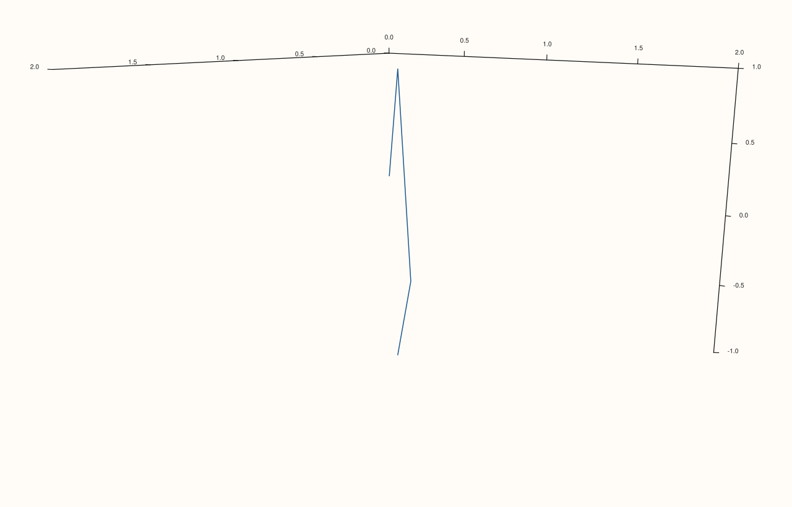

<!-- pluss-hand-authored -->

# Pane::lens

[Back to Pane API Reference](../../pane_api_reference)

## Signatures

```cpp
const Lens& Pane::lens() const noexcept
Lens& Pane::lens() noexcept
```

## What It Does

Returns this pane's `Lens` — the camera/viewpoint state controlling azimuth, elevation,
projection style, view angle, look-at target, and up-vector. As with
[`theme_tokens()`](theme_tokens.md), there is no separate `Pane::lens(Lens)` setter method;
instead, `lens()`'s non-`const` overload returns a **mutable reference** to the pane's own
`Lens` object, and every change is made by calling `Lens`'s own chainable mutators through
that reference (`pane.lens().look(...)`), or by assigning a whole new `Lens` value to it
directly.

`Lens` matters for both 2D and 3D panes, though its effect is far more visible on 3D
(`Volumetric`) panes — orbiting a 3D scene is the primary use case — while on 2D
(`Planar`) panes it mainly governs the pane's projection style, which ordinarily stays
`Orthographic` (2D data has no meaningful perspective to project).

```{important} The default Lens depends on Pane::kind()
Every pane starts with a `Lens` chosen by its [`kind()`](kind.md): a `Planar` pane
(`pane2()`) starts with `Lens::planar()` — a straight-down, `Orthographic` view
(`elevation_deg = 90`, `up = {0, 1, 0}`) suited to flat 2D data — while a `Volumetric` pane
(`pane3()`) starts with `Lens::spatial()` — an angled, `Orthographic` view
(`azimuth_deg = -37.5`, `elevation_deg = 30`, `up = {0, 0, 1}`) suited to 3D data. Both
static factories are directly callable too (`Lens::planar()`, `Lens::spatial()`), most
often useful when building a `Lens` value to assign wholesale rather than mutating one
in place. See Example 1 and Example 6.
```

### The `Lens` mutator methods

All six return `Lens&` and are `noexcept`, so they chain freely:

- **`look(azimuth_deg, elevation_deg)`** — sets both camera angles outright (an absolute
  set, not a delta).
- **`spin(delta_azimuth_deg, delta_elevation_deg)`** — nudges both camera angles by the
  given deltas relative to their *current* values — additive, unlike `look()`.
- **`target_at(Vec3d target)`** — sets the point the camera looks toward.
- **`up(Vec3d up_vector)`** — sets which direction is considered "up" in the scene.
- **`project(ProjectionKind projection)`** — switches between `ProjectionKind::Perspective`
  and `ProjectionKind::Orthographic`.
- **`view_angle(double degrees)`** — sets the field-of-view angle used under perspective
  projection.

## Parameters

*(none — see `Lens`'s own mutator methods above for their individual parameters)*

## Returns

`const Lens&` (const overload) / `Lens&` (non-const overload)
    A reference to this pane's current lens/camera state.

## Examples

Example 1. The default `Lens` differs by pane `kind()` — a 2D pane starts top-down
(`elevation_deg = 90`) and orthographic; a 3D pane starts angled
(`azimuth_deg = -37.5`, `elevation_deg = 30`) and also orthographic by default.

```cpp
using namespace pluss::pl;

auto fig = studio("lens_defaults");
auto& planar = fig.pane2();
planar.trend(std::vector<double>{1.0, 2.0, 3.0}, std::vector<double>{2.0, 4.0, 3.0});
std::cout << planar.lens().azimuth_deg() << " " << planar.lens().elevation_deg() << "\n";
std::cout << (planar.lens().projection() == ProjectionKind::Orthographic) << "\n";

auto& volumetric = fig.pane3();
volumetric.path3(std::vector<double>{0.0, 1.0}, std::vector<double>{0.0, 1.0}, std::vector<double>{0.0, 1.0});
std::cout << volumetric.lens().azimuth_deg() << " " << volumetric.lens().elevation_deg() << "\n";
std::cout << (volumetric.lens().projection() == ProjectionKind::Orthographic) << "\n";
```

### Output

```text
0 90
1
-37.5 30
1
```

Example 2. `look(azimuth, elevation)` sets both angles outright.

```cpp
using namespace pluss::pl;

auto fig = studio("lens_look");
auto& pane = fig.pane3();
std::vector<double> x{0.0, 1.0, 2.0, 1.0}, y{0.0, 1.0, 0.0, -1.0}, z{0.0, 1.0, 2.0, 1.0};
pane.path3(x, y, z);
pane.lens().look(45.0, 60.0);
fig.show();

std::cout << pane.lens().azimuth_deg() << " " << pane.lens().elevation_deg() << "\n";
```

### Output

```text
45 60
```



Example 3. `spin(delta_azimuth, delta_elevation)` nudges the *current* angles rather than
replacing them — additive, not absolute, unlike `look()`.

```cpp
using namespace pluss::pl;

auto fig = studio("lens_spin");
auto& pane = fig.pane3();
std::vector<double> x{0.0, 1.0, 2.0, 1.0}, y{0.0, 1.0, 0.0, -1.0}, z{0.0, 1.0, 2.0, 1.0};
pane.path3(x, y, z);

const double az0 = pane.lens().azimuth_deg();
const double el0 = pane.lens().elevation_deg();
pane.lens().spin(15.0, -10.0);

std::cout << (pane.lens().azimuth_deg() - az0) << "\n";
std::cout << (pane.lens().elevation_deg() - el0) << "\n";
```

### Output

```text
15
-10
```

Example 4. Chaining every mutator together — `look()`, `target_at()`, `up()`,
`project()`, and `view_angle()` in one fluent expression, since all six return `Lens&`.

```cpp
using namespace pluss::pl;

auto fig = studio("lens_chained");
auto& pane = fig.pane3();
std::vector<double> x{0.0, 1.0, 2.0, 1.0}, y{0.0, 1.0, 0.0, -1.0}, z{0.0, 1.0, 2.0, 1.0};
pane.path3(x, y, z);

pane.lens()
    .look(20.0, 45.0)
    .target_at(Vec3d{0.5, 0.5, 0.5})
    .up(Vec3d{0.0, 1.0, 0.0})
    .project(ProjectionKind::Perspective)
    .view_angle(50.0);
fig.show();

std::cout << pane.lens().view_angle_deg() << "\n";
std::cout << (pane.lens().projection() == ProjectionKind::Perspective) << "\n";
std::cout << pane.lens().target().x << " " << pane.lens().target().y << " " << pane.lens().target().z << "\n";
```

### Output

```text
50
1
0.5 0.5 0.5
```



Example 5. Switching a 3D pane to `Perspective` projection and back to `Orthographic` —
`project()` in isolation.

```cpp
using namespace pluss::pl;

auto fig = studio("lens_project");
auto& pane = fig.pane3();
pane.path3(std::vector<double>{0.0, 1.0}, std::vector<double>{0.0, 1.0}, std::vector<double>{0.0, 1.0});

pane.lens().project(ProjectionKind::Perspective);
std::cout << (pane.lens().projection() == ProjectionKind::Perspective) << "\n";

pane.lens().project(ProjectionKind::Orthographic);
std::cout << (pane.lens().projection() == ProjectionKind::Orthographic) << "\n";
```

### Output

```text
1
1
```

Example 6. The static factories `Lens::planar()`/`Lens::spatial()`, called directly rather
than read off an existing pane — useful for building a `Lens` value to assign wholesale.

```cpp
using namespace pluss::pl;

Lens planar_lens = Lens::planar();
Lens spatial_lens = Lens::spatial();

std::cout << planar_lens.elevation_deg() << "\n";
std::cout << spatial_lens.elevation_deg() << "\n";
```

### Output

```text
90
30
```

## Notes

- Both `Pane::lens()` overloads are `noexcept`; every `Lens` mutator is also `noexcept`.
- No `Pane::lens(Lens)` setter exists — assign through the mutable reference instead:
  `pane.lens() = Lens::spatial();` (whole-value) or chain individual mutators
  (`pane.lens().look(...).view_angle(...)`).
- `look()` is absolute; `spin()` is relative to the *current* angles — don't confuse the
  two when orbiting a scene interactively.
- The default `Lens` depends on `kind()` (`Planar` → `Lens::planar()`, `Volumetric` →
  `Lens::spatial()`) — see the important callout above.
- `Lens::planar()` and `Lens::spatial()` are both `Orthographic` by default; reach for
  `project(ProjectionKind::Perspective)` explicitly for a perspective-projected 3D view.

## See Also

- [`Pane::kind`](kind.md): determines the default `Lens` a new pane starts with.
- [`Pane::lights`](lights.md): the companion `LightRig` state for 3D lighting, alongside
  camera orientation.
- [`Studio::pane3`](../studio/pane3.md): creates the 3D panes where `Lens` matters most.

<div class="pluss-inline-prev-next">
  <a class="prev-link" href="theme_tokens.html">
    <span class="label">Previous</span>
    <span class="title">theme_tokens</span>
  </a>
  <a class="next-link" href="lights.html">
    <span class="label">Next</span>
    <span class="title">lights</span>
  </a>
</div>
