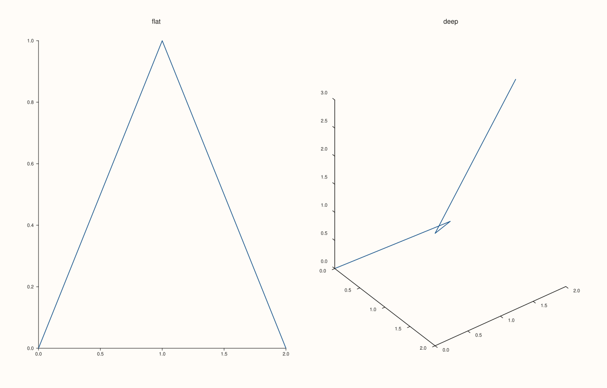
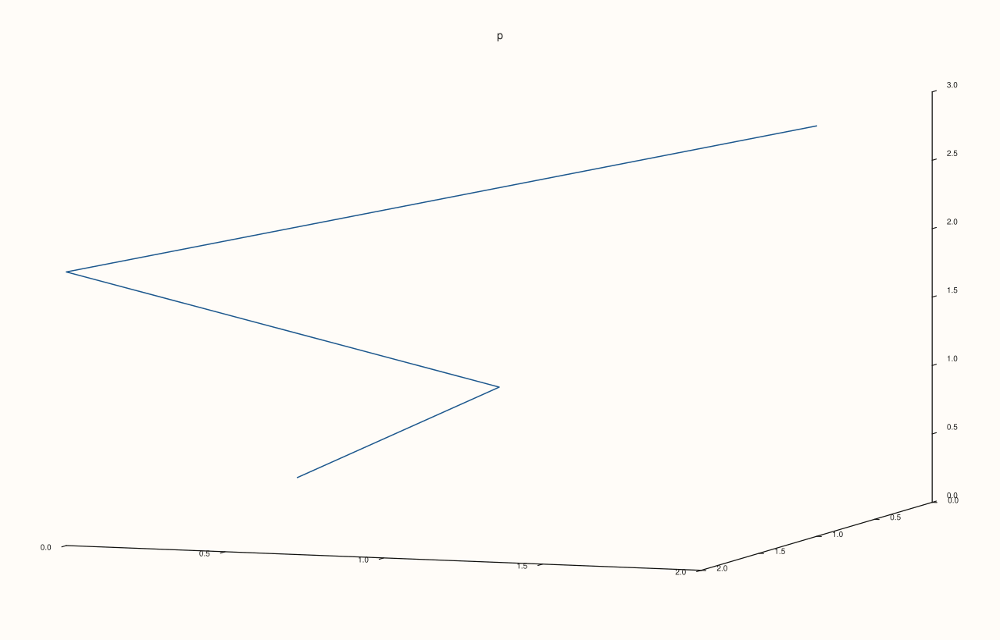
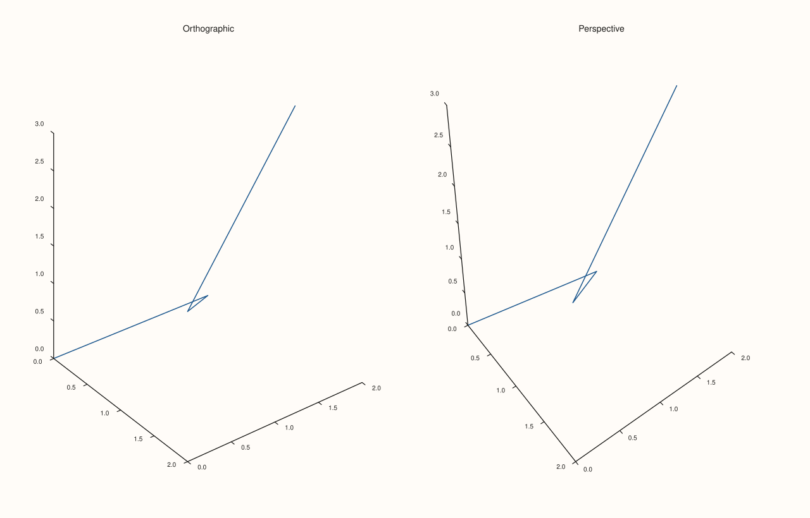
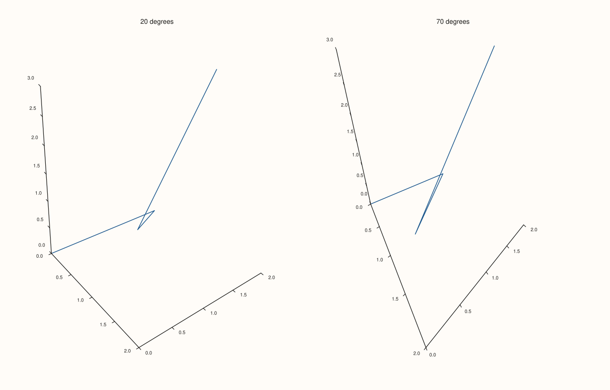
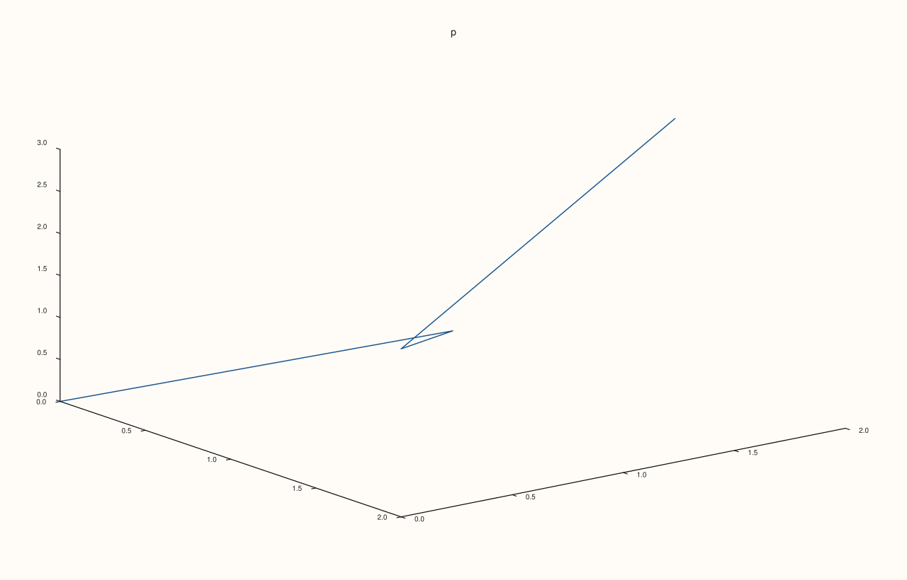
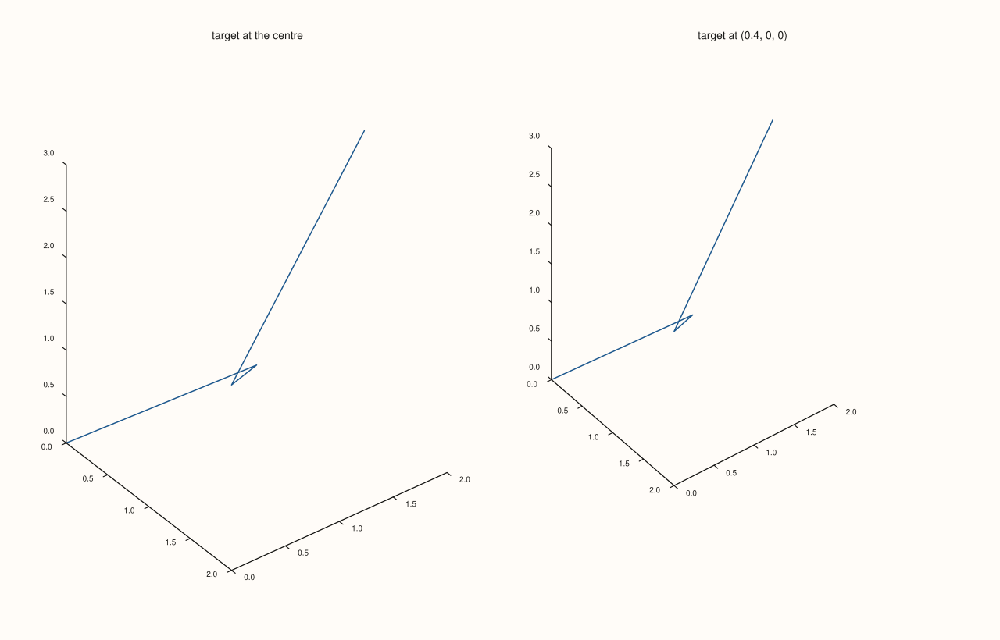
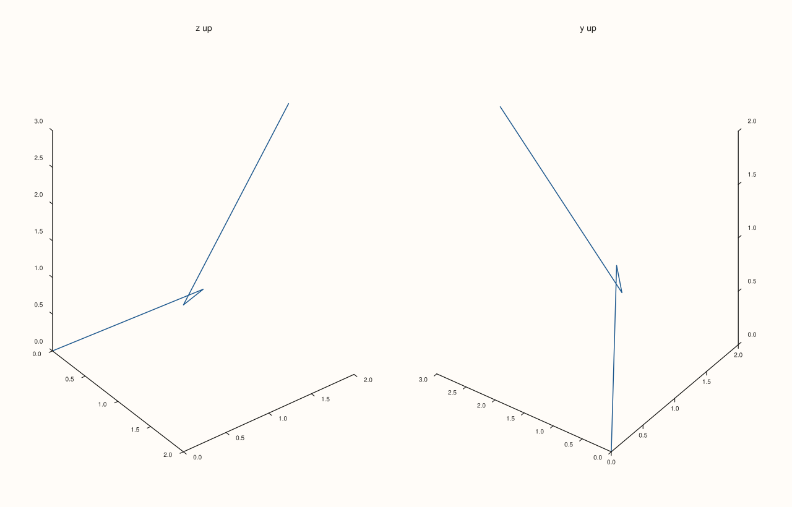
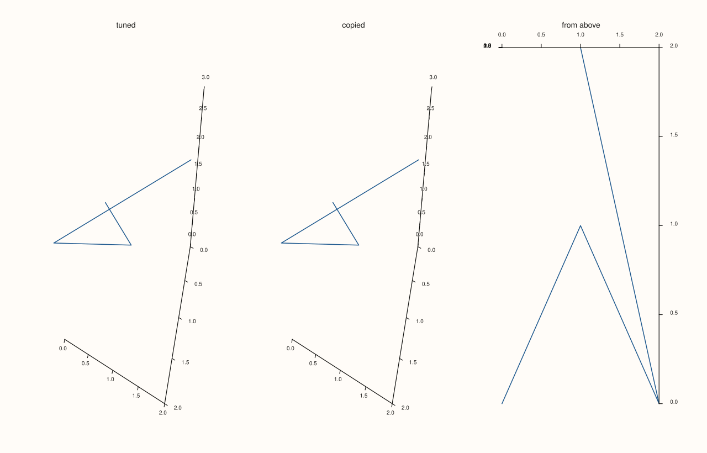

<!-- pluss-hand-authored -->

# Pane::lens

[Back to Pane API Reference](../../pane_api_reference)

## Signature

```cpp
const Lens& Pane::lens() const noexcept
Lens& Pane::lens() noexcept
```

## What It Does

Returns the pane's camera, a [`Lens`](../types/Lens.md): the viewing angles, the point looked at, the direction that is up, and the projection. There is no `Pane::lens(Lens)` setter: the non-const call returns a reference, and the view is changed through the chainable calls of the lens, `pane.lens().look(60, 25).project(ProjectionKind::Perspective)`, or by assigning a whole `Lens` to it.

| Call on the lens | Effect |
|---|---|
| `look(azimuth, elevation)` | Sets the viewing angles in degrees, replacing the current ones. |
| `spin(d_azimuth, d_elevation)` | Turns the view by the given angles from where it is. |
| `project(kind)` | `Orthographic` (the default of a pane: parallel lines stay parallel) or `Perspective` (distant parts look smaller). |
| `view_angle(degrees)` | The field of view of the perspective projection, strictly between 0 and 180; anything else throws. Orthographic views ignore it. |
| `target_at(point)` | The point the picture is centred on, in box units (0 is the centre of the data box, 0.5 its faces). |
| `up(vector)` | The direction drawn upward on the page. |

A volumetric pane starts with `Lens::spatial()` (azimuth -37.5, elevation 30, up = z) and a planar pane with `Lens::planar()` (straight down the z axis, up = y); see [`kind`](kind.md). Only volumetric panes are drawn through the lens: a planar pane looks straight down whatever it holds.

## Parameters

*(none)*

## Returns

`const Lens&` / `Lens&`
    The pane's own lens. The reference follows later calls; copy the lens to keep a view.

## Examples

Example 1. The lens each kind of pane starts with.

```cpp
auto fig = studio("lens_defaults");
fig.mosaic(1, 2);
auto& flat = fig.pane2("flat");
flat.trend(std::vector<double>{0, 1, 2}, std::vector<double>{0, 1, 0});
auto& deep = fig.pane3("deep");
auto& pane = deep;
pane.path3(std::vector<double>{0, 1, 2, 1}, std::vector<double>{0, 1, 0, 2}, std::vector<double>{0, 1, 2, 3});
auto show = [](const char* name, const Lens& lens) {
  std::cout << name << ": azimuth " << lens.azimuth_deg() << ", elevation " << lens.elevation_deg() << ", view angle " << lens.view_angle_deg()
            << ", orthographic " << (lens.projection() == ProjectionKind::Orthographic) << ", target (" << lens.target().x << ", " << lens.target().y << ", " << lens.target().z
            << "), up (" << lens.up_vector().x << ", " << lens.up_vector().y << ", " << lens.up_vector().z << ")\n";
};
show("planar    ", flat.lens());
show("volumetric", deep.lens());
fig.save_svg("figure.svg");
```

### Output

```text
planar    : azimuth 0, elevation 90, view angle 30, orthographic 1, target (0, 0, 0), up (0, 1, 0)
volumetric: azimuth -37.5, elevation 30, view angle 30, orthographic 1, target (0, 0, 0), up (0, 0, 1)
```



Example 2. `look` sets the angles outright; a second call replaces the first. Four views of the same data by azimuth and elevation.

```cpp
const double views[4][2] = {{-37.5, 30.0}, {-90.0, 10.0}, {0.0, 80.0}, {45.0, 30.0}};
auto fig = studio("lens_look");
fig.mosaic(1, 4);
for (int i = 0; i < 4; ++i) {
  auto& pane = fig.pane3("az " + std::to_string(static_cast<int>(views[i][0])) + ", el " + std::to_string(static_cast<int>(views[i][1])));
  pane.path3(std::vector<double>{0, 1, 2, 1}, std::vector<double>{0, 1, 0, 2}, std::vector<double>{0, 1, 2, 3});
  pane.lens().look(0.0, 0.0).look(views[i][0], views[i][1]);
}
std::cout << "last pane: azimuth " << fig.panes().back().lens().azimuth_deg() << ", elevation " << fig.panes().back().lens().elevation_deg() << "\n";
fig.save_svg("figure.svg");
```

### Output

```text
last pane: azimuth 45, elevation 30
```


Example 3. `spin` adds to the angles. After `look(10, 20)` a spin of (5, -5) leaves 15 and 15, and a second spin goes on from there; `look` would have replaced them.

```cpp
auto fig = studio("lens_spin");
auto& pane = fig.pane3("p");
pane.path3(std::vector<double>{0, 1, 2, 1}, std::vector<double>{0, 1, 0, 2}, std::vector<double>{0, 1, 2, 3});
pane.lens().look(10.0, 20.0).spin(5.0, -5.0);
std::cout << "after look(10, 20).spin(5, -5): " << pane.lens().azimuth_deg() << ", " << pane.lens().elevation_deg() << "\n";
pane.lens().spin(5.0, -5.0);
std::cout << "after a second spin: " << pane.lens().azimuth_deg() << ", " << pane.lens().elevation_deg() << "\n";
fig.save_svg("figure.svg");
```

### Output

```text
after look(10, 20).spin(5, -5): 15, 15
after a second spin: 20, 10
```



Example 4. `project`. A pane starts orthographic, where parallel lines stay parallel; in the perspective view the near part of the scene is drawn larger and parallel edges converge.

```cpp
auto fig = studio("lens_project");
fig.mosaic(1, 2);
for (int i = 0; i < 2; ++i) {
  auto& pane = fig.pane3(i == 0 ? "Orthographic" : "Perspective");
  pane.path3(std::vector<double>{0, 1, 2, 1}, std::vector<double>{0, 1, 0, 2}, std::vector<double>{0, 1, 2, 3});
  pane.lens().project(i == 0 ? ProjectionKind::Orthographic : ProjectionKind::Perspective);
}
std::cout << "default is Orthographic: " << (studio("d").pane3().lens().projection() == ProjectionKind::Orthographic) << "\n";
fig.save_svg("figure.svg");
```

### Output

```text
default is Orthographic: 1
```



Example 5. `view_angle` is the field of view of the perspective projection. A wide angle puts the eye close and exaggerates the perspective, a narrow one moves it away and flattens the view; the orthographic view has no field of view and ignores the angle.

```cpp
auto build = [&](ProjectionKind kind, double angle) {
  auto fig = studio("lens_view_angle");
  auto& pane = fig.pane3("p");
  pane.path3(std::vector<double>{0, 1, 2, 1}, std::vector<double>{0, 1, 0, 2}, std::vector<double>{0, 1, 2, 3});
  pane.lens().project(kind).view_angle(angle);
  return fig.to_svg();
};
std::cout << "perspective, 20 vs 70 degrees differ: " << (build(ProjectionKind::Perspective, 20.0) != build(ProjectionKind::Perspective, 70.0)) << "\n";
std::cout << "orthographic, 20 vs 70 degrees differ: " << (build(ProjectionKind::Orthographic, 20.0) != build(ProjectionKind::Orthographic, 70.0)) << "\n";
auto fig = studio("lens_view_angle_out");
fig.mosaic(1, 2);
for (int i = 0; i < 2; ++i) {
  auto& pane = fig.pane3(i == 0 ? "20 degrees" : "70 degrees");
  pane.path3(std::vector<double>{0, 1, 2, 1}, std::vector<double>{0, 1, 0, 2}, std::vector<double>{0, 1, 2, 3});
  pane.lens().project(ProjectionKind::Perspective).view_angle(i == 0 ? 20.0 : 70.0);
}
fig.save_svg("figure.svg");
```

### Output

```text
perspective, 20 vs 70 degrees differ: 1
orthographic, 20 vs 70 degrees differ: 0
```



Example 6. An angle outside (0, 180) has no field of view, so `view_angle` throws and leaves the lens as it was.

```cpp
auto fig = studio("lens_view_angle_errors");
auto& pane = fig.pane3("p");
pane.path3(std::vector<double>{0, 1, 2, 1}, std::vector<double>{0, 1, 0, 2}, std::vector<double>{0, 1, 2, 3});
for (double bad : {0.0, 180.0, -5.0, std::numeric_limits<double>::quiet_NaN()}) {
  try {
    pane.lens().view_angle(bad);
  } catch (const pluss::Error& e) {
    std::cout << e.message() << "\n";
  }
}
std::cout << "still " << pane.lens().view_angle_deg() << "\n";
fig.save_svg("figure.svg");
```

### Output

```text
Lens::view_angle: the angle must be strictly between 0 and 180 degrees
Lens::view_angle: the angle must be strictly between 0 and 180 degrees
Lens::view_angle: the angle must be strictly between 0 and 180 degrees
Lens::view_angle: the angle must be strictly between 0 and 180 degrees
still 30
```



Example 7. `target_at` centres the picture on a point, given in box units: (0, 0, 0) is the centre of the data box, which is where every lens starts. A target 0.4 box widths along x puts that point in the middle, and the whole box stays in view, so the data sits off the centre of the picture.

```cpp
auto fig = studio("lens_target");
fig.mosaic(1, 2);
for (int i = 0; i < 2; ++i) {
  auto& pane = fig.pane3(i == 0 ? "target at the centre" : "target at (0.4, 0, 0)");
  pane.path3(std::vector<double>{0, 1, 2, 1}, std::vector<double>{0, 1, 0, 2}, std::vector<double>{0, 1, 2, 3});
  if (i == 1) pane.lens().target_at(Vec3d{0.4, 0.0, 0.0});
}
const Lens& lens = fig.panes().back().lens();
std::cout << "target (" << lens.target().x << ", " << lens.target().y << ", " << lens.target().z << ")\n";
fig.save_svg("figure.svg");
```

### Output

```text
target (0.4, 0, 0)
```



Example 8. `up` chooses which direction is drawn upward. By default z is up; with y up, the same data is drawn turned.

```cpp
auto fig = studio("lens_up");
fig.mosaic(1, 2);
for (int i = 0; i < 2; ++i) {
  auto& pane = fig.pane3(i == 0 ? "z up" : "y up");
  pane.path3(std::vector<double>{0, 1, 2, 1}, std::vector<double>{0, 1, 0, 2}, std::vector<double>{0, 1, 2, 3});
  if (i == 1) pane.lens().up(Vec3d{0.0, 1.0, 0.0});
}
fig.save_svg("figure.svg");
```



Example 9. A view can be kept and reused as a value. The lens of the first pane is copied into the second, which is then drawn from the same view; assigning `Lens::planar()` goes straight down.

```cpp
auto fig = studio("lens_assign");
fig.mosaic(1, 3);
auto& first = fig.pane3("tuned");
first.path3(std::vector<double>{0, 1, 2, 1}, std::vector<double>{0, 1, 0, 2}, std::vector<double>{0, 1, 2, 3});
first.lens().look(20.0, 45.0).project(ProjectionKind::Perspective);
const Lens kept = first.lens();
auto& second = fig.pane3("copied");
second.path3(std::vector<double>{0, 1, 2, 1}, std::vector<double>{0, 1, 0, 2}, std::vector<double>{0, 1, 2, 3});
second.lens() = kept;
auto& third = fig.pane3("from above");
third.path3(std::vector<double>{0, 1, 2, 1}, std::vector<double>{0, 1, 0, 2}, std::vector<double>{0, 1, 2, 3});
third.lens() = Lens::planar();
std::cout << "copied: azimuth " << second.lens().azimuth_deg() << ", elevation " << second.lens().elevation_deg() << "\n";
std::cout << "from above: elevation " << third.lens().elevation_deg() << "\n";
fig.save_svg("figure.svg");
```

### Output

```text
copied: azimuth 20, elevation 45
from above: elevation 90
```



Example 10. A planar pane is drawn straight down whatever its lens says: the figure is the same with any view.

```cpp
auto build = [&](bool turned) {
  auto fig = studio("lens_planar");
  auto& pane = fig.pane2("p");
  pane.trend(std::vector<double>{0, 1, 2}, std::vector<double>{0, 1, 0});
  if (turned) pane.lens().look(40.0, 40.0);
  return fig.to_svg();
};
std::cout << "planar pane unchanged by look(): " << (build(true) == build(false)) << "\n";
auto fig = studio("lens_planar_out");
auto& pane = fig.pane2("p");
pane.trend(std::vector<double>{0, 1, 2}, std::vector<double>{0, 1, 0});
fig.save_svg("figure.svg");
```

### Output

```text
planar pane unchanged by look(): 1
```


## Notes

- `look`, `spin`, `target_at`, `up` and `project` are `noexcept`; `view_angle` throws `pluss::Error` for an angle outside (0, 180).
- The pane is fitted to its plot area after the view is applied, so the view changes the shape of the picture and not its size.

## See Also

- [`Lens`](../types/Lens.md): the type, with its full member list.
- [`Pane::kind`](kind.md): which lens a pane starts with.
- [`Pane::lights`](lights.md): the light, which is placed relative to the view.
- [`Pane::parallel_xy_labels`](parallel_xy_labels.md): axis labels that follow the view.

<div class="pluss-inline-prev-next">
  <a class="prev-link" href="legend_shape.html">
    <span class="label">Previous</span>
    <span class="title">legend_shape</span>
  </a>
  <a class="next-link" href="lights.html">
    <span class="label">Next</span>
    <span class="title">lights</span>
  </a>
</div>
