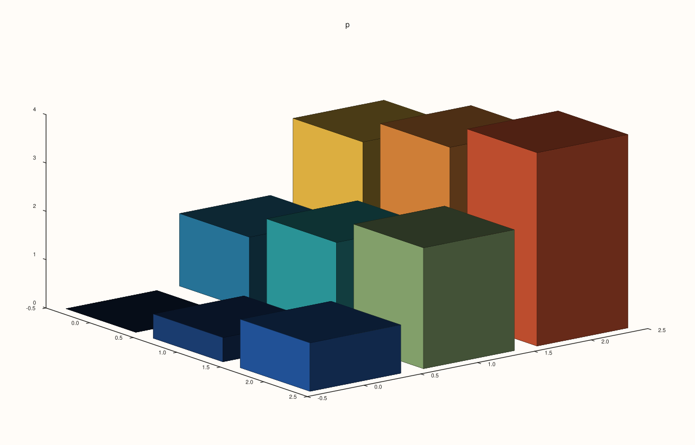
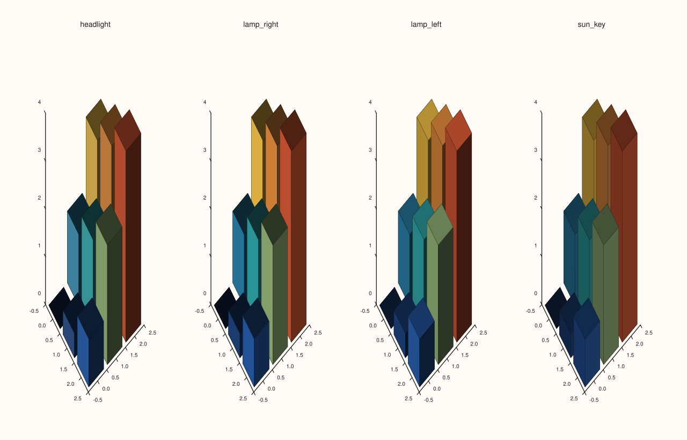
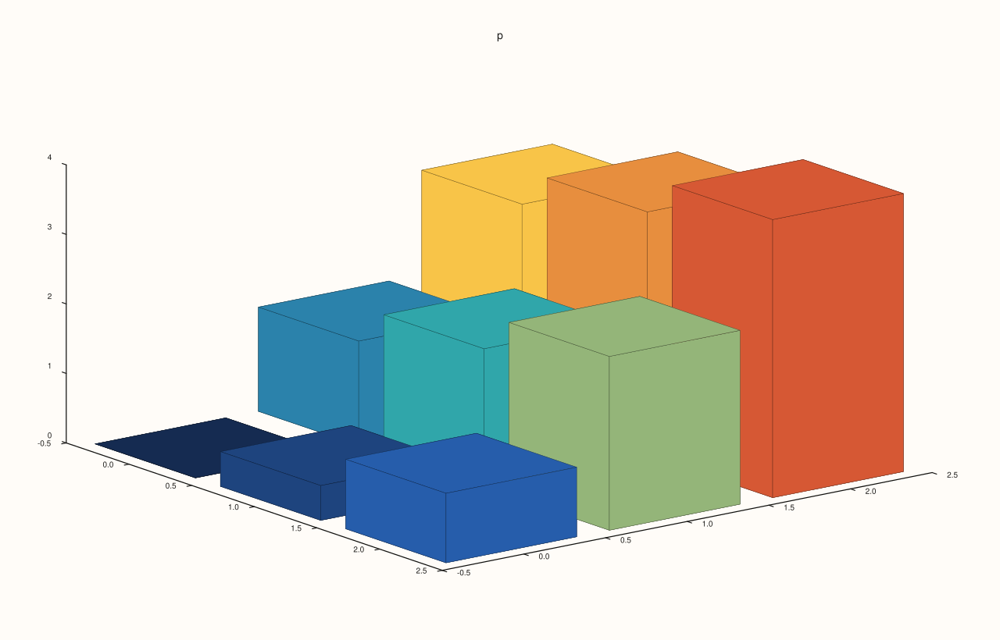
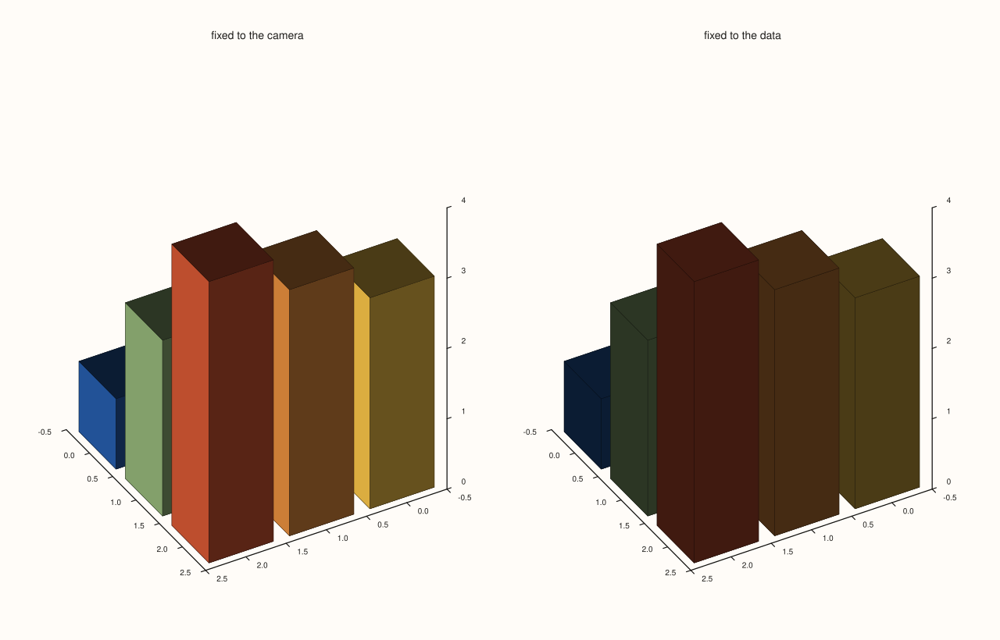

<!-- pluss-hand-authored -->

# Pane::lights

[Back to Pane API Reference](../../pane_api_reference)

## Signature

```cpp
const LightRig& Pane::lights() const noexcept
LightRig& Pane::lights() noexcept
```

## What It Does

Returns the pane's [`LightRig`](../types/LightRig.md): the lamps that shade its surfaces. As with [`lens`](lens.md) there is no setter; the non-const call returns a reference and lights are added through the rig's chainable calls.

A new pane has **no lights**, and surfaces are shaded only when both are true: the pane has at least one light, and the trace asks for shading with [`Trace::lighting`](../trace/lighting.md) (`Flat` or `Gouraud`; the default `None` draws the colours as they are). A lit surface is drawn with the brightness the lights give each face and a highlight set by its [`material`](../trace/material.md).

| Call on the rig | Adds |
|---|---|
| `headlight()` | One lamp at the camera, pointing the way the camera does: flat, shadowless light. |
| `lamp_right()` | One lamp above and to the right of the camera (30 degrees each). |
| `lamp_left()` | One lamp above and to the left (-30 degrees azimuth). |
| `sun_key()` | Two far-away (parallel) lights, a key and a softer fill, fixed relative to the camera. |
| `add(LightSpec)` | One lamp as specified: azimuth and elevation in degrees, `LightSpace::Camera` (follows the view) or `Data` (stays fixed to the data as the view turns), and `LightStyle::Local` (a lamp at a finite distance) or `Infinite` (parallel rays). |
| `clear()` | Removes every light. |

The brightness is the average over the lights, so adding a second lamp gives a different light and not a brighter one. `empty()` and `lights()` on the rig read the lights back; reading the list from a pane is `pane.lights().lights()`.

## Parameters

*(none)*

## Returns

`const LightRig&` / `LightRig&`
    The pane's own rig. The reference follows later calls.

## Examples

Example 1. A new pane has no lights.

```cpp
auto fig = studio("lights_default");
auto& pane = fig.pane3("p");
pane.path3(std::vector<double>{0, 1, 2, 1}, std::vector<double>{0, 1, 0, 2}, std::vector<double>{0, 1, 2, 3});
std::cout << "empty: " << pane.lights().empty() << ", count: " << pane.lights().lights().size() << "\n";
fig.save_svg("figure.svg");
```

### Output

```text
empty: 1, count: 0
```


Example 2. The presets. Each adds the lights shown: `headlight` and the two lamps one local light each, `sun_key` two parallel ones.

```cpp
auto fig = studio("lights_presets");
auto& pane = fig.pane3("p");
pane.path3(std::vector<double>{0, 1, 2, 1}, std::vector<double>{0, 1, 0, 2}, std::vector<double>{0, 1, 2, 3});
const char* styles[] = {"Local", "Infinite"};
auto list = [&](const char* name) {
  std::cout << name << ":";
  for (const auto& light : pane.lights().lights()) std::cout << " (az " << light.azimuth_deg << ", el " << light.elevation_deg << ", " << styles[static_cast<int>(light.style)] << ")";
  std::cout << "\n";
  pane.lights().clear();
};
pane.lights().headlight();  list("headlight ");
pane.lights().lamp_right(); list("lamp_right");
pane.lights().lamp_left();  list("lamp_left ");
pane.lights().sun_key();    list("sun_key   ");
fig.save_svg("figure.svg");
```

### Output

```text
headlight : (az 0, el 0, Local)
lamp_right: (az 30, el 30, Local)
lamp_left : (az -30, el 30, Local)
sun_key   : (az -20, el 35, Infinite) (az 120, el 15, Infinite)
```


Example 3. `add` takes a light of your own. This one is parallel light from the far side, fixed to the data rather than the camera.

```cpp
auto fig = studio("lights_custom");
auto& pane = fig.pane3("p");
pane.path3(std::vector<double>{0, 1, 2, 1}, std::vector<double>{0, 1, 0, 2}, std::vector<double>{0, 1, 2, 3});
pane.lights().add(LightSpec{90.0, 10.0, LightSpace::Data, LightStyle::Infinite});
const auto& light = pane.lights().lights().front();
std::cout << "lights: " << pane.lights().lights().size() << ", azimuth " << light.azimuth_deg << ", elevation " << light.elevation_deg
          << ", fixed to data " << (light.space == LightSpace::Data) << ", infinite " << (light.style == LightStyle::Infinite) << "\n";
fig.save_svg("figure.svg");
```

### Output

```text
lights: 1, azimuth 90, elevation 10, fixed to data 1, infinite 1
```


Example 4. Lights act on traces that ask for shading. The same surface and the same lamp: with `lighting(LightingMode::None)`, the default, the lamp changes nothing; with `Flat` the faces are shaded.

```cpp
auto z = pluss::series::linspace(0.0, 4.0, 9, pluss::ScalarType::Float64).reshape({3, 3});
auto build = [&](LightingMode mode, bool lamp) {
  auto fig = studio("lights_needs");
  auto& pane = fig.pane3("p");
  pane.spire3(std::vector<double>{0, 1, 2}, std::vector<double>{0, 1, 2}, z).lighting(mode);
  if (lamp) pane.lights().lamp_right();
  return fig.to_svg();
};
std::cout << "lighting None, lamp == no lamp: " << (build(LightingMode::None, true) == build(LightingMode::None, false)) << "\n";
std::cout << "lighting Flat, lamp != no lamp: " << (build(LightingMode::Flat, true) != build(LightingMode::Flat, false)) << "\n";
auto fig = studio("lights_needs_out");
auto& pane = fig.pane3("p");
pane.spire3(std::vector<double>{0, 1, 2}, std::vector<double>{0, 1, 2}, z).lighting(LightingMode::Flat);
pane.lights().lamp_right();
fig.save_svg("figure.svg");
```

### Output

```text
lighting None, lamp == no lamp: 1
lighting Flat, lamp != no lamp: 1
```



Example 5. Different rigs, different pictures. The lamp on the right and the lamp on the left shade the same surface differently, and so do the headlight and the sun.

```cpp
auto z = pluss::series::linspace(0.0, 4.0, 9, pluss::ScalarType::Float64).reshape({3, 3});
auto build = [&](int rig) {
  auto fig = studio("lights_rigs");
  auto& pane = fig.pane3("p");
  pane.spire3(std::vector<double>{0, 1, 2}, std::vector<double>{0, 1, 2}, z).lighting(LightingMode::Flat);
  if (rig == 0) pane.lights().headlight();
  if (rig == 1) pane.lights().lamp_right();
  if (rig == 2) pane.lights().lamp_left();
  if (rig == 3) pane.lights().sun_key();
  return fig.to_svg();
};
std::cout << "right != left: " << (build(1) != build(2)) << ", headlight != right: " << (build(0) != build(1)) << ", sun != right: " << (build(3) != build(1)) << "\n";
auto fig = studio("lights_rigs_out");
fig.mosaic(1, 4);
const char* names[] = {"headlight", "lamp_right", "lamp_left", "sun_key"};
for (int i = 0; i < 4; ++i) {
  auto& pane = fig.pane3(names[i]);
  pane.spire3(std::vector<double>{0, 1, 2}, std::vector<double>{0, 1, 2}, z).lighting(LightingMode::Flat);
  if (i == 0) pane.lights().headlight();
  if (i == 1) pane.lights().lamp_right();
  if (i == 2) pane.lights().lamp_left();
  if (i == 3) pane.lights().sun_key();
}
fig.save_svg("figure.svg");
```

### Output

```text
right != left: 1, headlight != right: 1, sun != right: 1
```



Example 6. `clear` removes every light: the pane is unlit again and the figure is the one that never had a light.

```cpp
auto z = pluss::series::linspace(0.0, 4.0, 9, pluss::ScalarType::Float64).reshape({3, 3});
auto build = [&](bool lit_then_cleared) {
  auto fig = studio("lights_clear");
  auto& pane = fig.pane3("p");
  pane.spire3(std::vector<double>{0, 1, 2}, std::vector<double>{0, 1, 2}, z).lighting(LightingMode::Flat);
  if (lit_then_cleared) pane.lights().sun_key().clear();
  return fig.to_svg();
};
std::cout << "cleared == never lit: " << (build(true) == build(false)) << "\n";
auto fig = studio("lights_clear_out");
auto& pane = fig.pane3("p");
pane.spire3(std::vector<double>{0, 1, 2}, std::vector<double>{0, 1, 2}, z).lighting(LightingMode::Flat);
pane.lights().sun_key().clear();
std::cout << "empty: " << pane.lights().empty() << "\n";
fig.save_svg("figure.svg");
```

### Output

```text
cleared == never lit: 1
empty: 1
```



Example 7. Camera or data. A light fixed to the camera is placed relative to the viewer and keeps its direction on the screen as the view turns; a light fixed to the data is placed relative to the scene and turns with it. The same lamp in the two spaces is two different lights, whatever the view.

```cpp
auto z = pluss::series::linspace(0.0, 4.0, 9, pluss::ScalarType::Float64).reshape({3, 3});
auto build = [&](LightSpace space, double azimuth) {
  auto fig = studio("lights_space");
  auto& pane = fig.pane3("p");
  pane.spire3(std::vector<double>{0, 1, 2}, std::vector<double>{0, 1, 2}, z).lighting(LightingMode::Flat);
  pane.lights().add(LightSpec{30.0, 30.0, space, LightStyle::Infinite});
  pane.lens().look(azimuth, 30.0);
  return fig.to_svg();
};
std::cout << "default view: Camera != Data: " << (build(LightSpace::Camera, -37.5) != build(LightSpace::Data, -37.5)) << "\n";
std::cout << "turned view:  Camera != Data: " << (build(LightSpace::Camera, 60.0) != build(LightSpace::Data, 60.0)) << "\n";
auto fig = studio("lights_space_out");
fig.mosaic(1, 2);
for (int i = 0; i < 2; ++i) {
  auto& pane = fig.pane3(i == 0 ? "fixed to the camera" : "fixed to the data");
  pane.spire3(std::vector<double>{0, 1, 2}, std::vector<double>{0, 1, 2}, z).lighting(LightingMode::Flat);
  pane.lights().add(LightSpec{30.0, 30.0, i == 0 ? LightSpace::Camera : LightSpace::Data, LightStyle::Infinite});
  pane.lens().look(60.0, 30.0);
}
fig.save_svg("figure.svg");
```

### Output

```text
default view: Camera != Data: 1
turned view:  Camera != Data: 1
```



## Notes

- The rig's `clear`, `headlight`, `lamp_right`, `lamp_left` and `sun_key` are `noexcept`; `add` can throw only on allocation failure.
- Lights have no effect on planar panes, on traces with `LightingMode::None`, or on traces that are not surfaces.

## See Also

- [`LightRig`](../types/LightRig.md): the type.
- [`Trace::lighting`](../trace/lighting.md), [`Trace::material`](../trace/material.md), [`Trace::shade`](../trace/shade.md): how a surface answers the light.
- [`Pane::lens`](lens.md): the view that camera-fixed lights follow.

<div class="pluss-inline-prev-next">
  <a class="prev-link" href="lens.html">
    <span class="label">Previous</span>
    <span class="title">lens</span>
  </a>
  <a class="next-link" href="parallel_xy_labels.html">
    <span class="label">Next</span>
    <span class="title">parallel_xy_labels</span>
  </a>
</div>
