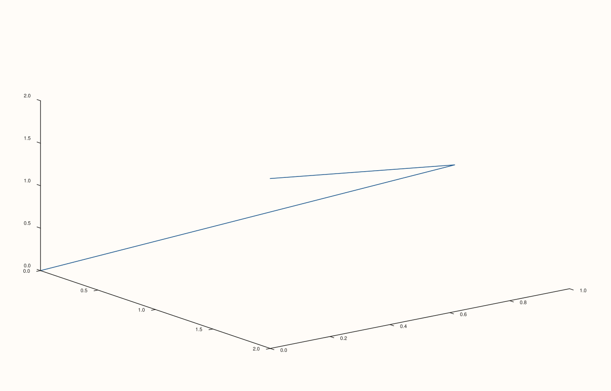

<!-- pluss-hand-authored -->

# Pane::lights

[Back to Pane API Reference](../../pane_api_reference)

## Signatures

```cpp
const LightRig& Pane::lights() const noexcept
LightRig& Pane::lights() noexcept
```

## What It Does

Returns this pane's `LightRig` — the set of light sources used when shading a 3D scene.
Same pattern as [`lens()`](lens.md): no separate `Pane::lights(LightRig)` setter exists;
instead the non-`const` overload returns a **mutable reference**, and lights are added or
cleared by calling `LightRig`'s own chainable methods through it. A fresh pane's
`LightRig` starts **empty** — `lights().empty()` is `true` and `lights().lights().size()`
is `0` — regardless of pane `kind()`; nothing is lit by default until a light is added.

```{note} lights() the method vs. lights() the accessor on LightRig
`Pane::lights()` returns the `LightRig` object itself. `LightRig` in turn has its *own*
`lights()` accessor (`const std::vector<LightSpec>& LightRig::lights() const`) that
returns the actual list of individual light entries — so reading the full light count
from a pane is `pane.lights().lights().size()`, with `lights()` appearing twice
deliberately: once for the pane's `LightRig`, once for that rig's entry list.
```

### The `LightRig` methods

- **`clear()`** — removes every light, returning to the empty starting state.
- **`add(LightSpec light)`** — appends one fully custom light (azimuth, elevation,
  `LightSpace`, `LightStyle`).
- **`headlight()`** — appends one light co-located with the camera (`azimuth_deg = 0`,
  `elevation_deg = 0`, `LightSpace::Camera`, `LightStyle::Local`) — a flat, shadow-minimal
  fill light.
- **`lamp_right()`** — appends one light offset to the upper right of the camera
  (`azimuth_deg = 30`, `elevation_deg = 30`, camera-relative, local).
- **`lamp_left()`** — appends one light offset to the upper left of the camera
  (`azimuth_deg = -30`, `elevation_deg = 30`, camera-relative, local) — the mirror of
  `lamp_right()`.
- **`sun_key()`** — appends **two** infinite (directional) lights at once, a stronger key
  light and a softer fill, both camera-relative — the closest built-in preset to outdoor,
  studio-style two-point lighting.

All five mutators return `LightRig&` and chain freely; `empty()` and `lights()` (the
`LightRig` accessor) are read-only and `noexcept`.

## Parameters

*(none — see `LightRig`'s own methods above for their individual parameters)*

## Returns

`const LightRig& / LightRig&`
    A reference to this pane's current light rig.

## Examples

Example 1. A fresh pane's `LightRig` is empty by default.

```cpp
using namespace pluss::pl;

auto fig = studio("lights_default");
auto& pane = fig.pane3();
std::vector<double> x{0.0, 1.0, 2.0}, y{0.0, 1.0, 0.0}, z{0.0, 1.0, 2.0};
pane.path3(x, y, z);

std::cout << pane.lights().empty() << "\n";
std::cout << pane.lights().lights().size() << "\n";
```

### Output

```text
1
0
```

Example 2. `headlight()` — a single camera-co-located fill light.

```cpp
using namespace pluss::pl;

auto fig = studio("lights_headlight");
auto& pane = fig.pane3();
std::vector<double> x{0.0, 1.0, 2.0}, y{0.0, 1.0, 0.0}, z{0.0, 1.0, 2.0};
pane.path3(x, y, z);

pane.lights().headlight();
fig.show();

std::cout << pane.lights().lights().size() << "\n";
```

### Output

```text
1
```


Example 3. `lamp_right()` and `lamp_left()` chained together — a symmetric two-point
setup.

```cpp
using namespace pluss::pl;

auto fig = studio("lights_two_point");
auto& pane = fig.pane3();
std::vector<double> x{0.0, 1.0, 2.0}, y{0.0, 1.0, 0.0}, z{0.0, 1.0, 2.0};
pane.path3(x, y, z);

pane.lights().lamp_right().lamp_left();
fig.show();

std::cout << pane.lights().lights().size() << "\n";
```

### Output

```text
2
```


Example 4. `sun_key()` — adds two lights (a key and a fill) in one call.

```cpp
using namespace pluss::pl;

auto fig = studio("lights_sun_key");
auto& pane = fig.pane3();
std::vector<double> x{0.0, 1.0, 2.0}, y{0.0, 1.0, 0.0}, z{0.0, 1.0, 2.0};
pane.path3(x, y, z);

pane.lights().sun_key();
fig.show();

std::cout << pane.lights().lights().size() << "\n";
```

### Output

```text
2
```


Example 5. A fully custom light via `add(LightSpec)`, then `clear()` back to empty.

```cpp
using namespace pluss::pl;

auto fig = studio("lights_custom_and_clear");
auto& pane = fig.pane3();
std::vector<double> x{0.0, 1.0, 2.0}, y{0.0, 1.0, 0.0}, z{0.0, 1.0, 2.0};
pane.path3(x, y, z);

pane.lights().add(LightSpec{45.0, 60.0, LightSpace::Data, LightStyle::Infinite});
std::cout << pane.lights().lights().size() << "\n";

pane.lights().clear();
std::cout << pane.lights().empty() << "\n";
fig.show();
```

### Output

```text
1
1
```



## Notes

- Both `Pane::lights()` overloads are `noexcept`. `clear()`, `headlight()`, `lamp_right()`,
  `lamp_left()`, and `sun_key()` are all `noexcept`; `add()` is not (it may allocate when
  the underlying vector grows).
- Starts empty on every new pane, 2D or 3D alike — an unlit 3D scene still renders (traces
  have their own base coloring), lighting only adds shading on top.
- Directly gates [`Trace::lighting`](../trace/lighting.md) and
  [`Trace::material`](../trace/material.md): with an empty `LightRig` (the default), both
  settings have **no observed effect at all** — the shading calculation that reads them
  short-circuits when there are no lights to shade with. Add at least one light (any of the
  five methods above) before expecting either setting to visibly change a surface trace's
  rendered output. Directly verified during this documentation effort.
- `LightSpec`'s four fields — `azimuth_deg`, `elevation_deg`, `LightSpace` (`Camera` vs.
  `Data`), and `LightStyle` (`Local` vs. `Infinite`) — are only reachable directly through
  `add()`; every named preset (`headlight()`, `lamp_right()`, `lamp_left()`, `sun_key()`)
  hard-codes its own fixed `LightSpec` value(s).
- `sun_key()` is the only preset that appends more than one light per call.
- `LightRig::lights()` (the entry-list accessor) is a *different* method from
  `Pane::lights()` (this page) — see the note above.

## See Also

- [`Pane::lens`](lens.md): the companion camera/orientation state.
- [`Studio::pane3`](../studio/pane3.md): creates the 3D panes where lighting has a visible
  effect.
- [`Trace::lighting`](../trace/lighting.md), [`Trace::material`](../trace/material.md): the
  per-trace settings this `LightRig` gates — both need at least one light configured here
  to have any observed effect.

<div class="pluss-inline-prev-next">
  <a class="prev-link" href="lens.html">
    <span class="label">Previous</span>
    <span class="title">lens</span>
  </a>
  <a class="next-link" href="scale_x.html">
    <span class="label">Next</span>
    <span class="title">scale_x</span>
  </a>
</div>
