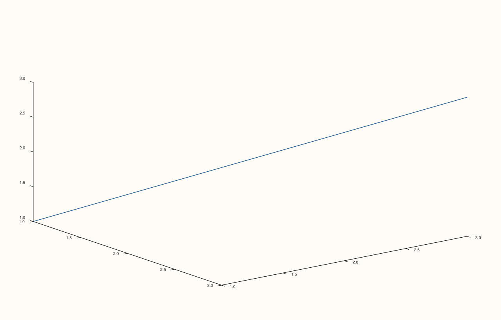

<!-- pluss-hand-authored -->

# Pane::parallel_xy_labels

[Back to Pane API Reference](../../pane_api_reference)

## Signatures

```cpp
Pane& Pane::parallel_xy_labels(bool enable) noexcept   // setter -- enable is now required
bool Pane::parallel_xy_labels() const noexcept          // getter -- always safe to call bare
```

## What It Does

On 3D (`Volumetric`) panes, intended to control whether the x- and y-axis tick labels are
kept parallel to the screen (easier to read at an angle) rather than following the axis's
own 3D orientation. `true` is the constructor default.

```{important} No observed rendering effect in testing
Directly tested at both the default camera angle and a steep, near-edge-on one
(`pane.lens().look(60.0, 10.0)`): toggling `parallel_xy_labels()` between `true` and
`false` produced **byte-for-byte identical SVG output** in every case tried, verified via
direct content diff (not byte count). This is the same kind of observed inertness already
documented for [`Pane::color_limit_method`](color_limit_method.md) — the setter and getter
both work exactly as declared (the value is stored and read back correctly), but no
camera angle tested made the setting visibly change the rendered output. Treat this as an
observed result for the cases tested, not a documented guarantee that it's inert in every
circumstance.
```

```{important} Fixed: enable is now required, not defaulted
parallel_xy_labels() had the identical shape as visible() -- a setter with a
default argument sharing its name with a const getter. Calling the bare,
zero-argument pane.parallel_xy_labels() on a non-const Pane& used to resolve
to the SETTER (default enable = true), not a read. It has since been fixed at
the source: enable is now required, so pane.parallel_xy_labels() (zero
arguments) always resolves to the getter. See visible()'s important callout
for the full explanation of why this was a hazard.
```

## Parameters

**enable** (`bool`, required, setter only)
    Whether x/y tick labels should be kept screen-parallel (`true`) or follow the axis's
    3D orientation (`false`) — see the important callout above regarding observed effect.

## Returns

**Setter:** `Pane&` — a reference to the same pane, for chaining.

**Getter:** `bool` — the current setting. Always safe to call bare.

## Examples

Example 1. The default: `true`.

```cpp
using namespace pluss::pl;

auto fig = studio("parallel_xy_default");
auto& pane = fig.pane3();
pane.path3(std::vector<double>{1.0, 2.0, 3.0}, std::vector<double>{1.0, 2.0, 3.0}, std::vector<double>{1.0, 2.0, 3.0});
fig.show();

std::cout << pane.parallel_xy_labels() << "\n";
```

### Output

```text
1
```


Example 2. Explicitly disabled — the setting and getter both work as declared, but see
the important callout above regarding rendered output.

```cpp
using namespace pluss::pl;

auto fig = studio("parallel_xy_off");
auto& pane = fig.pane3();
pane.path3(std::vector<double>{1.0, 2.0, 3.0}, std::vector<double>{1.0, 2.0, 3.0}, std::vector<double>{1.0, 2.0, 3.0});
pane.parallel_xy_labels(false);
bool off = pane.parallel_xy_labels();
fig.show();

std::cout << off << "\n";
```

### Output

```text
0
```



## Notes

- Both overloads are `noexcept`.
- `true` is also the constructor default state — a fresh pane already has this set to
  `true`.
- See the important callout above: no rendering difference was observed when toggling
  this, across the camera angles tested.
- `enable`'s default argument was removed specifically to eliminate the overload-resolution
  hazard this method used to carry — see the important callout above.
- Only meaningful on 3D (`Volumetric`) panes.

## See Also

- [`Pane::visible`](visible.md): the same fix, explained in full.
- [`Pane::axes_visible`](axes_visible.md): another setter/getter pair that received the
  same fix.
- [`Pane::color_limit_method`](color_limit_method.md): another setting whose stored value
  reads back correctly but showed no observed rendering effect in testing.

<div class="pluss-inline-prev-next">
  <a class="prev-link" href="axes_visible.html">
    <span class="label">Previous</span>
    <span class="title">axes_visible</span>
  </a>
  <a class="next-link" href="place.html">
    <span class="label">Next</span>
    <span class="title">place</span>
  </a>
</div>
