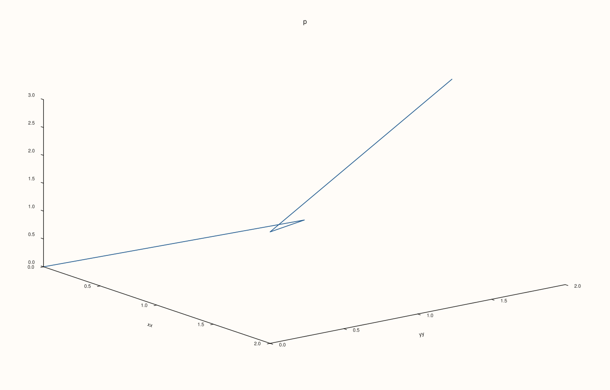
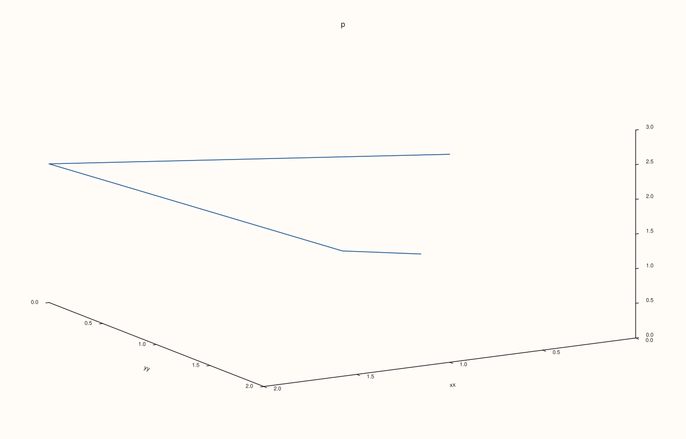
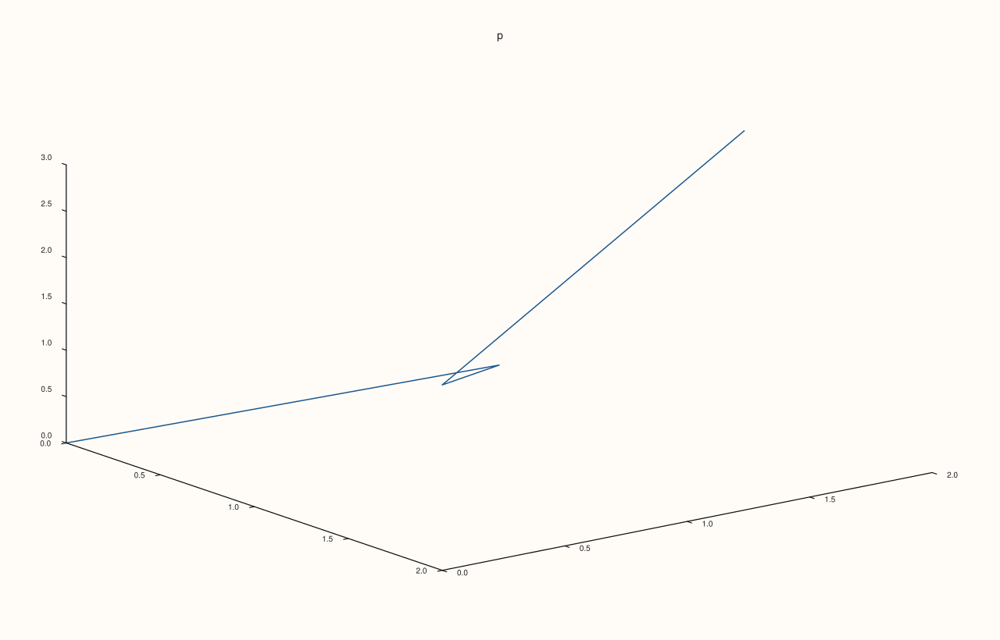

<!-- pluss-hand-authored -->

# Pane::parallel_xy_labels

[Back to Pane API Reference](../../pane_api_reference)

## Signature

```cpp
Pane& Pane::parallel_xy_labels(bool enable) noexcept
bool Pane::parallel_xy_labels() const noexcept
```

## What It Does

On a volumetric pane, chooses how the x and y axis labels sit against their axes. With `true`, the default, each label is turned to run along its axis edge as the view shows it, and set off from the edge; with `false` the labels stay upright, below and to the left of their edges. Planar panes have flat axes, so the setting changes nothing there.

An explicit rotation ([`x_label_rotation`](x_label_rotation.md), [`y_label_rotation`](y_label_rotation.md)) always wins: a label with a rotation of its own is drawn at that angle whatever this switch says. The z label is not affected; it always follows its own axis.

The setter requires its argument, so `pane.parallel_xy_labels()` always reads.

## Parameters

**enable** (`bool`, setter only)
    `true` for labels that run along their axes, `false` for upright labels.

## Returns

**Setter:** `Pane&`, the same pane.
**Getter:** `bool`, the setting. `true` for a new pane.

## Examples

Example 1. The default is on. The labels of a volumetric pane run along their axes: each is rotated by the angle of its edge in the view, so neither is upright.

```cpp
auto fig = studio("parallel_default");
auto& pane = fig.pane3("p");
pane.path3(std::vector<double>{0, 1, 2, 1}, std::vector<double>{0, 1, 0, 2}, std::vector<double>{0, 1, 2, 3});
pane.x_label("xx").y_label("yy");
auto look = [](const std::string& svg, const std::string& text) {
  const auto hit = svg.find(">" + text + "<");
  if (hit == std::string::npos) return std::string("absent");
  const auto open = svg.rfind("<text", hit);
  const std::string tag = svg.substr(open, hit - open);
  const auto anchor = tag.find("text-anchor=\"");
  std::string out = "anchor " + tag.substr(anchor + 13, tag.find('"', anchor + 13) - anchor - 13);
  const auto rot = tag.find("rotate(");
  out += rot == std::string::npos ? ", upright" : ", rotated " + tag.substr(rot + 7, tag.find(' ', rot) - rot - 7);
  return out;
};
const std::string svg = fig.to_svg();
std::cout << "default: " << pane.parallel_xy_labels() << "\n";
std::cout << "x label: " << look(svg, "xx") << "\n";
std::cout << "y label: " << look(svg, "yy") << "\n";
fig.save_svg("figure.svg");
```

### Output

```text
default: 1
x label: anchor middle, rotated 18.7110
y label: anchor middle, rotated -11.2780
```



Example 2. Turned off, the labels are upright.

```cpp
auto fig = studio("parallel_off");
auto& pane = fig.pane3("p");
pane.path3(std::vector<double>{0, 1, 2, 1}, std::vector<double>{0, 1, 0, 2}, std::vector<double>{0, 1, 2, 3});
pane.x_label("xx").y_label("yy");
auto look = [](const std::string& svg, const std::string& text) {
  const auto hit = svg.find(">" + text + "<");
  if (hit == std::string::npos) return std::string("absent");
  const auto open = svg.rfind("<text", hit);
  const std::string tag = svg.substr(open, hit - open);
  const auto anchor = tag.find("text-anchor=\"");
  std::string out = "anchor " + tag.substr(anchor + 13, tag.find('"', anchor + 13) - anchor - 13);
  const auto rot = tag.find("rotate(");
  out += rot == std::string::npos ? ", upright" : ", rotated " + tag.substr(rot + 7, tag.find(' ', rot) - rot - 7);
  return out;
};
pane.parallel_xy_labels(false);
const std::string svg = fig.to_svg();
std::cout << "now: " << pane.parallel_xy_labels() << "\n";
std::cout << "x label: " << look(svg, "xx") << "\n";
std::cout << "y label: " << look(svg, "yy") << "\n";
fig.save_svg("figure.svg");
```

### Output

```text
now: 0
x label: anchor middle, upright
y label: anchor end, upright
```


Example 3. The angle follows the view. Turning the pane by 60 degrees changes the angle each label is drawn at, because the edges point elsewhere in the picture.

```cpp
auto fig = studio("parallel_view");
auto& pane = fig.pane3("p");
pane.path3(std::vector<double>{0, 1, 2, 1}, std::vector<double>{0, 1, 0, 2}, std::vector<double>{0, 1, 2, 3});
pane.x_label("xx").y_label("yy");
auto look = [](const std::string& svg, const std::string& text) {
  const auto hit = svg.find(">" + text + "<");
  if (hit == std::string::npos) return std::string("absent");
  const auto open = svg.rfind("<text", hit);
  const std::string tag = svg.substr(open, hit - open);
  const auto anchor = tag.find("text-anchor=\"");
  std::string out = "anchor " + tag.substr(anchor + 13, tag.find('"', anchor + 13) - anchor - 13);
  const auto rot = tag.find("rotate(");
  out += rot == std::string::npos ? ", upright" : ", rotated " + tag.substr(rot + 7, tag.find(' ', rot) - rot - 7);
  return out;
};
const std::string before = fig.to_svg();
pane.lens().look(60.0, 25.0);
const std::string after = fig.to_svg();
std::cout << "x label at the default view: " << look(before, "xx") << "\n";
std::cout << "x label after look(60, 25):  " << look(after, "xx") << "\n";
fig.save_svg("figure.svg");
```

### Output

```text
x label at the default view: anchor middle, rotated 18.7110
x label after look(60, 25):  anchor middle, rotated -7.4358
```



Example 4. An explicit rotation wins. With `x_label_rotation(0)` the x label is upright although the switch is on; the y label, which has none, still runs along its edge.

```cpp
auto fig = studio("parallel_explicit");
auto& pane = fig.pane3("p");
pane.path3(std::vector<double>{0, 1, 2, 1}, std::vector<double>{0, 1, 0, 2}, std::vector<double>{0, 1, 2, 3});
pane.x_label("xx").y_label("yy");
auto look = [](const std::string& svg, const std::string& text) {
  const auto hit = svg.find(">" + text + "<");
  if (hit == std::string::npos) return std::string("absent");
  const auto open = svg.rfind("<text", hit);
  const std::string tag = svg.substr(open, hit - open);
  const auto anchor = tag.find("text-anchor=\"");
  std::string out = "anchor " + tag.substr(anchor + 13, tag.find('"', anchor + 13) - anchor - 13);
  const auto rot = tag.find("rotate(");
  out += rot == std::string::npos ? ", upright" : ", rotated " + tag.substr(rot + 7, tag.find(' ', rot) - rot - 7);
  return out;
};
pane.x_label_rotation(0.0);
const std::string svg = fig.to_svg();
std::cout << "x label: " << look(svg, "xx") << "\n";
std::cout << "y label: " << look(svg, "yy") << "\n";
fig.save_svg("figure.svg");
```

### Output

```text
x label: anchor middle, upright
y label: anchor middle, rotated -11.2780
```


Example 5. Without labels there is nothing to place, and the switch changes nothing; the same holds for a planar pane.

```cpp
auto build3 = [&](bool on) {
  auto fig = studio("parallel_nolabels");
  auto& pane = fig.pane3("p");
  pane.path3(std::vector<double>{0, 1, 2, 1}, std::vector<double>{0, 1, 0, 2}, std::vector<double>{0, 1, 2, 3});
  pane.parallel_xy_labels(on);
  return fig.to_svg();
};
auto build2 = [&](bool on) {
  auto fig = studio("parallel_planar");
  auto& pane = fig.pane2("p");
  pane.trend(std::vector<double>{0, 1, 2}, std::vector<double>{0, 1, 0});
  pane.x_label("x").y_label("y");
  pane.parallel_xy_labels(on);
  return fig.to_svg();
};
std::cout << "3D without labels unchanged: " << (build3(true) == build3(false)) << ", planar unchanged: " << (build2(true) == build2(false)) << "\n";
auto fig = studio("parallel_nolabels_out");
auto& pane = fig.pane3("p");
pane.path3(std::vector<double>{0, 1, 2, 1}, std::vector<double>{0, 1, 0, 2}, std::vector<double>{0, 1, 2, 3});
fig.save_svg("figure.svg");
```

### Output

```text
3D without labels unchanged: 1, planar unchanged: 1
```



## Notes

- Both forms are `noexcept`.
- The ticks' own rotation is separate: see [`x_tick_rotation`](x_tick_rotation.md).

## See Also

- [`Pane::x_label_rotation`](x_label_rotation.md), [`y_label_rotation`](y_label_rotation.md): rotate a label by hand, which overrides this switch.
- [`Pane::lens`](lens.md): the view that decides the angles.

<div class="pluss-inline-prev-next">
  <a class="prev-link" href="lights.html">
    <span class="label">Previous</span>
    <span class="title">lights</span>
  </a>
  <a class="next-link" href="path3.html">
    <span class="label">Next</span>
    <span class="title">path3</span>
  </a>
</div>
