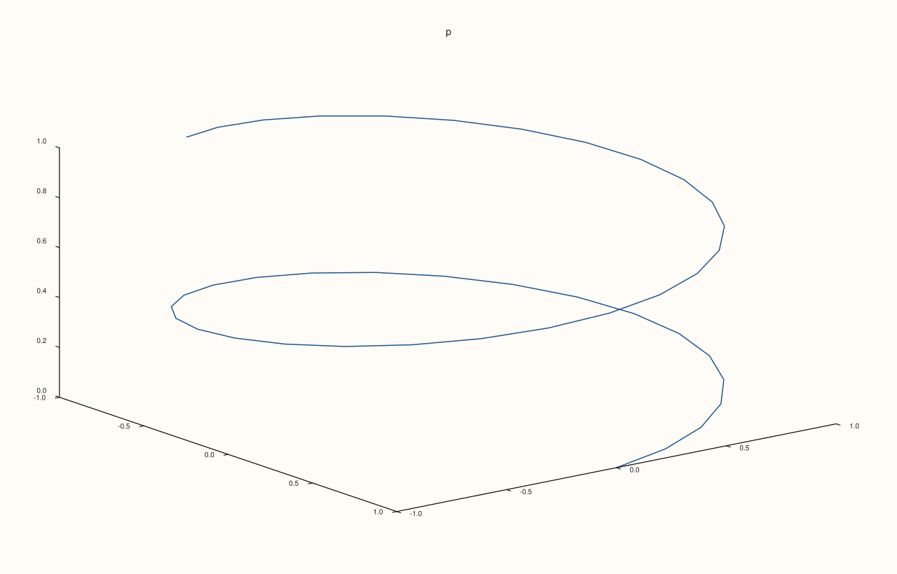
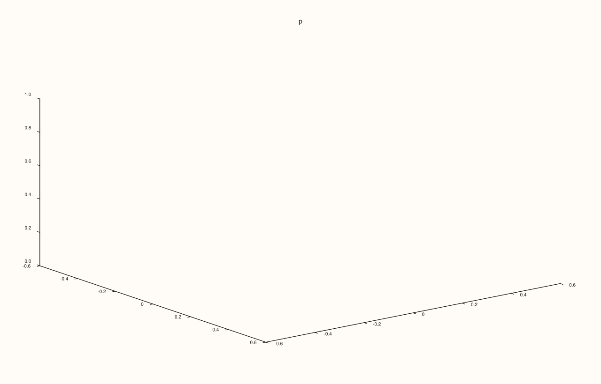
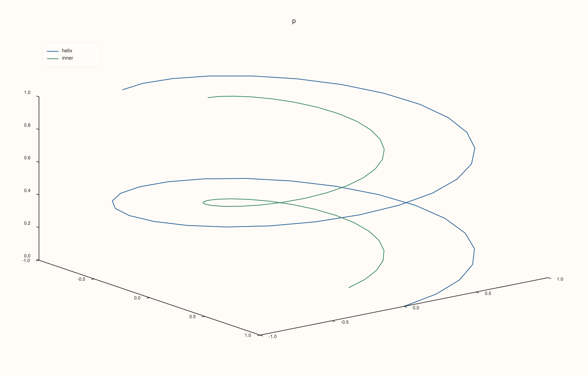
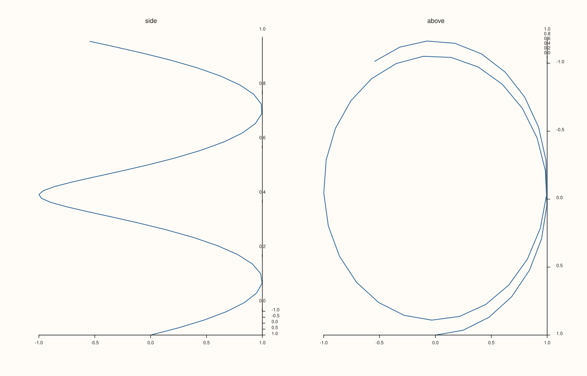

<!-- pluss-hand-authored -->

# Pane::path3

[Back to Pane API Reference](../../pane_api_reference)

## Signature

```cpp
Trace& Pane::path3(Series x, Series y, Series z)
```

## What It Does

Adds a **line in three dimensions**: the points `(x[i], y[i], z[i])` joined in the order given. It is the three-dimensional [`trend`](trend.md), for a trajectory, a curve in space or a track. The three series have the same length, or any of them length 1.

The pane must be volumetric ([`pane3`](../studio/pane3.md)); a planar pane takes [`trend`](trend.md). The view of the path is set by the pane's [`lens`](lens.md).

## Parameters

**x**, **y**, **z** (`Series`-convertible)
    The coordinates of the points. Equal lengths, or length 1.

## Returns

`Trace&`
    The new trace.

## Examples

Example 1. A helix: 41 points along a turning path that rises. The points are joined in the order given.

```cpp
auto fig = studio("path3_helix");
auto& pane = fig.pane3("p");
std::vector<double> hx, hy, hz;
for (int i = 0; i <= 40; ++i) {
  const double t = 0.25 * i;
  hx.push_back(std::cos(t));
  hy.push_back(std::sin(t));
  hz.push_back(0.1 * t);
}
pane.path3(hx, hy, hz);
fig.save_svg("figure.svg");
```



Example 2. A single value is repeated: this path stays in the plane z = 0.5.

```cpp
auto fig = studio("path3_broadcast");
auto& pane = fig.pane3("p");
pane.path3(std::vector<double>{0, 1, 1, 0, 0}, std::vector<double>{0, 0, 1, 1, 0}, std::vector<double>{0.5});
fig.save_svg("figure.svg");
```



Example 3. Several paths on one pane, each with its own call and its own colour.

```cpp
auto fig = studio("path3_two");
auto& pane = fig.pane3("p");
std::vector<double> hx, hy, hz;
for (int i = 0; i <= 40; ++i) {
  const double t = 0.25 * i;
  hx.push_back(std::cos(t));
  hy.push_back(std::sin(t));
  hz.push_back(0.1 * t);
}
pane.path3(hx, hy, hz).label("helix");
std::vector<double> sx, sy, sz;
for (std::size_t i = 0; i < hx.size(); ++i) { sx.push_back(0.5 * hx[i]); sy.push_back(0.5 * hy[i]); sz.push_back(hz[i]); }
pane.path3(sx, sy, sz).label("inner");
pane.legend(KeyPlace::NorthWest);
fig.save_svg("figure.svg");
```



Example 4. The view is the pane's [`lens`](lens.md). The same path seen from the side and from above.

```cpp
auto fig = studio("path3_view");
fig.mosaic(1, 2);
std::vector<double> hx, hy, hz;
for (int i = 0; i <= 40; ++i) {
  const double t = 0.25 * i;
  hx.push_back(std::cos(t));
  hy.push_back(std::sin(t));
  hz.push_back(0.1 * t);
}
auto& side = fig.pane3("side");
side.path3(hx, hy, hz);
side.lens().look(0.0, 5.0);
auto& above = fig.pane3("above");
above.path3(hx, hy, hz);
above.lens().look(0.0, 85.0);
fig.save_svg("figure.svg");
```



Example 5. Inputs that cannot be drawn are refused when the trace is added, and the message names the method and the problem. The pane keeps the traces it had.

```cpp
auto report = [](const char* what, auto&& call) {
  auto fig = studio("path3_errors");
  auto& pane = fig.pane3("p");
  try {
    call(pane);
    std::cout << what << ": accepted\n";
  } catch (const pluss::Error& e) {
    std::cout << what << ": " << e.message() << "\n";
  }
};
report("lengths differ", [](Pane& pane) { pane.path3(std::vector<double>{1, 2, 3}, std::vector<double>{1, 2, 3}, std::vector<double>{1, 2}); });
auto fig = studio("path3_errors_out");
auto& pane = fig.pane3("p");
pane.path3(std::vector<double>{0, 1}, std::vector<double>{0, 1}, std::vector<double>{0, 1});
fig.save_svg("figure.svg");
```

### Output

```text
lengths differ: path3: z length must match broadcasted x/y length
```


Example 6. `path3` needs a volumetric pane. On a planar pane it throws at once, naming the kind it needs, and nothing is added.

```cpp
auto fig = studio("path3_wrong_pane");
auto& pane = fig.pane2("p");
try {
  pane.path3(std::vector<double>{0, 1}, std::vector<double>{0, 1}, std::vector<double>{0, 1});
} catch (const pluss::Error& e) {
  std::cout << e.message() << "\n";
}
std::cout << "traces: " << pane.trace_count() << "\n";
fig.save_svg("figure.svg");
```

### Output

```text
path3 requires a volumetric pane
traces: 0
```


## Notes

- Returns the new [`Trace&`](../trace/label.md); the reference stays valid for the life of the pane, and the style calls of the trace ([`label`](../trace/label.md), [`stroke`](../trace/stroke.md), [`width`](../trace/width.md), ...) chain off it.
- The data is copied into the trace when it is added, so changing the vector afterwards does not change the figure.

## See Also

- [`Pane::trend`](trend.md): the line in a plane.
- [`Pane::cloud3`](cloud3.md): points in space.
- [`Pane::lens`](lens.md): the view.

<div class="pluss-inline-prev-next">
  <a class="prev-link" href="parallel_xy_labels.html">
    <span class="label">Previous</span>
    <span class="title">parallel_xy_labels</span>
  </a>
  <a class="next-link" href="pin.html">
    <span class="label">Next</span>
    <span class="title">pin</span>
  </a>
</div>
