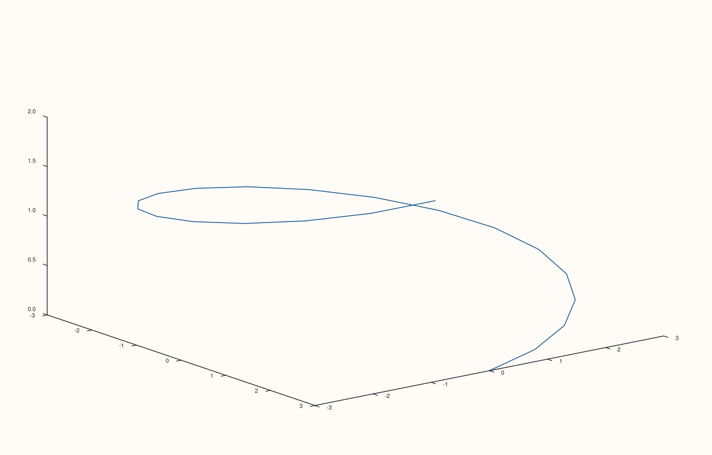

<!-- pluss-hand-authored -->

# Pane::path3

[Back to Pane API Reference](../../pane_api_reference)

## Signatures

```cpp
template <class X, class Y, class Z>
Trace& Pane::path3(X&& x, Y&& y, Z&& z)
```

## What It Does

Adds a 3D line trace — a connected polyline through `(x[i], y[i], z[i])` points, in the
order given. The 3D counterpart of [`Pane::trend`](trend.md); there is only one overload:
`x`, `y`, and `z` are always all required and always positional.

```{important} Requires a Volumetric pane
Calling `path3()` on a `Planar` pane throws
`std::logic_error("path3 requires a volumetric pane")`.
```

## Parameters

**x**, **y**, **z** (series-convertible)
    The 3D coordinates of each vertex, connected in index order.

## Returns

`Trace&`
    A reference to the newly created trace, for chaining.

## Examples

Example 1. A helical trajectory — `x`/`y` trace a circle while `z` climbs steadily.

```cpp
using namespace pluss::pl;

auto fig = studio("path3_basic");
auto& pane = fig.pane3();
std::vector<double> t;
for (int i = 0; i <= 20; ++i) t.push_back(i * 0.3);
std::vector<double> px, py, pz;
for (double v : t) {
  px.push_back(std::cos(v) * 3.0);
  py.push_back(std::sin(v) * 3.0);
  pz.push_back(v * 0.3);
}
pane.path3(px, py, pz);
fig.show();
```



## Notes

- Not `noexcept`.
- Unlike [`cloud3()`](cloud3.md), there is no size/color enrichment available on
  `path3()` — it draws a single connected line with the pane's current trace styling, not
  per-vertex-styled markers.
- `flash::lineplot3d` (if present) is a convenience wrapper around this exact method.

## See Also

- [`Pane::cloud3`](cloud3.md): the discrete-marker 3D counterpart, for unordered or
  per-point-styled points rather than a connected trajectory.
- [`Pane::trend`](trend.md): the 2D line-trace counterpart, on a `Planar` pane.

<div class="pluss-inline-prev-next">
  <a class="prev-link" href="cloud3.html">
    <span class="label">Previous</span>
    <span class="title">cloud3</span>
  </a>
  <a class="next-link" href="spire3.html">
    <span class="label">Next</span>
    <span class="title">spire3</span>
  </a>
</div>
