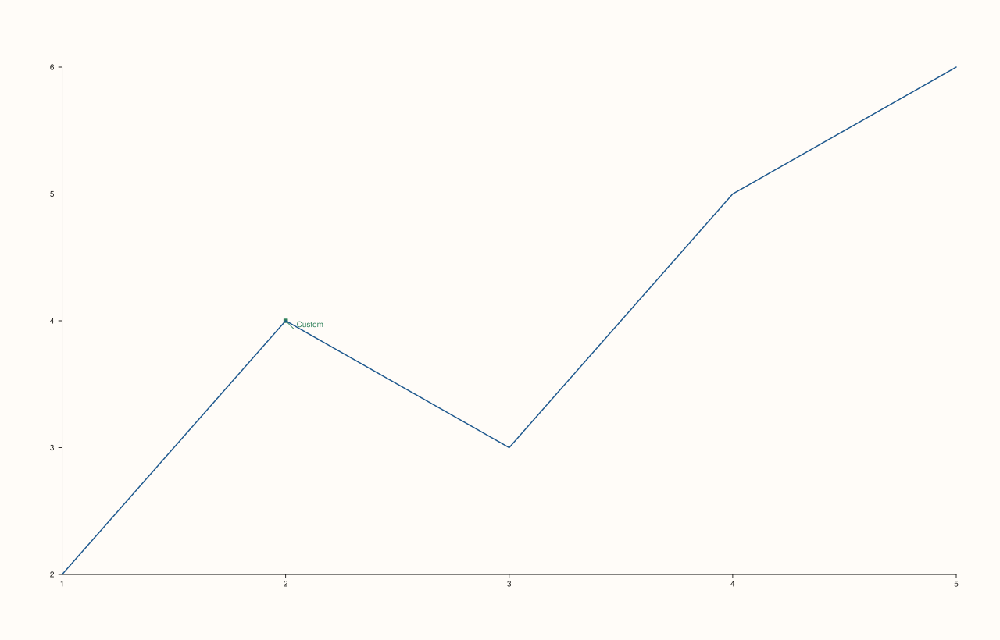
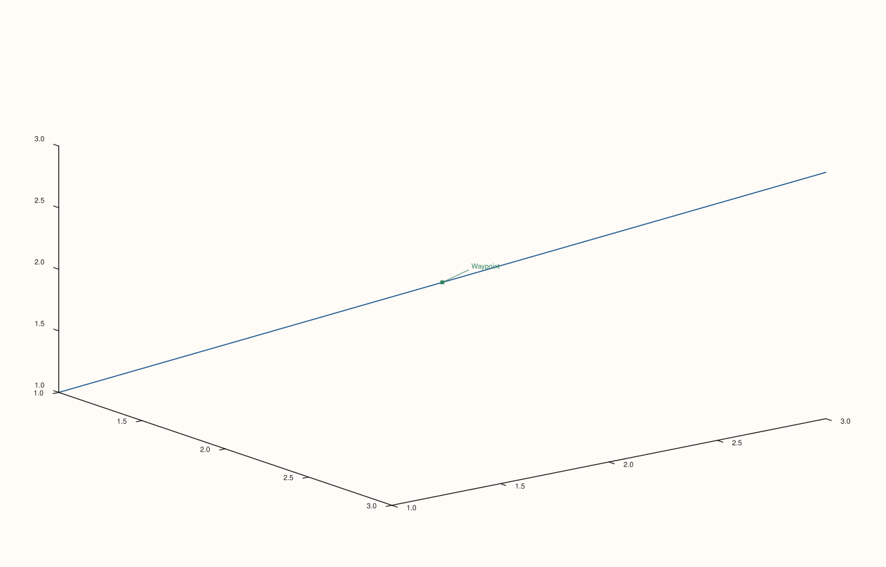

<!-- pluss-hand-authored -->

# Pane::pin

[Back to Pane API Reference](../../pane_api_reference)

## Signatures

```cpp
Pane& Pane::pin(std::string text, double x, double y, double offset_x = 38.0, double offset_y = -18.0)
Pane& Pane::pin(std::string text, Vec3d anchor, double offset_x = 38.0, double offset_y = -18.0)
```

## What It Does

Adds an annotation — a text callout anchored to a specific data point, offset away from
it by a fixed pixel amount so the text doesn't sit directly on top of the point it labels.
Two overloads cover 2D and 3D anchoring:

- **`pin(text, x, y, offset_x, offset_y)`** — anchors at a 2D point `(x, y)` (internally
  stored as `Vec3d{x, y, 0.0}`).
- **`pin(text, anchor, offset_x, offset_y)`** — anchors at an arbitrary `Vec3d` point,
  the natural choice for 3D panes.

Like [`rule_x()`](rule_x.md)/[`band_x()`](band_x.md), pins **accumulate** — each call
appends to a shared [`pins()`](pins.md) list, with no removal API.

```{important} anchor and BOTH offsets must all be finite
Every finite-ness check applies to `x`/`y` (or `anchor`'s three components) *and*
`offset_x`/`offset_y` together — any one of them being non-finite throws
`std::invalid_argument("pin: anchor and offsets must be finite")`. There's no per-parameter
distinction in the message; whichever combination fails, the same message reports it.
```

## Parameters

**text** (`std::string`)
    The annotation text.

**x**, **y** (`double`, first overload)
    The 2D anchor point in data coordinates.

**anchor** (`Vec3d`, second overload)
    The anchor point, usable for 3D positions.

**offset_x**, **offset_y** (`double`, default `38.0`, `-18.0`)
    Pixel offset from the anchor point to where the text is actually drawn.

## Returns

`Pane&`
    A reference to the same pane, for chaining.

## Examples

Example 1. The first overload, with the default offset.

```cpp
using namespace pluss::pl;

auto fig = studio("pin_2d");
auto& pane = fig.pane2();
pane.trend(std::vector<double>{1.0, 2.0, 3.0, 4.0, 5.0}, std::vector<double>{2.0, 4.0, 3.0, 5.0, 6.0});
pane.pin("Peak", 2.0, 4.0);
fig.show();

std::cout << pane.pins().size() << "\n";
std::cout << pane.pins()[0].offset_x << " " << pane.pins()[0].offset_y << "\n";
```

### Output

```text
1
38 -18
```


Example 2. A custom offset.

```cpp
using namespace pluss::pl;

auto fig = studio("pin_2d_custom_offset");
auto& pane = fig.pane2();
pane.trend(std::vector<double>{1.0, 2.0, 3.0, 4.0, 5.0}, std::vector<double>{2.0, 4.0, 3.0, 5.0, 6.0});
pane.pin("Custom", 2.0, 4.0, 10.0, 10.0);
fig.show();
```



Example 3. The second overload, anchored at a `Vec3d` point on a 3D pane.

```cpp
using namespace pluss::pl;

auto fig = studio("pin_3d");
auto& pane = fig.pane3();
pane.path3(std::vector<double>{1.0, 2.0, 3.0}, std::vector<double>{1.0, 2.0, 3.0}, std::vector<double>{1.0, 2.0, 3.0});
pane.pin("Waypoint", Vec3d{2.0, 2.0, 2.0});
fig.show();

std::cout << pane.pins().size() << "\n";
```

### Output

```text
1
```



Example 4. A non-finite anchor coordinate throws.

```cpp
using namespace pluss::pl;

auto fig = studio("pin_failure");
auto& pane = fig.pane2();
pane.trend(std::vector<double>{1.0, 2.0}, std::vector<double>{1.0, 2.0});

try {
  pane.pin("Bad", std::numeric_limits<double>::quiet_NaN(), 1.0);
} catch (const std::invalid_argument& e) {
  std::cout << e.what() << "\n";
}
```

### Output

```text
pin: anchor and offsets must be finite
```

## Notes

- Not `noexcept` (validates finiteness of anchor and offsets).
- Pins accumulate across calls — no removal API.
- The first overload is exactly the second with `anchor = Vec3d{x, y, 0.0}` — both funnel
  into the same underlying storage.
- Default offset (`38.0, -18.0`) places text up and to the right of the anchor point.

## See Also

- [`Pane::pins`](pins.md): reads back every pin added so far.
- [`Pane::rule_x`](rule_x.md) / [`Pane::band_x`](band_x.md): the other two accumulating
  annotation mechanisms — a full-width line and a shaded span, respectively, as opposed to
  a point-anchored text callout.

<div class="pluss-inline-prev-next">
  <a class="prev-link" href="band_z.html">
    <span class="label">Previous</span>
    <span class="title">band_z</span>
  </a>
  <a class="next-link" href="rules.html">
    <span class="label">Next</span>
    <span class="title">rules</span>
  </a>
</div>
