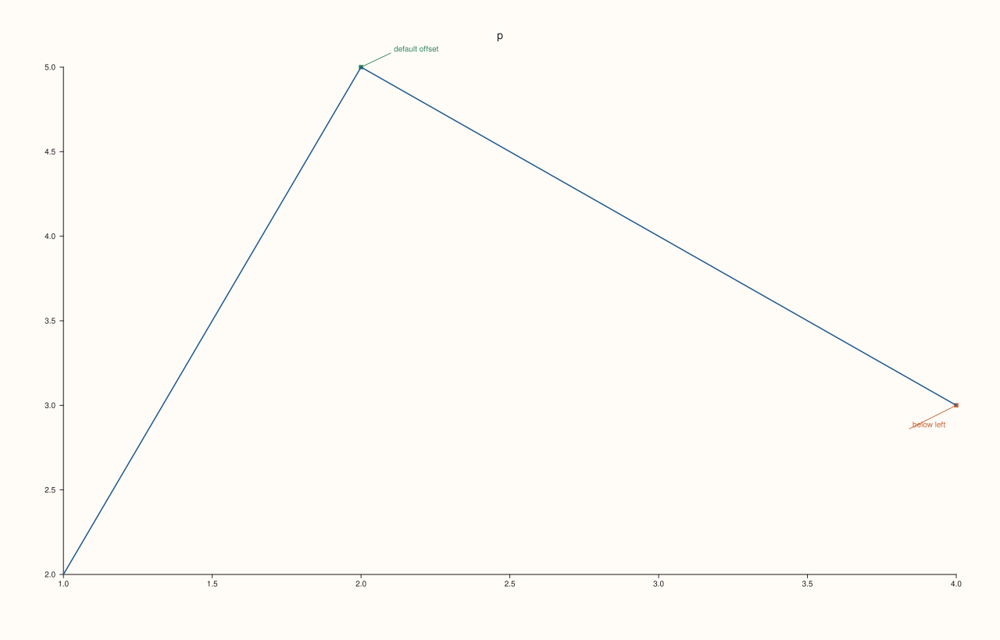
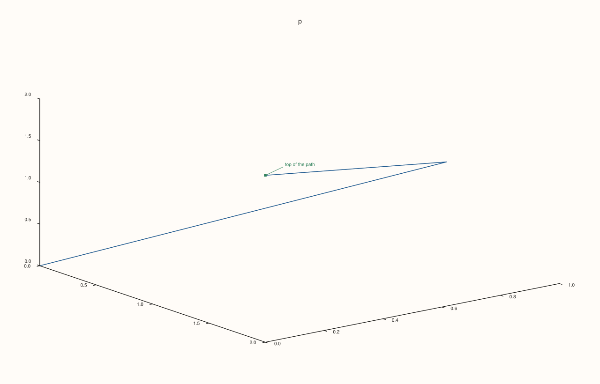
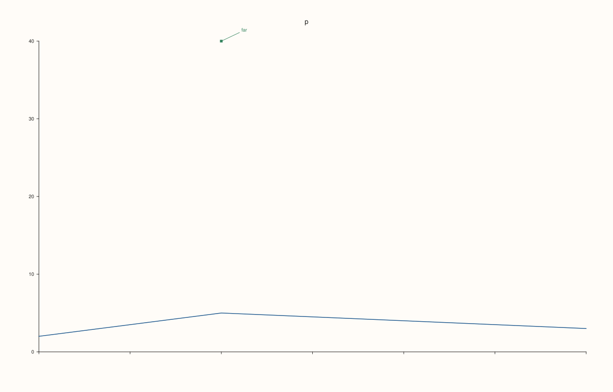
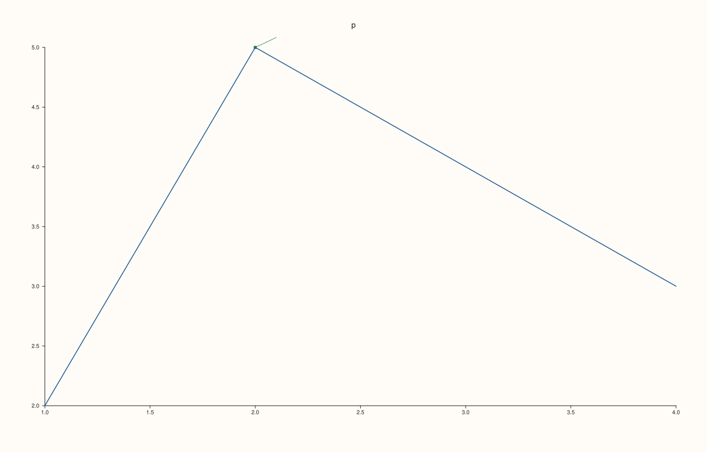

<!-- pluss-hand-authored -->

# Pane::pin

[Back to Pane API Reference](../../pane_api_reference)

## Signature

```cpp
Pane& Pane::pin(std::string text, double x, double y, double offset_x = 38.0, double offset_y = -18.0)
Pane& Pane::pin(std::string text, Vec3d anchor, double offset_x = 38.0, double offset_y = -18.0)
```

## What It Does

Attaches a note to a point: `text` is written near the point `(x, y)` (or the 3D point `anchor`) and a leader line joins it to the point. A pin annotates the data (the peak, an outlier, an event) without being data: it is not a trace, it is not in the legend, and it takes the pane's theme colours. Pins are kept in the order added and listed by [`pins`](pins.md).

The first form places a note on a planar pane at data position `(x, y)`; the second takes a `Vec3d` anchor, which is what a volumetric pane needs and is also accepted on a planar pane (its `z` is ignored). `offset_x` and `offset_y` say where the text sits relative to the anchor, in drawing units: the default puts it up and to the right, and negative `offset_x` puts it to the left. The anchor and both offsets must be finite; otherwise the call throws `pluss::Error` and no pin is added. Text is any string, and empty text is accepted.

A pin takes part in the automatic ranges of the axes so that its anchor stays visible; with a manual range a pin whose anchor lies outside the displayed range is not drawn. The pin is drawn when the figure is rendered.

## Parameters

**text** (`std::string`)
    The note.

**x**, **y** (`double`)
    The anchor on a planar pane, in data units. Finite.

**anchor** (`Vec3d`)
    The anchor as a 3D point. Finite.

**offset_x**, **offset_y** (`double`, default 38 and -18)
    Where the text sits relative to the anchor, in drawing units; `offset_y` is positive downwards. Finite.

## Returns

`Pane&`
    The same pane, for chaining.

## Examples

Example 1. A note on a point. The pin points at the highest value of the line, 5 at x = 2, and the text is drawn to the upper right by default.

```cpp
auto fig = studio("pin_basic");
auto& pane = fig.pane2("p");
pane.trend(std::vector<double>{1, 2, 3, 4}, std::vector<double>{2, 5, 4, 3});
pane.pin("peak", 2.0, 5.0);
const auto& pin = pane.pins().front();
std::cout << "stored: '" << pin.text << "' at (" << pin.anchor.x << ", " << pin.anchor.y << "), offset (" << pin.offset_x << ", " << pin.offset_y << ")\n";
std::cout << "drawn: " << (fig.to_svg().find(">peak<") != std::string::npos) << "\n";
fig.save_svg("figure.svg");
```

### Output

```text
stored: 'peak' at (2, 5), offset (38, -18)
drawn: 1
```


Example 2. Choosing where the text goes. Offsets of (-60, 30) put the note below and to the left of the point, away from the line; the stored offsets are what was given.

```cpp
auto fig = studio("pin_offsets");
auto& pane = fig.pane2("p");
pane.trend(std::vector<double>{1, 2, 3, 4}, std::vector<double>{2, 5, 4, 3});
pane.pin("default offset", 2.0, 5.0);
pane.pin("below left", 4.0, 3.0, -60.0, 30.0);
for (const auto& pin : pane.pins()) std::cout << pin.text << ": offset (" << pin.offset_x << ", " << pin.offset_y << ")\n";
fig.save_svg("figure.svg");
```

### Output

```text
default offset: offset (38, -18)
below left: offset (-60, 30)
```



Example 3. On a volumetric pane. The anchor is a 3D point, and the note follows it as the view is projected.

```cpp
auto fig = studio("pin_3d");
auto& pane = fig.pane3("p");
pane.path3(std::vector<double>{0, 1, 2}, std::vector<double>{0, 1, 0}, std::vector<double>{0, 1, 2});
pane.pin("top of the path", Vec3d{2.0, 0.0, 2.0});
std::cout << "pins: " << pane.pins().size() << ", drawn: " << (fig.to_svg().find(">top of the path<") != std::string::npos) << "\n";
fig.save_svg("figure.svg");
```

### Output

```text
pins: 1, drawn: 1
```



Example 4. Pins and the axis range. A pin far above the data widens an automatic range so its anchor stays visible; with a manual range the axis stays where it was set, and a pin whose anchor is outside it is not drawn.

```cpp
auto texts = [](const std::string& svg) {
  std::string out;
  for (std::size_t at = svg.find("<text"); at != std::string::npos; at = svg.find("<text", at + 1)) {
    const auto gt = svg.find('>', at);
    out += svg.substr(gt + 1, svg.find("</text>", gt) - gt - 1) + " ";
  }
  return out;
};
auto build = [&](bool manual) {
  auto fig = studio("pin_range");
  auto& pane = fig.pane2("p");
  pane.trend(std::vector<double>{1, 2, 3, 4}, std::vector<double>{2, 5, 4, 3});
  pane.x_tick_labels(false);
  if (manual) pane.y_limits(Range1d{0.0, 6.0});
  pane.pin("far", 2.0, 40.0);
  return fig;
};
std::cout << "automatic: " << texts(build(false).to_svg()) << "\n";
std::cout << "manual:    " << texts(build(true).to_svg()) << "\n";
build(false).save_svg("figure.svg");
```

### Output

```text
automatic: p 0 10 20 30 40 far 
manual:    p 0 1 2 3 4 5 6 
```



Example 5. Only finite numbers. A NaN or infinite anchor or offset throws `pluss::Error` and no pin is added; empty text is accepted.

```cpp
auto fig = studio("pin_invalid");
auto& pane = fig.pane2("p");
pane.trend(std::vector<double>{1, 2, 3, 4}, std::vector<double>{2, 5, 4, 3});
const double nan = std::numeric_limits<double>::quiet_NaN();
const double inf = std::numeric_limits<double>::infinity();
auto attempt = [&](const char* label, auto call) {
  try {
    call();
    std::cout << label << ": ok\n";
  } catch (const pluss::Error& e) {
    std::cout << label << ": " << e.message() << "\n";
  }
};
attempt("NaN anchor", [&] { pane.pin("x", nan, 1.0); });
attempt("infinite anchor", [&] { pane.pin("x", 1.0, inf); });
attempt("NaN offset", [&] { pane.pin("x", 1.0, 1.0, nan, 0.0); });
attempt("empty text", [&] { pane.pin("", 2.0, 5.0); });
std::cout << "pins added: " << pane.pins().size() << "\n";
fig.save_svg("figure.svg");
```

### Output

```text
NaN anchor: pin: anchor and offsets must be finite
infinite anchor: pin: anchor and offsets must be finite
NaN offset: pin: anchor and offsets must be finite
empty text: ok
pins added: 1
```



## Notes

- Not `noexcept`: it throws for non-finite numbers.
- For a line at a position use [`rule_x`](rule_x.md) or [`rule_y`](rule_y.md); for a range use [`band_x`](band_x.md) or [`band_y`](band_y.md).

## See Also

- [`Pane::pins`](pins.md): the pins of the pane.
- [`Pane::rule_x`](rule_x.md), [`band_x`](band_x.md): the other cues.

<div class="pluss-inline-prev-next">
  <a class="prev-link" href="path3.html">
    <span class="label">Previous</span>
    <span class="title">path3</span>
  </a>
  <a class="next-link" href="pins.html">
    <span class="label">Next</span>
    <span class="title">pins</span>
  </a>
</div>
