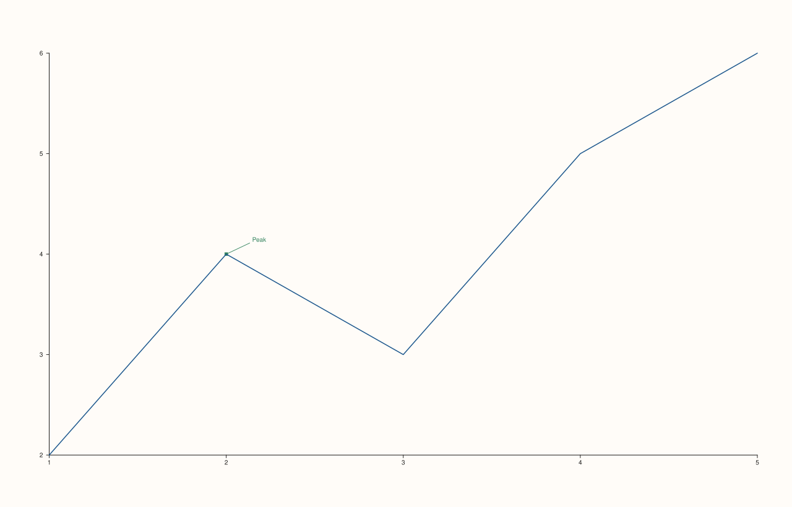

<!-- pluss-hand-authored -->

# Pane::pins

[Back to Pane API Reference](../../pane_api_reference)

## Signature

```cpp
const std::vector<PinCue>& Pane::pins() const noexcept
```

## What It Does

Returns every annotation added so far via [`pin()`](pin.md), in the order they were added.
Each `PinCue` carries its `anchor` (a `Vec3d`, `z` unused for the 2D overload's
`Vec3d{x, y, 0.0}`), `text`, `offset_x`/`offset_y`, and rendering `color` (defaulted).

## Parameters

*(none)*

## Returns

`const std::vector<PinCue>&`
    Every pin added so far, in insertion order.

## Examples

Example 1. Empty by default; growing as pins are added.

```cpp
using namespace pluss::pl;

auto fig = studio("pins_check");
auto& pane = fig.pane2();
pane.trend(std::vector<double>{1.0, 2.0, 3.0, 4.0, 5.0}, std::vector<double>{2.0, 4.0, 3.0, 5.0, 6.0});
std::cout << pane.pins().empty() << "\n";

pane.pin("Peak", 2.0, 4.0);
std::cout << pane.pins().size() << "\n";
std::cout << pane.pins()[0].text << "\n";
fig.show();
```

### Output

```text
1
1
Peak
```



## Notes

- `noexcept`, `const` — read-only.
- No removal API exists — this list only ever grows.

## See Also

- [`Pane::pin`](pin.md): the only way to add entries.
- [`Pane::rules`](rules.md) / [`Pane::bands`](bands.md): the other two accumulating
  annotation lists.

<div class="pluss-inline-prev-next">
  <a class="prev-link" href="bands.html">
    <span class="label">Previous</span>
    <span class="title">bands</span>
  </a>
  <a class="next-link" href="align_x.html">
    <span class="label">Next</span>
    <span class="title">align_x</span>
  </a>
</div>
