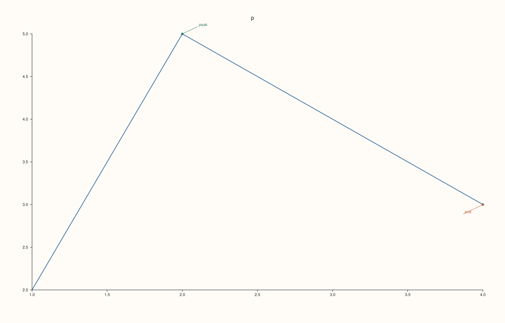
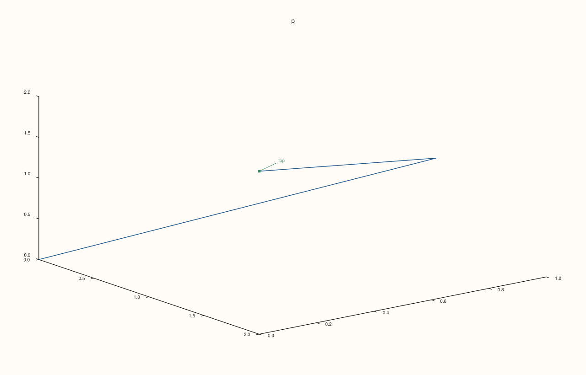
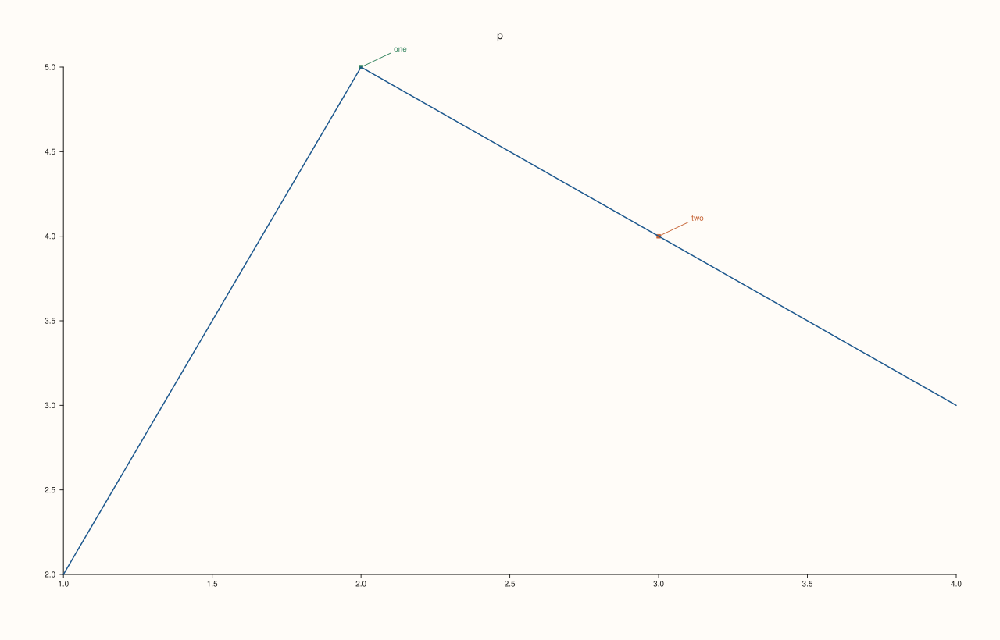

<!-- pluss-hand-authored -->

# Pane::pins

[Back to Pane API Reference](../../pane_api_reference)

## Signature

```cpp
const std::vector<PinCue>& Pane::pins() const noexcept
```

## What It Does

Returns the notes attached to points of the pane, in the order added by [`pin`](pin.md), as a read-only vector of `PinCue`:

| Field | Meaning | Default |
|---|---|---|
| `anchor` | The point the note points at, as `Vec3d` in data units; `z` is 0 on a planar pane. | origin |
| `text` | The note. | empty |
| `offset_x`, `offset_y` | Where the text sits relative to the anchor, in drawing units. | 38, -18 |
| `color` | The stored colour of the note; the figure draws pins in the accents of the pane's theme. | an accent |

The vector is empty for a pane with no pins and only grows; the reference follows later calls, so copy it to keep a snapshot.

## Parameters

*(none)*

## Returns

`const std::vector<PinCue>&`
    The pins, oldest first.

## Examples

Example 1. Listing the pins. Each pin has its anchor, its text and the offset of the text from the anchor.

```cpp
auto fig = studio("pins_list");
auto& pane = fig.pane2("p");
pane.trend(std::vector<double>{1, 2, 3, 4}, std::vector<double>{2, 5, 4, 3});
std::cout << "none yet: " << pane.pins().empty() << "\n";
pane.pin("peak", 2.0, 5.0).pin("end", 4.0, 3.0, -50.0, 24.0);
for (const auto& pin : pane.pins()) std::cout << pin.text << " at (" << pin.anchor.x << ", " << pin.anchor.y << ") offset (" << pin.offset_x << ", " << pin.offset_y << ")\n";
fig.save_svg("figure.svg");
```

### Output

```text
none yet: 1
peak at (2, 5) offset (38, -18)
end at (4, 3) offset (-50, 24)
```



Example 2. Anchors in 3D. A pin on a volumetric pane keeps all three coordinates of its anchor.

```cpp
auto fig = studio("pins_3d");
auto& pane = fig.pane3("p");
pane.path3(std::vector<double>{0, 1, 2}, std::vector<double>{0, 1, 0}, std::vector<double>{0, 1, 2});
pane.pin("top", Vec3d{2.0, 0.0, 2.0});
const auto& anchor = pane.pins().front().anchor;
std::cout << "anchor: " << anchor.x << ", " << anchor.y << ", " << anchor.z << "\n";
fig.save_svg("figure.svg");
```

### Output

```text
anchor: 2, 0, 2
```



Example 3. A snapshot needs a copy. The reference follows the pane, so a copy taken earlier keeps the old list.

```cpp
auto fig = studio("pins_snapshot");
auto& pane = fig.pane2("p");
pane.trend(std::vector<double>{1, 2, 3, 4}, std::vector<double>{2, 5, 4, 3});
pane.pin("one", 2.0, 5.0);
const auto snapshot = pane.pins();
const auto& live = pane.pins();
pane.pin("two", 3.0, 4.0);
std::cout << "snapshot: " << snapshot.size() << ", live: " << live.size() << "\n";
fig.save_svg("figure.svg");
```

### Output

```text
snapshot: 1, live: 2
```



## Notes

- `noexcept`, and has no effect on the figure.

## See Also

- [`Pane::pin`](pin.md): add a pin.
- [`Pane::rules`](rules.md), [`bands`](bands.md): the other cues.

<div class="pluss-inline-prev-next">
  <a class="prev-link" href="pin.html">
    <span class="label">Previous</span>
    <span class="title">pin</span>
  </a>
  <a class="next-link" href="place.html">
    <span class="label">Next</span>
    <span class="title">place</span>
  </a>
</div>
