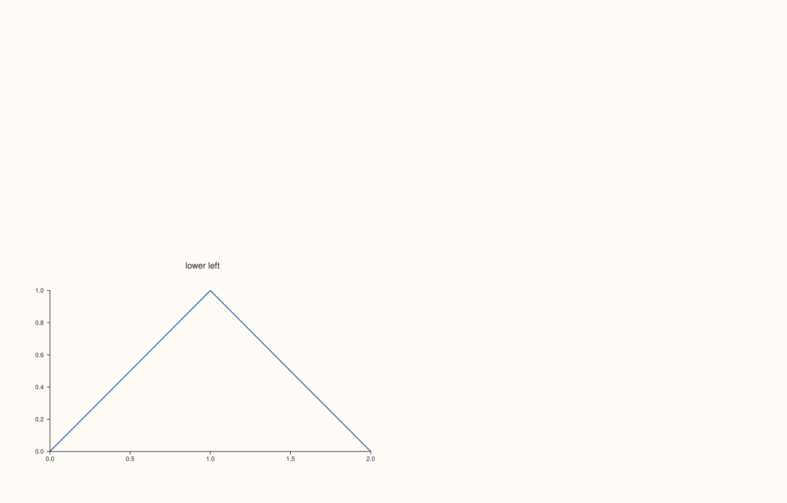
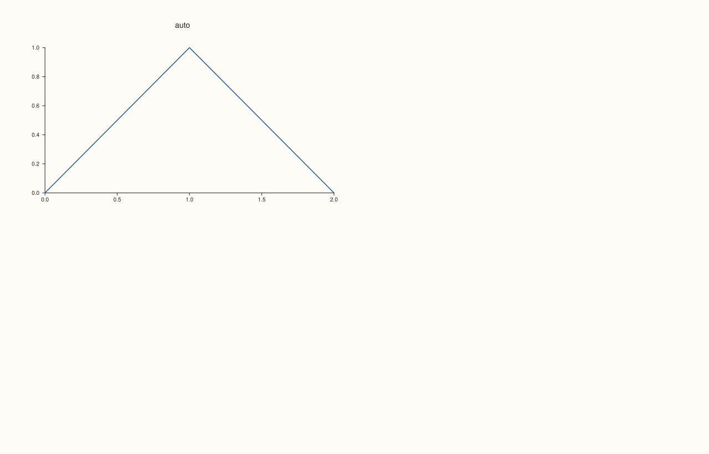
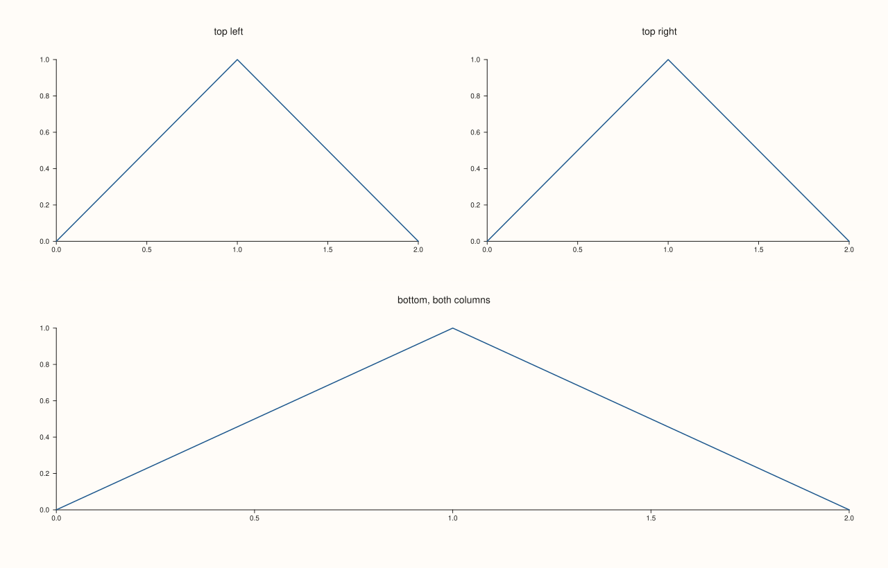
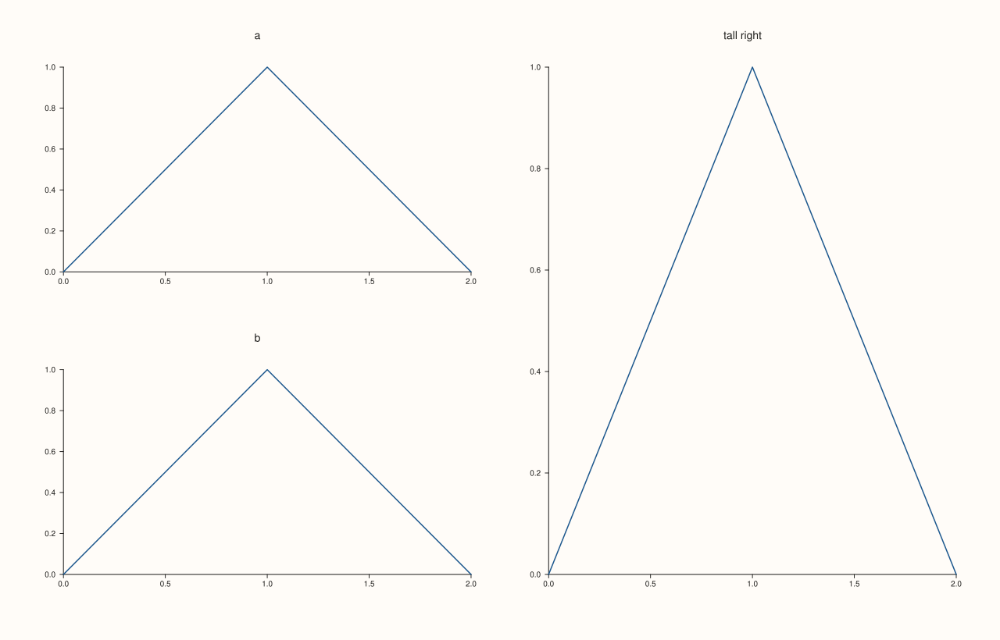
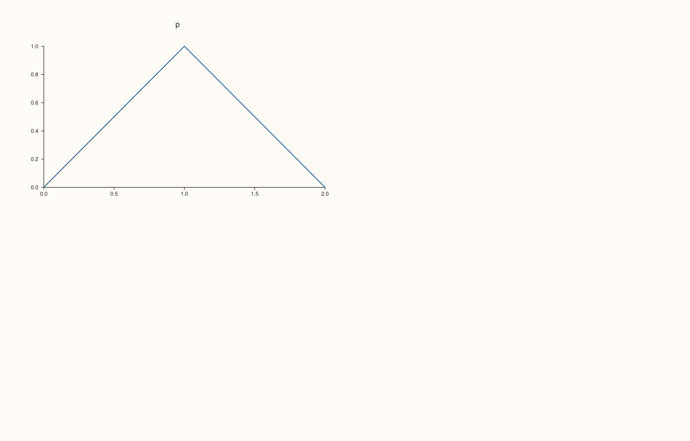
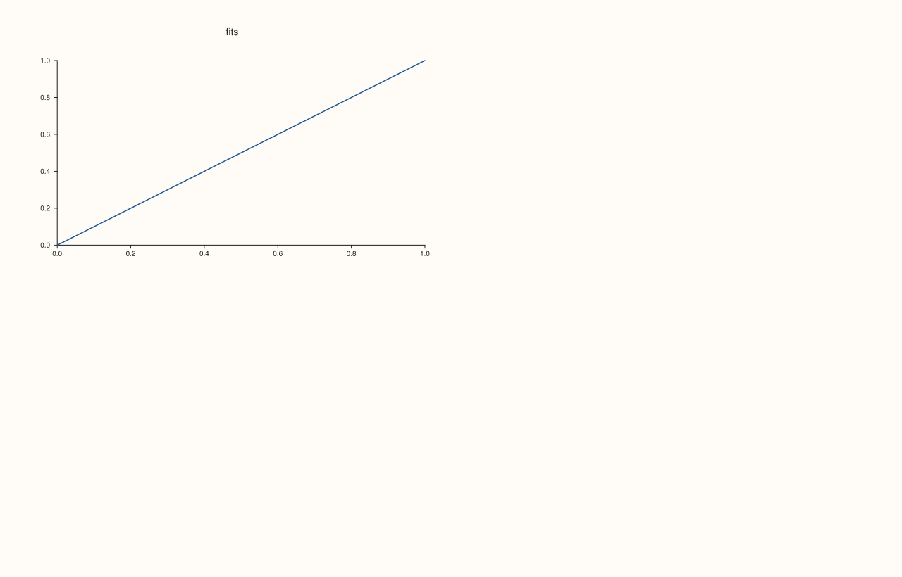
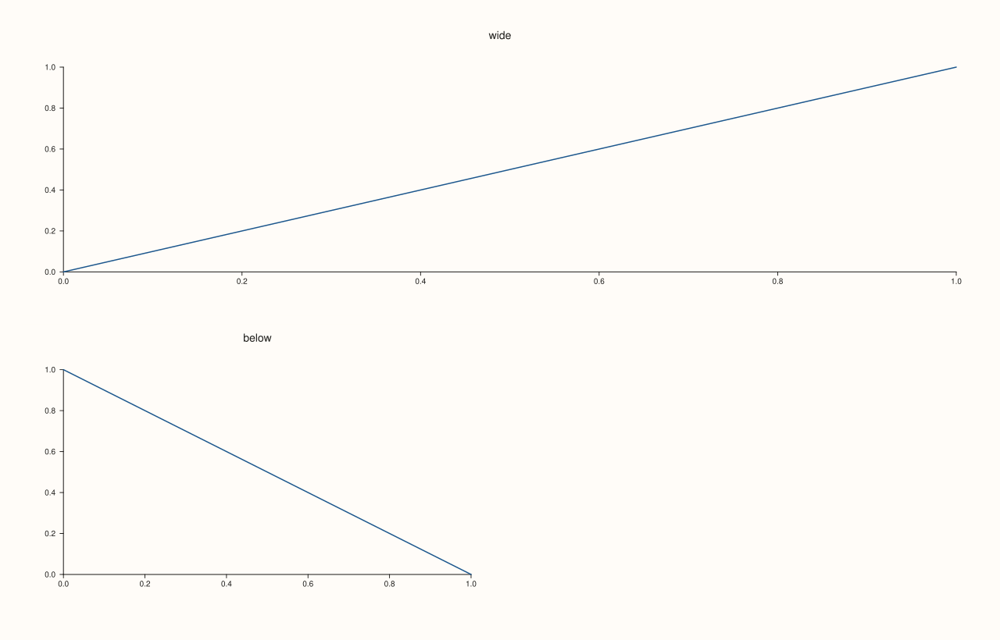

<!-- pluss-hand-authored -->

# Pane::place

[Back to Pane API Reference](../../pane_api_reference)

## Signature

```cpp
Pane& Pane::place(std::int64_t row, std::int64_t col)
Pane& Pane::place(std::int64_t row, std::int64_t col, std::int64_t row_span, std::int64_t col_span)
const PanePlacement& Pane::placement() const noexcept
```

## What It Does

Gives the pane a fixed cell, or a block of cells, in the figure's [`mosaic`](../studio/mosaic.md), instead of the next free cell in the order the panes were added. `place(row, col)` takes one cell; `place(row, col, row_span, col_span)` takes `row_span` rows and `col_span` columns whose top-left cell is `(row, col)`, counted from zero. It is the top-level counterpart of [`Studio::subpane2`](../studio/subpane2.md), which places a pane in a grid nested inside another pane.

Panes that are placed claim their cells first. The panes that are not placed then fill the remaining cells in the order they were added, row by row, skipping the claimed ones. So a figure can have a wide pane across the top and ordinary panes below, without numbering every cell.

`placement()` reads the result back: `row`, `col`, `row_span`, `col_span`, and `explicit_slot`, which is `true` once `place` has been called. The other fields (`parent`, `local_rows`, ...) belong to sub-panes.

`place` checks its own arguments: `row` and `col` must not be negative, and the spans must be positive, or it throws. Whether the block fits the mosaic, and whether it overlaps another pane, depends on the mosaic, which may not be declared yet: those are found when the figure is drawn, and the error says which.

## Parameters

**row**, **col** (`std::int64_t`)
    The top-left cell, counted from zero. Not negative.

**row_span**, **col_span** (`std::int64_t`, default 1 and 1)
    How many rows and columns the pane covers. Positive.

## Returns

**`place`:** `Pane&`, the same pane.
**`placement()`:** `const PanePlacement&`, the slot.

## Examples

Example 1. One cell. The pane is put in the lower left of a 2x2 mosaic, where nothing else would put it first.

```cpp
auto fig = studio("place_one");
fig.mosaic(2, 2);
auto make = [&](const char* name) -> Pane& {
  auto& pane = fig.pane2(name);
  pane.trend(std::vector<double>{0, 1, 2}, std::vector<double>{0, 1, 0});
  return pane;
};
auto& pane = make("lower left");
pane.place(1, 0);
const auto& slot = pane.placement();
std::cout << "row " << slot.row << ", col " << slot.col << ", spans " << slot.row_span << "x" << slot.col_span << ", explicit " << slot.explicit_slot << "\n";
fig.save_svg("figure.svg");
```

### Output

```text
row 1, col 0, spans 1x1, explicit 1
```



Example 2. Without `place` the pane has no slot of its own: `explicit_slot` is false, and the cell is given when the figure is drawn.

```cpp
auto fig = studio("place_default");
fig.mosaic(2, 2);
auto make = [&](const char* name) -> Pane& {
  auto& pane = fig.pane2(name);
  pane.trend(std::vector<double>{0, 1, 2}, std::vector<double>{0, 1, 0});
  return pane;
};
auto& pane = make("auto");
std::cout << "explicit: " << pane.placement().explicit_slot << "\n";
fig.save_svg("figure.svg");
```

### Output

```text
explicit: 0
```



Example 3. A span. A pane covering the whole bottom row of a 2x2 mosaic, with the first two panes added above it.

```cpp
auto fig = studio("place_span");
fig.mosaic(2, 2);
auto make = [&](const char* name) -> Pane& {
  auto& pane = fig.pane2(name);
  pane.trend(std::vector<double>{0, 1, 2}, std::vector<double>{0, 1, 0});
  return pane;
};
make("top left");
make("top right");
auto& wide = make("bottom, both columns");
wide.place(1, 0, 1, 2);
std::cout << "spans " << wide.placement().row_span << " row(s) and " << wide.placement().col_span << " column(s)\n";
fig.save_svg("figure.svg");
```

### Output

```text
spans 1 row(s) and 2 column(s)
```



Example 4. The other panes flow around it. The tall pane is placed on the right column first; the three panes without a slot take the cells left, in the order they were added.

```cpp
auto fig = studio("place_skip");
fig.mosaic(2, 2);
auto make = [&](const char* name) -> Pane& {
  auto& pane = fig.pane2(name);
  pane.trend(std::vector<double>{0, 1, 2}, std::vector<double>{0, 1, 0});
  return pane;
};
make("tall right").place(0, 1, 2, 1);
make("a");
make("b");
std::cout << "panes: " << fig.pane_count() << "\n";
fig.save_svg("figure.svg");
```

### Output

```text
panes: 3
```



Example 5. Bad arguments throw at once: a negative row or column, or a span that is zero or negative.

```cpp
auto fig = studio("place_errors");
fig.mosaic(2, 2);
auto make = [&](const char* name) -> Pane& {
  auto& pane = fig.pane2(name);
  pane.trend(std::vector<double>{0, 1, 2}, std::vector<double>{0, 1, 0});
  return pane;
};
auto& pane = make("p");
try { pane.place(-1, 0); } catch (const pluss::Error& e) { std::cout << e.message() << "\n"; }
try { pane.place(0, -2); } catch (const pluss::Error& e) { std::cout << e.message() << "\n"; }
try { pane.place(0, 0, 0, 1); } catch (const pluss::Error& e) { std::cout << e.message() << "\n"; }
try { pane.place(0, 0, 1, -1); } catch (const pluss::Error& e) { std::cout << e.message() << "\n"; }
std::cout << "still explicit: " << pane.placement().explicit_slot << "\n";
fig.save_svg("figure.svg");
```

### Output

```text
place: row/col must be non-negative and spans must be positive
place: row/col must be non-negative and spans must be positive
place: row/col must be non-negative and spans must be positive
place: row/col must be non-negative and spans must be positive
still explicit: 0
```



Example 6. A slot outside the mosaic is found when the figure is drawn. Here the pane is placed at row 5 of a mosaic with two rows.

```cpp
auto fig = studio("place_outside");
fig.mosaic(2, 2);
auto make = [&](const char* name) -> Pane& {
  auto& pane = fig.pane2(name);
  pane.trend(std::vector<double>{0, 1, 2}, std::vector<double>{0, 1, 0});
  return pane;
};
make("p").place(5, 5);
try { fig.to_svg(); } catch (const pluss::Error& e) { std::cout << e.message() << "\n"; }
auto ok = studio("place_outside_out");
ok.mosaic(2, 2);
ok.pane2("fits").trend(std::vector<double>{0, 1}, std::vector<double>{0, 1});
ok.save_svg("figure.svg");
```

### Output

```text
pane placement exceeds mosaic bounds
```



Example 7. Two panes claiming the same cell are found when the figure is drawn too: the wide pane covers both cells of the top row, and the second pane is placed in one of them.

```cpp
auto fig = studio("place_overlap");
fig.mosaic(2, 2);
auto make = [&](const char* name) -> Pane& {
  auto& pane = fig.pane2(name);
  pane.trend(std::vector<double>{0, 1, 2}, std::vector<double>{0, 1, 0});
  return pane;
};
make("wide").place(0, 0, 1, 2);
make("clash").place(0, 1);
try { fig.to_svg(); } catch (const pluss::Error& e) { std::cout << e.message() << "\n"; }
auto ok = studio("place_overlap_out");
ok.mosaic(2, 2);
auto& wide = ok.pane2("wide");
wide.trend(std::vector<double>{0, 1}, std::vector<double>{0, 1});
wide.place(0, 0, 1, 2);
auto& below = ok.pane2("below");
below.trend(std::vector<double>{0, 1}, std::vector<double>{1, 0});
below.place(1, 0);
ok.save_svg("figure.svg");
```

### Output

```text
pane placement overlaps an occupied mosaic cell
```



## Notes

- `place` throws `pluss::Error` for a negative cell or a non-positive span; `placement()` is `noexcept`.
- The checks against the mosaic (fit and overlap) are made when the figure is drawn, so they follow the final size of the mosaic.

## See Also

- [`Studio::mosaic`](../studio/mosaic.md): the grid that is filled.
- [`Studio::subpane2`](../studio/subpane2.md), [`subpane3`](../studio/subpane3.md): a nested grid inside a pane.
- [`Studio::pane2`](../studio/pane2.md): makes the pane.

<div class="pluss-inline-prev-next">
  <a class="prev-link" href="pins.html">
    <span class="label">Previous</span>
    <span class="title">pins</span>
  </a>
  <a class="next-link" href="placement.html">
    <span class="label">Next</span>
    <span class="title">placement</span>
  </a>
</div>
