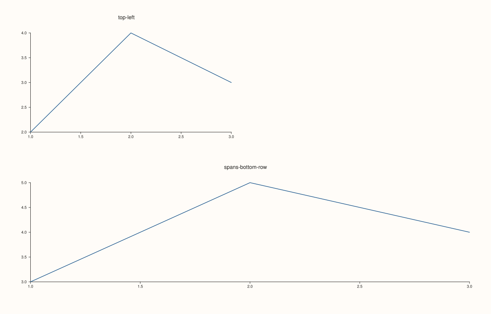

<!-- pluss-hand-authored -->

# Pane::place / placement

[Back to Pane API Reference](../../pane_api_reference)

## Signatures

```cpp
Pane& Pane::place(std::int64_t row, std::int64_t col)
Pane& Pane::place(std::int64_t row, std::int64_t col, std::int64_t row_span = 1, std::int64_t col_span = 1)
const PanePlacement& Pane::placement() const noexcept
```

## What It Does

Explicitly assigns this pane a fixed cell (or spanning block of cells) in the **figure's
own top-level** [`Studio::mosaic()`](../studio/mosaic.md) grid — the top-level counterpart
of [`Studio::subpane2()`](../studio/subpane2.md)/[`subpane3()`](../studio/subpane3.md),
which place a pane in a *nested* subgrid within another pane instead. Two overloads:

- **`place(row, col)`** — a 1×1 slot; exactly `place(row, col, 1, 1)`.
- **`place(row, col, row_span, col_span)`** — spans `row_span` rows and `col_span`
  columns starting at `(row, col)`.

`placement()` reads back the resulting `PanePlacement` — `row`, `col`, `row_span`,
`col_span`, `explicit_slot` (`true` once `place()` has been called), and (unrelated to
`place()` itself) `parent`/`local_rows`/`local_cols`/`local_gutter_x`/`local_gutter_y`,
which [`subpane2()`](../studio/subpane2.md)/[`subpane3()`](../studio/subpane3.md) use for
nested placement instead.

```{important} Validates the slot shape, not whether it fits the mosaic
`place()` only checks its own four parameters in isolation — `row`/`col` must be
non-negative and `row_span`/`col_span` must be positive, or it throws
`std::invalid_argument("place: row/col must be non-negative and spans must be positive")`.
Whether the requested slot actually fits within (or overlaps another pane in) the figure's
current `mosaic()` dimensions is **not** checked here — that's a render-time concern (see
[`Studio::mosaic()`](../studio/mosaic.md)'s own documentation of the overlap/overflow
errors that surface there instead).
```

## Parameters

**row**, **col** (`std::int64_t`)
    The 0-indexed top-level mosaic cell. Must be non-negative.

**row_span**, **col_span** (`std::int64_t`, default `1`, `1`, second overload only)
    How many rows/columns this pane spans starting from `row`/`col`. Must be positive.

## Returns

**`place()`:** `Pane&` — a reference to the same pane, for chaining.

**`placement()`:** `const PanePlacement&` — the current placement state.

## Examples

Example 1. An explicit 1×1 slot, and a pane spanning an entire row.

```cpp
using namespace pluss::pl;

auto fig = studio("place_default_span");
fig.mosaic(2, 2);
auto& top_left = fig.pane2("top-left");
top_left.trend(std::vector<double>{1.0, 2.0, 3.0}, std::vector<double>{2.0, 4.0, 3.0});
top_left.place(0, 0);
std::int64_t tl_row = top_left.placement().row;
std::int64_t tl_col = top_left.placement().col;
bool tl_explicit = top_left.placement().explicit_slot;

auto& bottom_row = fig.pane2("spans-bottom-row");
bottom_row.trend(std::vector<double>{1.0, 2.0, 3.0}, std::vector<double>{3.0, 5.0, 4.0});
bottom_row.place(1, 0, 1, 2);
std::int64_t br_col_span = bottom_row.placement().col_span;

fig.show();

std::cout << tl_row << " " << tl_col << " " << tl_explicit << "\n";
std::cout << br_col_span << "\n";
```

### Output

```text
0 0 1
2
```



Example 2. Both validation failures.

```cpp
using namespace pluss::pl;

auto fig = studio("place_failure");
fig.mosaic(2, 2);
auto& pane = fig.pane2();
pane.trend(std::vector<double>{1.0, 2.0}, std::vector<double>{1.0, 2.0});

try {
  pane.place(-1, 0);
} catch (const std::invalid_argument& e) {
  std::cout << e.what() << "\n";
}

try {
  pane.place(0, 0, 0, 1);
} catch (const std::invalid_argument& e) {
  std::cout << e.what() << "\n";
}
```

### Output

```text
place: row/col must be non-negative and spans must be positive
place: row/col must be non-negative and spans must be positive
```

## Notes

- `place()` is not `noexcept` (validates its four parameters); `placement()` **is**
  `noexcept` — no ambiguity hazard here, since `placement()` takes no arguments at all in
  either its own const accessor role and has no same-named setter to collide with.
- Only validates the shape of the request, not whether it fits the current mosaic — see
  the important callout above.
- The same reference-invalidation rule as [`pane2()`](../studio/pane2.md) applies: read
  `placement()`'s fields immediately after calling `place()`, before creating the next
  pane — both examples on this page follow that pattern.
- Without any `place()` call, a pane's position in the mosaic is inferred automatically
  from creation order (row-major auto-flow).

## See Also

- [`Studio::mosaic`](../studio/mosaic.md): defines the top-level grid `place()` positions
  a pane within, and where overlap/overflow errors actually surface.
- [`Studio::subpane2`](../studio/subpane2.md) / [`subpane3`](../studio/subpane3.md): the
  nested-subgrid counterpart to this top-level placement.

<div class="pluss-inline-prev-next">
  <a class="prev-link" href="parallel_xy_labels.html">
    <span class="label">Previous</span>
    <span class="title">parallel_xy_labels</span>
  </a>
  <a class="next-link" href="tick_font_scale.html">
    <span class="label">Next</span>
    <span class="title">tick_font_scale</span>
  </a>
</div>
