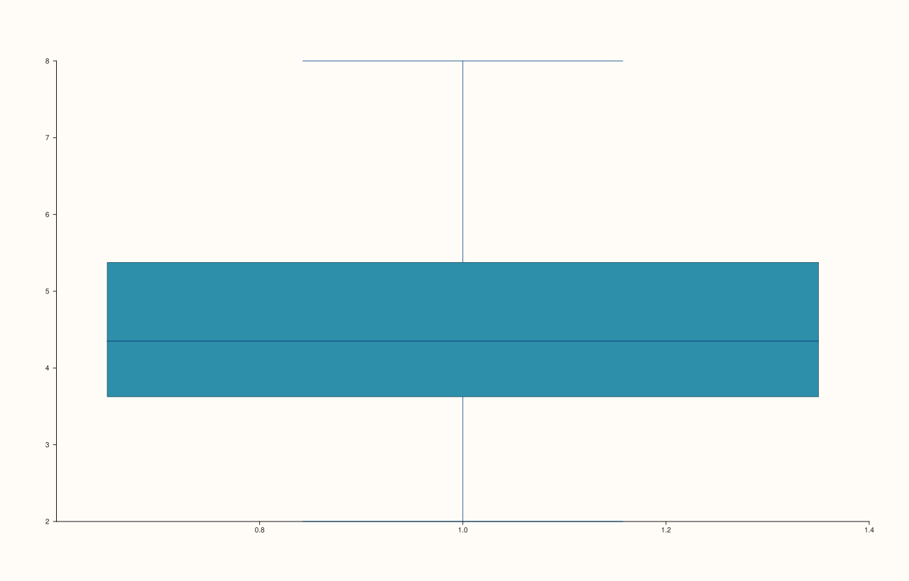
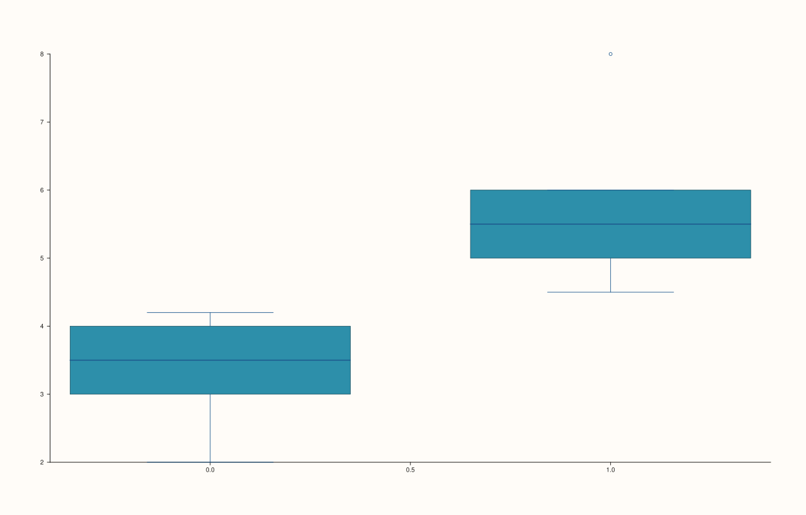

<!-- pluss-hand-authored -->

# Pane::quartet

[Back to Pane API Reference](../../pane_api_reference)

## Signatures

```cpp
template <class Values>
Trace& Pane::quartet(Values&& values)

template <class Group, class Values>
Trace& Pane::quartet(Group&& group, Values&& values)
```

## What It Does

Adds a quartile-summary (box-and-whisker style) trace — the low-level primitive behind
`flash::boxplot`. Two overloads:

- **`quartet(values)`** — one summary computed over the whole `values` series.
- **`quartet(group, values)`** — `values` split by `group` (any series-convertible
  grouping key, one summary drawn per distinct group value).

## Parameters

**values** (series-convertible)
    The raw observations to summarize.

**group** (series-convertible, second overload only)
    A per-observation grouping key, paired with `values` by index — one quartile summary
    is drawn per distinct group value.

## Returns

`Trace&`
    A reference to the newly created trace, for chaining.

## Examples

Example 1. A single ungrouped quartile summary.

```cpp
using namespace pluss::pl;

auto fig = studio("quartet_ungrouped");
auto& pane = fig.pane2();
std::vector<double> values{2.0, 3.0, 3.5, 4.0, 4.2, 4.5, 5.0, 5.5, 6.0, 8.0};
pane.quartet(values);
fig.show();
```



Example 2. The same values split into two groups — verified via direct SVG diff to
render genuinely different (two separate summaries, rather than one combined) output.

```cpp
using namespace pluss::pl;

auto fig = studio("quartet_grouped");
auto& pane = fig.pane2();
std::vector<double> values{2.0, 3.0, 3.5, 4.0, 4.2, 4.5, 5.0, 5.5, 6.0, 8.0};
std::vector<double> group{0.0, 0.0, 0.0, 0.0, 0.0, 1.0, 1.0, 1.0, 1.0, 1.0};
pane.quartet(group, values);
fig.show();
```



## Notes

- Not `noexcept` (constructs `Series` from the input arguments, which may throw for
  malformed input).
- No exception was observed for a mismatched `group`/`values` length in isolated testing
  of this method — treat a length mismatch as unverified/unsupported input rather than
  assuming a specific error.
- `flash::boxplot` is a convenience wrapper around this exact method.

## See Also

- [`Pane::bucket`](bucket.md): another statistics-summarizing trace kind, computing a
  binned count instead of quartile statistics.
- [`Pane::columns`](columns.md): draws pre-computed values directly rather than computing
  a statistical summary.

<div class="pluss-inline-prev-next">
  <a class="prev-link" href="bucket.html">
    <span class="label">Previous</span>
    <span class="title">bucket</span>
  </a>
  <a class="next-link" href="wedge.html">
    <span class="label">Next</span>
    <span class="title">wedge</span>
  </a>
</div>
