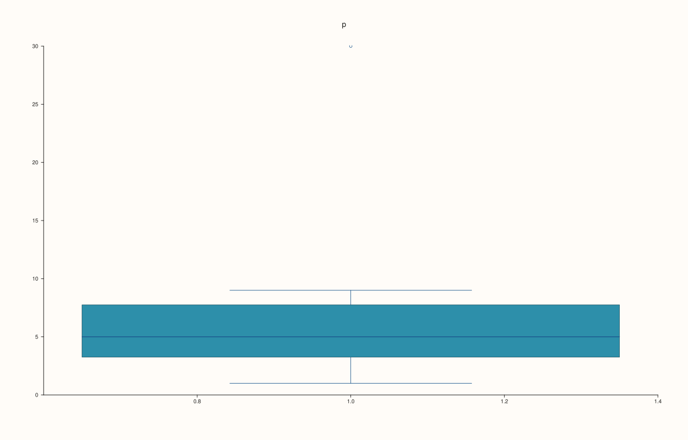
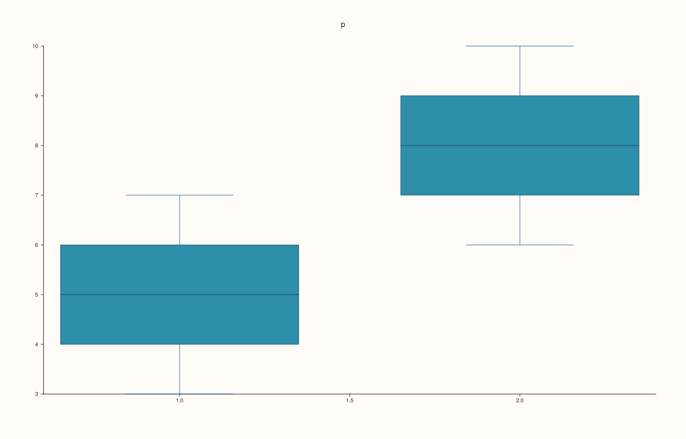
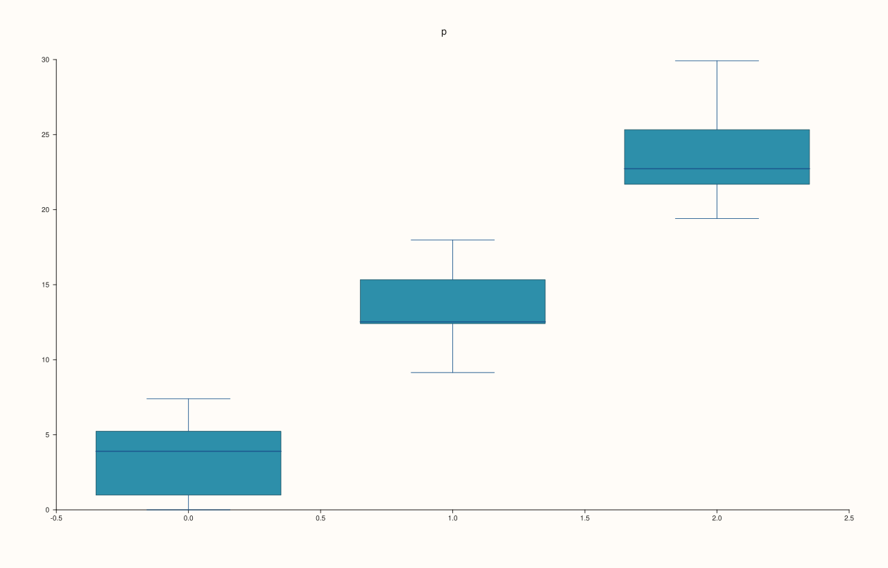
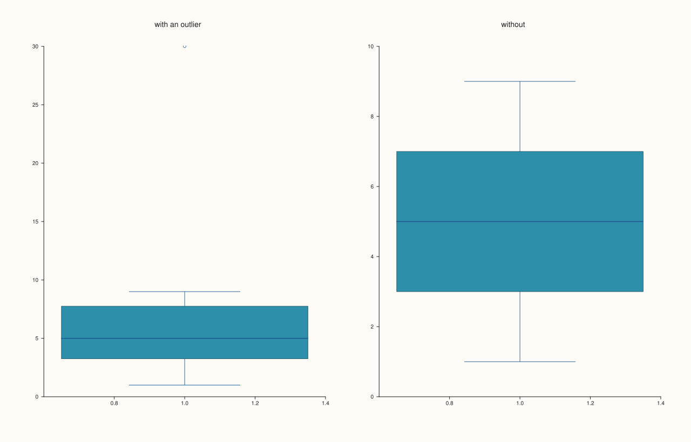

<!-- pluss-hand-authored -->

# Pane::quartet

[Back to Pane API Reference](../../pane_api_reference)

## Signature

```cpp
Trace& Pane::quartet(Series values)
Trace& Pane::quartet(Series group, Series values)
```

## What It Does

Adds a **box-and-whisker** summary of a sample: a box from the first to the third quartile with a line at the median, whiskers to the most extreme values that are not outliers, and the outliers as separate points. It shows the centre, the spread and the skew of a sample in a small space, and is the usual way to compare several samples.

| Call | Draws |
|---|---|
| `quartet(values)` | One box for all the values. |
| `quartet(group, values)` | One box for each distinct value of `group`, over the values in that group. |

`group` and `values` have the same length. There must be at least one value. Several boxes in one trace share one colour; to give samples different colours add them as separate traces.

## Parameters

**values** (`Series`-convertible)
    The sample. Not empty.

**group** (`Series`-convertible, optional)
    The group of each value; same length as `values`.

## Returns

`Trace&`
    The new trace.

## Examples

Example 1. One summary over all the values: the box spans the middle half of the data, the line in it is the median, and the whiskers reach out to the extremes that are not outliers.

```cpp
auto fig = studio("quartet_one");
auto& pane = fig.pane2("p");
pane.quartet(std::vector<double>{1, 2, 3, 4, 5, 6, 7, 8, 9, 30});
fig.save_svg("figure.svg");
```



Example 2. A group series splits the values into groups, one box for each distinct group value, in the order the groups first appear.

```cpp
auto fig = studio("quartet_groups");
auto& pane = fig.pane2("p");
pane.quartet(std::vector<double>{1, 1, 1, 1, 1, 2, 2, 2, 2, 2}, std::vector<double>{3, 4, 5, 6, 7, 6, 7, 8, 9, 10});
fig.save_svg("figure.svg");
```



Example 3. Three groups, to compare the spread of three samples at a glance.

```cpp
auto fig = studio("quartet_three");
auto& pane = fig.pane2("p");
std::vector<double> group, value;
for (int g = 0; g < 3; ++g) {
  for (int i = 0; i < 8; ++i) {
    group.push_back(g);
    value.push_back(10.0 * g + 3.0 * std::sin(1.7 * i + g) + i);
  }
}
pane.quartet(group, value);
fig.save_svg("figure.svg");
```



Example 4. A value far from the rest is drawn on its own beyond the whisker rather than stretching the box: the single 30 above stands apart from the data that runs to 9.

```cpp
auto fig = studio("quartet_outlier");
fig.mosaic(1, 2);
auto& with = fig.pane2("with an outlier");
with.quartet(std::vector<double>{1, 2, 3, 4, 5, 6, 7, 8, 9, 30});
auto& without = fig.pane2("without");
without.quartet(std::vector<double>{1, 2, 3, 4, 5, 6, 7, 8, 9});
fig.save_svg("figure.svg");
```



Example 5. Inputs that cannot be drawn are refused when the trace is added, and the message names the method and the problem. The pane keeps the traces it had.

```cpp
auto report = [](const char* what, auto&& call) {
  auto fig = studio("quartet_errors");
  auto& pane = fig.pane2("p");
  try {
    call(pane);
    std::cout << what << ": accepted\n";
  } catch (const pluss::Error& e) {
    std::cout << what << ": " << e.message() << "\n";
  }
};
report("group and values differ", [](Pane& pane) { pane.quartet(std::vector<double>{1, 2}, std::vector<double>{1, 2, 3}); });
report("no values", [](Pane& pane) { pane.quartet(std::vector<double>{}); });
auto fig = studio("quartet_errors_out");
auto& pane = fig.pane2("p");
pane.trend(std::vector<double>{0, 1}, std::vector<double>{0, 1});
fig.save_svg("figure.svg");
```

### Output

```text
group and values differ: quartet: series lengths must match or broadcast from scalar
no values: quartet: values must be a non-empty vector
```


Example 6. `quartet` needs a planar pane. On a volumetric pane it throws at once, naming the kind it needs, and nothing is added.

```cpp
auto fig = studio("quartet_wrong_pane");
auto& pane = fig.pane3("p");
try {
  pane.quartet(std::vector<double>{1, 2, 3});
} catch (const pluss::Error& e) {
  std::cout << e.message() << "\n";
}
std::cout << "traces: " << pane.trace_count() << "\n";
fig.save_svg("figure.svg");
```

### Output

```text
quartet requires a planar pane
traces: 0
```


## Notes

- Returns the new [`Trace&`](../trace/label.md); the reference stays valid for the life of the pane, and the style calls of the trace ([`label`](../trace/label.md), [`stroke`](../trace/stroke.md), [`width`](../trace/width.md), ...) chain off it.
- The data is copied into the trace when it is added, so changing the vector afterwards does not change the figure.

## See Also

- [`Pane::violin`](violin.md): the shape of the distribution.
- [`Pane::bucket`](bucket.md): the histogram.

<div class="pluss-inline-prev-next">
  <a class="prev-link" href="placement.html">
    <span class="label">Previous</span>
    <span class="title">placement</span>
  </a>
  <a class="next-link" href="radial.html">
    <span class="label">Next</span>
    <span class="title">radial</span>
  </a>
</div>
