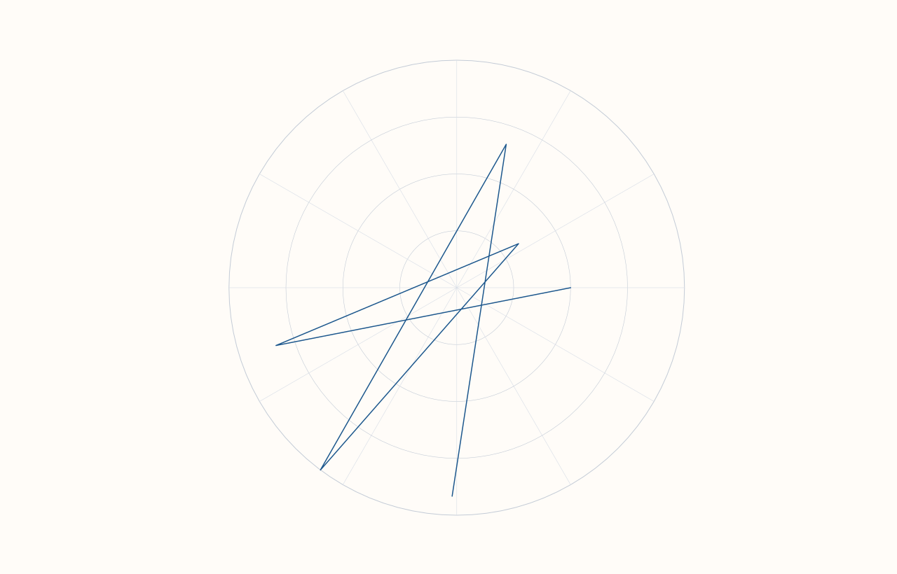

<!-- pluss-hand-authored -->

# Pane::radial

[Back to Pane API Reference](../../pane_api_reference)

## Signatures

```cpp
template <class Theta, class Radius>
Trace& Pane::radial(Theta&& theta, Radius&& radius)
```

## What It Does

Adds a polar (radar/spider-chart-style) trace — a closed polygon connecting
`(theta[i], radius[i])` points, where `theta` is an angle (in degrees) and `radius` is the
distance from the pane's center at that angle. There is only one overload: both series are
always required, always paired positionally by index, and there is no options struct to
toggle.

```{important} Requires a Planar pane
Calling `radial()` on a `Volumetric` pane throws
`std::logic_error("radial requires a planar pane")`.
```

## Parameters

**theta** (series-convertible)
    Angles, in degrees, for each vertex of the polygon.

**radius** (series-convertible)
    The distance from center at the corresponding angle, paired with `theta` by index.

## Returns

`Trace&`
    A reference to the newly created trace, for chaining.

## Examples

Example 1. A six-vertex radar-style polygon.

```cpp
using namespace pluss::pl;

auto fig = studio("radial_basic");
auto& pane = fig.pane2();
pane.radial(std::vector<double>{0.0, 60.0, 120.0, 180.0, 240.0, 300.0}, std::vector<double>{3.0, 5.0, 2.0, 6.0, 4.0, 5.5});
fig.show();
```



## Notes

- Not `noexcept`.
- `theta` and `radius` must have matching lengths (paired by index); a mismatch was not
  specifically exercised here — treat it as unverified/unsupported input rather than
  assuming a specific error, consistent with the general pattern observed across other
  paired-series trace methods (e.g. [`Pane::quartet`](quartet.md)'s `group`/`values`).
- `radial()` is a single, un-overloaded entry point — unlike most other trace-creation
  methods on `Pane`, there is no grouped variant, no options struct, and no alternate
  call shape to choose between.
- A single `Pane` supports drawing a `radial()` trace alongside ordinary Cartesian traces
  (e.g. [`trend()`](trend.md), [`cloud()`](cloud.md)) in the same pane — this method does
  not require or imply a dedicated "polar pane" kind; it is simply another `TraceKind`
  layered onto the same 2D `Planar` pane.
- `flash::`'s radar/polar-chart-family function (if present) is a convenience wrapper
  around this exact method.

## See Also

- [`Pane::trend`](trend.md): the ordinary Cartesian line-trace counterpart.
- [`Pane::wedge`](wedge.md): another whole-shape trace kind (a pie), likewise requiring a
  `Planar` pane.

<div class="pluss-inline-prev-next">
  <a class="prev-link" href="violin.html">
    <span class="label">Previous</span>
    <span class="title">violin</span>
  </a>
  <a class="next-link" href="whisk.html">
    <span class="label">Next</span>
    <span class="title">whisk</span>
  </a>
</div>
