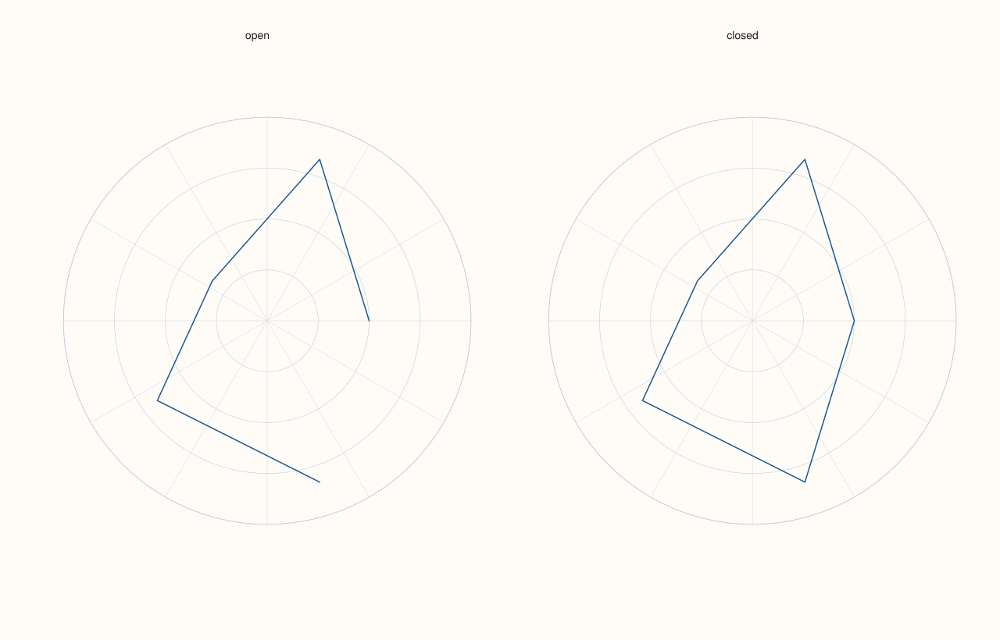
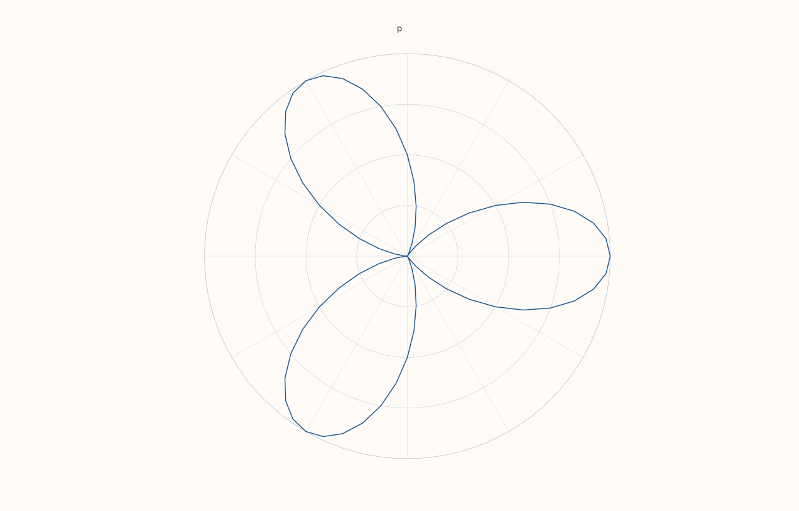
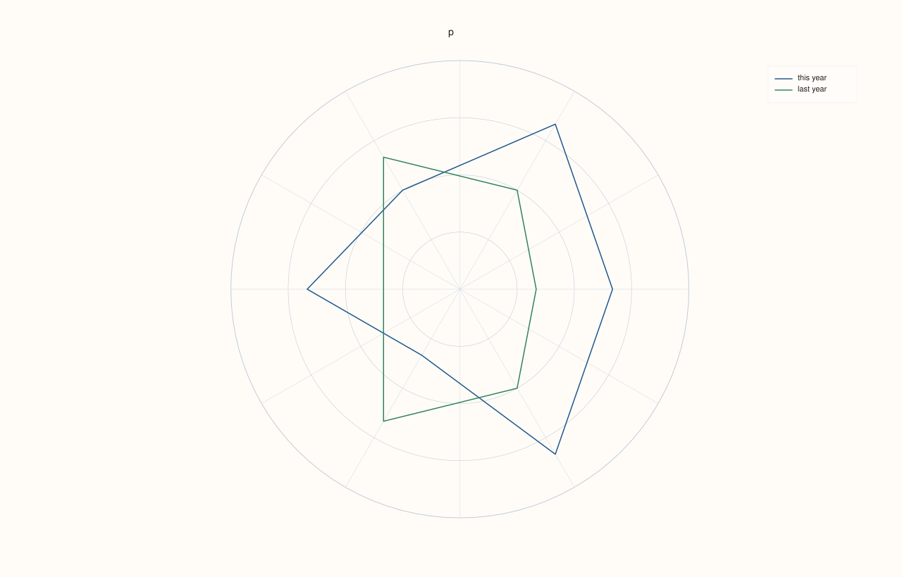
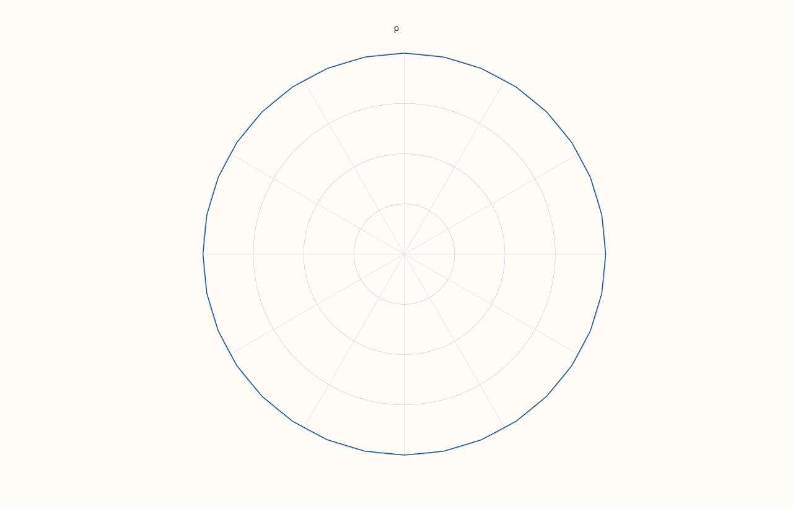

<!-- pluss-hand-authored -->

# Pane::radial

[Back to Pane API Reference](../../pane_api_reference)

## Signature

```cpp
Trace& Pane::radial(Series theta, Series radius)
```

## What It Does

Adds a **polar trace**: points given by an angle and a distance from the centre, joined in the order given. It is the trace of radar (spider) charts and of curves written in polar form. `theta` is in **radians**, counted anticlockwise from the direction of the positive x axis (to the right); `radius` is the distance from the centre, in the units of the pane. The trace is an open line: repeat the first point at the end to close a shape. A pane that holds only radial traces is drawn as a round plot with rings and spokes instead of x and y axes.

`theta` and `radius` have the same length, or one of them has length 1.

## Parameters

**theta** (`Series`-convertible)
    The angles, in radians.

**radius** (`Series`-convertible)
    The distances from the centre.

## Returns

`Trace&`
    The new trace.

## Examples

Example 1. Angle and radius for each point, the angle in radians counted anticlockwise from the right. Five points at equal angles of a fifth of a turn, with their radii.

```cpp
auto fig = studio("radial_basic");
auto& pane = fig.pane2("p");
std::vector<double> theta, radius{3, 5, 2, 4, 5};
for (int i = 0; i < 5; ++i) theta.push_back(2.0 * 3.141592653589793 * i / 5.0);
pane.radial(theta, radius);
fig.save_svg("figure.svg");
```


Example 2. The points are joined in the order given and the last is not joined to the first. To close a shape, repeat the first point at the end: the second figure is closed.

```cpp
auto fig = studio("radial_closed");
fig.mosaic(1, 2);
std::vector<double> theta, radius{3, 5, 2, 4, 5};
for (int i = 0; i < 5; ++i) theta.push_back(2.0 * 3.141592653589793 * i / 5.0);
auto& open = fig.pane2("open");
open.radial(theta, radius);
theta.push_back(theta.front());
radius.push_back(radius.front());
auto& closed = fig.pane2("closed");
closed.radial(theta, radius);
fig.save_svg("figure.svg");
```



Example 3. Many points make a smooth curve: a three-petal rose, `r = 1 + cos(3 theta)`, sampled every 5 degrees (theta in radians).

```cpp
auto fig = studio("radial_rose");
auto& pane = fig.pane2("p");
std::vector<double> theta, radius;
for (int degrees = 0; degrees <= 360; degrees += 5) {
  const double t = degrees * 3.141592653589793 / 180.0;
  theta.push_back(t);
  radius.push_back(1.0 + std::cos(3.0 * t));
}
pane.radial(theta, radius);
fig.save_svg("figure.svg");
```



Example 4. Two traces on one polar pane, to compare two profiles on the same scale: six directions each, both closed.

```cpp
auto fig = studio("radial_two");
auto& pane = fig.pane2("p");
std::vector<double> theta;
for (int i = 0; i <= 6; ++i) theta.push_back(2.0 * 3.141592653589793 * i / 6.0);
pane.radial(theta, std::vector<double>{4, 5, 3, 4, 2, 5, 4}).label("this year");
pane.radial(theta, std::vector<double>{2, 3, 4, 2, 4, 3, 2}).label("last year");
pane.legend(KeyPlace::NorthEast);
fig.save_svg("figure.svg");
```



Example 5. A single radius is repeated for every angle: points on a circle of that radius, here 33 points around it.

```cpp
auto fig = studio("radial_circle");
auto& pane = fig.pane2("p");
std::vector<double> theta;
for (int i = 0; i <= 32; ++i) theta.push_back(2.0 * 3.141592653589793 * i / 32.0);
pane.radial(theta, std::vector<double>{4});
fig.save_svg("figure.svg");
```



Example 6. Inputs that cannot be drawn are refused when the trace is added, and the message names the method and the problem. The pane keeps the traces it had.

```cpp
auto report = [](const char* what, auto&& call) {
  auto fig = studio("radial_errors");
  auto& pane = fig.pane2("p");
  try {
    call(pane);
    std::cout << what << ": accepted\n";
  } catch (const pluss::Error& e) {
    std::cout << what << ": " << e.message() << "\n";
  }
};
report("lengths differ", [](Pane& pane) { pane.radial(std::vector<double>{0, 1.5, 3}, std::vector<double>{1, 2}); });
auto fig = studio("radial_errors_out");
auto& pane = fig.pane2("p");
pane.trend(std::vector<double>{0, 1}, std::vector<double>{0, 1});
fig.save_svg("figure.svg");
```

### Output

```text
lengths differ: radial: series lengths must match or broadcast from scalar
```


Example 7. `radial` needs a planar pane. On a volumetric pane it throws at once, naming the kind it needs, and nothing is added.

```cpp
auto fig = studio("radial_wrong_pane");
auto& pane = fig.pane3("p");
try {
  pane.radial(std::vector<double>{0, 1}, std::vector<double>{1, 2});
} catch (const pluss::Error& e) {
  std::cout << e.message() << "\n";
}
std::cout << "traces: " << pane.trace_count() << "\n";
fig.save_svg("figure.svg");
```

### Output

```text
radial requires a planar pane
traces: 0
```


## Notes

- Returns the new [`Trace&`](../trace/label.md); the reference stays valid for the life of the pane, and the style calls of the trace ([`label`](../trace/label.md), [`stroke`](../trace/stroke.md), [`width`](../trace/width.md), ...) chain off it.
- The data is copied into the trace when it is added, so changing the vector afterwards does not change the figure.

## See Also

- [`Pane::trend`](trend.md): points on x and y axes.

<div class="pluss-inline-prev-next">
  <a class="prev-link" href="quartet.html">
    <span class="label">Previous</span>
    <span class="title">quartet</span>
  </a>
  <a class="next-link" href="ribbon.html">
    <span class="label">Next</span>
    <span class="title">ribbon</span>
  </a>
</div>
