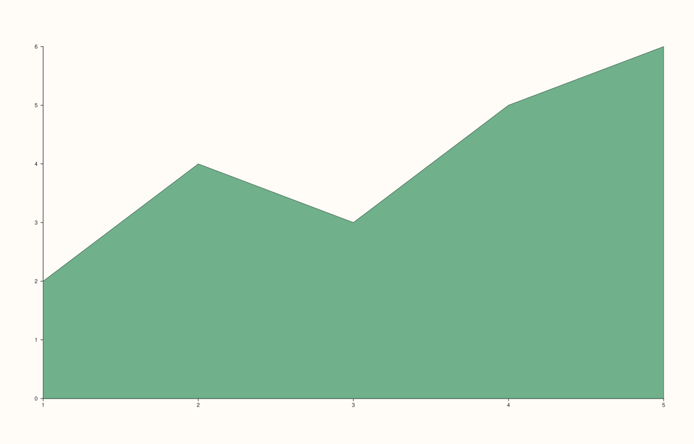
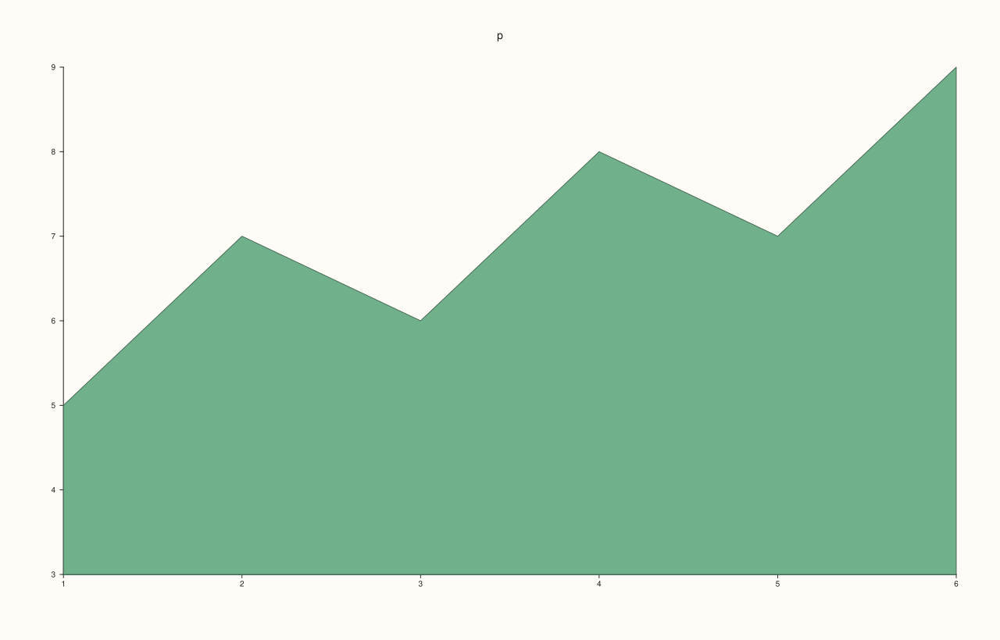

<!-- pluss-hand-authored -->

# Pane::ribbon

[Back to Pane API Reference](../../pane_api_reference)

## Signatures

```cpp
template <class Y>
Trace& Pane::ribbon(Y&& y, double base = 0.0)

template <class X, class Y>
Trace& Pane::ribbon(X&& x, Y&& y, double base = 0.0)
```

## What It Does

Adds a filled-band ("ribbon" / area-under-curve) trace — the region between a `base`
baseline and each `y[i]` value, filled solid, at position `x[i]`. Two overloads, split on
whether `x` is supplied explicitly:

- **`ribbon(y, base = 0.0)`** — `x` is auto-assigned as `0, 1, 2, …`.
- **`ribbon(x, y, base = 0.0)`** — `x` is supplied explicitly.

Both overloads share the same `base` default of `0.0` (the ribbon fills down to the y-axis
origin unless told otherwise).

## Parameters

**y** (series-convertible)
    The upper edge of the filled band at each point.

**x** (series-convertible, two-argument overload only)
    The explicit horizontal position of each point. When omitted (one-argument overload),
    positions are auto-assigned as `0, 1, 2, …`.

**base** (`double`, default `0.0`)
    The baseline the band fills down (or up) to. `0.0` fills to the y-axis origin;
    a non-zero `base` shifts the *bottom* edge of the filled region, not the top —
    `y` values remain exactly where given.

## Returns

`Trace&`
    A reference to the newly created trace, for chaining.

## Examples

Example 1. A filled band from the default `base = 0.0`, `x` auto-assigned.

```cpp
using namespace pluss::pl;

auto fig = studio("ribbon_y_only");
auto& pane = fig.pane2();
pane.ribbon(std::vector<double>{2.0, 4.0, 3.0, 5.0, 6.0});
fig.show();
```



Example 2. The same `y` values, with `x` given explicitly instead of auto-assigned.
Verified via direct SVG diff to render genuinely different from Example 1.

```cpp
using namespace pluss::pl;

auto fig = studio("ribbon_xy");
auto& pane = fig.pane2();
pane.ribbon(std::vector<double>{10.0, 20.0, 30.0, 40.0, 50.0}, std::vector<double>{2.0, 4.0, 3.0, 5.0, 6.0});
fig.show();
```


Example 3. A non-zero `base` — the filled region now runs from `1.5` up to each `y[i]`
rather than from `0.0`. Verified via direct SVG diff to render genuinely different from
Example 1 (a visibly shifted/shortened bottom edge).

```cpp
using namespace pluss::pl;

auto fig = studio("ribbon_base");
auto& pane = fig.pane2();
pane.ribbon(std::vector<double>{2.0, 4.0, 3.0, 5.0, 6.0}, 1.5);
fig.show();
```



## Notes

- Not `noexcept`.
- Named-parameter style is not available in C++ — to set `base` on the auto-`x` overload
  while keeping `x` auto-assigned, call the one-argument-plus-`base` overload
  (`ribbon(y, base)`) rather than trying to pass a placeholder `x`.
- `flash::areaplot` (if present) is a convenience wrapper around this exact method.

## See Also

- [`Pane::spike`](spike.md): the discrete-stem sibling of this method — same parameter
  shape (`y`, optional `x`, `base`), but rendered as individual vertical lines rather than
  a continuous filled band.
- [`Pane::trend`](trend.md): an unfilled line-only counterpart.

<div class="pluss-inline-prev-next">
  <a class="prev-link" href="whisk.html">
    <span class="label">Previous</span>
    <span class="title">whisk</span>
  </a>
  <a class="next-link" href="spike.html">
    <span class="label">Next</span>
    <span class="title">spike</span>
  </a>
</div>
