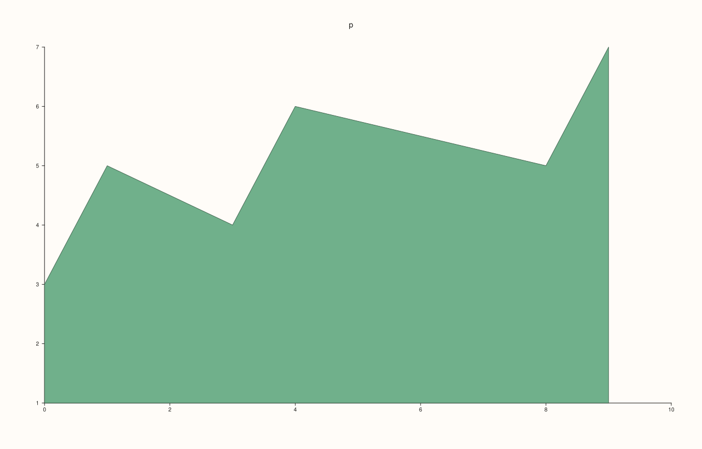
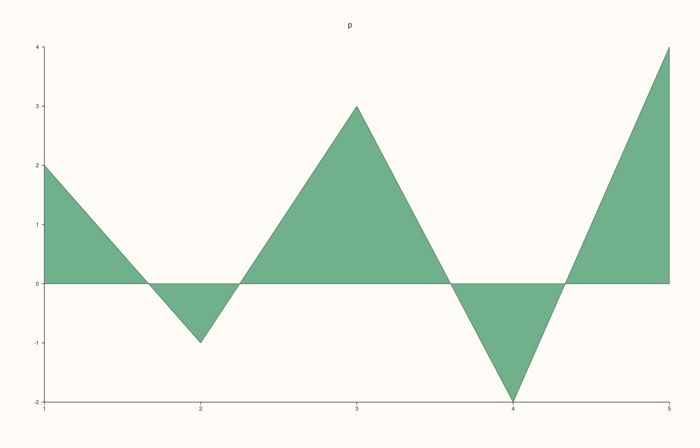
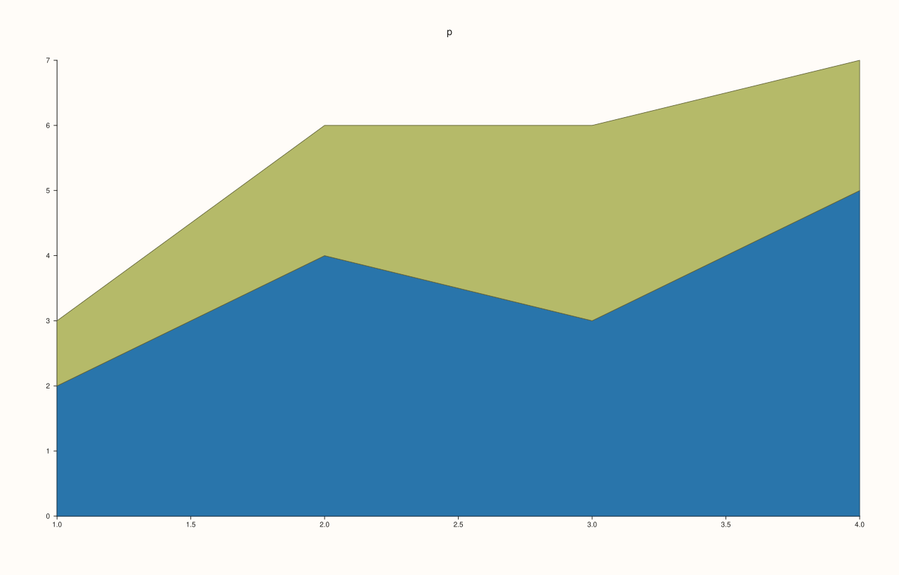
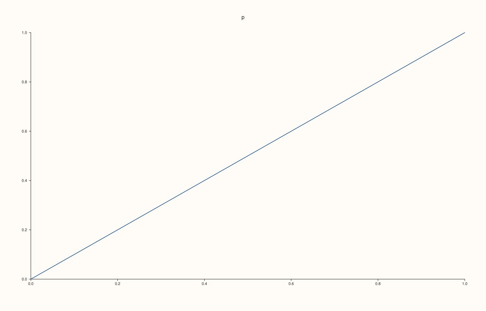

<!-- pluss-hand-authored -->

# Pane::ribbon

[Back to Pane API Reference](../../pane_api_reference)

## Signature

```cpp
Trace& Pane::ribbon(Series y, double base = 0.0)
Trace& Pane::ribbon(Series x, Series y, double base = 0.0)
```

## What It Does

Adds a **filled band**: the region between a baseline and a curve through the values, the trace of an area chart. The baseline is `base`, 0 by default, so a positive series is filled down to the axis; a different `base` is a different floor.

| Call | Meaning |
|---|---|
| `ribbon(y, base = 0)` | Values at the positions 1, 2, 3, ... |
| `ribbon(x, y, base = 0)` | Values at the positions `x`. |

A rank-2 `y` is read as one series per column, with a band for each, stacked one on top of the next. `x` and `y` have as many rows as each other. For the same data as vertical stems rather than a filled region use [`spike`](spike.md); for the line alone, [`trend`](trend.md).

## Parameters

**x** (`Series`-convertible, second call)
    The positions.

**y** (`Series`-convertible)
    The values.

**base** (`double`, default 0)
    The baseline the band start from.

## Returns

`Trace&`
    The new trace.

## Examples

Example 1. Values only: the positions are the indices 1, 2, 3, ... The region between the values and the base (0) is filled.

```cpp
auto fig = studio("ribbon_y");
auto& pane = fig.pane2("p");
pane.ribbon(std::vector<double>{2, 4, 3, 5, 4, 6});
fig.save_svg("figure.svg");
```


Example 2. Positions and values. The positions need not be evenly spaced.

```cpp
auto fig = studio("ribbon_xy");
auto& pane = fig.pane2("p");
pane.ribbon(std::vector<double>{0, 1, 3, 4, 8, 9}, std::vector<double>{2, 4, 3, 5, 4, 6});
fig.save_svg("figure.svg");
```


Example 3. The base moves the baseline. With base 3 the band is drawn between 3 and each value, so values below 3 fill upward from the line to the data.

```cpp
auto fig = studio("ribbon_base");
auto& pane = fig.pane2("p");
pane.ribbon(std::vector<double>{2, 4, 3, 5, 4, 6}, 3.0);
pane.rule_y(3.0, "base");
fig.save_svg("figure.svg");
```


Example 4. The base with positions: the second overload takes it after the data.

```cpp
auto fig = studio("ribbon_base_xy");
auto& pane = fig.pane2("p");
pane.ribbon(std::vector<double>{0, 1, 3, 4, 8, 9}, std::vector<double>{2, 4, 3, 5, 4, 6}, 1.0);
fig.save_svg("figure.svg");
```



Example 5. Negative values lie below the base, which is zero by default.

```cpp
auto fig = studio("ribbon_negative");
auto& pane = fig.pane2("p");
pane.ribbon(std::vector<double>{2, -1, 3, -2, 4});
fig.save_svg("figure.svg");
```



Example 6. A rank-2 `y` makes one band for each column, **stacked**: the rows are the positions, and each band is drawn on top of the ones before it, so its upper edge is the running total. Here two columns give two bands; the upper edge of the second is the sum of the two.

```cpp
auto fig = studio("ribbon_matrix");
auto& pane = fig.pane2("p");
auto y = pluss::make_series(std::vector<double>{2, 1, 4, 2, 3, 3, 5, 2}, {4, 2});
pane.ribbon(y);
std::cout << "traces: " << pane.trace_count() << "\n";
fig.save_svg("figure.svg");
```

### Output

```text
traces: 1
```



Example 7. Inputs that cannot be drawn are refused when the trace is added, and the message names the method and the problem. The pane keeps the traces it had.

```cpp
auto report = [](const char* what, auto&& call) {
  auto fig = studio("ribbon_errors");
  auto& pane = fig.pane2("p");
  try {
    call(pane);
    std::cout << what << ": accepted\n";
  } catch (const pluss::Error& e) {
    std::cout << what << ": " << e.message() << "\n";
  }
};
report("x and y differ", [](Pane& pane) { pane.ribbon(std::vector<double>{1, 2, 3}, std::vector<double>{1, 2}); });
auto fig = studio("ribbon_errors_out");
auto& pane = fig.pane2("p");
pane.trend(std::vector<double>{0, 1}, std::vector<double>{0, 1});
fig.save_svg("figure.svg");
```

### Output

```text
x and y differ: ribbon: x must match the ribbon rows or the full y matrix shape
```



Example 8. `ribbon` needs a planar pane. On a volumetric pane it throws at once, naming the kind it needs, and nothing is added.

```cpp
auto fig = studio("ribbon_wrong_pane");
auto& pane = fig.pane3("p");
try {
  pane.ribbon(std::vector<double>{1, 2});
} catch (const pluss::Error& e) {
  std::cout << e.message() << "\n";
}
std::cout << "traces: " << pane.trace_count() << "\n";
fig.save_svg("figure.svg");
```

### Output

```text
ribbon requires a planar pane
traces: 0
```


## Notes

- Returns the new [`Trace&`](../trace/label.md); the reference stays valid for the life of the pane, and the style calls of the trace ([`label`](../trace/label.md), [`stroke`](../trace/stroke.md), [`width`](../trace/width.md), ...) chain off it.
- The data is copied into the trace when it is added, so changing the vector afterwards does not change the figure.

## See Also

- [`Pane::spike`](spike.md): the stems.
- [`Pane::trend`](trend.md): the line.
- [`Pane::columns`](columns.md): bars.

<div class="pluss-inline-prev-next">
  <a class="prev-link" href="radial.html">
    <span class="label">Previous</span>
    <span class="title">radial</span>
  </a>
  <a class="next-link" href="ridge3.html">
    <span class="label">Next</span>
    <span class="title">ridge3</span>
  </a>
</div>
