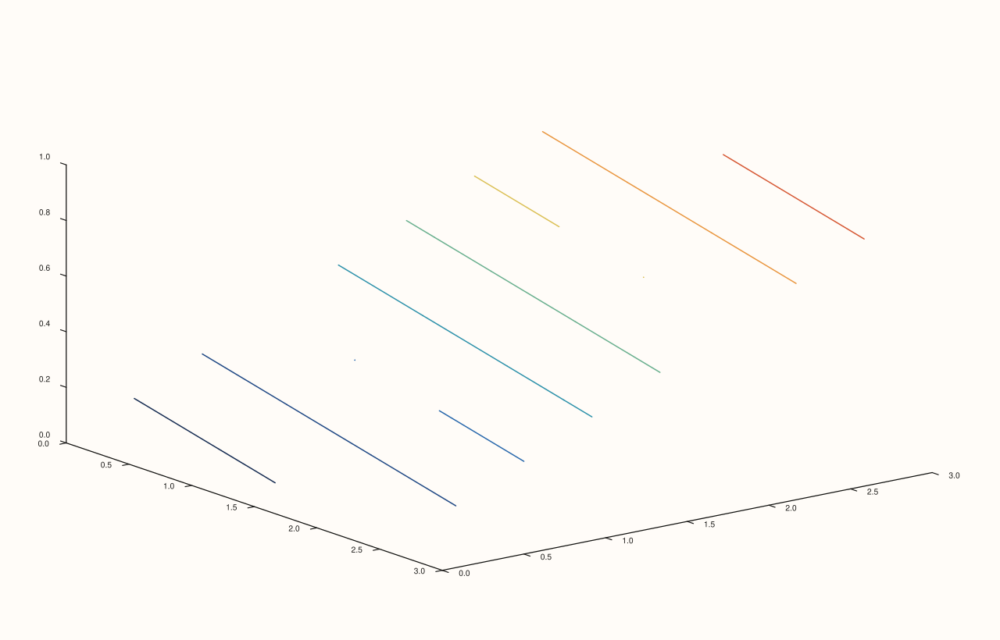
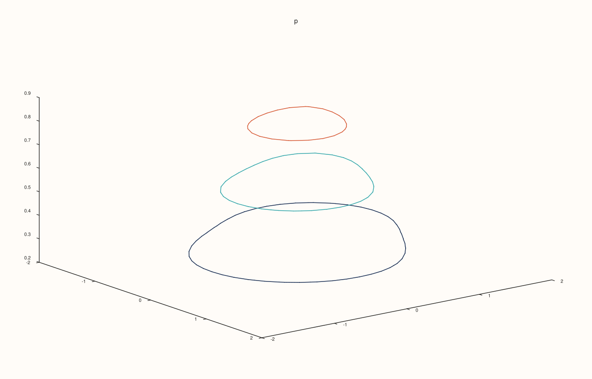
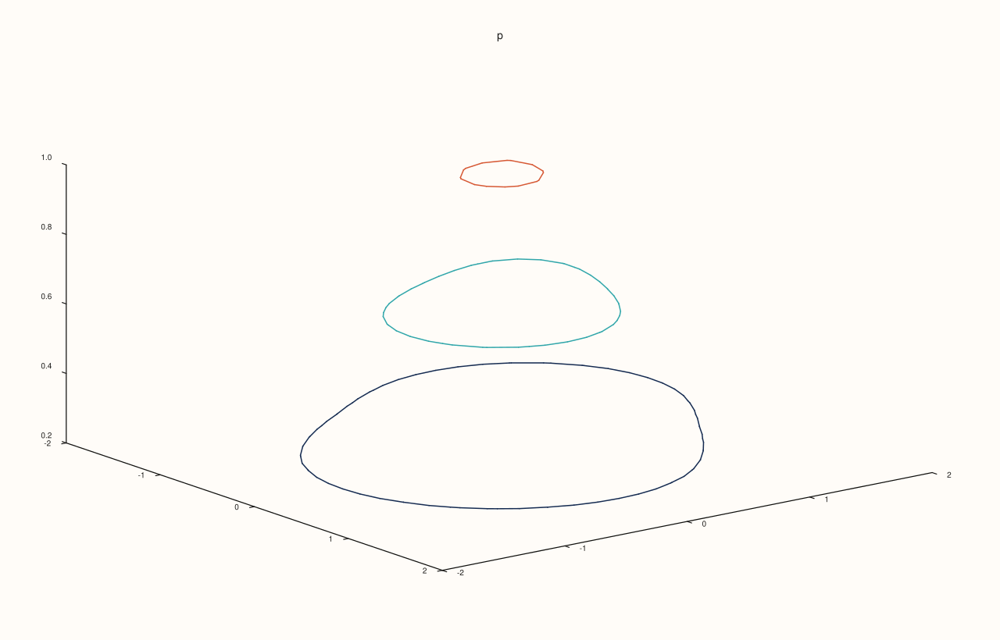
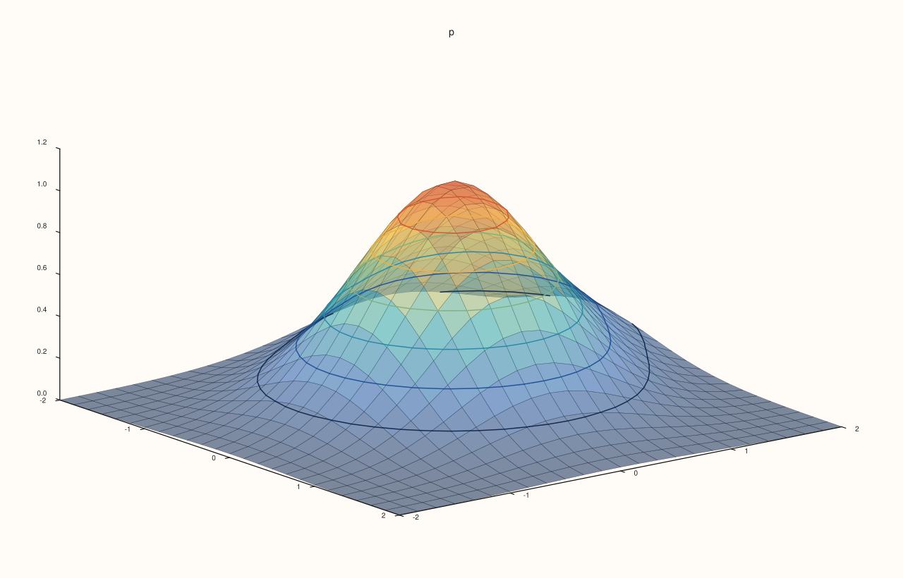
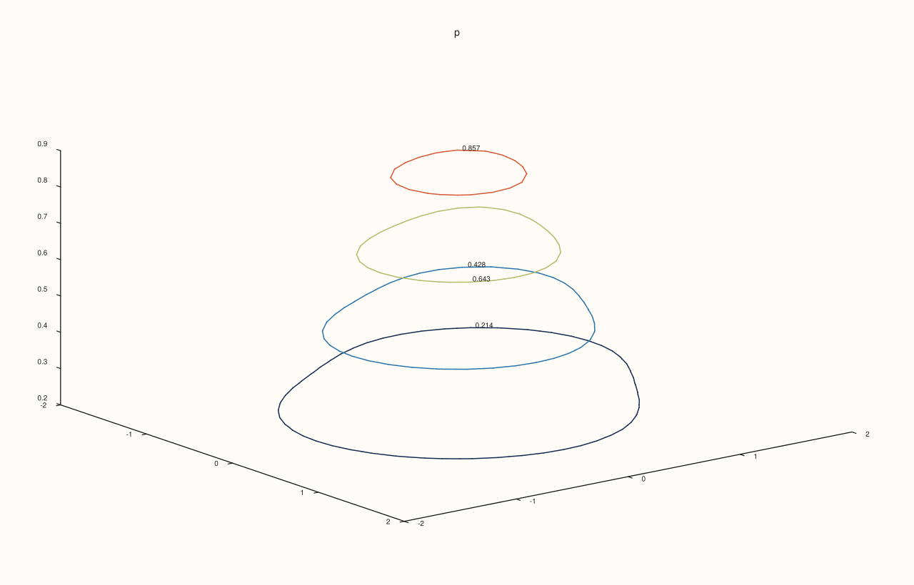

<!-- pluss-hand-authored -->

# Pane::ridge3

[Back to Pane API Reference](../../pane_api_reference)

## Signature

```cpp
Trace& Pane::ridge3(Series x, Series y, Series z)
Trace& Pane::ridge3(Series x, Series y, Series z, std::vector<double> levels)
Trace& Pane::ridge3(Series x, Series y, Series z, int level_count)
```

## What It Does

Adds **contour lines in three dimensions**: the curves along which a field `z(x, y)` has a given value, drawn at that value's height instead of flattened onto the plane. It is [`contour`](contour.md) on a volumetric pane, and shows the shape of the field and its levels in one picture.

`z` is a rank-2 matrix, as for [`sheet`](sheet.md). The levels are chosen as for `contour`:

| Call | Levels |
|---|---|
| `ridge3(x, y, z)` | 8, evenly spaced between the lowest and highest value. |
| `ridge3(x, y, z, level_count)` | `level_count` (an integer, positive), evenly spaced. |
| `ridge3(x, y, z, levels)` | Exactly the values of the container `levels`. |

An integer is always a count; one level at the value 4 is `std::vector<double>{4.0}`. The colours come from the palette over the range of the field, or one colour for a single level.

## Parameters

**x**, **y** (`Series`-convertible)
    The coordinates of the columns and rows.

**z** (`Series`-convertible, rank 2)
    The field.

**level_count** (`int`) or **levels** (container)
    How many levels, or which.

## Returns

`Trace&`
    The new trace.

## Examples

Example 1. Contour lines lifted to their own height: each curve is drawn at the value of its level, so the picture is a set of rings stacked in the air over the grid.

```cpp
auto fig = studio("ridge3_default");
auto& pane = fig.pane3("p");
const std::int64_t n = 25;
std::vector<double> axis(static_cast<std::size_t>(n)), field(static_cast<std::size_t>(n * n));
for (std::int64_t i = 0; i < n; ++i) axis[static_cast<std::size_t>(i)] = -2.0 + 4.0 * i / (n - 1);
for (std::int64_t i = 0; i < n; ++i) {
  for (std::int64_t j = 0; j < n; ++j) {
    const double x = axis[static_cast<std::size_t>(i)], y = axis[static_cast<std::size_t>(j)];
    field[static_cast<std::size_t>(i * n + j)] = std::exp(-(x * x + y * y)) + 0.5 * std::exp(-((x - 1.0) * (x - 1.0) + (y + 1.0) * (y + 1.0)));
  }
}
auto z = pluss::make_series(field, {n, n});
pane.ridge3(axis, axis, z);
fig.save_svg("figure.svg");
```



Example 2. An integer is a number of levels: three give a coarse picture.

```cpp
auto fig = studio("ridge3_count");
auto& pane = fig.pane3("p");
const std::int64_t n = 25;
std::vector<double> axis(static_cast<std::size_t>(n)), field(static_cast<std::size_t>(n * n));
for (std::int64_t i = 0; i < n; ++i) axis[static_cast<std::size_t>(i)] = -2.0 + 4.0 * i / (n - 1);
for (std::int64_t i = 0; i < n; ++i) {
  for (std::int64_t j = 0; j < n; ++j) {
    const double x = axis[static_cast<std::size_t>(i)], y = axis[static_cast<std::size_t>(j)];
    field[static_cast<std::size_t>(i * n + j)] = std::exp(-(x * x + y * y)) + 0.5 * std::exp(-((x - 1.0) * (x - 1.0) + (y + 1.0) * (y + 1.0)));
  }
}
auto z = pluss::make_series(field, {n, n});
pane.ridge3(axis, axis, z, 3);
fig.save_svg("figure.svg");
```



Example 3. A container is a list of levels: here the lines at 0.2, 0.6 and 1.0.

```cpp
auto fig = studio("ridge3_levels");
auto& pane = fig.pane3("p");
const std::int64_t n = 25;
std::vector<double> axis(static_cast<std::size_t>(n)), field(static_cast<std::size_t>(n * n));
for (std::int64_t i = 0; i < n; ++i) axis[static_cast<std::size_t>(i)] = -2.0 + 4.0 * i / (n - 1);
for (std::int64_t i = 0; i < n; ++i) {
  for (std::int64_t j = 0; j < n; ++j) {
    const double x = axis[static_cast<std::size_t>(i)], y = axis[static_cast<std::size_t>(j)];
    field[static_cast<std::size_t>(i * n + j)] = std::exp(-(x * x + y * y)) + 0.5 * std::exp(-((x - 1.0) * (x - 1.0) + (y + 1.0) * (y + 1.0)));
  }
}
auto z = pluss::make_series(field, {n, n});
pane.ridge3(axis, axis, z, std::vector<double>{0.2, 0.6, 1.0});
fig.save_svg("figure.svg");
```



Example 4. On the surface they came from: a [`sheet`](sheet.md) and its contour lines on one pane. The lines follow the surface because each is drawn at its own height.

```cpp
auto fig = studio("ridge3_with_sheet");
auto& pane = fig.pane3("p");
const std::int64_t n = 25;
std::vector<double> axis(static_cast<std::size_t>(n)), field(static_cast<std::size_t>(n * n));
for (std::int64_t i = 0; i < n; ++i) axis[static_cast<std::size_t>(i)] = -2.0 + 4.0 * i / (n - 1);
for (std::int64_t i = 0; i < n; ++i) {
  for (std::int64_t j = 0; j < n; ++j) {
    const double x = axis[static_cast<std::size_t>(i)], y = axis[static_cast<std::size_t>(j)];
    field[static_cast<std::size_t>(i * n + j)] = std::exp(-(x * x + y * y)) + 0.5 * std::exp(-((x - 1.0) * (x - 1.0) + (y + 1.0) * (y + 1.0)));
  }
}
auto z = pluss::make_series(field, {n, n});
pane.sheet(axis, axis, z).transparent(true);
pane.ridge3(axis, axis, z, 6);
fig.save_svg("figure.svg");
```



Example 5. The value of each level can be written on its line with [`Trace::annotate_levels`](../trace/annotate_levels.md).

```cpp
auto fig = studio("ridge3_annotate");
auto& pane = fig.pane3("p");
const std::int64_t n = 25;
std::vector<double> axis(static_cast<std::size_t>(n)), field(static_cast<std::size_t>(n * n));
for (std::int64_t i = 0; i < n; ++i) axis[static_cast<std::size_t>(i)] = -2.0 + 4.0 * i / (n - 1);
for (std::int64_t i = 0; i < n; ++i) {
  for (std::int64_t j = 0; j < n; ++j) {
    const double x = axis[static_cast<std::size_t>(i)], y = axis[static_cast<std::size_t>(j)];
    field[static_cast<std::size_t>(i * n + j)] = std::exp(-(x * x + y * y)) + 0.5 * std::exp(-((x - 1.0) * (x - 1.0) + (y + 1.0) * (y + 1.0)));
  }
}
auto z = pluss::make_series(field, {n, n});
pane.ridge3(axis, axis, z, 4).annotate_levels(true);
fig.save_svg("figure.svg");
```



Example 6. Inputs that cannot be drawn are refused when the trace is added, and the message names the method and the problem. The pane keeps the traces it had.

```cpp
auto report = [](const char* what, auto&& call) {
  auto fig = studio("ridge3_errors");
  auto& pane = fig.pane3("p");
  try {
    call(pane);
    std::cout << what << ": accepted\n";
  } catch (const pluss::Error& e) {
    std::cout << what << ": " << e.message() << "\n";
  }
};
report("no levels", [](Pane& pane) { auto z = pluss::series::linspace(0.0, 1.0, 9, pluss::ScalarType::Float64).reshape({3, 3}); pane.ridge3(std::vector<double>{1, 2, 3}, std::vector<double>{1, 2, 3}, z, 0); });
report("z is not a matrix", [](Pane& pane) { pane.ridge3(std::vector<double>{1, 2, 3}, std::vector<double>{1, 2, 3}, std::vector<double>{1, 2, 3}); });
auto fig = studio("ridge3_errors_out");
auto& pane = fig.pane3("p");
pane.path3(std::vector<double>{0, 1}, std::vector<double>{0, 1}, std::vector<double>{0, 1});
fig.save_svg("figure.svg");
```

### Output

```text
no levels: ridge3: automatic contour levels must be positive
z is not a matrix: ridge3: z must be a rank-2 matrix
```


Example 7. `ridge3` needs a volumetric pane. On a planar pane it throws at once, naming the kind it needs, and nothing is added.

```cpp
auto fig = studio("ridge3_wrong_pane");
auto& pane = fig.pane2("p");
try {
  pane.ridge3(std::vector<double>{0, 1}, std::vector<double>{0, 1}, pluss::series::linspace(0.0, 1.0, 4, pluss::ScalarType::Float64).reshape({2, 2}));
} catch (const pluss::Error& e) {
  std::cout << e.message() << "\n";
}
std::cout << "traces: " << pane.trace_count() << "\n";
fig.save_svg("figure.svg");
```

### Output

```text
ridge3 requires a volumetric pane
traces: 0
```


## Notes

- Returns the new [`Trace&`](../trace/label.md); the reference stays valid for the life of the pane, and the style calls of the trace ([`label`](../trace/label.md), [`stroke`](../trace/stroke.md), [`width`](../trace/width.md), ...) chain off it.
- The data is copied into the trace when it is added, so changing the vector afterwards does not change the figure.

## See Also

- [`Pane::contour`](contour.md): the lines on a plane.
- [`Pane::sheet`](sheet.md): the surface.
- [`Trace::annotate_levels`](../trace/annotate_levels.md): write the levels.

<div class="pluss-inline-prev-next">
  <a class="prev-link" href="ribbon.html">
    <span class="label">Previous</span>
    <span class="title">ribbon</span>
  </a>
  <a class="next-link" href="rule_x.html">
    <span class="label">Next</span>
    <span class="title">rule_x</span>
  </a>
</div>
