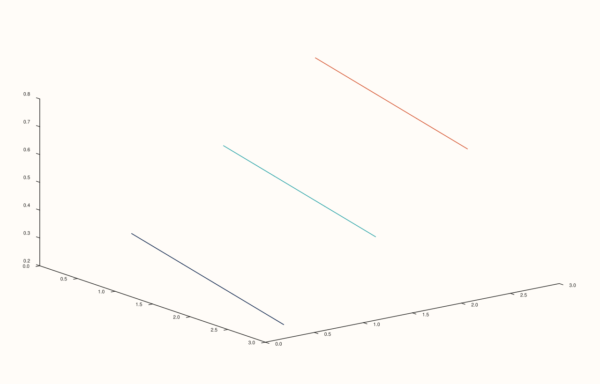

<!-- pluss-hand-authored -->

# Pane::ridge3

[Back to Pane API Reference](../../pane_api_reference)

## Signatures

```cpp
template <class X, class Y, class Z>
Trace& Pane::ridge3(X&& x, Y&& y, Z&& z)

template <class X, class Y, class Z, class Levels>
  requires (!std::integral<std::remove_cvref_t<Levels>>)
Trace& Pane::ridge3(X&& x, Y&& y, Z&& z, Levels&& levels)

template <class X, class Y, class Z>
Trace& Pane::ridge3(X&& x, Y&& y, Z&& z, int level_count)
```

## What It Does

Adds a 3D elevated-contour trace over a scalar field `z(x, y)` — the same contour-level
computation as [`contour()`](contour.md) and [`isoband()`](isoband.md), but drawn lifted
onto a `Volumetric` pane's third axis instead of flattened onto a 2D `Planar` one.
`ridge3()` reuses `ContourData` and `contour()`'s exact three-overload shape, constructing
it with `elevated=true`:

- **`ridge3(x, y, z)`** — automatically chooses `8` evenly-spaced levels.
- **`ridge3(x, y, z, levels)`** — draws contours at exact `z` values listed in `levels`.
- **`ridge3(x, y, z, level_count)`** — automatically spaces exactly `level_count` levels.

```{important} Requires a Volumetric pane
Unlike its `contour()`/`isoband()` siblings, `ridge3()` requires a `Volumetric` pane.
Calling `ridge3()` on a `Planar` pane throws
`std::logic_error("ridge3 requires a volumetric pane")`.
```

`z` must be rank-2, identically to [`contour()`](contour.md).

## Parameters

**x**, **y** (series-convertible)
    The grid's coordinate axes.

**z** (series-convertible, must be rank-2)
    The scalar field values over the `(x, y)` grid.

**levels** (series-convertible, `levels`-overload only)
    Explicit `z` values at which to draw elevated contour lines.

**level_count** (`int`, `level_count`-overload only)
    The number of automatically, evenly spaced levels, replacing the default of `8`.

## Returns

`Trace&`
    A reference to the newly created trace, for chaining.

## Examples

Example 1. The default automatic level count (`8`), on a `Volumetric` pane.

```cpp
using namespace pluss::pl;

auto fig = studio("ridge3_default");
auto& pane = fig.pane3();
auto z = pluss::series::linspace(0.0, 1.0, 16, pluss::ScalarType::Float64).reshape({4, 4});
pane.ridge3(std::vector<double>{0.0, 1.0, 2.0, 3.0}, std::vector<double>{0.0, 1.0, 2.0, 3.0}, z);
fig.show();
```


Example 2. Explicit levels. Verified via direct SVG diff to render genuinely different
from Example 1.

```cpp
using namespace pluss::pl;

auto fig = studio("ridge3_explicit_levels");
auto& pane = fig.pane3();
auto z = pluss::series::linspace(0.0, 1.0, 16, pluss::ScalarType::Float64).reshape({4, 4});
pane.ridge3(std::vector<double>{0.0, 1.0, 2.0, 3.0}, std::vector<double>{0.0, 1.0, 2.0, 3.0}, z,
            std::vector<double>{0.25, 0.5, 0.75});
fig.show();
```



Example 3. An explicit level count of `3`. Verified via direct SVG diff to render
genuinely different from Example 1.

```cpp
using namespace pluss::pl;

auto fig = studio("ridge3_level_count");
auto& pane = fig.pane3();
auto z = pluss::series::linspace(0.0, 1.0, 16, pluss::ScalarType::Float64).reshape({4, 4});
pane.ridge3(std::vector<double>{0.0, 1.0, 2.0, 3.0}, std::vector<double>{0.0, 1.0, 2.0, 3.0}, z, 3);
fig.show();
```


## Notes

- Not `noexcept`.
- The `Levels`-taking overload uses the same `requires (!std::integral<...>)`
  disambiguation as [`contour()`](contour.md) and [`isoband()`](isoband.md).
- `flash::` (if present) may not have a dedicated ridge-plot wrapper for this specific
  trace kind — check the `flash::` namespace directly before assuming one exists.

## See Also

- [`Pane::contour`](contour.md): the un-elevated line-only sibling on a `Planar` pane,
  sharing the identical `ContourData` payload and overload shape.
- [`Pane::isoband`](isoband.md): the `filled=true` sibling on a `Planar` pane.
- [`Pane::sheet`](sheet.md): another `Volumetric` field-visualizing trace kind, rendering
  a continuous filled surface rather than discrete elevated contour lines.

<div class="pluss-inline-prev-next">
  <a class="prev-link" href="isoband.html">
    <span class="label">Previous</span>
    <span class="title">isoband</span>
  </a>
  <a class="next-link" href="isoshell.html">
    <span class="label">Next</span>
    <span class="title">isoshell</span>
  </a>
</div>
