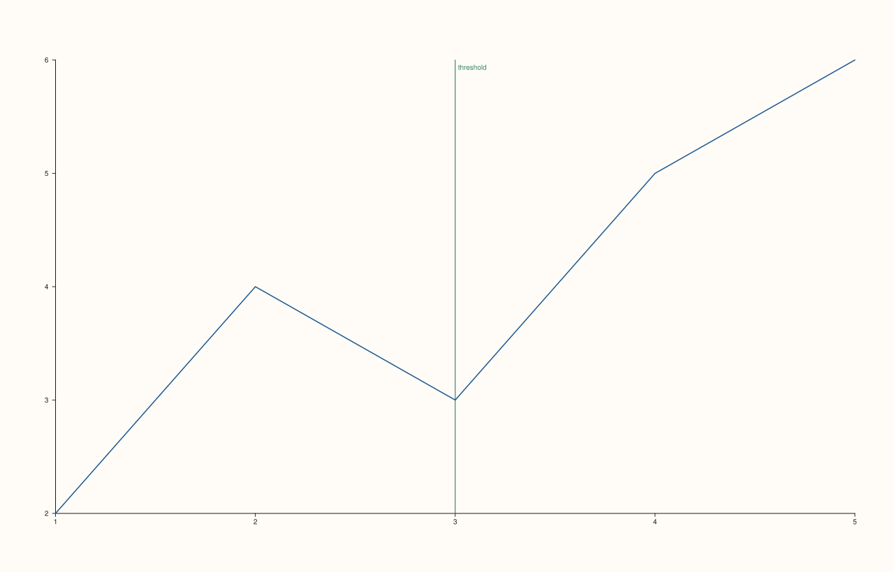
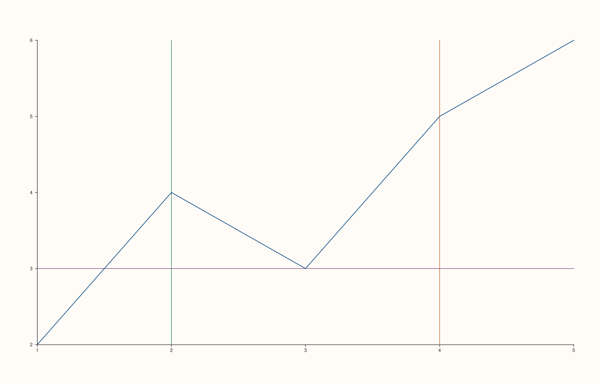

<!-- pluss-hand-authored -->

# Pane::rule_x

[Back to Pane API Reference](../../pane_api_reference)

## Signature

```cpp
Pane& Pane::rule_x(double value, std::string label = {})
```

## What It Does

Draws a reference line straight across the pane at a fixed x-axis `value` — a common way
to mark a threshold, target, or other notable value against the plotted data. Unlike most
single-value settings elsewhere in `Pane`, rules **accumulate**: each call to `rule_x()`
(or [`rule_y()`](rule_y.md)/[`rule_z()`](rule_z.md)) appends a new entry to a shared
`rules()` list rather than replacing a previous one, so a pane can carry any number of
rule lines across any mix of axes. There is no `clear_x_rule()`-style removal method —
rules, once added, stay until the pane itself is discarded.

## Parameters

**value** (`double`)
    The x-axis position for the rule line. Must be finite.

**label** (`std::string`, default `{}`)
    Optional text drawn alongside the rule line. An empty label draws no text, just the
    line itself.

## Returns

`Pane&`
    A reference to the same pane, for chaining — including chaining multiple rule calls
    together (`pane.rule_x(2.0).rule_x(4.0).rule_y(3.0)`).

## Examples

Example 1. A single labeled rule line.

```cpp
using namespace pluss::pl;

auto fig = studio("rule_x_basic");
auto& pane = fig.pane2();
pane.trend(std::vector<double>{1.0, 2.0, 3.0, 4.0, 5.0}, std::vector<double>{2.0, 4.0, 3.0, 5.0, 6.0});
pane.rule_x(3.0, "threshold");
fig.show();

std::cout << pane.rules().size() << "\n";
std::cout << pane.rules()[0].value << " " << pane.rules()[0].label << "\n";
```

### Output

```text
1
3 threshold
```



Example 2. Multiple rules, chained together, mixing x- and y-axis rules on the same pane —
they accumulate into a single shared `rules()` list.

```cpp
using namespace pluss::pl;

auto fig = studio("rule_multiple");
auto& pane = fig.pane2();
pane.trend(std::vector<double>{1.0, 2.0, 3.0, 4.0, 5.0}, std::vector<double>{2.0, 4.0, 3.0, 5.0, 6.0});
pane.rule_x(2.0).rule_x(4.0).rule_y(3.0);
fig.show();

std::cout << pane.rules().size() << "\n";
```

### Output

```text
3
```



Example 3. A non-finite value throws.

```cpp
using namespace pluss::pl;

auto fig = studio("rule_x_failure");
auto& pane = fig.pane2();
pane.trend(std::vector<double>{1.0, 2.0}, std::vector<double>{1.0, 2.0});

try {
  pane.rule_x(std::numeric_limits<double>::quiet_NaN());
} catch (const std::invalid_argument& e) {
  std::cout << e.what() << "\n";
}
```

### Output

```text
rule_x: value must be finite
```

## Notes

- Not `noexcept` (validates finiteness).
- Rules accumulate across calls, and across axes — [`rule_y()`](rule_y.md)/
  [`rule_z()`](rule_z.md) push into the exact same shared list read back by
  [`rules()`](rules.md), just tagged with a different `CueAxis`.
- No removal API exists for individual or all rules once added.
- An empty `label` draws just the line, no text.

## See Also

- [`Pane::rule_y`](rule_y.md) / [`Pane::rule_z`](rule_z.md): the y- and z-axis
  equivalents, appending to the same list.
- [`Pane::rules`](rules.md): reads back every rule added so far.
- [`Pane::band_x`](band_x.md): a span (range) reference region, as opposed to a single
  line.

<div class="pluss-inline-prev-next">
  <a class="prev-link" href="caption_text.html">
    <span class="label">Previous</span>
    <span class="title">caption_text</span>
  </a>
  <a class="next-link" href="rule_y.html">
    <span class="label">Next</span>
    <span class="title">rule_y</span>
  </a>
</div>
