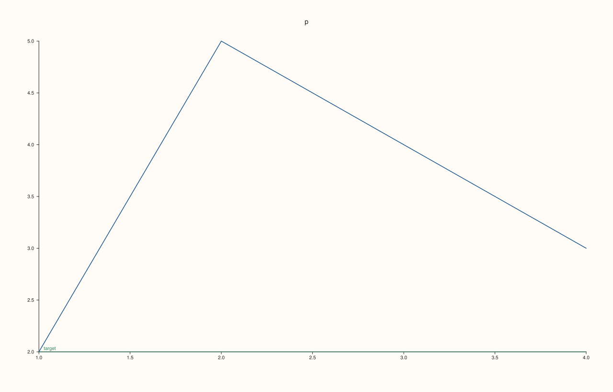

<!-- pluss-hand-authored -->

# Pane::rule_y

[Back to Pane API Reference](../../pane_api_reference)

## Signature

```cpp
Pane& Pane::rule_y(double value, std::string label = {})
```

## What It Does

The y-axis counterpart of [`rule_x()`](rule_x.md): draws a reference line at a fixed
y-axis `value`. Appends to the exact same shared [`rules()`](rules.md) list as
`rule_x()`/`rule_z()`, just tagged with `CueAxis::Y`. Every other detail carries over
unchanged — see [`rule_x()`](rule_x.md) for the full worked-example set, including the
accumulation and multi-axis mixing behavior.

## Parameters

**value** (`double`)
    The y-axis position for the rule line. Must be finite.

**label** (`std::string`, default `{}`)
    Optional text drawn alongside the rule line.

## Returns

`Pane&`
    A reference to the same pane, for chaining.

## Examples

Example 1. A labeled rule line on the y-axis.

```cpp
using namespace pluss::pl;

auto fig = studio("rule_y_basic");
auto& pane = fig.pane2();
pane.trend(std::vector<double>{1.0, 2.0, 3.0, 4.0, 5.0}, std::vector<double>{2.0, 4.0, 3.0, 5.0, 6.0});
pane.rule_y(4.5, "target");
fig.show();

std::cout << pane.rules().size() << "\n";
```

### Output

```text
1
```



## Notes

See [`rule_x()`](rule_x.md)'s Notes — every detail applies identically here, including
the "value must be finite" validation and the shared, accumulating `rules()` list.

## See Also

- [`Pane::rule_x`](rule_x.md): the x-axis equivalent, with the full worked-example set.
- [`Pane::rule_z`](rule_z.md): the z-axis equivalent.
- [`Pane::rules`](rules.md): reads back every rule added so far.
- [`Pane::band_y`](band_y.md): a span (range) reference region on the y-axis.

<div class="pluss-inline-prev-next">
  <a class="prev-link" href="rule_x.html">
    <span class="label">Previous</span>
    <span class="title">rule_x</span>
  </a>
  <a class="next-link" href="rule_z.html">
    <span class="label">Next</span>
    <span class="title">rule_z</span>
  </a>
</div>
