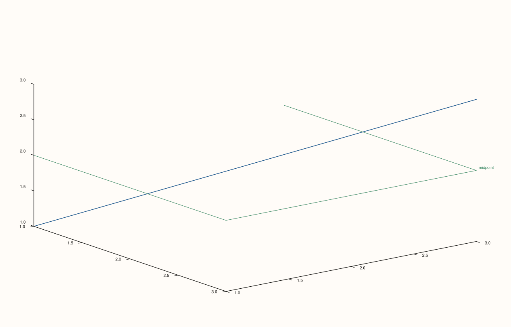
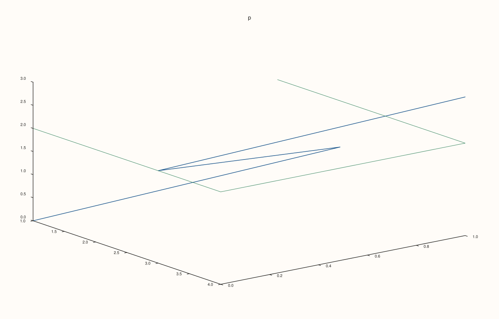
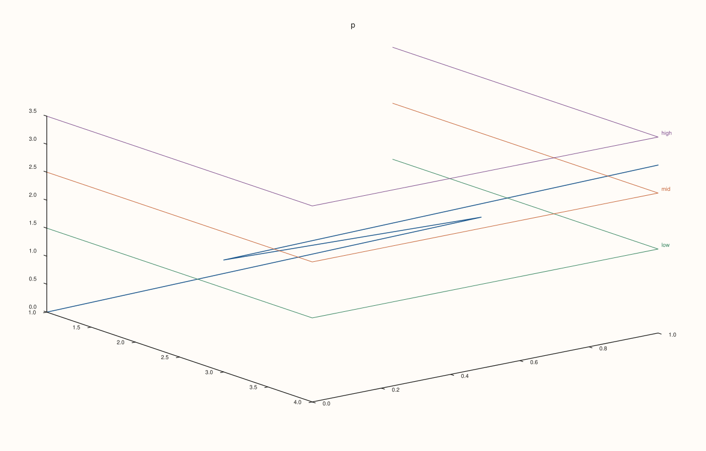
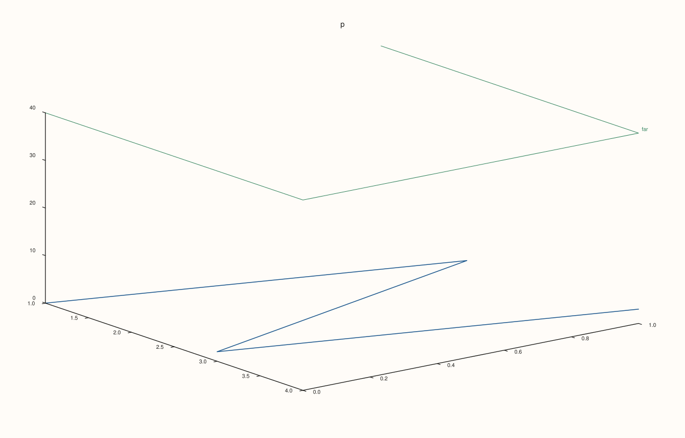
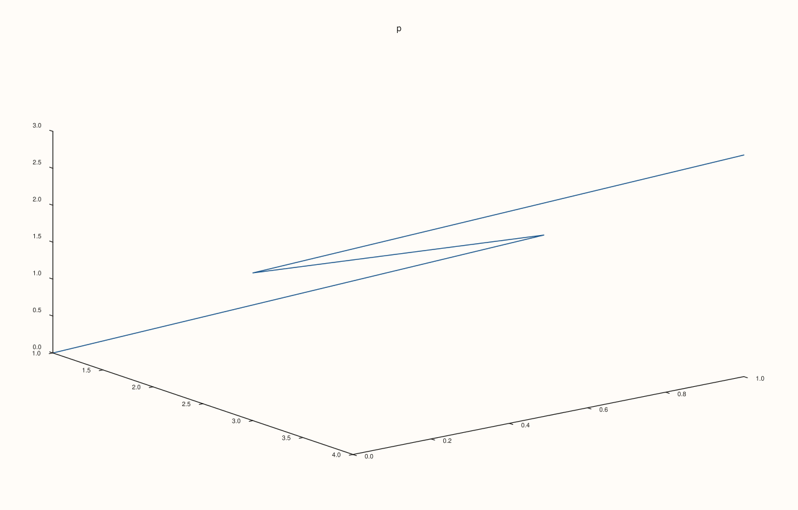
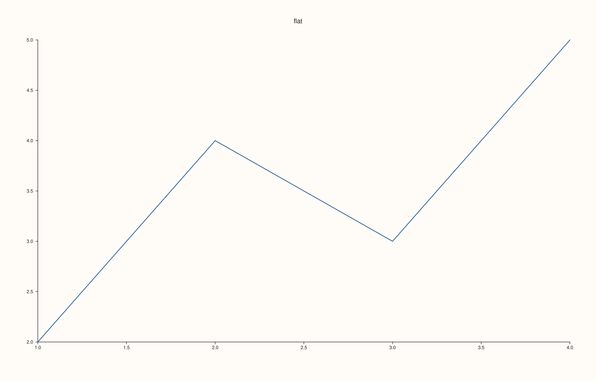

<!-- pluss-hand-authored -->

# Pane::rule_z

[Back to Pane API Reference](../../pane_api_reference)

## Signature

```cpp
Pane& Pane::rule_z(double value, std::string label = {})
```

## What It Does

Adds a reference line at z = `value`: a rule drawn across the volume at that position, with an optional `label` written on it. Rules mark thresholds, targets and baselines without being data: they are not traces, they are not in the legend, and they take the colours of the pane's theme. Each call adds one rule; they are kept in the order added and listed by [`rules`](rules.md).

The position must be finite; a NaN or infinite value throws `pluss::Error` and nothing is added. A rule takes part in the automatic range of its axis, so a rule outside the data widens the axis to keep it visible, while a manual range ([`z_limits`](z_limits.md)) is never changed by a rule, and a rule outside it is not drawn. The rule is drawn when the figure is rendered, so it can be added before or after the traces. On a planar pane a z rule is stored but has no axis to be drawn on.

## Parameters

**value** (`double`)
    The position of the rule, in data units. Finite.

**label** (`std::string`, default empty)
    Text written on the rule. Empty draws no text.

## Returns

`Pane&`
    The same pane, for chaining.

## Examples

Example 1. A labelled reference line. A rule at z = 2 with the label `target`; it is stored with its axis, value and label, and the label is drawn on the line.

```cpp
auto fig = studio("rule_z_basic");
auto& pane = fig.pane3("p");
pane.path3(std::vector<double>{1, 2, 3, 4}, std::vector<double>{0, 1, 0, 1}, std::vector<double>{1, 2, 3, 4});
pane.rule_z(2.0, "target");
const auto& rule = pane.rules().front();
std::cout << "stored: axis " << static_cast<int>(rule.axis) << ", value " << rule.value << ", label '" << rule.label << "', width " << rule.width << "\n";
std::cout << "label drawn: " << (fig.to_svg().find(">target<") != std::string::npos) << "\n";
fig.save_svg("figure.svg");
```

### Output

```text
stored: axis 2, value 2, label 'target', width 1
label drawn: 1
```



Example 2. Without a label. The label is optional: the line is drawn and no extra text appears, and the figure has one more path than the one without the rule.

```cpp
auto paths = [](const std::string& svg) {
  std::size_t n = 0;
  for (auto at = svg.find("<path"); at != std::string::npos; at = svg.find("<path", at + 1)) ++n;
  return n;
};
auto build = [&](bool with_rule) {
  auto fig = studio("rule_z_nolabel");
  auto& pane = fig.pane3("p");
  pane.path3(std::vector<double>{1, 2, 3, 4}, std::vector<double>{0, 1, 0, 1}, std::vector<double>{0, 1, 2, 3});
  if (with_rule) pane.rule_z(2.0);
  return fig.to_svg();
};
std::cout << "paths without: " << paths(build(false)) << ", with: " << paths(build(true)) << "\n";
auto fig = studio("rule_z_nolabel_out");
auto& pane = fig.pane3("p");
pane.path3(std::vector<double>{1, 2, 3, 4}, std::vector<double>{0, 1, 0, 1}, std::vector<double>{0, 1, 2, 3});
pane.rule_z(2.0);
fig.save_svg("figure.svg");
```

### Output

```text
paths without: 26, with: 27
```



Example 3. Several rules. Each call adds a rule; they are kept in the order added and each is drawn, so a pane can carry a baseline and thresholds together.

```cpp
auto fig = studio("rule_z_several");
auto& pane = fig.pane3("p");
pane.path3(std::vector<double>{1, 2, 3, 4}, std::vector<double>{0, 1, 0, 1}, std::vector<double>{0, 1, 2, 3});
pane.rule_z(1.5, "low").rule_z(2.5, "mid").rule_z(3.5, "high");
std::cout << "rules: " << pane.rules().size() << ":";
for (const auto& r : pane.rules()) std::cout << " " << r.label << "@" << r.value;
std::cout << "\n";
fig.save_svg("figure.svg");
```

### Output

```text
rules: 3: low@1.5 mid@2.5 high@3.5
```



Example 4. Rules and the z range. A rule far outside the data widens an automatic range so it stays visible; with a manual range the axis stays where it was set, and a rule outside that range is not drawn at all.

```cpp
auto texts = [](const std::string& svg) {
  std::string out;
  for (std::size_t at = svg.find("<text"); at != std::string::npos; at = svg.find("<text", at + 1)) {
    const auto gt = svg.find('>', at);
    out += svg.substr(gt + 1, svg.find("</text>", gt) - gt - 1) + " ";
  }
  return out;
};
auto build = [&](bool manual) {
  auto fig = studio("rule_z_range");
  auto& pane = fig.pane3("p");
  pane.path3(std::vector<double>{1, 2, 3, 4}, std::vector<double>{0, 1, 0, 1}, std::vector<double>{0, 1, 2, 3});
  pane.x_tick_labels(false);
  pane.y_tick_labels(false);
  if (manual) pane.z_limits(Range1d{0.0, 5.0});
  pane.rule_z(40.0, "far");
  return fig.to_svg();
};
std::cout << "automatic range: " << texts(build(false)) << "\n";
std::cout << "manual 0 to 5:   " << texts(build(true)) << "\n";
auto fig = studio("rule_z_range_out");
auto& pane = fig.pane3("p");
pane.path3(std::vector<double>{1, 2, 3, 4}, std::vector<double>{0, 1, 0, 1}, std::vector<double>{0, 1, 2, 3});
pane.rule_z(40.0, "far");
fig.save_svg("figure.svg");
```

### Output

```text
automatic range: far p 0 10 20 30 40 
manual 0 to 5:   far p 0 1 2 3 4 5 
```



Example 5. Only finite values. A NaN or infinite position throws `pluss::Error` and no rule is added.

```cpp
auto fig = studio("rule_z_invalid");
auto& pane = fig.pane3("p");
pane.path3(std::vector<double>{1, 2, 3, 4}, std::vector<double>{0, 1, 0, 1}, std::vector<double>{0, 1, 2, 3});
for (double bad : {std::numeric_limits<double>::quiet_NaN(), std::numeric_limits<double>::infinity(), -std::numeric_limits<double>::infinity()}) {
  try {
    pane.rule_z(bad, "never");
  } catch (const pluss::Error& e) {
    std::cout << bad << ": " << e.message() << "\n";
  }
}
std::cout << "rules added: " << pane.rules().size() << "\n";
fig.save_svg("figure.svg");
```

### Output

```text
nan: rule_z: value must be finite
inf: rule_z: value must be finite
-inf: rule_z: value must be finite
rules added: 0
```



Example 6. On a planar pane. A pane without a third axis has nowhere to draw a z rule: the call is accepted and the rule is stored, and the figure is the same as without it.

```cpp
auto build = [](bool with_rule) {
  auto fig = studio("rule_z_planar");
  auto& pane = fig.pane2("flat");
  pane.trend(std::vector<double>{1, 2, 3, 4}, std::vector<double>{2, 4, 3, 5});
  if (with_rule) pane.rule_z(1.0, "ignored");
  return fig.to_svg();
};
std::cout << "same figure: " << (build(true) == build(false)) << "\n";
auto fig = studio("rule_z_planar_out");
fig.pane2("flat").trend(std::vector<double>{1, 2, 3, 4}, std::vector<double>{2, 4, 3, 5});
fig.save_svg("figure.svg");
```

### Output

```text
same figure: 1
```



## Notes

- Not `noexcept`: it throws for a non-finite value.
- A rule marks one position; for a range use [`band_z`](band_z.md).

## See Also

- [`Pane::band_z`](band_z.md): a shaded range.
- [`Pane::rules`](rules.md): the rules of the pane.
- [`Pane::pin`](pin.md): a note attached to a point.
- [`Pane::rule_x`](rule_x.md): the same for the x axis.
- [`Pane::rule_y`](rule_y.md): the same for the y axis.

<div class="pluss-inline-prev-next">
  <a class="prev-link" href="rule_y.html">
    <span class="label">Previous</span>
    <span class="title">rule_y</span>
  </a>
  <a class="next-link" href="rules.html">
    <span class="label">Next</span>
    <span class="title">rules</span>
  </a>
</div>
