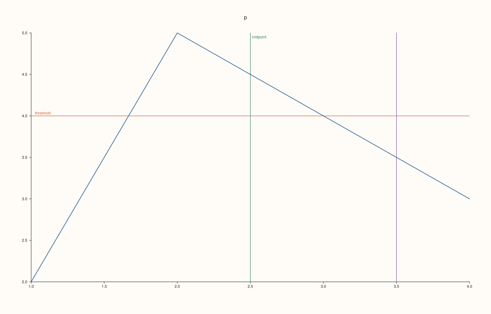
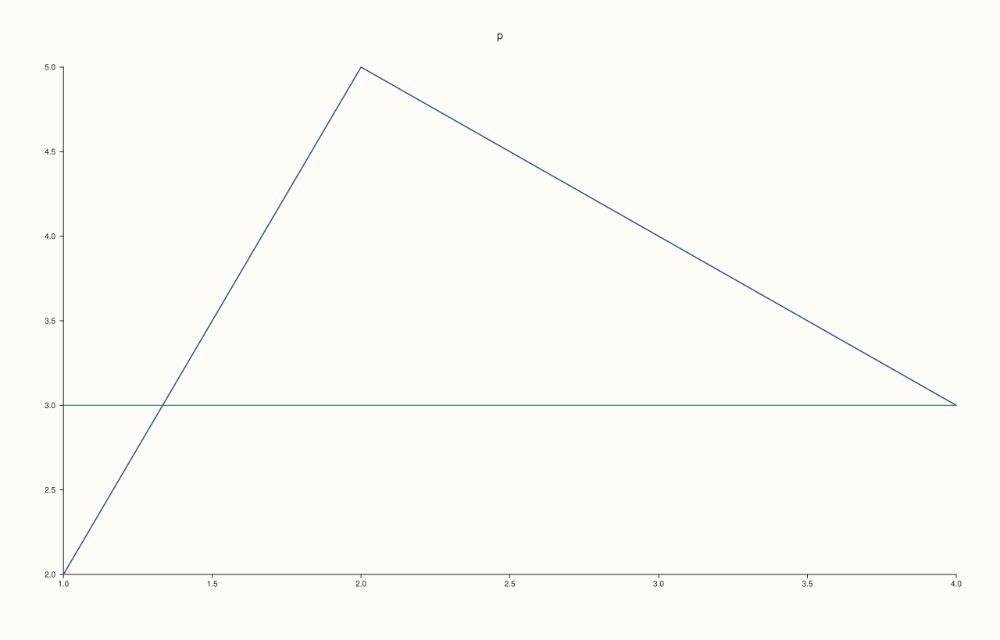
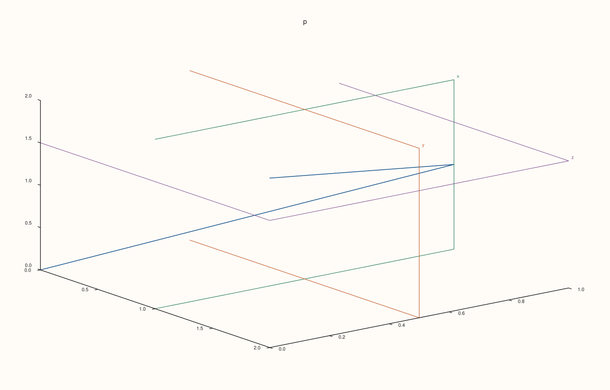
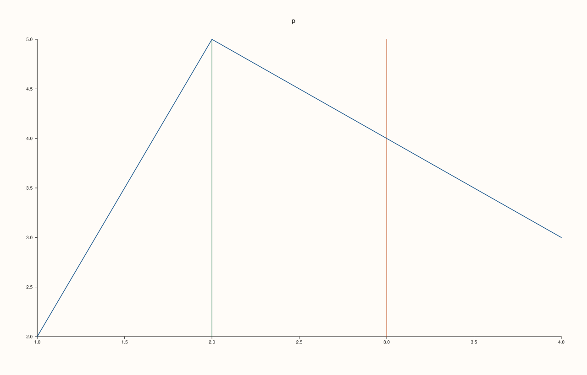

<!-- pluss-hand-authored -->

# Pane::rules

[Back to Pane API Reference](../../pane_api_reference)

## Signature

```cpp
const std::vector<RuleCue>& Pane::rules() const noexcept
```

## What It Does

Returns the reference lines of the pane, in the order they were added by [`rule_x`](rule_x.md), [`rule_y`](rule_y.md) and [`rule_z`](rule_z.md), as a read-only vector of `RuleCue`:

| Field | Meaning | Default |
|---|---|---|
| `axis` | `CueAxis::X`, `Y` or `Z`: which axis the rule is at. | X |
| `value` | The position, in data units. | 0 |
| `label` | The text written on the rule; empty for none. | empty |
| `color` | The stored colour; the figure draws cues in the accents of the pane's theme. | an accent |
| `width` | The line width. | 1.1 |

The vector is empty for a pane with no rules. It lists what was added, not what is visible: rules of all three axes are in it, including a z rule on a planar pane, which has no axis to be drawn on. Rules cannot be removed, so the vector only grows. The reference is to the pane's own vector and follows later calls; copy it to keep a snapshot.

## Parameters

*(none)*

## Returns

`const std::vector<RuleCue>&`
    The rules, oldest first.

## Examples

Example 1. Listing the rules. Rules of different axes are in one list, in the order added, each with its axis, value and label.

```cpp
auto fig = studio("rules_list");
auto& pane = fig.pane2("p");
pane.trend(std::vector<double>{1, 2, 3, 4}, std::vector<double>{2, 5, 4, 3});
std::cout << "none yet: " << pane.rules().empty() << "\n";
pane.rule_x(2.5, "midpoint").rule_y(4.0, "threshold").rule_x(3.5);
const char* axes[] = {"x", "y", "z"};
for (const auto& rule : pane.rules()) {
  std::cout << axes[static_cast<int>(rule.axis)] << " = " << rule.value << (rule.label.empty() ? "" : "  '" + rule.label + "'") << "\n";
}
fig.save_svg("figure.svg");
```

### Output

```text
none yet: 1
x = 2.5  'midpoint'
y = 4  'threshold'
x = 3.5
```



Example 2. The fields of a rule. A rule has the default width, a colour, and the label that was given; an unlabelled rule has an empty label.

```cpp
auto fig = studio("rules_fields");
auto& pane = fig.pane2("p");
pane.trend(std::vector<double>{1, 2, 3, 4}, std::vector<double>{2, 5, 4, 3});
pane.rule_y(3.0);
const RuleCue& rule = pane.rules().front();
std::cout << "label empty: " << rule.label.empty() << ", width: " << rule.width << ", alpha: " << rule.color.alpha << "\n";
fig.save_svg("figure.svg");
```

### Output

```text
label empty: 1, width: 1.15, alpha: 1
```



Example 3. All axes in one list. A volumetric pane takes rules on all three axes; the list keeps them in order with their axis tag.

```cpp
auto fig = studio("rules_3d");
auto& pane = fig.pane3("p");
pane.path3(std::vector<double>{0, 1, 2}, std::vector<double>{0, 1, 0}, std::vector<double>{0, 1, 2});
pane.rule_x(1.0, "x").rule_y(0.5, "y").rule_z(1.5, "z");
std::cout << "count: " << pane.rules().size() << "\n";
for (const auto& rule : pane.rules()) std::cout << static_cast<int>(rule.axis) << ": " << rule.label << " at " << rule.value << "\n";
fig.save_svg("figure.svg");
```

### Output

```text
count: 3
0: x at 1
1: y at 0.5
2: z at 1.5
```



Example 4. A snapshot needs a copy. The reference follows the pane, so a copy taken earlier keeps the old list.

```cpp
auto fig = studio("rules_snapshot");
auto& pane = fig.pane2("p");
pane.trend(std::vector<double>{1, 2, 3, 4}, std::vector<double>{2, 5, 4, 3});
pane.rule_x(2.0);
const auto snapshot = pane.rules();
const auto& live = pane.rules();
pane.rule_x(3.0);
std::cout << "snapshot: " << snapshot.size() << ", live: " << live.size() << "\n";
fig.save_svg("figure.svg");
```

### Output

```text
snapshot: 1, live: 2
```



## Notes

- `noexcept`, and has no effect on the figure.
- Rules are added with [`rule_x`](rule_x.md), [`rule_y`](rule_y.md) and [`rule_z`](rule_z.md); there is no call that removes one.

## See Also

- [`Pane::rule_x`](rule_x.md), [`rule_y`](rule_y.md), [`rule_z`](rule_z.md): add a rule.
- [`Pane::bands`](bands.md), [`pins`](pins.md): the other cues.

<div class="pluss-inline-prev-next">
  <a class="prev-link" href="rule_z.html">
    <span class="label">Previous</span>
    <span class="title">rule_z</span>
  </a>
  <a class="next-link" href="scale_guide.html">
    <span class="label">Next</span>
    <span class="title">scale_guide</span>
  </a>
</div>
