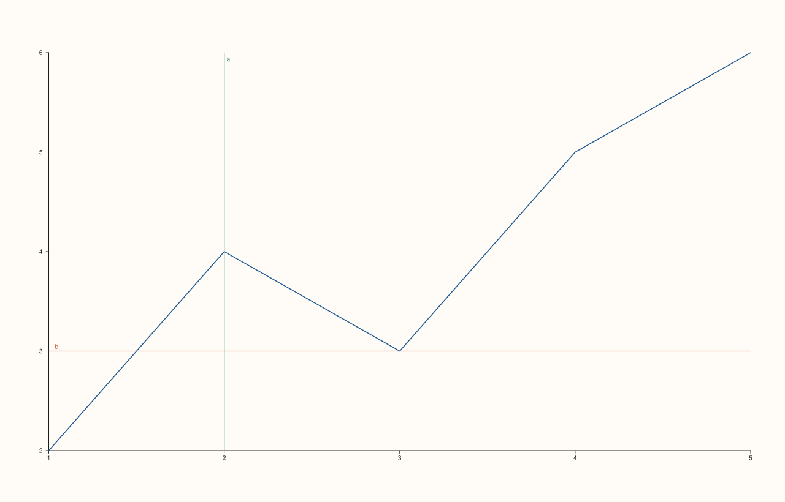

<!-- pluss-hand-authored -->

# Pane::rules

[Back to Pane API Reference](../../pane_api_reference)

## Signature

```cpp
const std::vector<RuleCue>& Pane::rules() const noexcept
```

## What It Does

Returns every reference line added so far via [`rule_x()`](rule_x.md)/
[`rule_y()`](rule_y.md)/[`rule_z()`](rule_z.md), in the order they were added, regardless
of which axis each one was added on. Each `RuleCue` carries its `axis` (`CueAxis::X`/`Y`/`Z`),
`value`, `label`, and rendering `color`/`width` (both defaulted, not user-configurable
through the `rule_x`/`rule_y`/`rule_z` API itself).

## Parameters

*(none)*

## Returns

`const std::vector<RuleCue>&`
    Every rule added so far, in insertion order.

## Examples

Example 1. Empty by default; growing as rules are added across multiple axes.

```cpp
using namespace pluss::pl;

auto fig = studio("rules_check");
auto& pane = fig.pane2();
pane.trend(std::vector<double>{1.0, 2.0, 3.0, 4.0, 5.0}, std::vector<double>{2.0, 4.0, 3.0, 5.0, 6.0});
std::cout << pane.rules().empty() << "\n";

pane.rule_x(2.0, "a").rule_y(3.0, "b");
std::cout << pane.rules().size() << "\n";
std::cout << (pane.rules()[0].axis == CueAxis::X) << "\n";
std::cout << (pane.rules()[1].axis == CueAxis::Y) << "\n";
fig.show();
```

### Output

```text
1
2
1
1
```



## Notes

- `noexcept`, `const` — read-only.
- Reflects rules added across all three axis methods, in a single shared, insertion-ordered
  list — there's no per-axis breakdown at the API level; filter by `.axis` if only one
  axis's rules are needed.
- No removal API exists — this list only ever grows.

## See Also

- [`Pane::rule_x`](rule_x.md) / [`Pane::rule_y`](rule_y.md) / [`Pane::rule_z`](rule_z.md):
  the only ways to add entries.
- [`Pane::bands`](bands.md) / [`Pane::pins`](pins.md): the other two accumulating
  annotation lists.

<div class="pluss-inline-prev-next">
  <a class="prev-link" href="pin.html">
    <span class="label">Previous</span>
    <span class="title">pin</span>
  </a>
  <a class="next-link" href="bands.html">
    <span class="label">Next</span>
    <span class="title">bands</span>
  </a>
</div>
