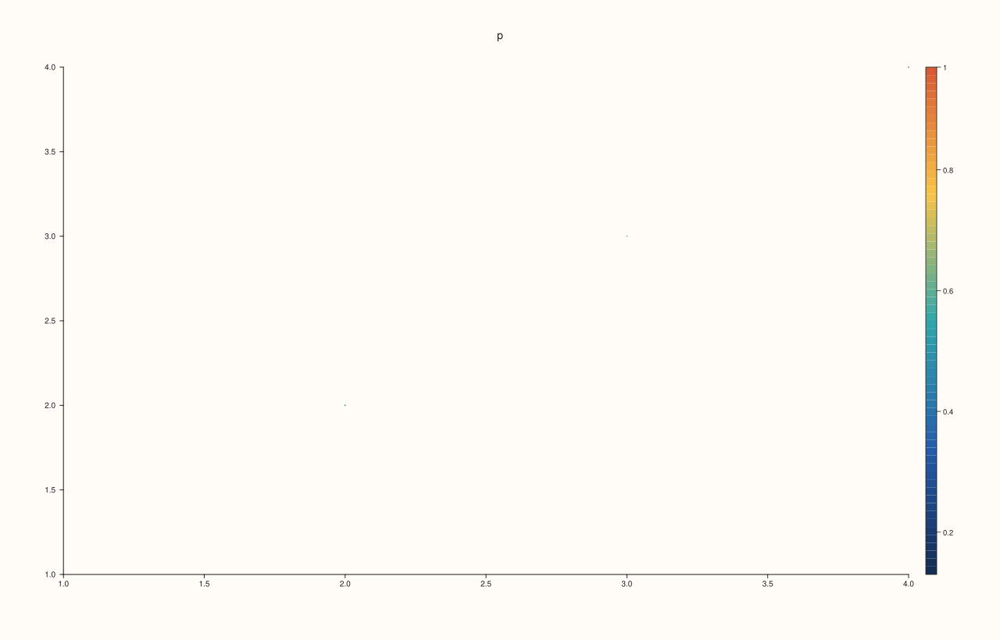
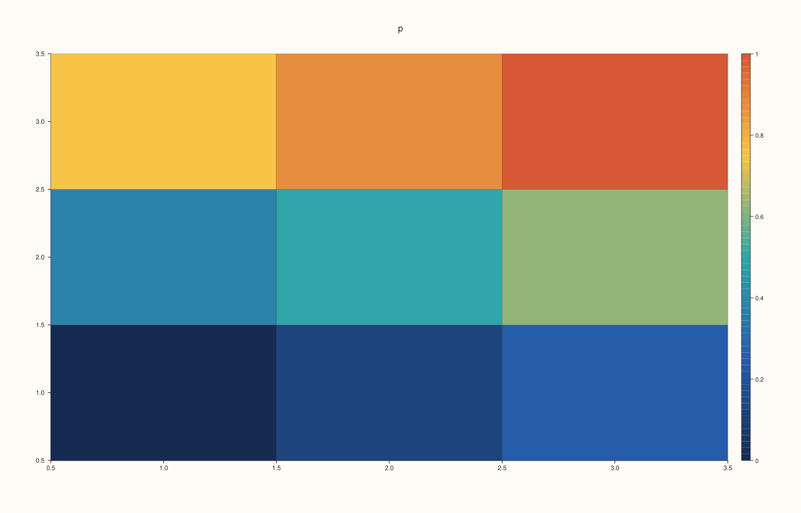
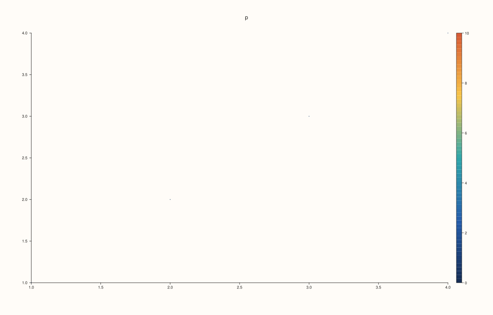
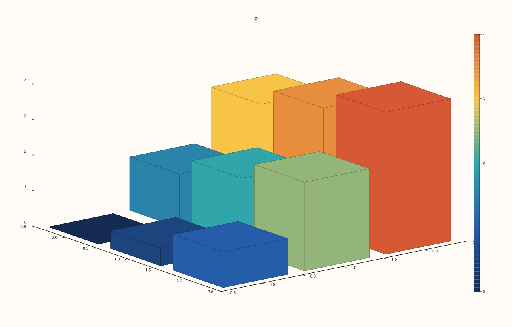

<!-- pluss-hand-authored -->

# Pane::scale_guide

[Back to Pane API Reference](../../pane_api_reference)

## Signature

```cpp
Pane& Pane::scale_guide(bool enable = true) noexcept
bool Pane::scale_guide_enabled() const noexcept
```

## What It Does

Turns the pane's **scale guide** on or off: the colour bar drawn beside the plot that shows which values the colours stand for, with the palette as a gradient and ticks along it. It is the key to a colour scale, as [`legend`](legend.md) is the key to labelled traces.

The guide describes the colours of the traces whose colour comes from data: a [`cloud`](cloud.md) given a colour series, a [`fieldmap`](fieldmap.md), a [`contour`](contour.md) and the volumetric surfaces. Its range is the range the colours are mapped over: the data's own, or the one set by [`color_limits`](color_limits.md) or [`color_limit_method`](color_limit_method.md), or by a trace's own limits ([`Trace::color_limits`](../trace/color_limits.md)). When no visible trace has a colour scale there is nothing to describe: no guide is drawn and no room is kept for one, whatever the switch says.

The guide is off by default. Its setter and its getter have different names.

## Parameters

**enable** (`bool`, default `true`, setter only)
    `true` to draw the guide, `false` to leave it out.

## Returns

**Setter (`scale_guide`):** `Pane&`, the same pane.
**Getter (`scale_guide_enabled`):** `bool`, the switch.

## Examples

Example 1. Off by default. The colours of the cloud are drawn, with no bar to say what they mean.

```cpp
auto fig = studio("guide_default");
auto& pane = fig.pane2("p");
pane.cloud(std::vector<double>{1, 2, 3, 4}, std::vector<double>{1, 2, 3, 4}, std::vector<double>{5, 5, 5, 5}, std::vector<double>{0.13, 0.4, 0.62, 0.97});
std::cout << "enabled: " << pane.scale_guide_enabled() << "\n";
fig.save_svg("figure.svg");
```

### Output

```text
enabled: 0
```


Example 2. With the guide on, the bar is drawn beside the plot, and its ticks are written with the other texts of the figure.

```cpp
auto fig = studio("guide_on");
auto& pane = fig.pane2("p");
pane.cloud(std::vector<double>{1, 2, 3, 4}, std::vector<double>{1, 2, 3, 4}, std::vector<double>{5, 5, 5, 5}, std::vector<double>{0.13, 0.4, 0.62, 0.97});
auto texts = [](const std::string& svg) {
  std::string out;
  for (std::size_t at = svg.find("<text"); at != std::string::npos; at = svg.find("<text", at + 1)) {
    const auto gt = svg.find('>', at);
    out += svg.substr(gt + 1, svg.find("</text>", gt) - gt - 1) + " ";
  }
  return out;
};
const std::string off = texts(fig.to_svg());
pane.scale_guide();
std::cout << "enabled: " << pane.scale_guide_enabled() << "\n";
std::cout << "off: " << off << "\n";
std::cout << "on:  " << texts(fig.to_svg()) << "\n";
fig.save_svg("figure.svg");
```

### Output

```text
enabled: 1
off: p 1.0 1.5 2.0 2.5 3.0 3.5 4.0 1.0 1.5 2.0 2.5 3.0 3.5 4.0 
on:  p 1.0 1.5 2.0 2.5 3.0 3.5 4.0 1.0 1.5 2.0 2.5 3.0 3.5 4.0 0.2 0.4 0.6 0.8 1 
```



Example 3. A field map is coloured by its values, so it has a guide too: here the values run from 0 to 1.

```cpp
auto fig = studio("guide_fieldmap");
auto& pane = fig.pane2("p");
pane.fieldmap(std::vector<double>{1, 2, 3}, std::vector<double>{1, 2, 3}, pluss::series::linspace(0.0, 1.0, 9, pluss::ScalarType::Float64).reshape({3, 3}));
pane.scale_guide(true);
fig.save_svg("figure.svg");
```



Example 4. The guide shows the range the colours are mapped over. With the limits set to 0..10, the same data takes the low end of the palette and the bar's ticks run to 10.

```cpp
auto fig = studio("guide_limits");
auto& pane = fig.pane2("p");
pane.cloud(std::vector<double>{1, 2, 3, 4}, std::vector<double>{1, 2, 3, 4}, std::vector<double>{5, 5, 5, 5}, std::vector<double>{0.13, 0.4, 0.62, 0.97});
auto texts = [](const std::string& svg) {
  std::string out;
  for (std::size_t at = svg.find("<text"); at != std::string::npos; at = svg.find("<text", at + 1)) {
    const auto gt = svg.find('>', at);
    out += svg.substr(gt + 1, svg.find("</text>", gt) - gt - 1) + " ";
  }
  return out;
};
pane.scale_guide(true);
std::cout << "data range:   " << texts(fig.to_svg()) << "\n";
pane.color_limits(Range1d{0.0, 10.0});
std::cout << "limits 0..10: " << texts(fig.to_svg()) << "\n";
fig.save_svg("figure.svg");
```

### Output

```text
data range:   p 1.0 1.5 2.0 2.5 3.0 3.5 4.0 1.0 1.5 2.0 2.5 3.0 3.5 4.0 0.2 0.4 0.6 0.8 1 
limits 0..10: p 1.0 1.5 2.0 2.5 3.0 3.5 4.0 1.0 1.5 2.0 2.5 3.0 3.5 4.0 0 2 4 6 8 10 
```



Example 5. A trace with no colour scale has no guide. The switch is stored, the figure is unchanged, and no room is kept beside the plot.

```cpp
auto build = [&](bool on) {
  auto fig = studio("guide_trend");
  auto& pane = fig.pane2("p");
  pane.trend(std::vector<double>{0, 1, 2}, std::vector<double>{0, 1, 0});
  pane.scale_guide(on);
  return fig.to_svg();
};
std::cout << "same figure with the guide on: " << (build(true) == build(false)) << "\n";
auto fig = studio("guide_trend_out");
auto& pane = fig.pane2("p");
pane.trend(std::vector<double>{0, 1, 2}, std::vector<double>{0, 1, 0});
pane.scale_guide(true);
std::cout << "enabled: " << pane.scale_guide_enabled() << "\n";
fig.save_svg("figure.svg");
```

### Output

```text
same figure with the guide on: 1
enabled: 1
```


Example 6. On a volumetric pane, a coloured surface has its guide beside the picture.

```cpp
auto fig = studio("guide_3d");
auto& pane = fig.pane3("p");
pane.spire3(std::vector<double>{0, 1, 2}, std::vector<double>{0, 1, 2}, pluss::series::linspace(0.0, 4.0, 9, pluss::ScalarType::Float64).reshape({3, 3}));
pane.scale_guide(true);
fig.save_svg("figure.svg");
```



## Notes

- Both forms are `noexcept`.
- The room for the guide is kept only when it is drawn.

## See Also

- [`Pane::color_limits`](color_limits.md), [`color_limit_method`](color_limit_method.md): the range the guide shows.
- [`Trace::palette`](../trace/palette.md): the colours.
- [`Pane::legend`](legend.md): the key to labelled traces.

<div class="pluss-inline-prev-next">
  <a class="prev-link" href="rules.html">
    <span class="label">Previous</span>
    <span class="title">rules</span>
  </a>
  <a class="next-link" href="scale_x.html">
    <span class="label">Next</span>
    <span class="title">scale_x</span>
  </a>
</div>
